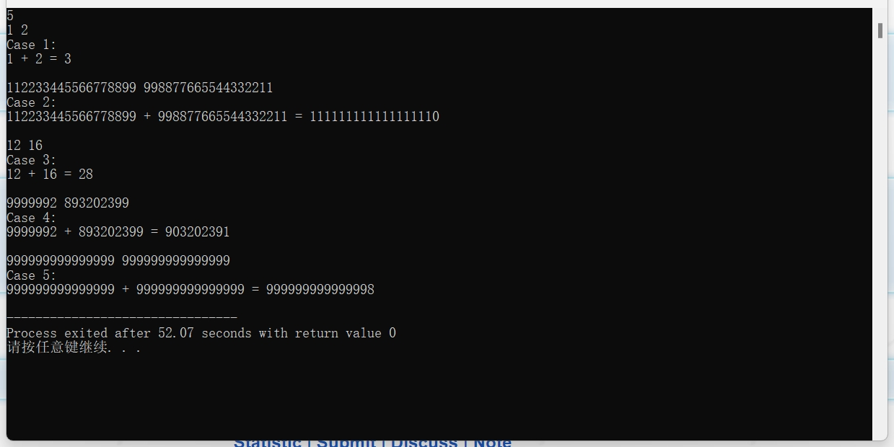
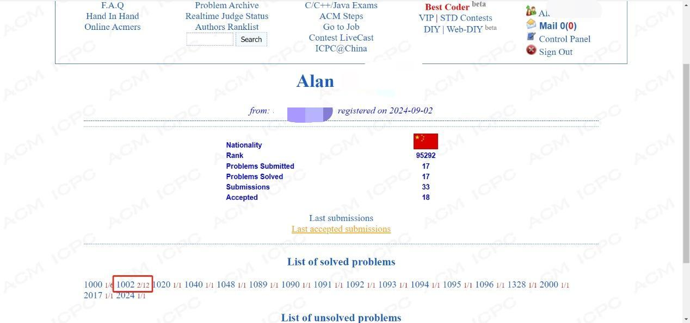
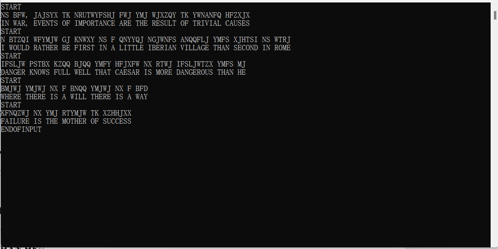
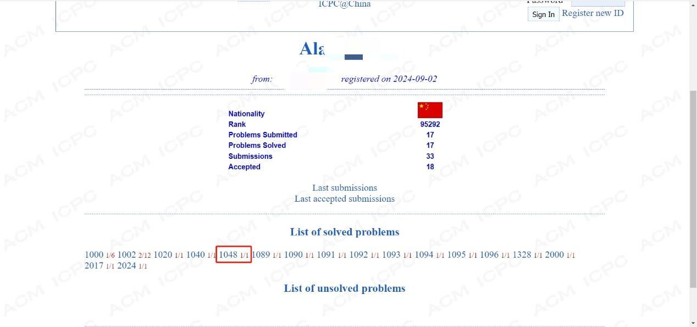

# 解题报告模板

A + B Problem II  1002

1 问题描述

我有一个非常简单的问题要问你。给定两个整数 A 和 B，您的任务是计算 A + B 的总和。

2 输入

输入的第一行包含一个整数 T(1<=T<=20)，表示测试用例的数量。接下来是 T 行，每行由两个正整数 A 和 B 组成。请注意，这些整数非常大，这意味着您不应该使用 32 位整数来处理它们。您可以假设每个整数的长度不会超过 1000。

3 输出

对于每个测试用例，您应该输出两行。第一行是“Case #:”，#表示测试用例的编号。第二行是一个方程“A + B = Sum”，Sum表示A + B的结果。注意方程中有一些空格。在两个测试用例之间输出一个空行。

4 样例输入

2

1 2

112233445566778899 998877665544332211

5 样例输出

Case 1:

1 + 2 = 3

Case 2:

112233445566778899 + 998877665544332211 = 1111111111111111110

6 问题分析

问题背景描述

给定两个非常大的整数A和B，计算它们的和。输入包含多个测试用例，每个测试用例由两个大整数组成。输出每个测试用例的结果，格式为“Case #: A + B = Sum”。

符号说明

T: 测试用例的数量（1 <= T <= 20）

A, B: 需要相加的两个大整数，长度不超过1000位

Sum: A和B的和

解题思路和方法

输入处理：读取输入的测试用例数量T，然后依次读取每个测试用例中的两个大整数A和B。

字符串处理：将输入的大整数A和B存储为字符串，以便逐位处理。

数组初始化：使用三个数组A、B和Sum来分别存储A、B和它们的和。

逐位相加：从最低位开始逐位相加，如果某一位的和大于9，则进位到下一位。

结果输出：按照指定格式输出每个测试用例的结果，并在每个测试用例之间添加一个空行。

必要的数据结构

数组 A[1001], B[1001], Sum[1001]：用于存储大整数的每一位数字。

算法步骤

读取输入的测试用例数量T。

对于每个测试用例：

初始化数组A、B和Sum。

读取两个大整数A和B，并转换为字符串形式。

将字符串形式的A和B转换为数组形式，存储在A和B中。

从最低位开始逐位相加，处理进位。

找到Sum数组中的最高有效位，并输出结果。

7 程序代码

8 测试示例

9 结果截图

10 解题备注

经验与心得

处理大整数：对于非常大的整数，直接使用常规的整数类型（如int或long long）可能会导致溢出。因此，需要将大整数转换为字符串来处理，或者使用数组逐位存储每一位数字。

逐位相加：从最低位开始逐位相加，并处理进位。这是解决大整数加法的关键步骤。

初始化和边界条件：在每个测试用例开始时，确保所有相关变量和数组都被正确初始化。特别注意数组的大小要足够大以容纳可能的最大位数。

The Hardest Problem Ever  1048

1 问题描述

朱利叶斯·凯撒生活在一个充满危险和阴谋的时代。凯撒所面临的最艰难的处境就是让自己活下去。为了生存，他决定创造第一个密码。这个密码非常可靠，如果不知道它是如何工作的，没有人能猜出它。
你是凯撒军队的副队长。你的任务是破译凯撒发送的信息并提供给你的将军。代码很简单。对于明文消息中的每个字母，将其向右移动五个位置以创建安全消息（即，如果字母是“A”，则密文将为“F”）。由于您要根据 Caesar 的消息创建纯文本，因此您将执行相反的操作：

密文
A BCDEFGHIJKLMNOPQRSTUV WXYZ

纯文本
VWXYZABCDEFGHIJKLMNOP QRSTU

此密码中仅移动字母。任何非字母字符应保持不变，并且所有字母字符均为大写。

2 输入

该问题的输入将由最多 100 个数据集的（非空）系列组成。每个数据集将根据以下描述进行格式化，并且不会有空行分隔数据集。所有字符均为大写。

单个数据集由 3 个组成部分：

起始行 - 单行，“START”

密码消息 - 包含 1 到 200 个字符（含）的单行，包括来自 Caesar 的单条消息

结束行 - 单行，“END”

最终数据集后面将是一行“ENDOFINPUT”。

3 输出

对于每个数据集，只有一行输出。这是凯撒的原始消息。

4 样例输入

START

NS BFW, JAJSYX TK NRUTWYFSHJ FWJ YMJ WJXZQY TK YWNANFQ HFZXJX

END

START

N BTZQI WFYMJW GJ KNWXY NS F QNYYQJ NGJWNFS ANQQFLJ YMFS XJHTSI NS WTRJ

END

START

IFSLJW PSTBX KZQQ BJQQ YMFY HFJXFW NX RTWJ IFSLJWTZX YMFS MJ END

ENDOFINPUT

5 样例输出

IN WAR, EVENTS OF IMPORTANCE ARE THE RESULT OF TRIVIAL CAUSES

I WOULD RATHER BE FIRST IN A LITTLE IBERIAN VILLAGE THAN SECOND IN ROME

DANGER KNOWS FULL WELL THAT CAESAR IS MORE DANGEROUS THAN HE

6 问题分析

问题背景描述

Julius Caesar发明了一种简单的密码，通过将每个字母向右移动五个位置来加密消息。解密过程则是将每个字母向左移动五个位置。本题要求编写程序对Caesar的密文进行解密，并输出原始明文。

符号说明

大写字母：A-Z

非字母字符：保持不变

输入格式：

"START"：表示一个数据集合的开始

密文：由大写字母和非字母字符组成的字符串

"END"：表示一个数据集合的结束

"ENDOFINPUT"：表示所有输入数据的结束

解题思路和方法

读取输入：逐行读取输入，直到遇到"ENDOFINPUT"为止。

处理每个数据集合：

忽略"START"和"END"行。

对每行密文进行处理，将其转换为明文。

解密算法：

对于每个大写字母，将其向左移动5个位置。如果移动后超出'A'的范围，则循环到'Z'。

非字母字符保持不变。

输出结果：将解密后的明文输出。

必要的数据结构与算法

字符串处理：使用C++标准库中的string类来存储和操作字符串。

字符判断与转换：使用isupper()函数判断字符是否为大写字母，使用ASCII码进行字符转换。

7 程序代码

8 测试示例

一般测试示例至少需要5组，每组输入需要的数据，有时需要在该组测试数据下对其进行简单的说明。

9 结果截图

10 解题备注

解题中的注意事项

正确处理循环：当字符左移后超出'A'的范围时，需要进行循环处理，即加上26使其回到'Z'。

忽略空行和标记行：确保只处理密文行，忽略"START"和"END"行。

保持字符类型一致：确保输出的字符与输入字符的类型一致（如大写或小写）。

边界条件检查：特别关注边界情况，如输入字符串为空或仅包含非字母字符的情况。

效率考虑：虽然本题的数据量不大，但在实际编程中应注意算法的效率，避免不必要的计算。
