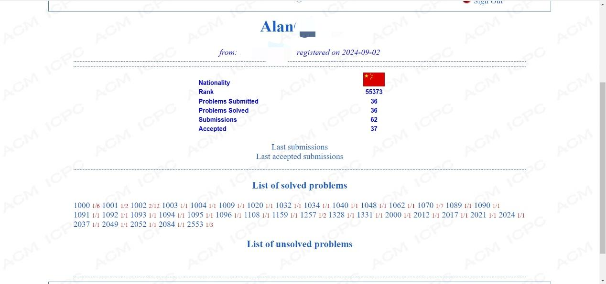
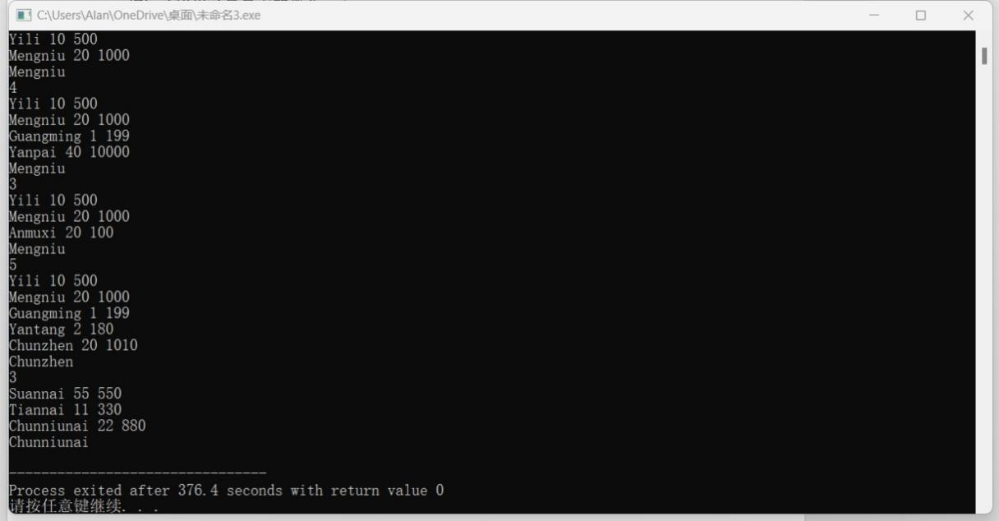
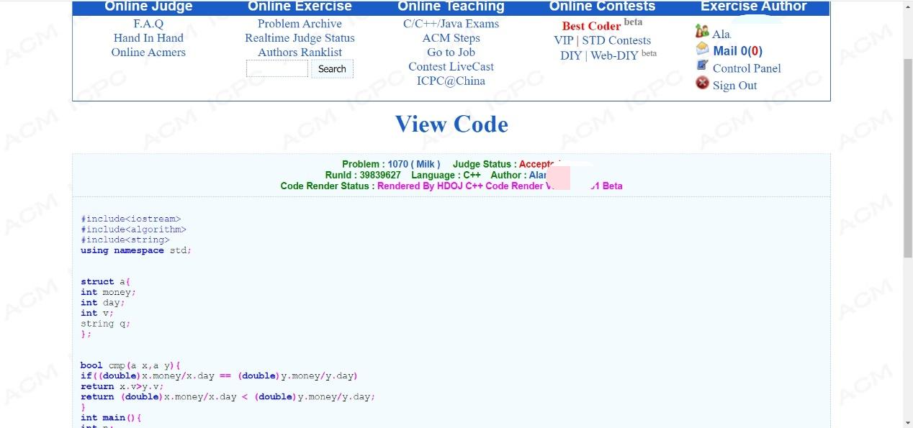
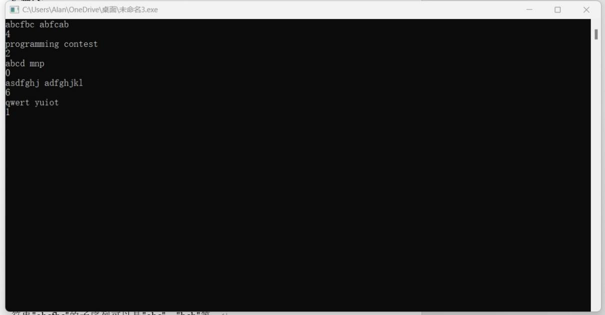
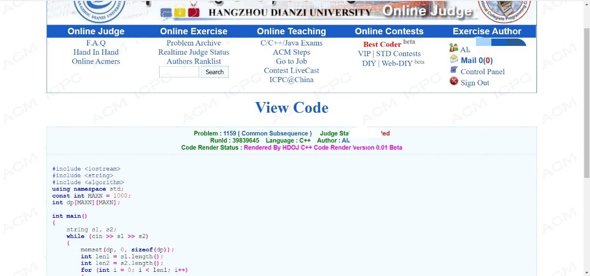

# 解题报告模板

所有题目AC截图：

Milk  1070

1 问题描述

伊格纳修斯每天都喝牛奶，现在他在超市里，想要挑选一瓶牛奶。超市里有很多种牛奶，所以伊格纳修斯想知道哪种牛奶最便宜。

这里有一些规则：1. 伊格内修斯绝不会喝6天前或更早生产的牛奶。这意味着，如果牛奶的生产日期是2005年1月1日，那么伊格内修斯在2005年1月6日（含）之后将不会再喝这瓶牛奶。2. 伊格内修斯每天喝200毫升牛奶。3. 如果瓶子里剩下的牛奶少于200毫升，伊格内修斯就会把它扔掉。4. 超市里的所有牛奶都是今天生产的。

需要注意的是，Ignatius只想买一瓶牛奶，因此如果一瓶牛奶的容量小于200毫升，请忽略它。

鉴于一些牛奶的信息，你的任务是告诉Ignatius哪一种牛奶最便宜。

2 输入

输入包含若干个测试用例。输入的第一行是一个单个整数T，表示测试用例的数量。接下来有T个测试用例。

每个测试用例以一个单个整数N（1<=N<=100）开始，表示牛奶的种类数。然后有N行后续数据，每行包含一个字符串S（长度不超过100个字符），表示牛奶的品牌，然后是两个整数，表示该品牌的价格P（元）和容量V（毫升）。

3 输出

对于每个测试用例，您应该输出最便宜的牛奶品牌。如果有多个最便宜的品牌，你应该输出产量最大的那个。

4 样例输入

2

2

Yili 10 500

Mengniu 20 1000

4

Yili 10 500

Mengniu 20 1000

Guangming 1 199

Yanpai 40 10000

5 样例输出

Mengniu

Mengniu

6 问题分析

问题背景描述

Ignatius需要在超市中选择一瓶牛奶。他每天饮用200mL，想要找到性价比最高的牛奶。选择的牛奶需满足以下条件：

1.	牛奶超过6天不能饮用，最多饮用5天。

2.	容量不足200mL的牛奶无法满足一天的需求，不予考虑。

3.	在价格与性价比相同的情况下，选择容量更大的品牌。

符号说明

•	n: 测试用例的数量。

•	k: 每个测试用例中的牛奶种类数。

•	money: 牛奶的价格（单位：元）。

•	v: 牛奶的容量（单位：mL）。

•	day: 牛奶能饮用的天数（最多为5天）。

•	q: 牛奶品牌名称。

解题思路和方法

核心算法与逻辑

1.	数据筛选与处理：

•	计算每种牛奶能饮用的天数，公式为：

容量不足200mL的牛奶被忽略。

•	若days为0，则该牛奶无效。

2.	性价比计算与排序：

•	定义性价比为：

•	按性价比升序排序，若性价比相同，则按容量降序排序。

3.	选择最优牛奶：

•	排序后选择首个符合条件的牛奶。

数据结构

•	结构体 a：

用于存储牛奶的价格、容量、品牌名以及能饮用的天数。

•	排序函数：

自定义比较函数cmp，实现多条件排序。

7 程序代码

8 测试示例

9 结果截图

10 解题备注

解题经验与心得

1. 明确问题需求

•	逐条分析题目要求，尤其是需要剔除不符合条件的数据（如容量不足200mL或超过可饮用天数的牛奶）。

•	找到问题的核心逻辑，如性价比计算和排序规则。

2. 精确建模

•	用适当的数据结构（如结构体）清晰地表达题目中的实体属性。

•	确定核心属性之间的关系，例如性价比（价格/天数）和次要比较条件（容量）。

3. 筛选与排序

•	筛选是解题的第一步，忽略不满足条件的数据。

•	排序是找到最优解的重要手段，灵活运用多条件排序（如性价比优先、容量次之）。

4. 细化特殊情况

•	特殊数据需明确处理，如容量不足、性价比相等时的次优规则。

•	在多条件排序中，确保比较函数的逻辑完整性。

解题归纳规律

1.	抽象问题：

•	将实际问题转化为数学或逻辑模型。例如，将饮用天数和性价比转化为计算公式。

2.	过滤无效数据：

•	优先剔除无效数据，减少后续计算负担。

•	此题中，容量不足200mL的牛奶直接过滤掉。

3.	性价比问题的常见套路：

•	定义性价比：找到衡量“优劣”的标准（如价格/天数）。

•	多条件排序：性价比相同，使用次要条件（如容量）进行排序。

4.	多条件排序规则：

•	使用比较函数cmp，分步骤定义优先级。

•	通常按以下原则：

•	主要条件先排序（如性价比）。

•	次要条件按需求排序（如容量或其他属性）。

5.	边界处理：

•	确保边界条件处理正确，例如容量不足、0天饮用天数的情况。

•	避免浮点数比较精度问题，优先使用double或明确指定比较方法。

Common Subsequence  1159

1 问题描述

给定序列的子序列是给定序列中遗漏了某些元素（可能没有）的序列。给定序列X = <x1, x2，…， xm>另一个序列Z = <z1, z2，…， zk>是X的子序列，如果存在严格递增的序列<i1, i2，…，如>的X指标，使得对于所有j = 1,2，…，k, xij = zj。例如，Z = <a, b, f, c>是X = <a, b, c, f, b, c>的子序列，索引序列< 1,2,4,6 >。给定两个序列X和Y，问题是找到X和Y的最大长度公共子序列的长度。

程序输入来自一个文本文件。文件中的每个数据集包含两个表示给定序列的字符串。这些序列由任意数量的空格分隔。输入数据正确。对于每一组数据，程序在标准输出中打印从单独行开始的最大长度公共子序列的长度。

2 输入

无

3 输出

无

4 样例输入

abcfbc abfcab

programming contest

abcd mnp

5 样例输出

4

2

0

6 问题分析

问题背景描述

本题要求找到两个字符串的最长公共子序列（Longest Common Subsequence, LCS）的长度。一个子序列是从原字符串中移除某些字符（可以是零个或多个）后剩下字符按原顺序排列而成的字符串。例如，字符串"abcfbc"的子序列可以是"abc"、"bcb"等。

•	输入：多个测试用例，每个测试用例由两个字符串组成，之间由任意数量的空格分隔。

•	输出：每个测试用例输出两个字符串的LCS长度，每个结果占一行。

符号说明

1.	s1, s2：两个输入字符串。

2.	len1, len2：字符串 s1 和 s2 的长度。

3.	dp[i][j]：表示字符串 s1[0..i-1] 和 s2[0..j-1] 的最长公共子序列长度。

解题思路和方法

1. 动态规划模型

本问题是经典的动态规划问题，求解 LCS 采用二维动态规划表格 dp：

•	状态转移方程：

•	当当前字符匹配时：dp[i][j] = dp[i-1][j-1] + 1

•	当当前字符不匹配时：dp[i][j] = \max(dp[i-1][j], dp[i][j-1])

•	边界条件：

•	初始状态：若任意字符串为空，则 dp[i][0] = dp[0][j] = 0。

2. 算法步骤

1.	初始化二维数组 dp：

•	dp[i][j] 存储当前子问题的结果。

•	初始值为 0，表示空字符串的 LCS 长度。

2.	递推填表：

•	遍历两个字符串的所有字符组合，更新 dp[i][j] 的值。

3.	输出结果：

•	dp[len1][len2] 为最终答案，表示两个字符串的 LCS 长度。

数据结构

1.	动态规划表 dp：

•	使用二维数组存储状态转移结果，大小为 (len1+1) x (len2+1)，时间复杂度和空间复杂度均为O(len1 \times len2)。

2.	辅助变量：

•	使用字符串长度 len1 和 len2 避免多次调用 s1.length() 和 s2.length()。

7 程序代码

8 测试示例

9 结果截图

10 解题备注

经验与心得：

1. 预处理的重要性：

- 对于涉及动态规划或组合数学的问题，预先计算和存储一些中间结果（如阶乘、排列数等）可以显著提高后续计算的效率。

- 在本题中，通过预计算`nums`数组，减少了重复计算的时间复杂度。

2. 理解组合数学公式：

- 掌握基本的组合数学公式（如排列数、组合数）对于解决类似问题至关重要。

- 本题中的关键是理解并正确应用组合数公式`C(n, m) = n! / (m! * (n - m)!)`。

3. 注意输入输出格式：

- 确保输入输出格式符合要求，特别是在处理多个测试用例时，要正确读取和输出每个测试用例的结果。

4. 边界条件处理：

- 在处理边界条件时要小心，特别是当`N`或`M`接近极限值时，确保程序不会出错或超时。

归纳的规律与规则：

1. 组合数的性质：

- 组合数具有对称性，即`C(n, m) = C(n, n-m)`。

- 当`m > n/2`时，使用`C(n, m) = C(n, n-m)`可以减少计算量。

2. 排列数的计算：

- 排列数可以通过逐步累乘的方式计算，即从`n`开始逐步乘以每一个小于`n`的整数。

解题中注意事项

1. 数组越界：

- 在使用数组时，确保访问的索引在有效范围内，避免数组越界错误。

2. 数据类型：

- 由于组合数可能非常大，使用`long long`类型来存储结果以防止溢出。

3. 输入输出格式：

- 确保输入输出格式正确，特别是在处理多个测试用例时，要注意换行符的位置。

4. 时间复杂度：

- 虽然本题的时间复杂度较高，但由于题目限制了`N`的最大值为20，因此可以在合理的时间内完成计算。然而，对于更大的`N`值，需要考虑更高效的算法。

5. 代码可读性：

- 保持代码整洁和模块化，有助于提高可读性和可维护性。例如，可以将组合数计算封装成一个函数。
