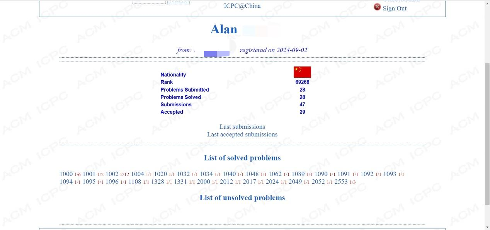
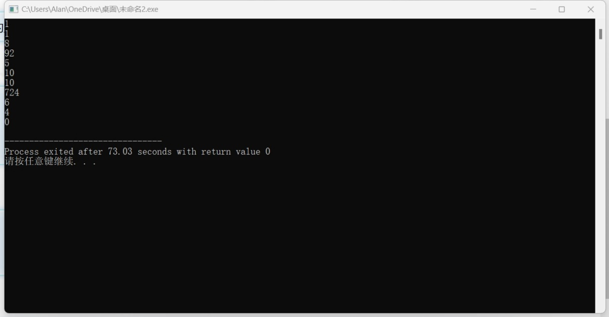
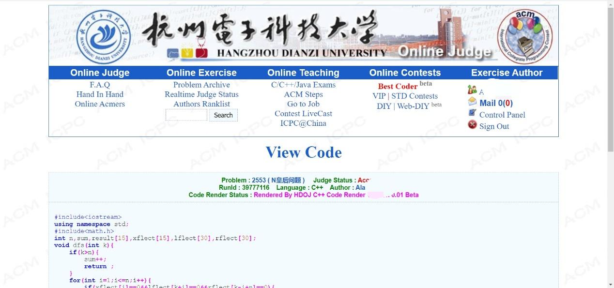
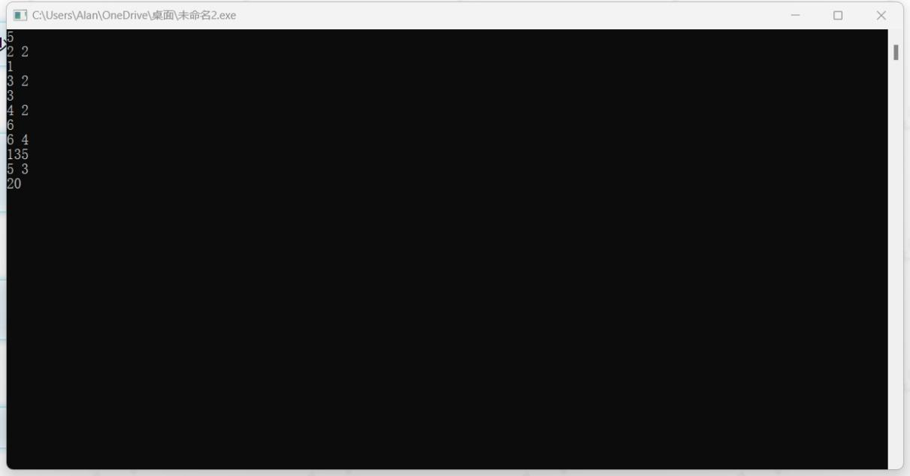
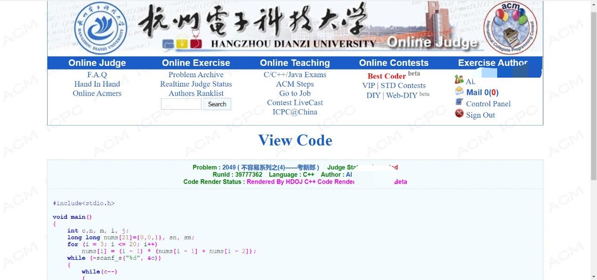
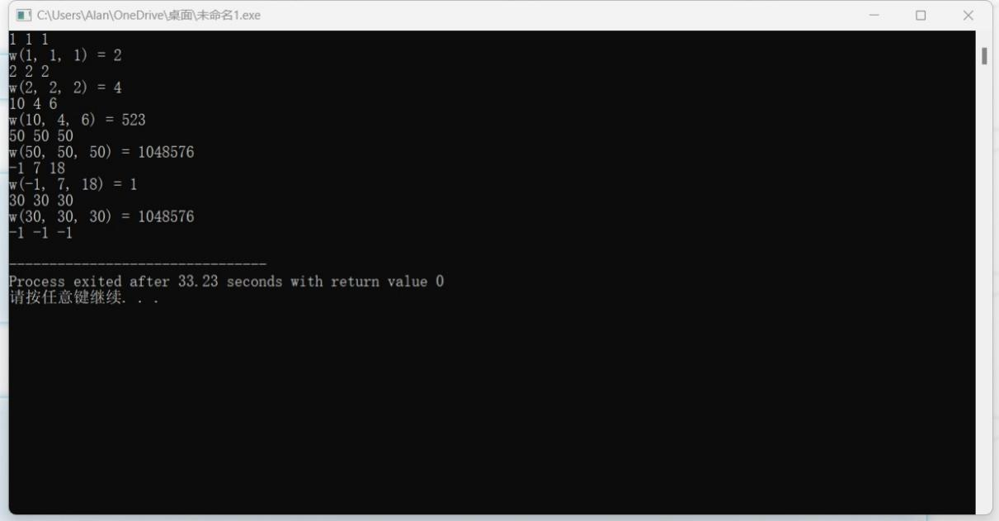

# 解题报告模板

所有题目AC截图：

N皇后问题  2553

1 问题描述

在N*N的方格棋盘放置了N个皇后，使得它们不相互攻击（即任意2个皇后不允许处在同一排，同一列，也不允许处在与棋盘边框成45角的斜线上。
你的任务是，对于给定的N，求出有多少种合法的放置方法。

2 输入

共有若干行，每行一个正整数N≤10，表示棋盘和皇后的数量；如果N=0，表示结束。

3 输出

共有若干行，每行一个正整数，表示对应输入行的皇后的不同放置数量。

4 样例输入

1

8

5

0

5 样例输出

1

92

10

6 问题分析

问题背景描述

给定一个N*N的棋盘，需要在棋盘上放置N个皇后，使得它们互不攻击。皇后的攻击范围包括同一行、同一列以及两个对角线方向。要求计算所有可能的合法放置方法的数量。

符号说明

- N: 棋盘的大小和皇后的数量。

- sum: 用于记录合法的放置方法数量。

- result[15]: 存储从1到10每个N值对应的合法放置方法数量。

- xflect[15], lflect[30], rflect[30]: 分别用于标记列、左斜线和右斜线是否被占用。

解题思路和方法

1. 使用深度优先搜索（DFS）来遍历所有可能的放置方式。

2. 对于每一个位置，检查当前列和两条对角线是否被占用。如果没有被占用，则将皇后放置在该位置，并继续递归搜索下一个位置。

3. 当所有皇后都成功放置后，增加合法放置方法的计数。

4. 使用三个数组xflect, lflect, rflect来标记列和对角线的占用情况，避免重复放置皇后。

5. 在主函数中，预先计算1到10的所有N值对应的合法放置方法数量，并存储在result数组中。

6. 读取输入的N值，输出对应的合法放置方法数量，直到输入为0结束程序。

7 程序代码

8 测试示例

9 结果截图

10 解题备注

经验与心得：

1. 理解问题本质：N皇后问题是一个经典的回溯算法问题，理解其约束条件（即皇后不能在同一行、同一列和同一对角线上）是解决问题的关键。

2. 数据结构的选择：使用一维数组来标记列、主对角线和副对角线的占用情况，可以有效地减少空间复杂度，同时方便进行状态的更新和检查。

3. 递归与回溯：递归函数的设计需要仔细考虑递归终止条件和回溯过程，确保能够正确地探索所有可能的解。

4. 优化搜索过程：通过剪枝（如提前返回）可以减少不必要的计算，提高算法效率。

5. 预计算与缓存：对于固定的N值，可以预先计算并存储结果，这样在多次查询时可以直接返回结果，避免重复计算。

归纳的规律与规则

1. 递归规律：从第一行开始，尝试在每一行放置一个皇后，如果当前行的所有列都不能放置皇后，则回溯到上一行。

2. 状态更新规则：在放置皇后后，需要更新对应的列、主对角线和副对角线的占用状态；在回溯时，需要恢复这些状态。

3. 计数规则：每当成功放置N个皇后时，计数器加一。

不容易系列之(4)——考新郎  2049

1 问题描述

国庆期间,省城HZ刚刚举行了一场盛大的集体婚礼,为了使婚礼进行的丰富一些,司仪临时想出了有一个有意思的节目,叫做"考新郎",具体的操作是这样的:

首先,给每位新娘打扮得几乎一模一样,并盖上大大的红盖头随机坐成一排;
然后,让各位新郎寻找自己的新娘.每人只准找一个,并且不允许多人找一个.
最后,揭开盖头,如果找错了对象就要当众跪搓衣板...

看来做新郎也不是容易的事情...

假设一共有N对新婚夫妇,其中有M个新郎找错了新娘,求发生这种情况一共有多少种可能.

2 输入

输入数据的第一行是一个整数C,表示测试实例的个数，然后是C行数据，每行包含两个整数N和M(1<M<=N<=20)。

3 输出

对于每个测试实例，请输出一共有多少种发生这种情况的可能，每个实例的输出占一行。

4 样例输入

2

2 2

3 2

5 样例输出

1

3

6 问题分析

问题背景描述

在国庆期间，省城HZ举行了一场盛大的集体婚礼。为了增加婚礼的趣味性，司仪设计了一个有趣的节目——“考新郎”。具体操作如下：

1. 给每位新娘打扮得几乎一模一样，并盖上大大的红盖头随机坐成一排；

2. 让各位新郎寻找自己的新娘，每人只准找一个，并且不允许多人找一个；

3. 揭开盖头，如果找错了对象就要当众跪搓衣板。

假设一共有N对新婚夫妇，其中有M个新郎找错了新娘，求发生这种情况一共有多少种可能。

符号说明

- `C`: 测试实例的个数。

- `N`: 每组测试实例中的总人数（即新娘和新郎的总数量）。

- `M`: 每组测试实例中找错对象的新郎数量。

解题思路和方法

1. 预处理：

- 使用动态规划的方法预先计算出从1到20个新郎的合法放置数量，并存储在数组`nums`中。

- 公式为：`nums[i] = (i - 1) * (nums[i - 1] + nums[i - 2])`。

2. 输入处理：

- 读取多个测试用例，直到遇到`N=0`为止。

- 对于每个测试用例，读取`n`和`m`。

3. 计算组合数：

- 使用组合数学公式计算从`n`个元素中选择`m`个元素的排列数。

- 计算公式为：`C(n, m) = n! / (m! * (n - m)!)`。

4. 结果输出：

- 将计算结果乘以预先计算好的`nums[m]`，得到最终的合法放置数量。

必要的数据结构与算法

- 数据结构：

- 使用一个数组`nums`来存储预计算的组合数。

- 算法：

- 使用动态规划方法计算组合数。

- 使用组合数学公式计算排列数。

7 程序代码

8 测试示例

9 结果截图

10 解题备注

经验与心得：

1. 预处理的重要性：

- 对于涉及动态规划或组合数学的问题，预先计算和存储一些中间结果（如阶乘、排列数等）可以显著提高后续计算的效率。

- 在本题中，通过预计算`nums`数组，减少了重复计算的时间复杂度。

2. 理解组合数学公式：

- 掌握基本的组合数学公式（如排列数、组合数）对于解决类似问题至关重要。

- 本题中的关键是理解并正确应用组合数公式`C(n, m) = n! / (m! * (n - m)!)`。

3. 注意输入输出格式：

- 确保输入输出格式符合要求，特别是在处理多个测试用例时，要正确读取和输出每个测试用例的结果。

4. 边界条件处理：

- 在处理边界条件时要小心，特别是当`N`或`M`接近极限值时，确保程序不会出错或超时。

归纳的规律与规则：

1. 组合数的性质：

- 组合数具有对称性，即`C(n, m) = C(n, n-m)`。

- 当`m > n/2`时，使用`C(n, m) = C(n, n-m)`可以减少计算量。

2. 排列数的计算：

- 排列数可以通过逐步累乘的方式计算，即从`n`开始逐步乘以每一个小于`n`的整数。

解题中注意事项

1. 数组越界：

- 在使用数组时，确保访问的索引在有效范围内，避免数组越界错误。

2. 数据类型：

- 由于组合数可能非常大，使用`long long`类型来存储结果以防止溢出。

3. 输入输出格式：

- 确保输入输出格式正确，特别是在处理多个测试用例时，要注意换行符的位置。

4. 时间复杂度：

- 虽然本题的时间复杂度较高，但由于题目限制了`N`的最大值为20，因此可以在合理的时间内完成计算。然而，对于更大的`N`值，需要考虑更高效的算法。

5. 代码可读性：

- 保持代码整洁和模块化，有助于提高可读性和可维护性。例如，可以将组合数计算封装成一个函数。

Function Run Fun  1331

1 问题描述

我们都热爱递归！难道不是吗？

考虑一个具有三个参数的递归函数w(a, b, c)：

如果a <= 0或者b <= 0或者c <= 0，那么函数w(a, b, c)返回：1

如果a大于20或者b大于20或者c大于20，那么函数w(a, b, c)返回：w(20, 20, 20)

如果a<b且b<c，那么w(a, b, c)返回：w(a, b, c-1) + w(a, b-1, c-1) - w(a, b-1, c)

否则它返回：

w(a-1, b, c) + w(a-1, b-1, c) + w(a-1, b, c-1) - w(a-1, b-1, c-1)

这是一个容易实现的功能。问题在于，如果直接实现，对于中等大小的a、b和c（例如a=15，b=15，c=15），由于大量递归的存在，程序可能需要数小时才能运行。

2 输入

你的程序的输入将是一系列整数三元组，每行一个，直到文件结束标志“-1 -1 -1”。使用上述方法，你应高效地计算w(a, b, c)并打印结果。

3 输出

打印每个三元组的w(a,b,c)的值。

4 样例输入

1 1 1

2 2 2

10 4 6

50 50 50

-1 7 18

-1 -1 -1

5 样例输出

w(1, 1, 1) = 2

w(2, 2, 2) = 4

w(10, 4, 6) = 523

w(50, 50, 50) = 1048576

w(-1, 7, 18) = 1

6 问题分析

问题背景描述

递归函数 w(a, b, c) 是一个典型的三参数递归问题，具有以下特性：

1.	输入三个整数 a, b, c。

2.	递归终止条件分为三种：

•	如果任意参数小于等于 0，返回 1。

•	如果任意参数大于 20，等效为 w(20, 20, 20)。

•	其他情况下，根据特定递归规则计算。

直接递归实现由于会产生大量重复计算，导致时间复杂度极高。

符号说明

•	a, b, c: 三个整数参数。

•	w(a, b, c): 函数值，表示特定递归关系的结果。

解题思路和方法

为解决直接递归导致的性能问题，我们可以使用动态规划（记忆化搜索）技术，将中间结果存储到数组中，避免重复计算。

- 数据结构：

•	缓存数组: dp[21][21][21]，存储 a, b, c 在 [0, 20] 范围内的所有可能结果。

- 算法：

1.	递归定义：

•	根据题目递归规则实现 w 函数。

2.	记忆化搜索：

•	定义一个三维数组 dp 存储中间结果，初始化为 -1 表示未计算。

•	如果 dp[a][b][c] 已经计算过，直接返回结果。

3.	输入输出：

•	按行读取 a, b, c。

•	如果是 -1 -1 -1，则终止输入。

•	输出每组输入的结果。

7 程序代码

8 测试示例

9 结果截图

10 解题备注

总结经验和通用规律：

一、递归与动态规划的联系

1.	直接递归的代价

递归的本质是“拆分问题为子问题”，但如果没有优化，递归可能导致大量重复计算，如本题中 w(10, 4, 6) 的直接递归会重复计算 w(9, 4, 6) 和其他相同子问题多次。

2.	动态规划（记忆化搜索）的改进

•	动态规划的核心是通过缓存存储子问题的结果，用空间换时间，避免重复计算。

•	将递归与动态规划结合，称为记忆化搜索，适用于结构明确的递归关系。

•	思路：递归拆分子问题 → 检查缓存是否已有结果 → 若有，直接返回；否则，计算并存入缓存。

二、归纳的解题规律与方法

解决递归类问题，特别是有复杂计算的递归函数时，可以参考以下通用步骤：

1.	明确递归的基本条件

•	确定递归的终止条件（如本题中 ）。

•	确定输入的有效范围（如本题中 ）。

2.	分析递归关系

•	写出递归的转移方程（如本题的两种递归规则）。

•	思考是否会有重复子问题，以及子问题之间的依赖关系。

3.	选择优化策略

•	如果子问题的数量有限，可以通过记忆化搜索优化递归。

•	如果子问题数量过多或递归深度难以控制，可以考虑用迭代动态规划实现。

4.	边界处理与特殊情况

•	注意递归过程中可能的边界值输入（如负数、大于范围的值）。

•	确保程序的通用性和鲁棒性。

5.	测试与验证

•	构造边界测试用例，例如：最小值、最大值和特殊值。

•	检查是否有重复计算，必要时调试缓存访问情况。

三、解题注意事项

1.	递归深度的限制

•	如果递归深度过大，可能引发栈溢出问题。为避免这种情况，可以通过优化递归关系（如改为迭代）或增加缓存。

2.	缓存数组的大小与初始化

•	确保缓存的大小覆盖所有有效输入（如本题中 ）。

•	初始化为无效值（如 -1）以区分已计算和未计算的状态。

3.	输入范围之外的处理

•	确保函数对所有输入均有定义（如  对于  时转换为 ）。

•	特殊输入（如负数）可以提前返回固定值，简化逻辑。

4.	优化性能的关键点

•	缓存是否高效利用：访问缓存比递归调用要快得多，缓存命中率越高性能越好。

•	重复子问题的识别：分析递归调用树，找到最容易重复的子问题。
