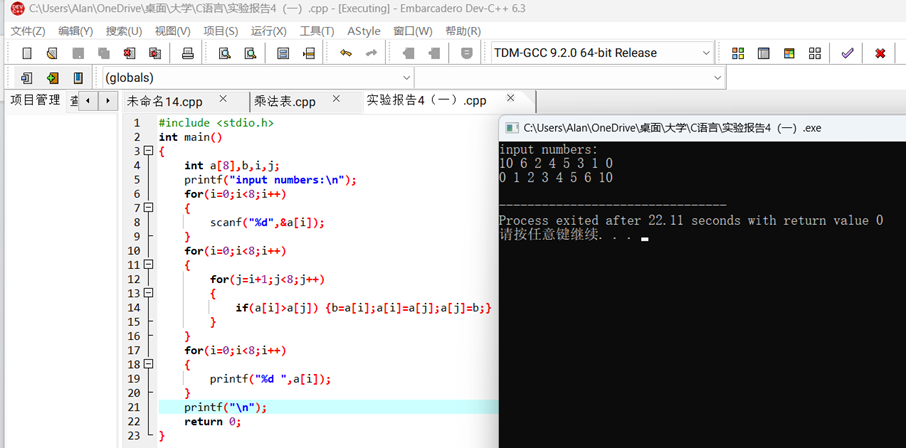
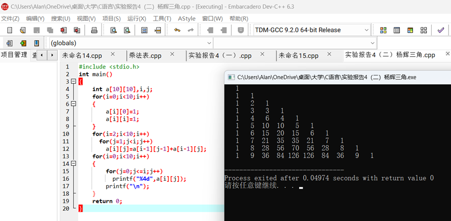
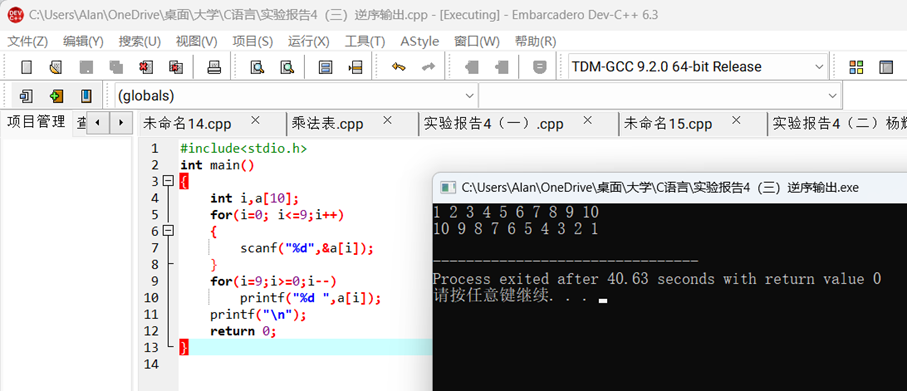
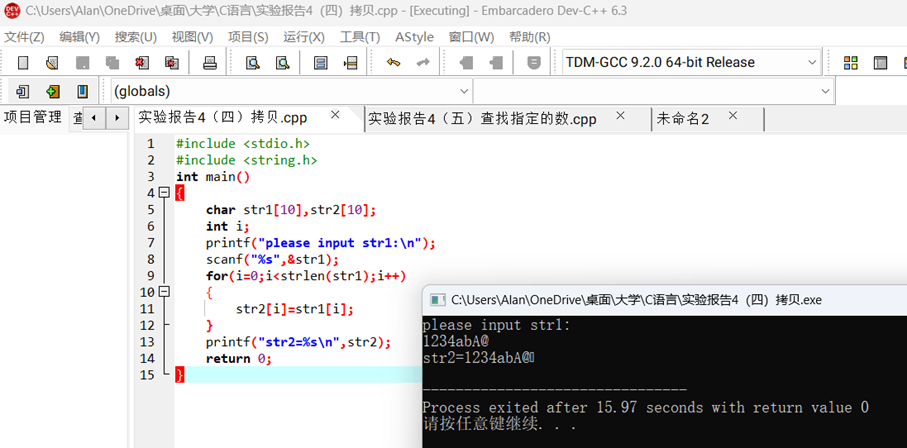
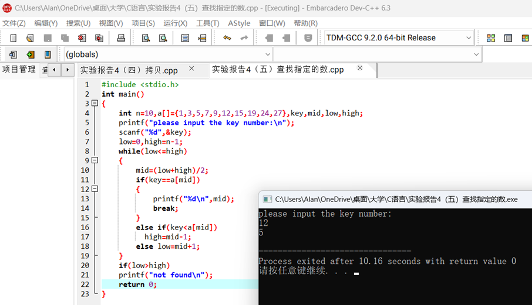
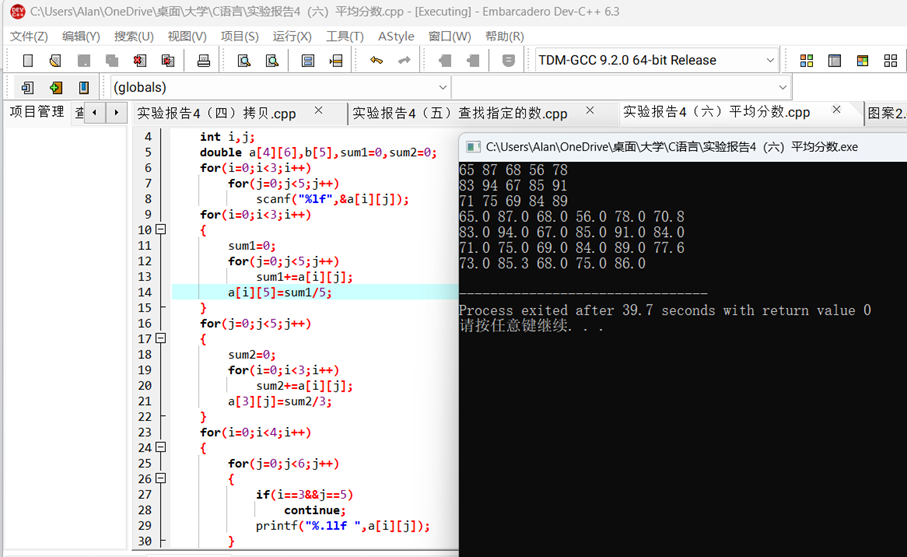

一、实验目的及要求

  实验目的：

  掌握数组的使用。

  实验要求：1．掌握数组的基本概念，包括：数组的定义、数组的类型、数组的初始化、数组的赋值、数组元素下标的范围、数组元素的正确引用以及引用数组元素的输入/输出。

  2．掌握字符数组与字符串的使用方法；理解字符数组与其它数组的区别、理解字符串及其特点；掌握常用的字符串处理库函数的用法并清楚字符串的简单处理。

  3．掌握与数组相关的算法，包括排序算法和查找算法等。

   

   

   

   

  

 

 

  

  二、实验原理与内容

  实验步骤：

  （一）用冒泡法对8个整数进行由小到大排序。 

  （二）编写程序，打印出以下的杨辉三角形（要求打印出10行）。

  1

  1 

  1

  1 

  2  1

  1 

  3  3  1

  1 

  4  6  4  1

  …………………

  （三）编写一个程序，将一个数组中的值按逆序重新存放。

  （四）编写一个程序，不用strcpy函数，将字符串s1拷贝到s2中去。

  （五）在数组中查找指定的数，若存在，则输出其在数组中的序号。

  （六）三个学生考五门课程，计算出每个学生的平均成绩及单科成绩的平均分并输出。输入/输出格式举例如下：

  输入成绩：

               

  65   87   68   56   78

               

  83   94   67   85   91

               

  71   75   69   84   89

  输出结果：

               

  65      87     

  68      56     

  78    70.5

               

  83      94     

  67      85     

  91    84.0

               

  71      75     

  69      84     

  89    77.5

               

  73.0   85.3    68.0   

  75    86.0   77.3    

  注：每个学生的平均成绩放在最后一列的对应行上，单科成绩的平均分放在最后一行的对应列上。

   

  

 

 

  

  三、实验软硬件环境

  PC Embarcadero

  Dev-C++

   

  

 

 

  

  四、实验过程（实验步骤、记录、数据、分析）

  （一）用冒泡法对8个整数进行由小到大排序。

   

  （二）编写程序，打印出以下的杨辉三角形（要求打印出10行）。

  1

  1 

  1

  1 

  2  1

  1 

  3  3  1

  1 

  4  6  4  1

  …………………

  

  （三）编写一个程序，将一个数组中的值按逆序重新存放。

  

  （四）编写一个程序，不用strcpy函数，将字符串s1拷贝到s2中去。

  

  （五）在数组中查找指定的数，若存在，则输出其在数组中的序号。

  

  （六）三个学生考五门课程，计算出每个学生的平均成绩及单科成绩的平均分并输出。输入/输出格式举例如下：

  输入成绩：

               

  65   87   68   56   78

               

  83   94   67   85   91

               

  71   75   69   84   89

  输出结果：

               

  65      87     

  68      56     

  78    70.5

               

  83      94     

  67      85     

  91    84.0

               

  71      75     

  69      84     

  89    77.5

               

  73.0   85.3    68.0   

  75    86.0   77.3    

  注：每个学生的平均成绩放在最后一列的对应行上，单科成绩的平均分放在最后一行的对应列上。

  

   

   

                                                             

           

                    

  

  

 

 

  

  五、测试/调试及实验结果分析

   

   

   

  

 

 

  

  六、实验结论与体会

  学会数组的使用大有用处，但是一定要自己模拟程序的运行，搞清楚i++、i--输出的实际效果。

  2023 年 10 月 28 日