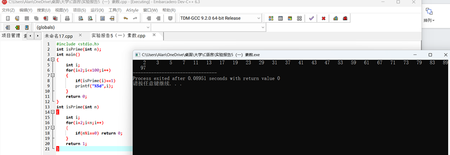
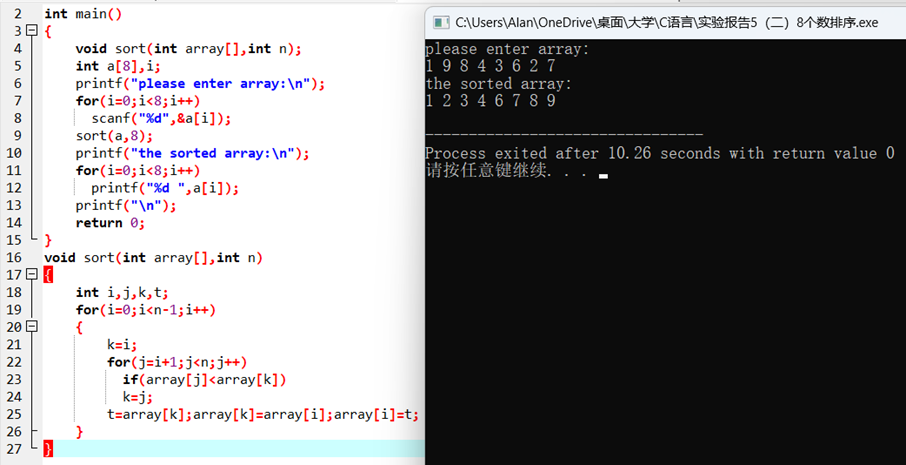
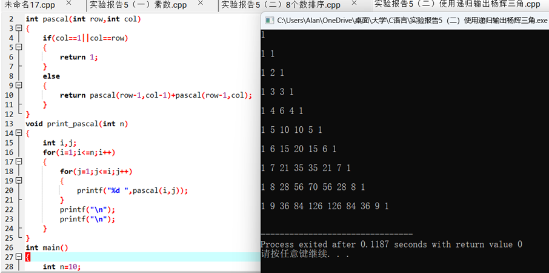
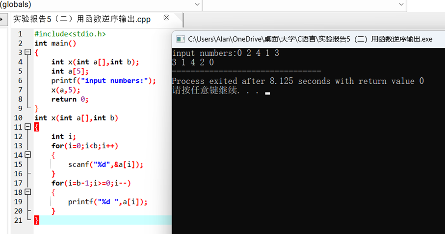
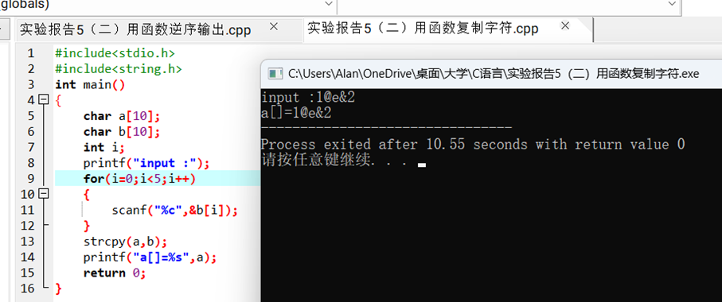
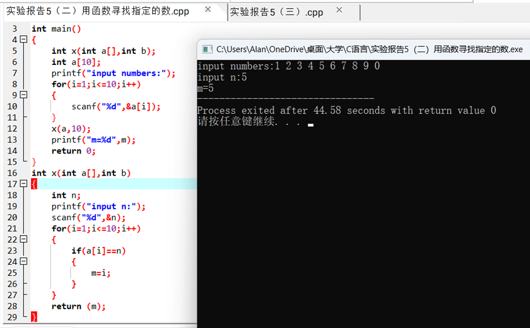
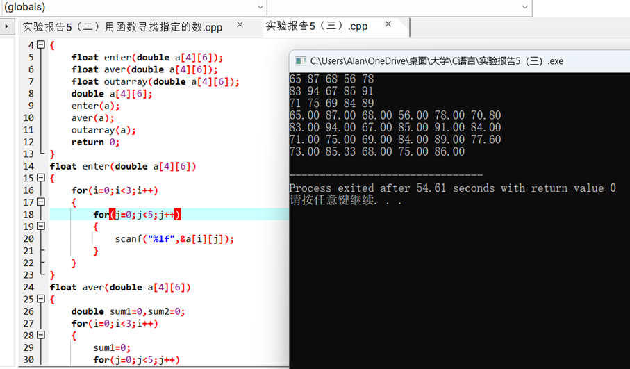

一、实验目的及要求

  实验目的：

  掌握函数的使用。

  实验要求：１．掌握C语言中使用函数的方法 

  ２．掌握通过“值传送”等调用函数的方法 

  ３．掌握嵌套调用及递归调用的设计方法 

  ４．进一步练习阅读检查与调试修改C程序的方法

   

   

   

   

   

  

 

 

  

  二、实验原理与内容

  实验步骤：

  （一）采用函数调用的方式输出100以内的所有素数。

  （二）将实验四中的1&#8212;5题用函数实现。

  （三）修改实验四中的第6题，采用函数调用的方式实现。

  （1）编写一个函数输入数据，函数名为enter（）。功能是输入原始学生成绩。

  （2）编写一个函数计算平均值，函数名为aver（）。功能是计算平均成绩（包括每个学生的平均成绩和每个单科的平均成绩）。

  （3）编写一个函数输出数据，函数名为outarray（）。功能是输出数组元素。

  （4）在主调函数中调用上述三个函数。

   

  

 

 

  

  三、实验软硬件环境

  PC Embarcadero

  Dev-C++

   

  

 

 

  

  四、实验过程（实验步骤、记录、数据、分析）

  （一）采用函数调用的方式输出100以内的所有素数。

  

  （二）将实验四中的1&#8212;5题用函数实现。

  1：

  2：

  

  3：

  

  4：

  

  5:

  

   

  （三）修改实验四中的第6题，采用函数调用的方式实现。

  （1）编写一个函数输入数据，函数名为enter（）。功能是输入原始学生成绩。

  （2）编写一个函数计算平均值，函数名为aver（）。功能是计算平均成绩（包括每个学生的平均成绩和每个单科的平均成绩）。

  （3）编写一个函数输出数据，函数名为outarray（）。功能是输出数组元素。

  （4）在主调函数中调用上述三个函数。

  

   

                    

  

  

 

 

  

  五、测试/调试及实验结果分析

   

   

   

  

 

 

  

  六、实验结论与体会

  要熟悉掌握函数调用，能以另一种方式解决问题。

  2023 年 11 月 08 日