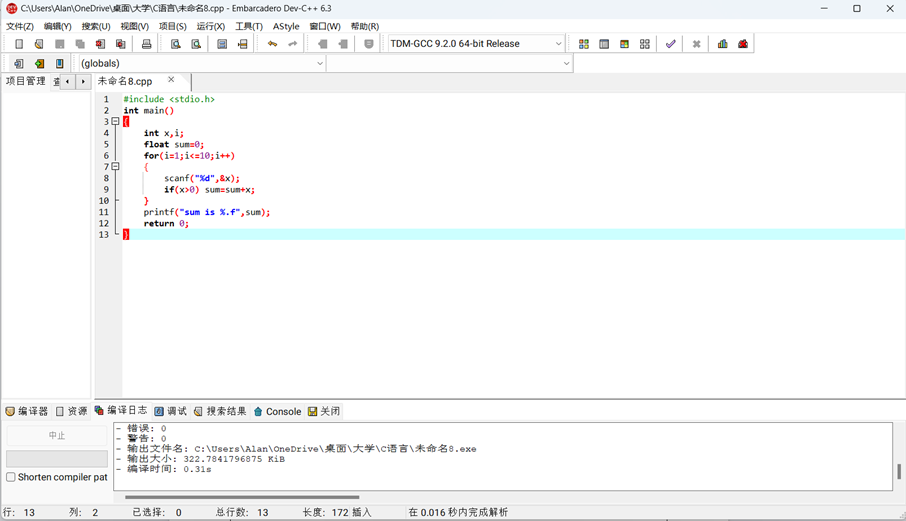
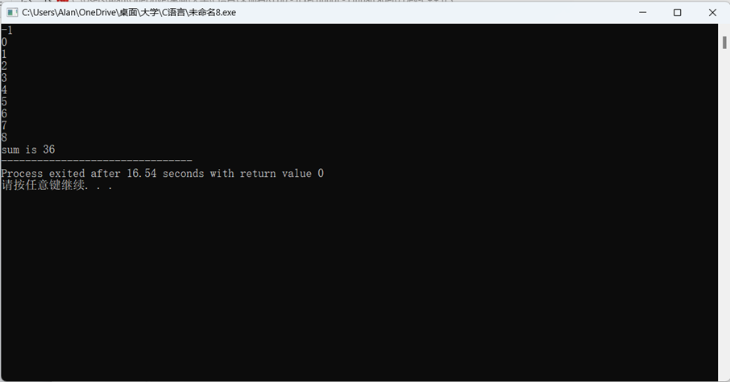
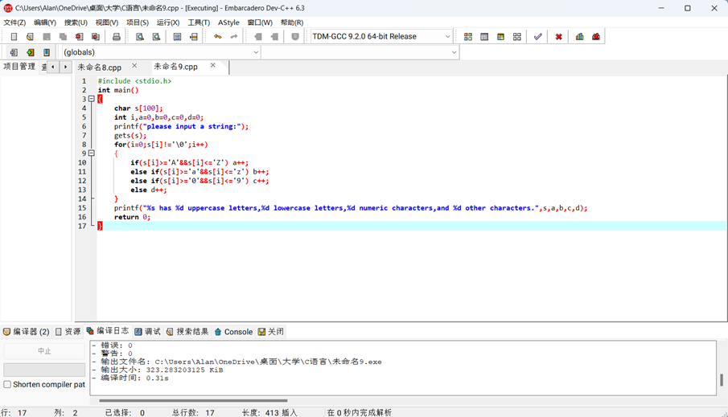
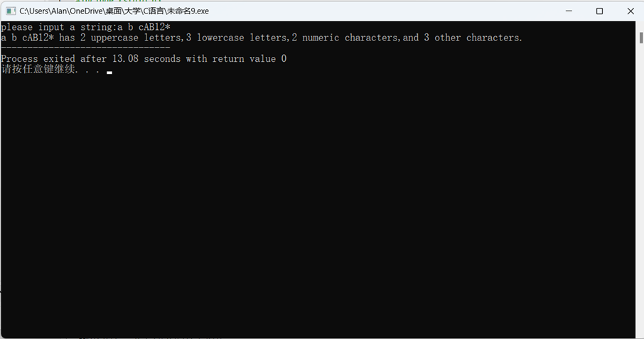
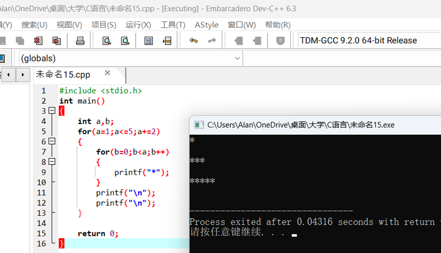
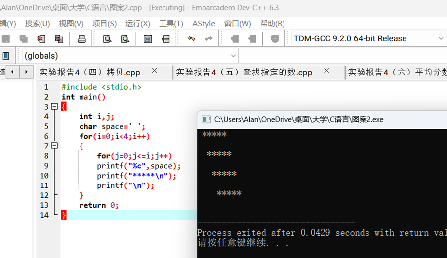
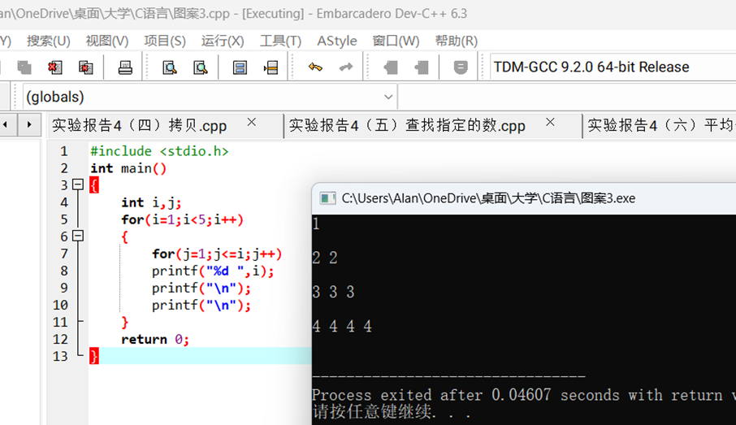
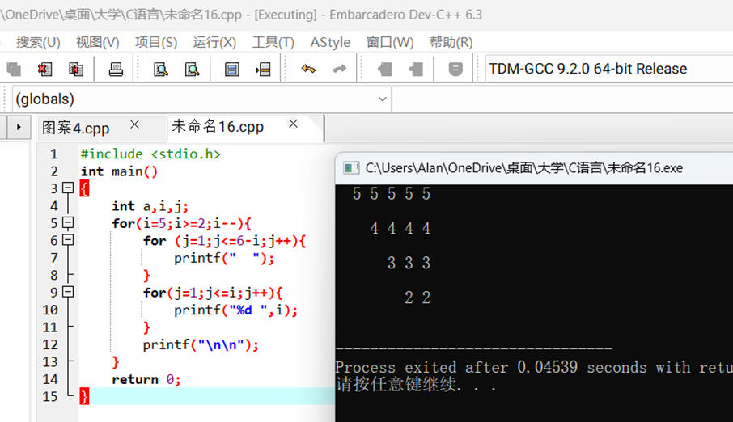
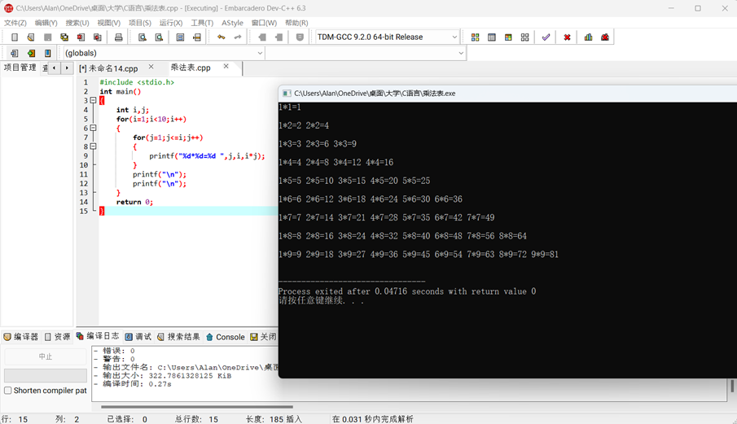

一、实验目的及要求

  实验目的：

  掌握循环结构的使用。

  实验要求：１．进一步联系选择结构的程序设计 

  ２．练习并掌握实现循环结构的三种方法 

  ３．练习并掌握循环结构嵌套 

   

   

   

  

 

 

  

  二、实验原理与内容

  实验步骤：

  （一）求从键盘输入的10个数中所有正数之和。

  （二）输入&#8212;行字符，统计并输出其中大写字母、小写字母、数字和其他字符的个数。

  （三）输出以下图案

  *             

  *****            

  1               5

  5 5 5 5

  ***            

  *****               

  2

  2              

  4 4 4 4

  *****           

  *****           3 3

  3              

  3 3 3

                   

  *****          4 4 4

  4              

  2 2

  （五）在屏幕上显示九九乘法表，输出效果如下： 

  1*1=1

  1*2=2

  2*2=4

  1*3=3

  2*3=6 3*3=9

  1*4=4

  2*4=8 3*4=12 4*4=16

  1*5=5

  2*5=10 3*5=15 4*5=20 5*5=25

  1*6=6

  2*6=12 3*6=18 4*6=24 5*6=30 6*6=36

  1*7=7

  2*7=14 3*7=21 4*7=28 5*7= 35 6*7=42 7*7=49

  1*8=8

  2*8=16 3*8=24 4*8=32 5*8=40 6*8=48 7*8=56 8*8=64

  1*9=9

  2*9=18 3*9=27 4*9=36 5*9=45 6*9=54 7*9=63 8*9=72 9*9=81

   

  

 

 

  

  三、实验软硬件环境

  PC Embarcadero

  Dev-C++

   

  

 

 

  

  四、实验过程（实验步骤、记录、数据、分析）

  （一）求从键盘输入的10个数中所有正数之和。

  

          

  （二）输入&#8212;行字符，统计并输出其中大写字母、小写字母、数字和其他字符的个数。

          

   

  （三）输出以下图案

  *             

  *****            

  1              

  5 5 5 5 5

  ***            

  *****               

  2

  2              

  4 4 4 4

  *****           

  *****           3 3

  3              

  3 3 3

                   

  *****          4 4 4

  4              

  2 2

                   

  

  

  

  

  （五）在屏幕上显示九九乘法表，输出效果如下： 

  1*1=1

  1*2=2

  2*2=4

  1*3=3

  2*3=6 3*3=9

  1*4=4

  2*4=8 3*4=12 4*4=16

  1*5=5

  2*5=10 3*5=15 4*5=20 5*5=25

  1*6=6

  2*6=12 3*6=18 4*6=24 5*6=30 6*6=36

  1*7=7

  2*7=14 3*7=21 4*7=28 5*7= 35 6*7=42 7*7=49

  1*8=8

  2*8=16 3*8=24 4*8=32 5*8=40 6*8=48 7*8=56 8*8=64

  1*9=9

  2*9=18 3*9=27 4*9=36 5*9=45 6*9=54 7*9=63 8*9=72 9*9=81

  

   

   

                                                             

           

                    

  

  

 

 

  

  五、测试/调试及实验结果分析

   

   

   

  

 

 

  

  六、实验结论与体会

  运用好for循环语句，能解决很多有规律的、繁琐的、重复的问题。

  2023 年 10 月 28 日