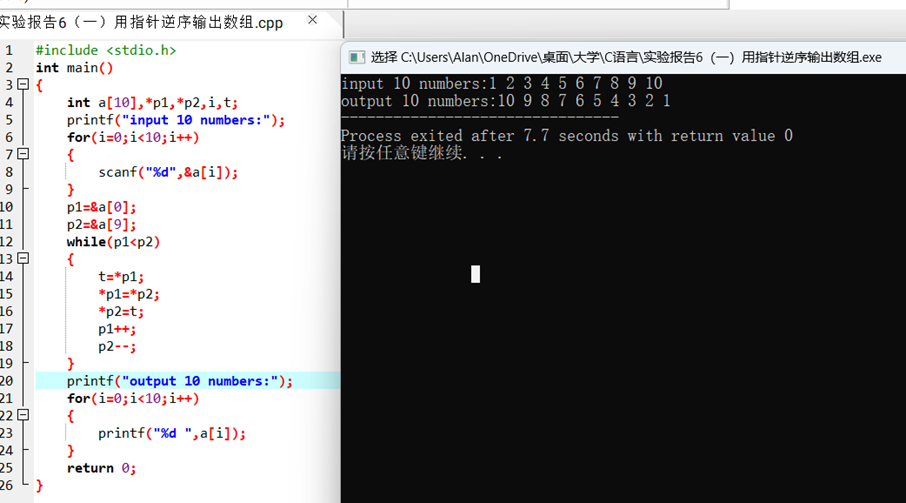
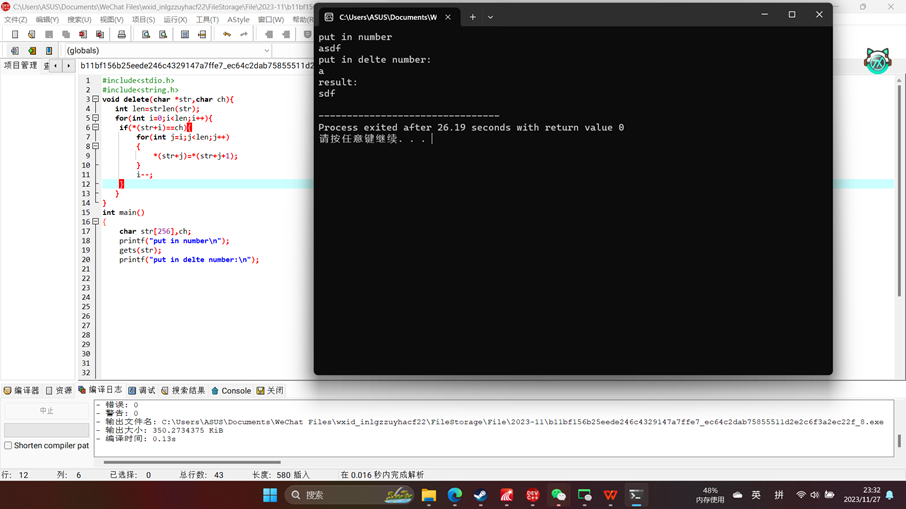

一、实验目的及要求

  实验目的：

  掌握指针的使用。

  实验要求：1．掌握指针的基本概念和基本用法。包括：变量的地址和变量的值，指针变量的说明、指针变量的初始化、指针的内容与定义格式、指针的基本运算等。

  2．掌握数组与指针的关系并能够利用指针解决数组的相关问题。

  3．掌握字符串与指针的关系并能够利用指针处理字符串的问题。

  ** **

   

   

   

   

  

 

 

  

  二、实验原理与内容

  实验步骤：

  （一）将一个数组中的值按逆序重新存放。 

  （二）编写函数delete（char *str，char ch），它的功能是从str所指向的字符串中删除与变量ch相同的字符。要求：

  （1）在主函数中以初始化方式输入一个字符串。

  （2）调用delete（）函数。

  （3）在主函数中输出处理后的结果。

  

 

 

  

  三、实验软硬件环境

  PC Embarcadero

  Dev-C++

   

  

 

 

  

  四、实验过程（实验步骤、记录、数据、分析）

  （一）将一个数组中的值按逆序重新存放。

  

   

  （二）编写函数delete（char *str，char ch），它的功能是从str所指向的字符串中删除与变量ch相同的字符。要求：

  （1）在主函数中以初始化方式输入一个字符串。

  （2）调用delete（）函数。

  （3）在主函数中输出处理后的结果。

  

   

   

  

 

 

  

  五、测试/调试及实验结果分析

   

   

   

  

 

 

  

  六、实验结论与体会

  要熟悉掌握指针，掌握指针与数组、字符串的关系，并能使用它去解决问题。

  2023 年 11 月 27 日