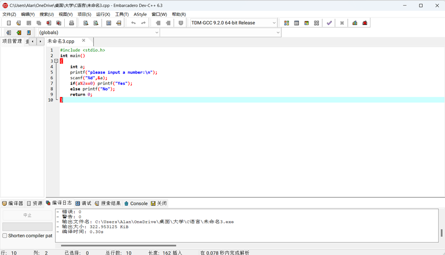
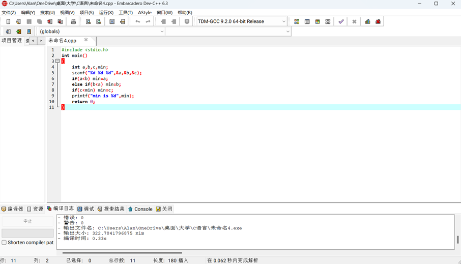
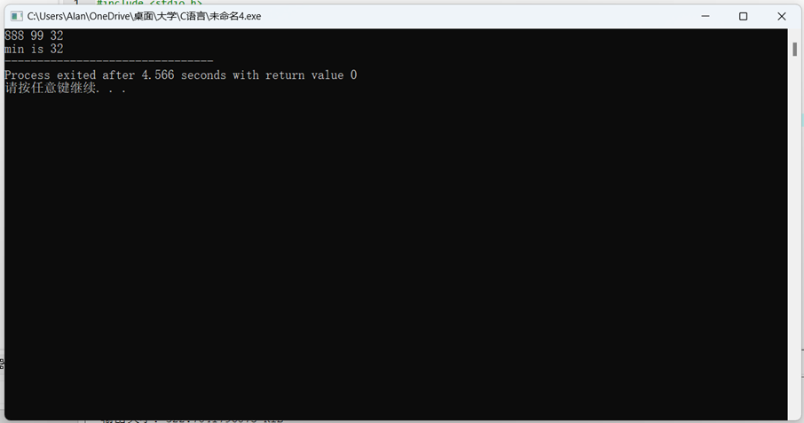
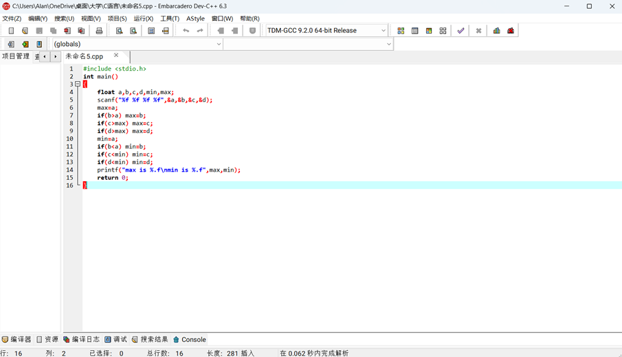
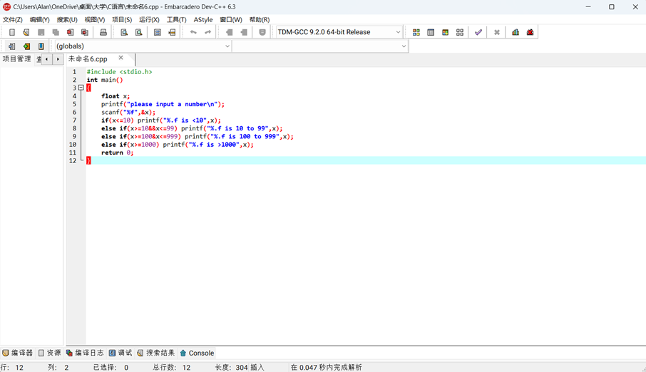
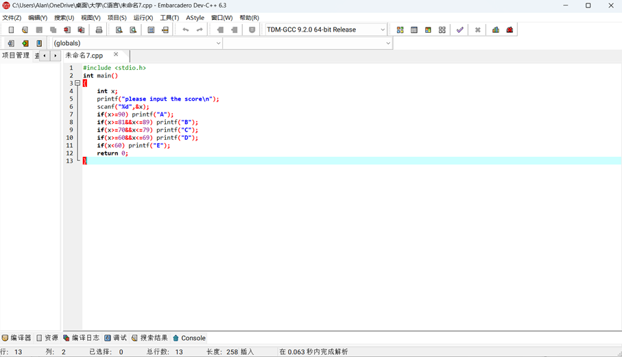
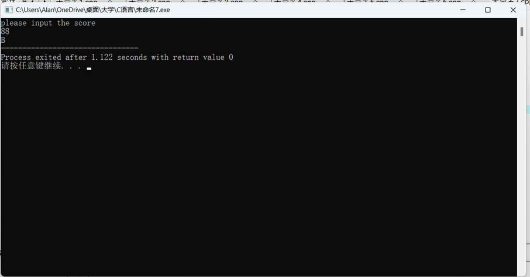

一、实验目的及要求

  实验目的：

  掌握好条件语句的使用。

  实验要求：1. 熟练掌握利用if语句实现选择结构 

  2. 利用switch语句实现多分支选择结构 

  3. 练习调试与修改程序

   

   

  

 

 

  

  二、实验原理与内容

  实验步骤：

   （一）输入一个整数，判断它是否为偶数。

  （二）从键盘输入三个数，输出其中的最小数。

  （三）输入四个整数，输出其中的最大数和最小数。

  （四）输入一个整数，将其数值按小于10、10~99、100~999、1000以上分类并显示。例如，输入358时，显示358  is  100  to  999。

  （五）给出一个百分制成绩，要求输出成绩等级A、B、C、D、E。90分以上为A，8l-89分为B，70-79分为C，60-69分为D，60分以下为E。 

   

   

  

 

 

  

  三、实验软硬件环境

  PC Embarcadero

  Dev-C++

   

  

 

 

  

  四、实验过程（实验步骤、记录、数据、分析）

  （一）输入一个整数，判断它是否为偶数。

  

  

  （二）从键盘输入三个数，输出其中的最小数。

      

       

  （三）输入四个整数，输出其中的最大数和最小数。

  

  

  （四）输入一个整数，将其数值按小于10、10~99、100~999、1000以上分类并显示。例如，输入358时，显示358  is  100  to  999。

  

  

  （五）给出一个百分制成绩，要求输出成绩等级A、B、C、D、E。90分以上为A，8l-89分为B，70-79分为C，60-69分为D，60分以下为E。 

  

  

   

                                    

                                                             

                                                             

           

                    

  

  

 

 

  

  五、测试/调试及实验结果分析

   

   

   

  

 

 

  

  六、实验结论与体会

  在编写第二项实验内容的时候，一开始想的过于复杂，后来才发现原来可以用更简单的语言编写，以后要注意：不能轻易把简单的问题复杂化，否则就是浪费时间。

  2023 年 10 月 28 日