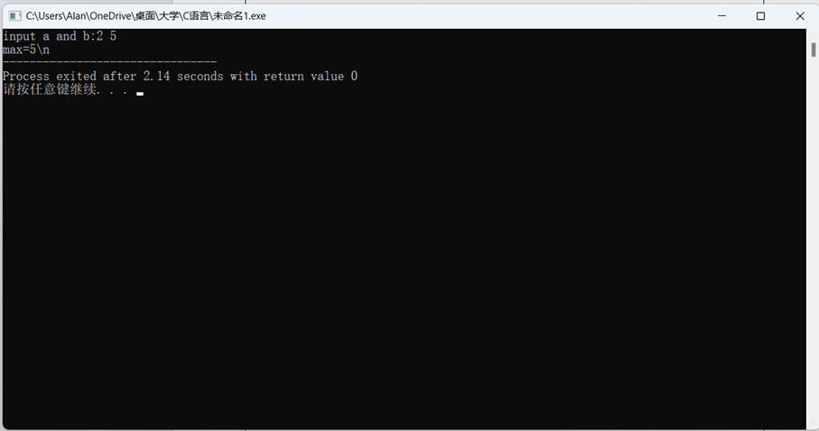
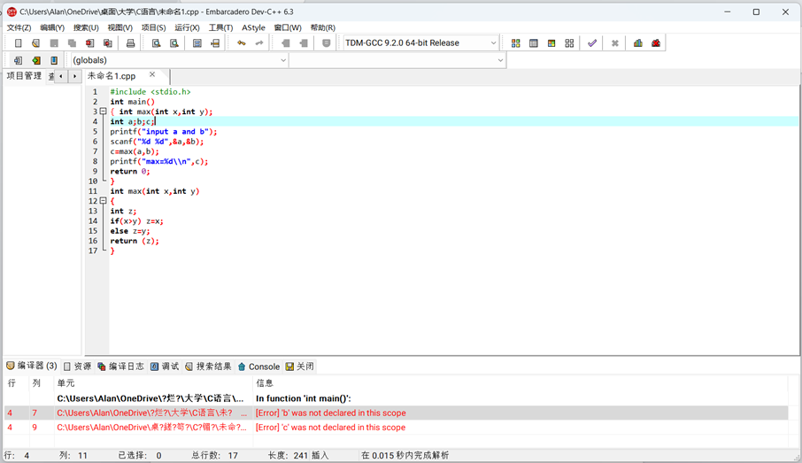
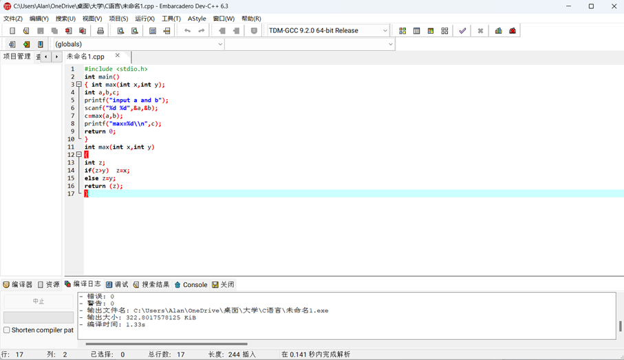
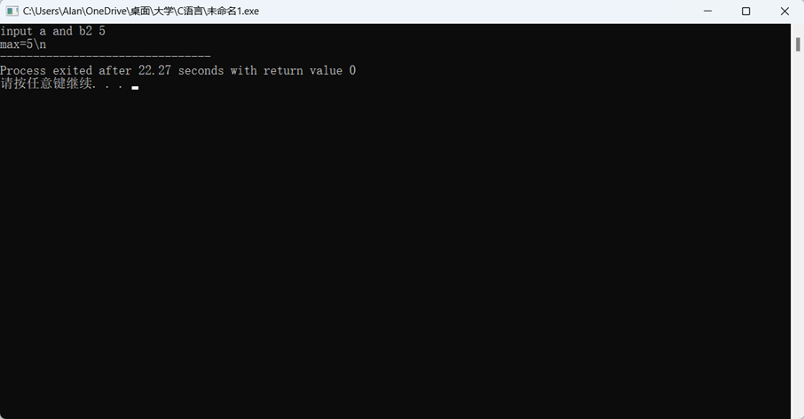
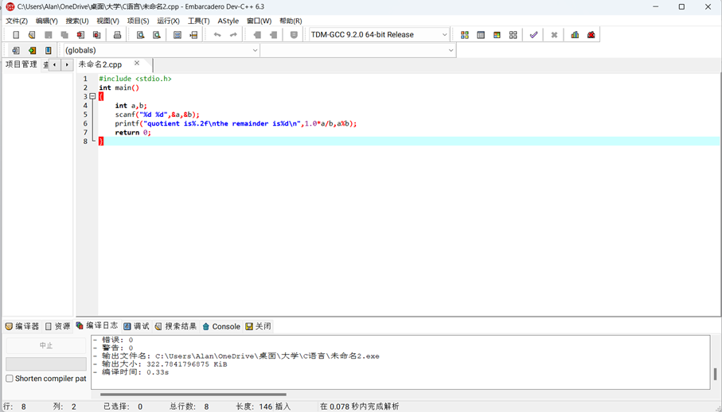
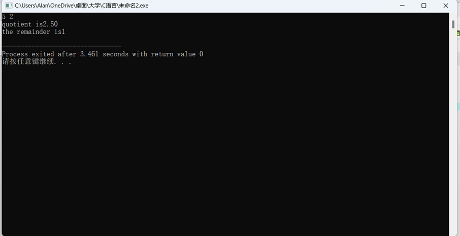

一、实验目的及要求

  实验目的：

  掌握顺序结构的使用。

  实验要求：1．理解和掌握C程序的基本结构。 

  2．掌握C程序的编译连接与运行的过程。

  3．掌握和理解本实验中出现的一些基本的C语言语句。

  4．体会算法在程序设计中的重要性。

   

  

 

 

  

  二、实验原理与内容

  实验步骤：

  1．熟悉语言集成开发环境

  2．（一）输入并运行一个需要在运行时输入数据的程序。

  （1）输入下面的程序：

  #include

  &lt;stdio.h&gt;

  int

  main()

  {

  int max(int x, int y);

  int

  a, b, c;

  printf(“input

  a and b: ”);

  scanf(“%d,

  %d”, &amp;a, &amp;b);

  c=max(a,b);

  printf(“max=%d\\n”,c);

  return

  0;

  }

  int

  max(int x, int y)

  {

  int

  z;

  if(x&gt;y)

  z=x;

  else

  z=y;

  return

  (z);

  }

  （2）编译并运行，在运行时从键盘输入整数2和5，然后按“回车”键，观察运行结果。

  （3）将程序中的第4行改为

  int

  a; b; c;

  再进行编译，观察其结果。

  （4）将max函数中的第3，4行合并写为一行，即

    

  if(z&gt;y)  z=x;  else z=y;

  进行编译和运行，分析结果。

  （二）自己编写程序，实现输入两个整数，求出它们的商数和余数并进行输出。 

   

  

 

 

  

  三、实验软硬件环境

  PC Embarcadero

  Dev-C++

   

  

 

 

  

  四、实验过程（实验步骤、记录、数据、分析）

  编译并运行，在运行时从键盘输入整数2和5，然后按“回车”键，观察运行结果。

  

  将程序中的第4行改为int a; b; c;再进行编译，观察其结果。

  

  将max函数中的第3，4行合并写为一行，即if(z&gt;y) 

  z=x;  else z=y;进行编译和运行，分析结果。

  

  

  自己编写程序，实现输入两个整数，求出它们的商数和余数并进行输出。

  

  

          

                                    

                                                             

                                                             

                                                                     

                                                    

                                                             

                                                             

                                                    

                                                    

                                                                     

                                                                     

                                            

                                    

                                                                                                                                                                          

                                                 

                                                             

                                    

                                    

                                            

                                                    

                                                    

                                            

                                                             

                                            

                                            

                                                    

          

      

  

   

   

          

   

                

                    

                    

  

  

 

 

  

  五、测试/调试及实验结果分析

   

   

   

  

 

 

  

  六、实验结论与体会

  一定要规范写好程序语言，如：int a,b,c;不可写成：int a;b;c;

  不能一直依赖自动给出的程序前缀，要养成自己写出来的习惯。

   

  2023 年 10 月 28 日