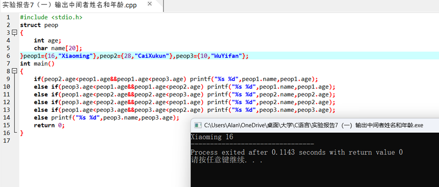
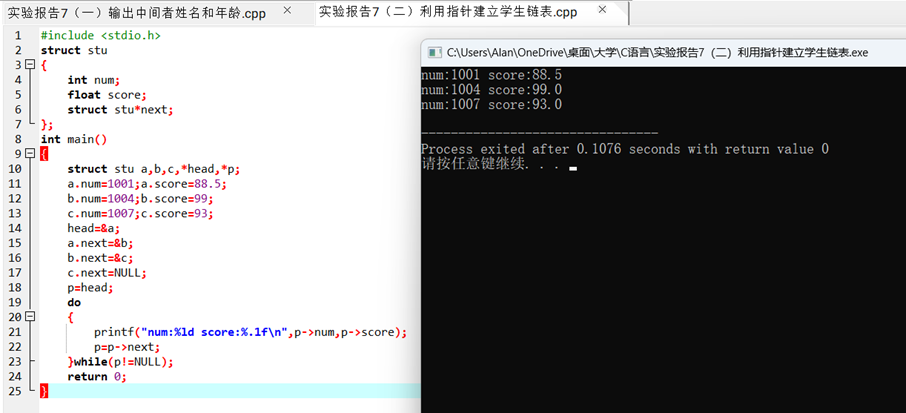

一、实验目的及要求

  实验目的：

  掌握结构体的使用，以及结构体结合数组、指针、链表的使用。

  实验要求：1．理解结构体类型的含义；掌握结构体类型变量的定义方法和使用、结构体类型变量的说明以及初始化方法。

  2．理解结构体与数组的区别；掌握结构体类型数组的概念、定义和使用方法。

   

  ** **

   

   

   

   

  

 

 

  

  二、实验原理与内容

  实验步骤：

  （一）在一个结构数组中，存有三个人的姓名和年龄，输出三人中年龄居中者的姓名和年龄。 

  （二）利用指针建立学生链表。

   

  

 

 

  

  三、实验软硬件环境

  PC Embarcadero

  Dev-C++

   

  

 

 

  

  四、实验过程（实验步骤、记录、数据、分析）

  （一）在一个结构数组中，存有三个人的姓名和年龄，输出三人中年龄居中者的姓名和年龄。 

  

  （二）利用指针建立学生链表。

  

  

 

 

  

  五、测试/调试及实验结果分析

   

   

   

  

 

 

  

  六、实验结论与体会

  结构体是另一种构造数据类型，它可以结合数组、指针和链表去使用，我要熟悉掌握结构体类型，使自己的代码更高级。

  2023 年 12 月 15 日