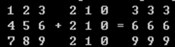
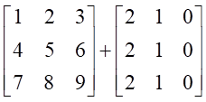
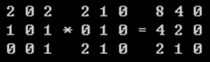
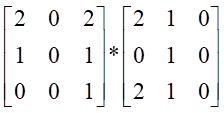

一、实验目的及要求

  1、掌握String类及相关方法的使用，能够使用正则表达式对字符串进行分解和匹配。

  2、掌握Java数组的声明和创建方法、掌握数组的应用。

  3、能够使用一维和二维数组进行简单运算。

   

   

   

   

   

   

   

  

 

 

  

  二、实验原理与内容

  1、给定一行句子，每个词之间用空格隔开，要么是全小写英文单词，要么是全大写英文单词，要么是自然数。

  要求将这些单词倒序输出。而且对于每个单词，如果是小写词，应当转为大写;如果是大写词，应当转为小写; 如果是自然数，应该倒转输出。

  例如：

  输入：WE will GO to

  234 FLOOR at 17 pm

  输出：PM 71 AT

  floor 432 TO go WILL we 

  编写程序要求要用到正则表达式。

  2、编写一个主类，至少包括3个方法。在main方法中，定义两个整数矩阵，分别调用矩阵加matrixAdd()和矩阵乘matrixMultiply()两个方法，输出运算结果。

  示例：计算下面两个矩阵的加法：

  

，输出如图结果：

  计算下面两个矩阵的乘法：

  

，输出如图结果：

  在计算矩阵的加法和乘法时，首先要考虑能不能运算。对于乘法要考虑矩阵乘法的特殊情况，比如一行乘以一列以及一列乘以一行等特殊情况，并对这些特殊情况进行测试。

   

   

  

 

 

  

  三、实验软硬件环境

  Cmd命令框、java

   

   

   

   

  

 

 

  

  四、实验过程（实验步骤、记录、数据、分析）

  1.代码思路：

   

  代码和注释：

  package

  test02;

  import

  java.util.*;

  import

  java.io.*;

  import

  java.util.Scanner; // 导入Scanner类，用于获取用户输入

  import

  java.util.regex.Matcher; // 导入Matcher类，用于正则表达式匹配

  import

  java.lang.StringBuffer; // 导入StringBuffer类，用于字符串操作

   

  public class

  Test2_1 {

     

  public static void main(String [] args) throws IOException {

         

  String str1, str2, str3, str4;

         

  BufferedReader buf;

         

  buf = new BufferedReader(new InputStreamReader(System.in)); // 初始化BufferedReader对象，从标准输入读取数据

         

  System.out.print(&quot;请输入一行句子：&quot;);

         

  String str = buf.readLine(); // 读取用户输入的一行文本

         

  String[] strarry = new String[100];

         

  // String str=&quot;WE will GO to 234 FLOOR at 17 pm&quot;;

         

  String regex = &quot;[\\s]+&quot;; // 定义正则表达式，匹配一个或多个空白字符

         

  String[] words = str.split(regex); // 使用正则表达式分割字符串，得到单词数组

         

  

         

  // 遍历单词数组

         

  for (int i = 0; i &lt; words.length; i++) {

             

  int m = i + 1; // 当前单词序号

             

  if (words[i].matches(&quot;[A-Z]+&quot;)) { // 如果单词全为大写字母

                 

  str1 = words[i].toLowerCase(); // 转换为小写

                 

  strarry[i] = str1; // 存储转换后的单词

                 

  System.out.println(&quot;单词&quot; + m + &quot;:&quot; + strarry[i]);

             

  } else if (words[i].matches(&quot;[a-z]+&quot;)) { // 如果单词全为小写字母

                 

  str2 = words[i].toUpperCase(); // 转换为大写

                 

  strarry[i] = str2; // 存储转换后的单词

                 

  System.out.println(&quot;单词&quot; + m + &quot;:&quot; + strarry[i]);

             

  } else { // 如果单词包含非字母字符

               

    StringBuffer sb = new StringBuffer(words[i]);

                 

  str3 = sb.reverse().toString(); // 反转字符串

                 

  strarry[i] = str3; // 存储反转后的字符串

                 

  System.out.println(&quot;单词&quot; + m + &quot;:&quot; + strarry[i]);

             

  }

         

  }

         

  

         

  System.out.print(&quot;反转后：&quot;);

         

  // 反向遍历字符串数组并打印非空元素

         

  for (int j = 0; j &lt; strarry.length; j++) {

             

  if (strarry[99 - j] != null) { // 如果数组元素不为空

                 

  System.out.println(&quot; &quot; + strarry[99 - j] + &quot; &quot;);

             

  }

         

  }

      }

  }

   

  2.代码思路：

   

  代码和注释：

  package

  test02;

  import

  java.util.*;

  import

  java.io.*;

   

  public class

  Test2_2 {

     

  public static void main(String [] args) throws IOException {

         

  Scanner reader = new Scanner(System.in);

         

  int m, n, r, s;

         

  System.out.print(&quot;请输入第一个矩阵的行数：&quot;);

         

  m = reader.nextInt(); // 读取用户输入的第一个矩阵的行数

         

  System.out.print(&quot;请输入第一个矩阵的列数：&quot;);

         

  n = reader.nextInt(); // 读取用户输入的第一个矩阵的列数

         

  int[][] Arry1;

         

  Arry1 = new int[m][n]; // 初始化Arry1为m行n列的二维数组

         

  matrixCreat(m, n, Arry1); // 调用matrixCreat方法填充Arry1

         

  matrixPrint(m, n, Arry1); // 调用matrixPrint方法打印Arry1

         

  System.out.print(&quot;请输入第二个矩阵的行数：&quot;);

         

  r = reader.nextInt(); // 读取用户输入的第二个矩阵的行数

         

  System.out.print(&quot;请输入第二个矩阵的列数：&quot;);

         

  s = reader.nextInt(); // 读取用户输入的第二个矩阵的列数

         

  int[][] Arry2;

         

  Arry2 = new int[r][s]; // 初始化Arry2为r行s列的二维数组

         

  matrixCreat(r, s, Arry2); // 调用matrixCreat方法填充Arry2

         

  matrixPrint(r, s, Arry2); // 调用matrixPrint方法打印Arry2

         

  if (m == r &amp;&amp; n == s) { // 如果两个矩阵的行数和列数都相等

             

  int[][] Arry3;

             

  Arry3 = new int[m][n]; // 初始化Arry3为m行n列的二维数组

             

  matrixAdd(m, s, Arry1, Arry2, Arry3); // 调用matrixAdd方法将Arry1和Arry2相加，结果存储在Arry3中

             

  System.out.println(&quot;两个矩阵的元素相加后为：&quot;);

             

  for (int i = 0; i &lt; m; i++) { // 遍历Arry3的每一行

                 

  for (int j = 0; j &lt; n; j++) { // 遍历Arry3的每一列

                     

  System.out.print(Arry3[i][j] + &quot;   &quot;); // 打印Arry3的元素

                     

  if (j == n - 1) { // 如果当前是行的最后一个元素

                         

  System.out.print(&quot;\n&quot;);

                     

  }

                 

  }

             

  }

         

  }

         

  if (n == r) { // 如果第一个矩阵的列数等于第二个矩阵的行数

             

  int[][] Arry4;

             

  Arry4 = new int[m][s]; // 初始化Arry4为m行s列的二维数组

             

  matrixMultiply(m, s, r, Arry1, Arry2, Arry4); // 调用matrixMultiply方法将Arry1和Arry2相乘，结果存储在Arry4中

             

  System.out.println(&quot;两个矩阵的元素相乘后为：&quot;);

             

  for (int i = 0; i &lt; m; i++) { // 遍历Arry4的每一行

                 

  for (int j = 0; j &lt; s; j++) { // 遍历Arry4的每一列

                     

  System.out.print(Arry4[i][j] + &quot;   &quot;); // 打印Arry4的元素

                     

  if (j == s - 1) { // 如果当前是行的最后一个元素

                         

  System.out.print(&quot;\n&quot;);

                     

  }

                 

  }

             

  }

         

  }

         

  if (n != r) { // 如果第一个矩阵的列数不等于第二个矩阵的行数

             

  System.out.print(&quot;这两个矩阵既不能相加也不能相乘!&quot;);

         

  }

     

  }

   

     

  // 创建并填充矩阵的方法

     

  public static int matrixCreat(int x, int y, int[][] Arry) {

         

  Scanner reader = new Scanner(System.in);

         

  System.out.println(&quot;请输入&quot; + x + &quot;*&quot; + y + &quot;矩阵的元素：&quot;);

         

  for (int i = 0; i &lt; x; i++) { // 遍历每一行

             

  for (int j = 0; j &lt; y; j++) { // 遍历每一列

                 

  Arry[i][j] = reader.nextInt(); // 读取用户输入的元素并赋值给Arry

             

  }

         

  }

         

  return 0;

     

  }

   

     

  // 打印矩阵的方法

     

  public static int matrixPrint(int x, int y, int[][] Arry) {

         

  System.out.println(x + &quot;*&quot; + y + &quot;矩阵的元素为：&quot;);

         

  for (int i = 0; i &lt; x; i++) { // 遍历每一行

             

  for (int j = 0; j &lt; y; j++) { // 遍历每一列

                 

  System.out.print(Arry[i][j] + &quot; &quot;); // 打印矩阵的元素

                 

  if (j == y - 1) { // 如果当前是行的最后一个元素

                     

  System.out.print(&quot;\n&quot;);

                 

  }

             

  }

         

  }

         

  return 0;

     

  }

   

     

  // 矩阵相加的方法

     

  public static int matrixAdd(int x, int y, int[][] A, int[][] B, int[][] C) {

         

  for (int i = 0; i &lt; x; i++) { // 遍历每一行

             

  for (int j = 0; j &lt; y; j++) { // 遍历每一列

                 

  C[i][j] = A[i][j] + B[i][j]; // 对应位置元素相加并赋值给C

             

  }

         

  }

         

  return 0;

     

  }

   

     

  // 矩阵相乘的方法

     

  public static int matrixMultiply(int x, int y, int z, int[][] A, int[][] B,

  int[][] C) {

         

  int a = 0;

         

  while (a &lt; x) { // 遍历A的每一行

             

  int b = 0;

             

  while (b &lt; y) { // 遍历B的每一列

                 

  int k = 0;

                 

  for (int j = 0; j &lt; z; j++) { // 遍历A的每一列和B的每一行

                     

  k += A[a][j] * B[j][b]; // 计算对应位置元素的乘积并累加到k

                 

  }

                 

  C[a][b] = k; // 将k赋值给C的对应位置

                 

  b++;

             

  }

             

  a++;

         

  }

         

  return 0;

     

  }

  }

  

 

 

  

   

   

  

 

 

  

  五、测试/调试及实验结果分析

   

   

   

   

   

   

   

   

   

   

   

   

   

  

 

 

  

  六、实验结论与体会

   

   

   

   

   

   

  年    月    日