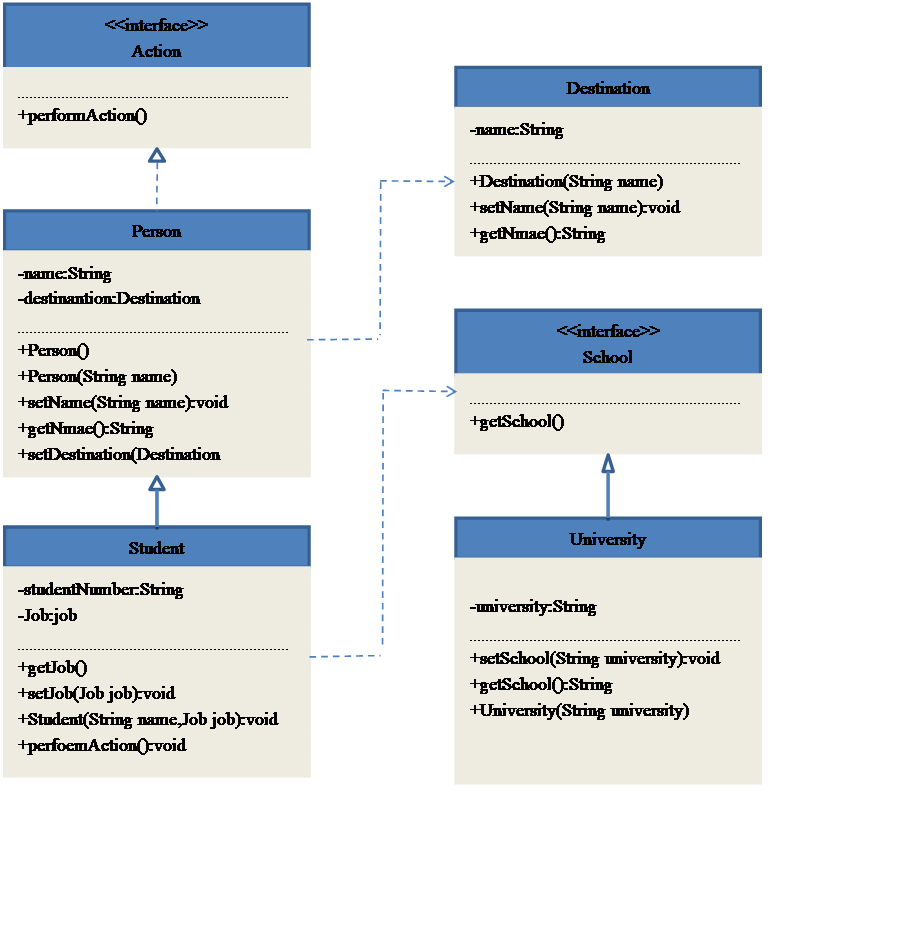
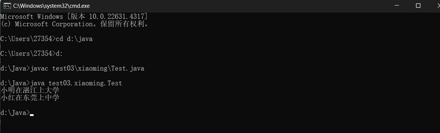

一、实验目的及要求

  1、掌握类的定义和使用、掌握对象的声明和使用。

  2、掌握继承、抽象类、重载、覆盖等面向对象概念。

  3、理解面向对象的多态，理解程序的可扩展和可移植。

   

   

   

   

   

   

   

   

  

 

 

  

  二、实验原理与内容

  1、用面向对象的思想解决“小明在湛江上大学”这一需求，分析出这一句话中包含的哪些类与对象，并找出它们之间的关系（比如继承、实现接口、依赖等），分析程序的可扩展性。报告中应给出从“小明在湛江上大学”这句话中分析得到了哪些类以及它们之间的关系，并用类图表示。

  2、抽象并定义工程中的类，定义并实现类中的属性和方法。注：学习面向对象编程阶段，类和方法的设定尽可能复杂化，尽可能将继承、重载、覆盖、多态、抽象和接口等各种面向对象技术运用其中，并指出这些技术体现在报告中的什么地方。

  3、建立测试类Test，在main方法中创建各个类的对象并调用，输入“小明在湛江上大学”，并展示程序的可扩展性输出。

   

   

   

   

   

   

   

   

   

   

   

  

 

 

  

  三、实验软硬件环境

  Cmd命令框、java

   

   

   

   

   

  

 

 

  

  四、实验过程（实验步骤、记录、数据、分析）

  代码思路：

  用面向对象的思想解决“小明在湛江上大学”这一需求，首先我们可以知道这一需求可概括为“XX（人名）在XX（地名）上XX（学历）”。故分析出“小明在湛江上大学”是一个抽象行为，所以先定义一个抽象方法Action，在这个方法里有performAction方法，用来执行抽象行为。然后分析出小明是学生，学生是人，可见学生与人是is-a的关系，故创建一个Person父类，Student继承Person父类。再分析出湛江是一个地方名，所以定义一个Destination类，通过Person中的setDestination来获取地方名。最后分析出上大学说明小明是一位大学生，所以定义先定义一个抽象类School，用getSchool来获取学历，再定义一个University类来说明小明是大学生。代码的扩展性体现在不仅可以解决“小明在湛江上大学”这一需求，还可以解决“XX（人名）在XX（地名）上XX（学历）”这类需求，如：小红在东莞上中学，小红是学生，东莞是地名，中学是学历。

  这些类的关系如以下类图：

   

  

  

   

    

   

   

    

    

   

  

   

   

   

   

   

   

   

   

   

   

   

   

   

   

   

   

   

   

   

   

   

   

   

   

   

   

   

   

  

  代码和注释：

   

   

   

  package

  test03.xiaoming;

  public

  interface Action{

          void

  performAction();   //公有的行为抽象方法

  }

   

  package

  test03.xiaoming;

  public

  abstract class Person implements Action{

          private

  String name;        //私有类的name名字

          protected

  Destination destination;  //定义Destination类的destination地方

          public

  void setName(String name){

                   this.name=name;

                      //获取name

          }

          public

  String getName(){

                   return

  name;                     //返回name

          }

          public

  void setDestination(Destination destination){

                   this.destination=destination;           //获取地方

          }

          public

  Person(){ }

          public

  Person(String name){

                   this.name=name;

          }

  }

          

   

  package

  test03.xiaoming;

  public class

  Student extends Person {

          private

  String studentNumber;                //定义String类的studentNumber

   

          public

  School getSchool(){

                   return

  school;          //返回school

          }

          public

  void setSchool(School school){

                   this.school=school;         //获取school

          }

          

          private

  School school;

          public

  Student(String name,School school){

                   super(name);           //访问父类的name

                   this.school=school;

          }

          public

  void performAction(){

                   System.out.println(this.getName()+&quot;在&quot;+destination.getName()+&quot;上&quot;+school.getSchool());             //执行student行为

          }

  }

   

  package

  test03.xiaoming;

  public

  interface School {

          String

  getSchool();          //定义抽象类的getSchoo方法

  }

   

  package

  test03.xiaoming;

  public class

  Destination {

          private

  String name;                //定义String类的地方名

          public

  String getName(){

                   return

  name;            

          }

          public

  void setName(String name){

                   this.name=name;

          }

          public

  Destination(String name){

                   this.name=name;

          }

  }

   

   

  package

  test03.xiaoming;

  public class

  University implements School{                  //University通过接口与School连接

          private

  String university;                         //定义String类的大学

          public

  void setSchool(String universuty){

                   this.university=university;

          }

          public

  University(String university){

                   this.university=university;

          }

          public

  String getSchool(){

                   return

  university;

          }

  }

   

   

   

   

   

  package

  test03.xiaoming;

  public class

  Midschool implements School{          //Midschool通过接口与School连接

          private

  String midschool;                        //定义String类的Midschool

          public

  void setSchool(String midschool){

                   this.midschool=midschool;

          }

          public

  Midschool(String midschool){

                   this.midschool=midschool;

          }

          public

  String getSchool(){

                   return

  midschool;

          }

  }

   

   

   

   

   

   

  package

  test03.xiaoming;

   

   

  public class

  Test{

          public

  static void main(String [] arges){

                   //创建一个大学对象

                   School

  university=new University(&quot;大学&quot;);

                   //创建一个学生小明

                   Person

  xiaoming=new Student(&quot;小明&quot;,university);

                   //创建地方名对象

                   Destination

  Zhanjiang=new Destination(&quot;湛江&quot;);

                   //设置小明上学的地方

                   xiaoming.setDestination(Zhanjiang);

                   //小明执行行为

                   xiaoming.performAction();

   

   

                   //创建一个中学对象

                   School

  midSchool=new Midschool(&quot;中学&quot;);

                   //创建一个学生小红

                   Person

  xiaohong=new Student(&quot;小红&quot;,midSchool);

                   //创建地方名对象

                   Destination

  Dongguan=new Destination(&quot;东莞&quot;);

                   //设置小红上学的地方

                   xiaohong.setDestination(Dongguan);

                   //小红执行行为

                   xiaohong.performAction();

                   

          }

  }

   

   

   

   

   

   

   

  

 

 

  

   

   

   

   

   

   

   

   

   

   

   

   

  

 

 

  

  五、测试/调试及实验结果分析

   

  

   

   

   

   

   

   

   

   

   

   

   

  

 

 

  

  六、实验结论与体会

  1. 如何建立起类与类之间的关系？

  通过合理地使用继承、实现、关联、依赖、聚合和组合等关系来建立起类与类之间的关系。

  2. 程序的可扩展性和可移植性是如何实现的？

  Java程序的可扩展性和可移植性是通过多种机制共同实现的，包括继承、多态、接口和抽象类、设计模式、模块化、Java虚拟机（JVM）、源代码可移植性、标准库的跨平台性、避免使用非标准库。

  3. 为什么要尽可能的复杂化，在实际工程当中是不是也需要这样做？

  在Java开发中，复杂化并不是一个绝对的目标，而是由多种因素共同作用的结果，Java开发中的复杂性来源：语言特性和严谨性、平台与生态系统的庞大、内存管理机制、并发编程模型、框架与库的多样性、企业级应用的安全与维护。而在实际工程中，是否追求复杂化取决于多个因素：项目需求、团队技术能力、长期维护成本、技术趋势和最佳实践。

   

  体会：

  通过这次实验，我们学会了通过使用继承、接口、关联、依赖、聚合和组合等关系来建立起类与类之间的关系；其次学会了如何利用面向对象的思想解决实际问题并很好的分析出问题需求；同时，学会了提高程序的可扩展性。

   

   

   

  2024年  11  月  8  日