## 一、实验目的及要求

1. 熟悉Linux操作环境；
2. 掌握 Linux一般命令格式；
3. 掌握有关文件和目录操作的常用命令；
4. 掌握有关进程操作的常用命令。

## 二、实验原理与内容

1. 熟练掌握登录和退出系统命令。
2. 熟悉 date，cal，who，echo，clear，passwd，man等命令。
3. 在用户主目录下对文件进行如下操作：复制一个文件、显示文件内容、查找指定内容、排序、文件比较、文件删除。
4. 对目录进行管理：创建和删除子目录、改变和显示工作目录、列出文件权限、建立链接文件等。
5. 显示系统中的进程信息。

## 三、实验软硬件环境

台式电脑、VMware虚拟机、CENTOS 7以上版本。

## 四、实验过程（实验步骤、记录、数据、分析）

### 1. 登录与退出系统

登录进入系统，打开shell环境（终端），使用Linux的GUI窗口实现系统的开机、关机以及注销和重启等操作。

使用 `shutdown`、`halt`、`poweroff`、`init` 以及 `reboot` 等命令实现开关机等操作。

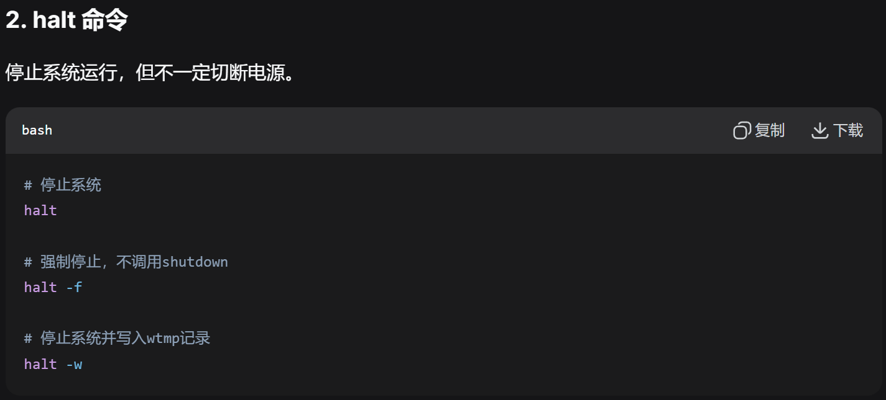

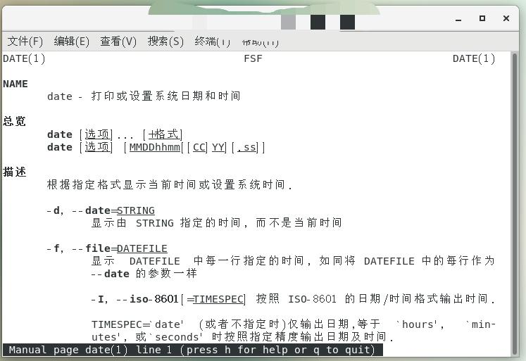

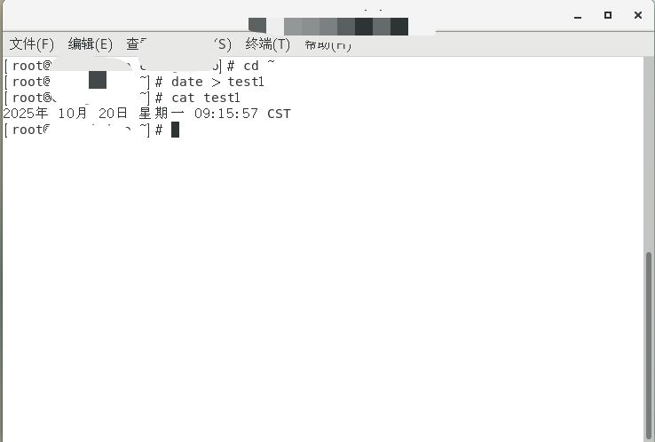

### 2. 基本命令使用

使用 `date`、`cal`、`who`、`echo`、`clear` 等命令，了解 Linux命令格式。

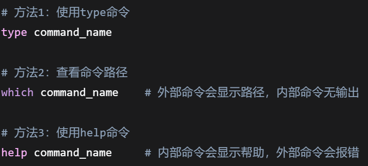

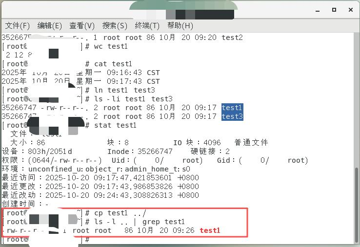

### 3. 命令帮助与类型

利用 `man` 命令查看date、echo 等命令的帮助说明；使用 `type` 命令查看自己所熟悉的命令的类型。

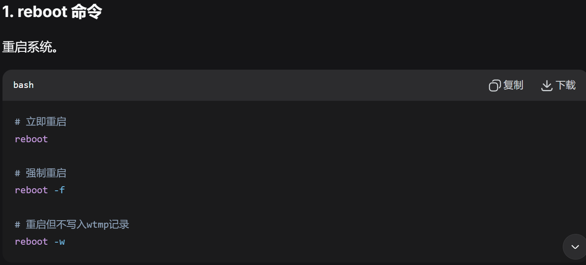

#### 如何区分内部命令和外部命令？

**内部命令（Shell Builtin）**：
- 嵌入在shell程序中的命令
- 执行速度快（不需要创建新进程）
- 影响shell环境（如cd改变当前目录）
- 使用 `help command` 查看帮助

**外部命令（External Command）**：
- 独立的可执行文件
- 位于 /bin, /usr/bin, /sbin 等目录
- 执行时需要创建新进程
- 使用 `man command` 或 `command --help` 查看帮助

### 4. 目录操作

#### 4.1 新建目录

在用户默认工作目录下新建目录testdir1。

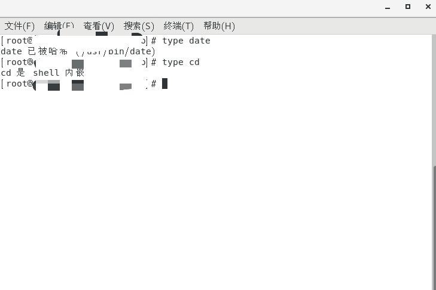

#### 4.2 复制目录

在用户目录下复制testdir1为testdir2。

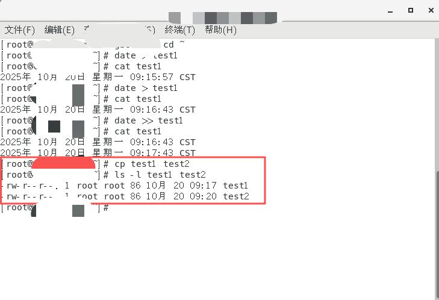

#### 4.3 删除目录

在用户目录下删除testdir2。

### 5. 文件操作

#### 5.1 进入默认工作目录

#### 5.2 输出重定向（覆盖）

运行 `date > test1`，然后运行 `cat test1`，记录观察到的信息。

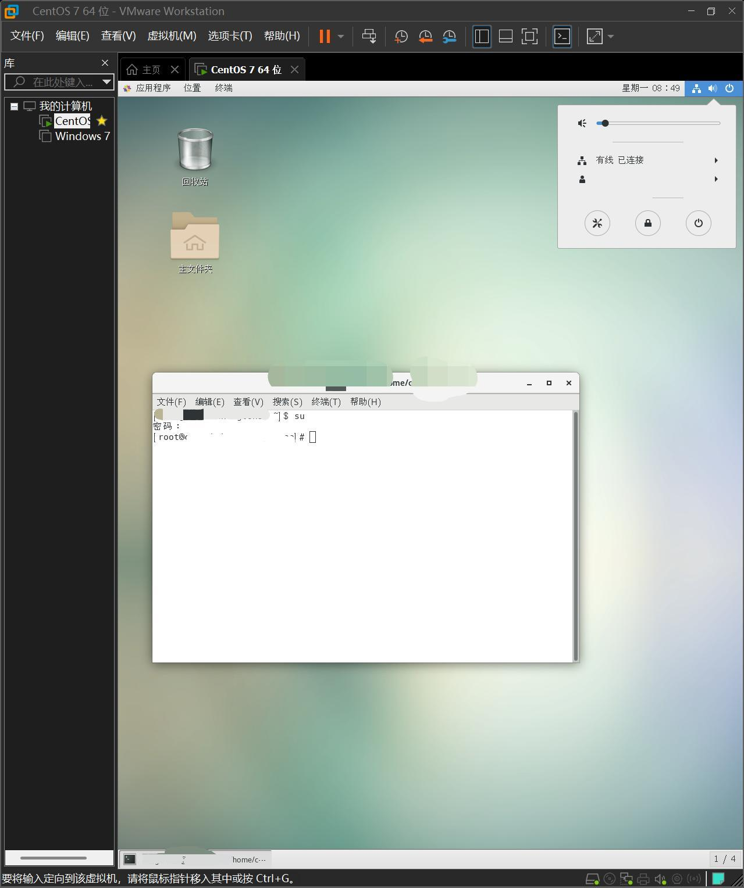

#### 5.3 再次覆盖写入

再次运行 `date > test1`，然后运行 `cat test1`，记录观察到的信息。

#### 5.4 追加重定向

运行 `date >> test1`，然后运行 `cat test1`，记录观察到的信息并说明原因。

> **原因**：`>` 是输出重定向，会覆盖文件原有内容；`>>` 是输出追加重定向，会在文件末尾追加新内容。

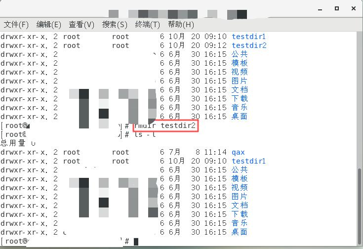

#### 5.5 复制文件

复制test1为test2。

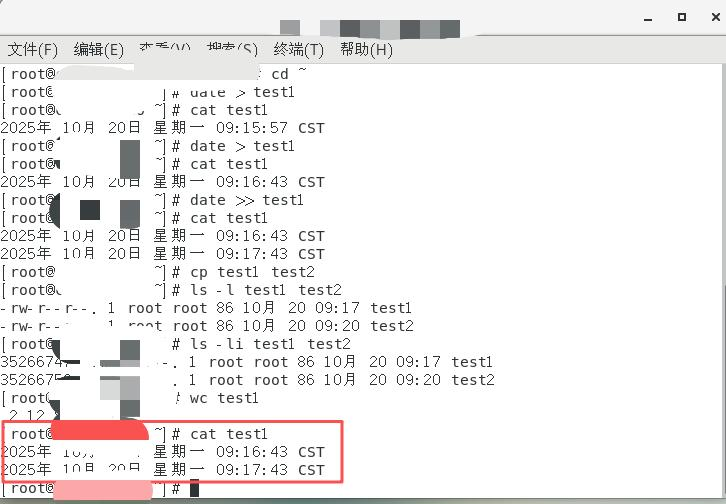

#### 5.6 查看文件详细信息

查看test1和test2的文件详细信息，记录并说明其异同。

**异同分析**：

| 属性 | 相同点 | 不同点 |
|------|--------|--------|
| 文件大小 | 相同 | - |
| 权限 | 相同（-rw-r--r--） | - |
| 内容 | 相同 | - |
| 修改时间 | 相近 | - |
| inode编号 | - | 不同（独立文件副本） |

> 对其中一个文件的修改不会影响另一个。

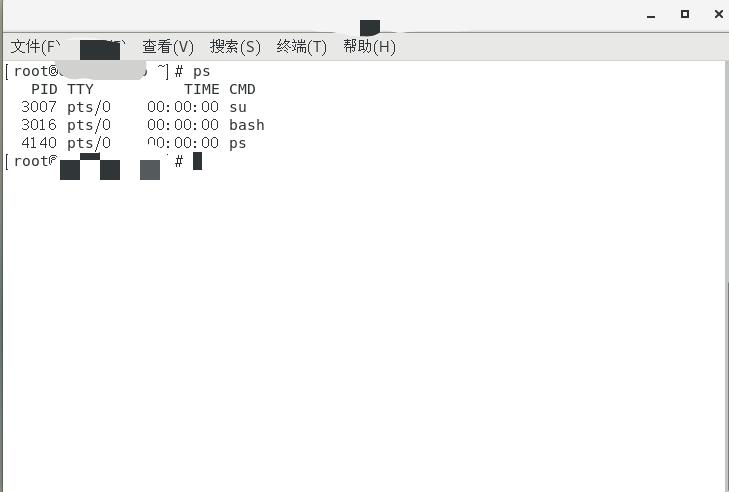

#### 5.7 统计文件内容

统计test1文件内容的行数、字数。

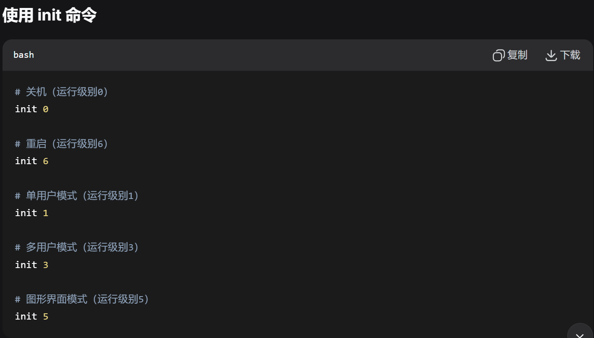

#### 5.8 显示文件内容

显示test1的内容。

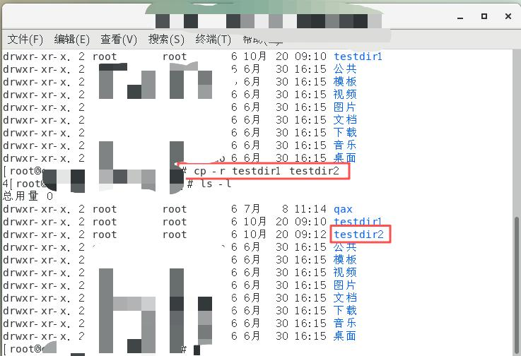

#### 5.9 建立链接文件

建立test1的链接文件test3。

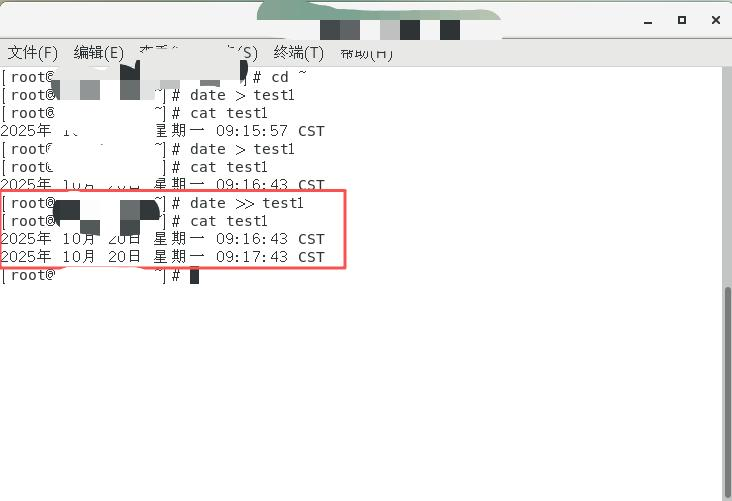

#### 5.10 复制到上级目录

复制test1到上一级目录。

#### 5.11 删除文件和目录

在用户目录下删除test1，删除testdir1。

### 6. 进程操作

#### 6.1 显示进程信息

显示当前系统中所有进程信息。

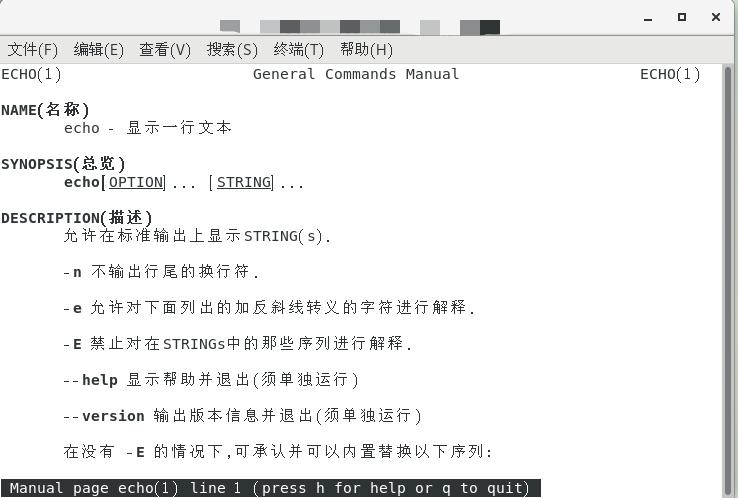

#### 6.2 结束进程

结束一个进程。

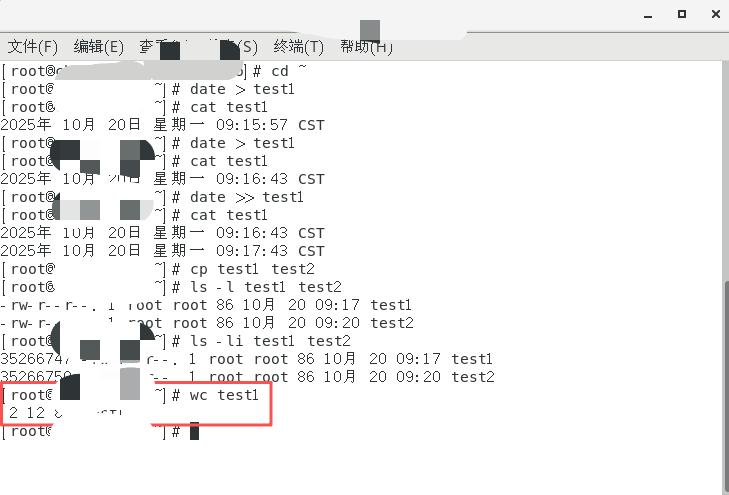

## 五、实验结论与体会

通过本次实验，熟练掌握了登录退出系统的方法，能灵活运用 `shutdown`、`reboot` 等命令管理系统，也清楚了 `date`、`cal`、`who` 等基础命令的用法，还借助 `type` 命令区分了内部命令（如 `cd`）和外部命令（如 `date`）。

在文件与目录操作中，明白了 `>` 覆盖文件内容、`>>` 追加内容的差异，知道硬链接与原文件共享inode，而复制会生成独立文件，也掌握了 `mkdir`、`rmdir`、`cp`、`rm` 等命令的使用。进程操作方面，能用 `ps` 查看进程信息。

这次实验让我对Linux命令行操作更熟练，也意识到操作时要注意命令细节，比如 `rmdir` 只能删除空目录。此次实验为后续学习Linux打下了好基础，提升了实践能力。