## 实验目的及要求

1. Linux环境下gcc编译器的安装；
2. 熟悉Linux环境下高级语言编译流程；
3. 掌握vi、gcc、gdb的使用；
4. 基本掌握make的用法，能在Linux系统上编程。

## 二、实验原理与内容

1. gcc编译过程及常用编译选项；
2. gdb调试器使用流程，查看文件、设置断点、单步运行等gdb基本命令的使用；
3. 编写多个C源文件，通过MAKEFILE实现自动化编译。

## 三、实验软硬件环境

台式电脑、VMware虚拟机、CENTOS 7.0以上版本。

## 四、实验过程（实验步骤、记录、数据、分析）

### 1. Linux下gcc编译器的安装

#### 1.1 查看gcc是否已安装

使用命令 `gcc --version` 查看系统中是否已经安装，如果已经安装，请使用命令 `yum remove gcc` 卸载gcc。

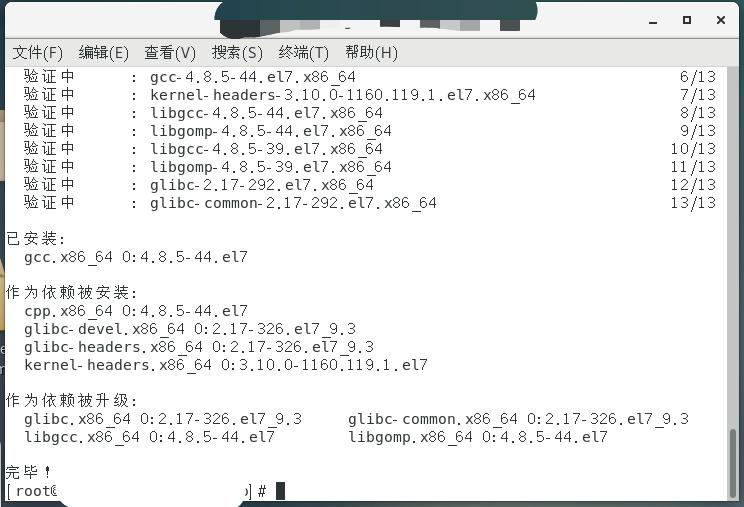

#### 1.2 通过rpm安装gcc

下载 `gcc-4.8.5-44.el7.x86_64.rpm`，然后使用 `rpm -ivh gcc-4.8.5-44.el7.x86_64.rpm`，看是否能安装成功，如果不能安装，分析原因。

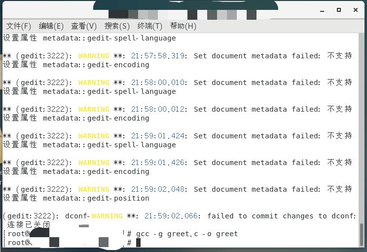

#### 1.3 通过yum安装gcc

如果不能安装成功，使用命令 `yum install gcc`，如果无法安装，修改配置文件然后再安装。

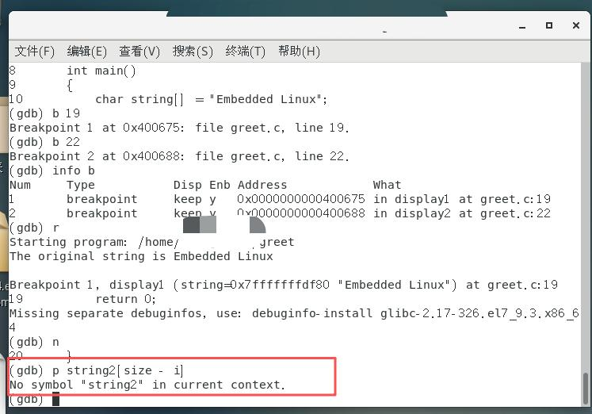

### 2. Linux下C语言开发流程及GCC编译器的使用

#### 2.1 启动虚拟机

启动虚拟机，进入Linux操作系统，然后启动终端。

#### 2.2 使用Vim编辑源程序

练习命令模式、编辑模式、底行模式之间的切换，在终端中输入 `vi hello.c`，编辑完成后存盘。

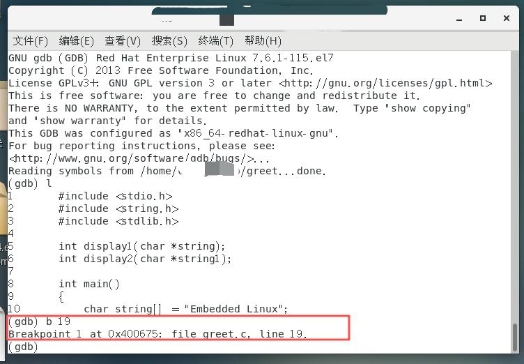

#### 2.3 练习编译选项的使用

```bash
gcc -E hello.c -o hello.i          # 预处理
gcc -S hello.i -o hello.S          # 编译
gcc -c hello.S -o hello.o          # 汇编（目标文件）
gcc hello.o -o hello               # 链接（可执行文件）
```

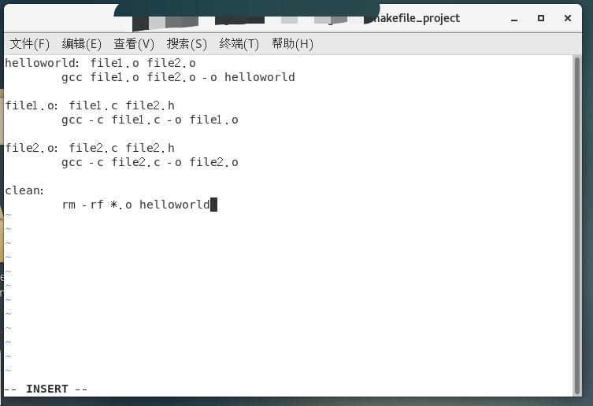


#### 2.4 运行程序

在终端中查看程序运行结果。

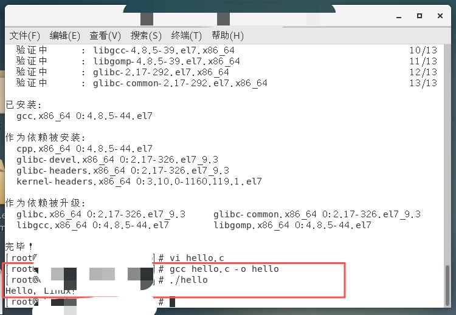

### 3. GDB调试器的使用

使用gedit输入如下源代码，编辑完成后存盘。此代码的功能为输出倒序main函数中定义的字符串，但结果没有输出显示，现通过调试的方式来解决程序中存在的问题。

程序源代码如下：

```c
#include <stdio.h>
int display1 (char *string)
int display2 (char *string1)
int main ()
{
    char string[] = "Embedded Linux";
    display1 (string);
    display2 (string);
}
int display1 (char *string)
{
    printf ("The original string is %s \n", string);
}
int display2 (char *string1)
{
    char *string2;
    int size,i;
    size = strlen (string1);
    string2 = (char *) malloc (size + 1);
    for (i = 0; i <= size; i++)
        string2[size - i] = string1[i];
    string2[size+1] = ' ';
    printf("The string afterward is %s\n",string2);
}
```

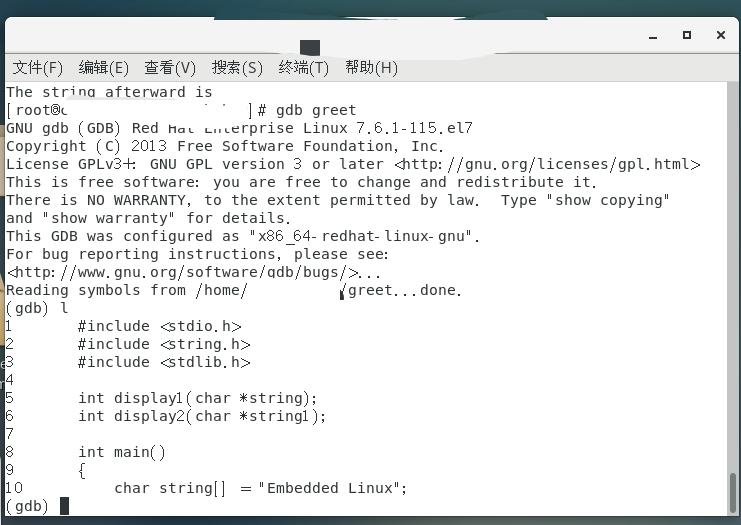

#### 3.1 编译带调试信息的程序

用gcc编译：`gcc -g greet.c -o greet`

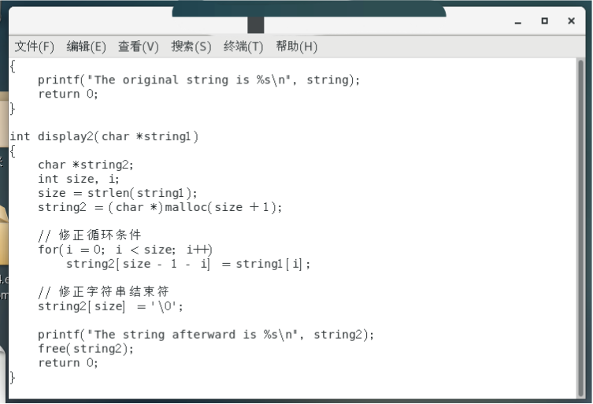

#### 3.2 运行程序

运行greet：`./greet`，查看输出结果是否正确。

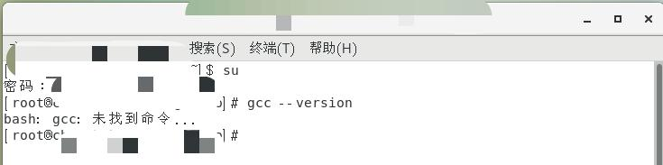

#### 3.3 启动GDB调试

启动Gdb调试：`gdb greet`

- 查看源代码：`l`

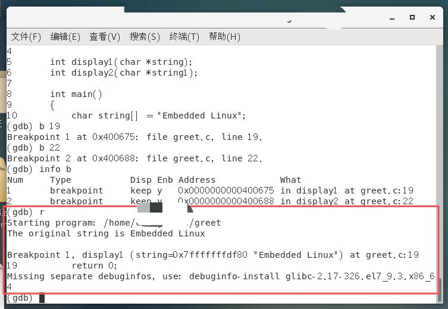

- 在30行（for循环处）设置断点：`b 19`

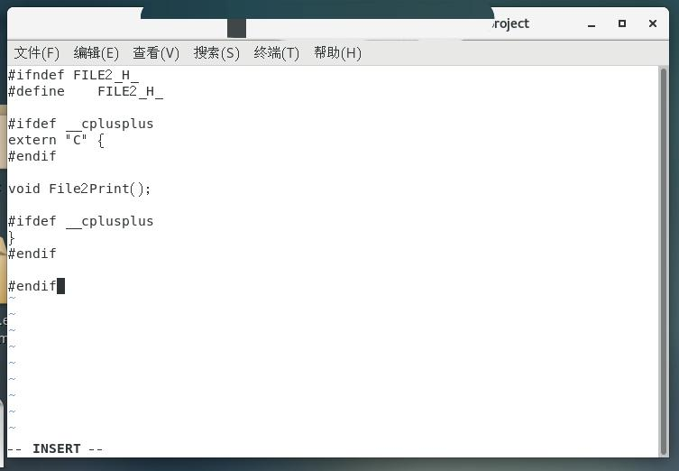

- 在33行（printf函数处）设置断点：`b 22`

- 查看断点设置情况：`info b`

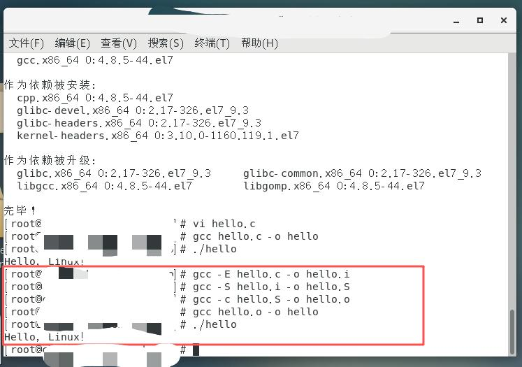

- 运行代码：`r`

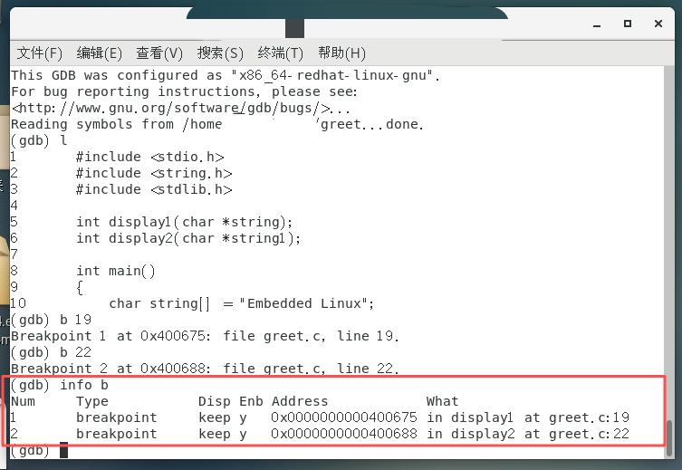

- 单步运行代码：`n`

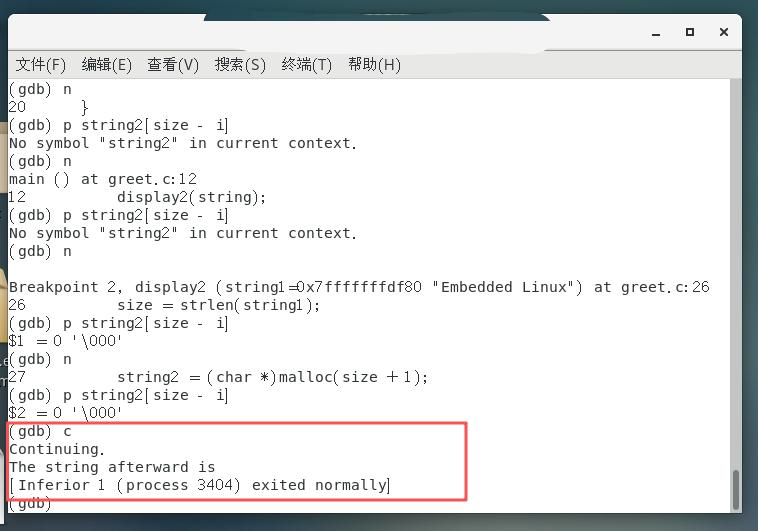

- 查看暂停点变量值：`p string2[size - i]`

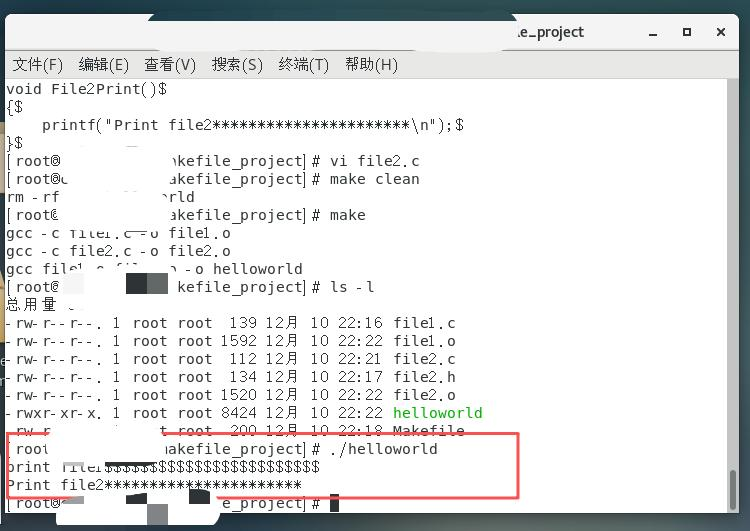

- 继续单步运行代码数次，并使用命令查看，发现string2[size-1]的值正确

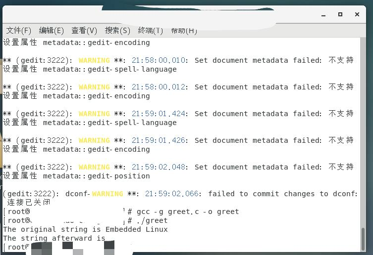

- 继续程序的运行：`c`

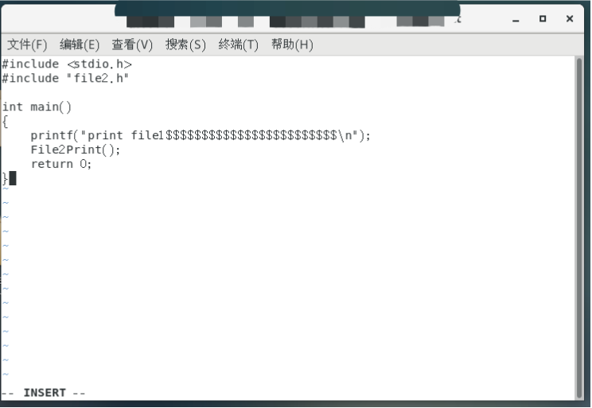

程序在printf前停止运行，此时依次查看string2[0]、string2[1]…，找到程序运行结果不正确的原因：

- `string2[0]` 应该是字符串结束符 `\0`，但可能不是
- 倒序拷贝的逻辑有错误：`for(i = 0; i <= size; i++)` 应该是 `for(i = 0; i < size; i++)`
- `string2[size+1] = ' '` 应该是 `string2[size] = '\0'`

- 退出Gdb：`q`


将程序修改正确并使用Gcc重新编译，查看运行结果：`./greet`

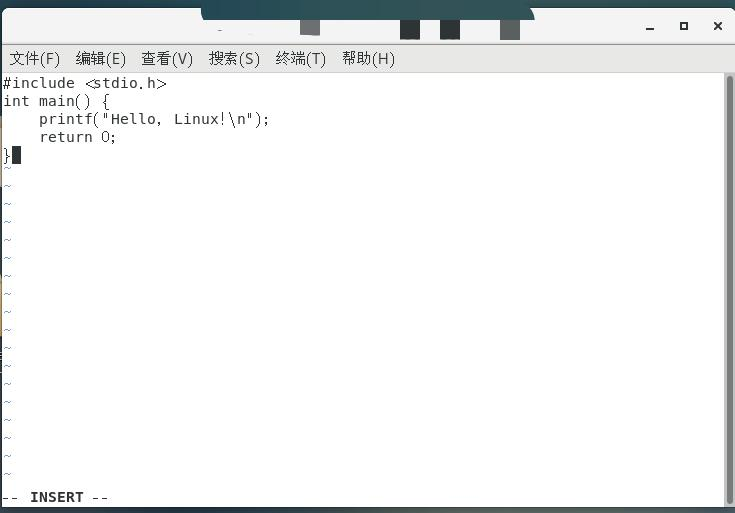

### 4. Linux平台Makefile编写

#### 4.1 准备三个文件

**file1.c:**

```c
#include <stdio.h>
#include "file2.h"
int main()
{
    printf("print file1$$$$$$$$$$$$$$$$$$$$$$$$\n");
    File2Print();
    return 0;
}
```

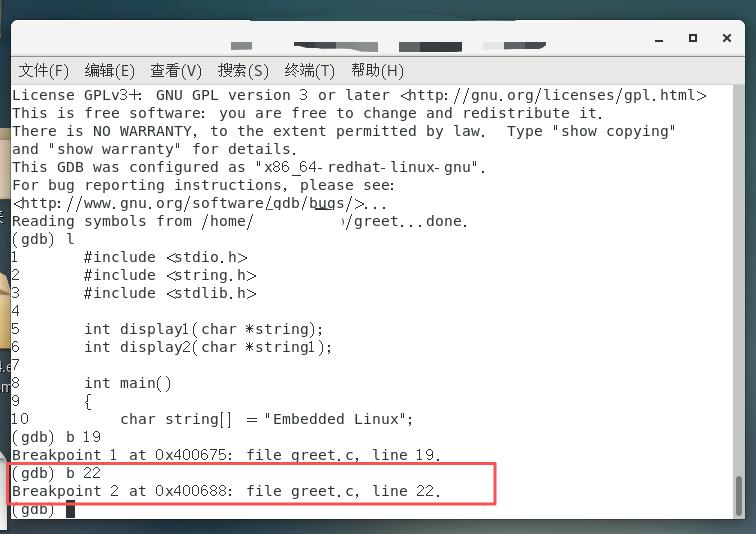

**file2.h:**

```c
#ifndef FILE2_H_
#define FILE2_H_
    #ifdef __cplusplus
        extern "C" {
    #endif
    void File2Print();
    #ifdef __cplusplus
        }
    #endif
#endif
```

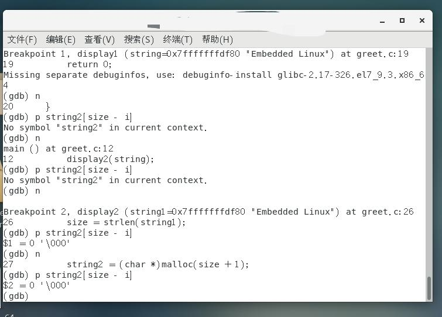

**file2.c:**

```c
#include "file2.h"
void File2Print()
{
    printf("Print file2**********************\n");
}
```

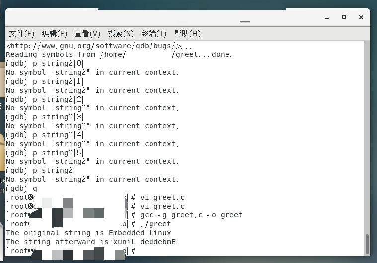

#### 4.2 编写Makefile

```makefile
helloworld:file1.o file2.o
    gcc file1.o file2.o -o helloworld
file1.o:file1.c file2.h
    gcc -c file1.c -o file1.o
file2.o:file2.c file2.h
    gcc -c file2.c -o file2.o
clean:
    rm -rf *.o helloworld
```

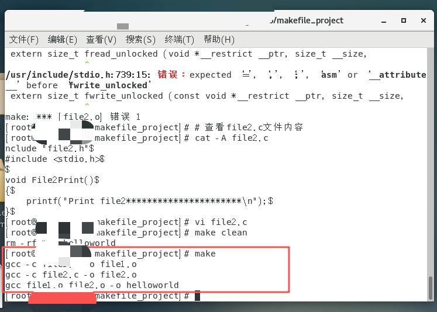

#### 4.3 编译与运行

改变makefile的文件属性为可执行，输入 `make` 命令，生成helloworld可执行文件，然后 `./helloworld` 执行。


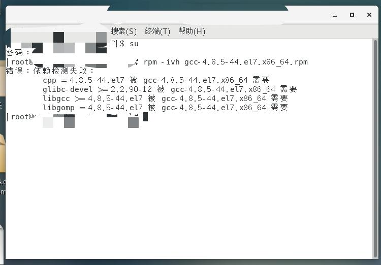

## 五、实验结论与体会

### 实验结论

**1. GCC编译器使用**

通过本次实验，成功掌握了Linux环境下GCC编译器的安装与使用：
- 学会了使用 yum 包管理器安装GCC
- 掌握了GCC编译的四个基本阶段：预处理（-E）、编译（-S）、汇编（-c）、链接
- 能够正确使用各种编译选项生成不同类型的中间文件和可执行文件

**2. GDB调试器应用**

通过实际调试代码，掌握了GDB调试的基本技能：
- 能够使用 `-g` 选项编译带调试信息的程序
- 熟练使用GDB基本命令：l、b、r、n、p、c、q
- 能够设置断点、单步执行、查看变量值、分析程序逻辑错误
- 发现了原代码中的多个逻辑错误，并通过调试定位问题根源

**3. Makefile编写与使用**

掌握了多文件项目的自动化编译：
- 学会了编写基本的Makefile文件，理解目标、依赖、命令的关系
- 掌握了 `make` 和 `make clean` 命令的使用
- 理解了增量编译的原理，提高了编译效率
- 能够正确组织多文件C项目的结构

### 实验体会

1. **Linux开发环境的优势**：命令行操作更加高效快捷，Linux提供了完整的开发工具链（gcc、gdb、make等），可以自由获取和使用各种开源工具和库。

2. **调试技能的重要性**：编程不仅是写代码，更重要的是调试和解决问题。掌握调试方法比单纯得到正确结果更有价值，调试需要耐心细致，逐步排查问题。

3. **自动化编译的必要性**：对于多文件项目，手动编译效率低下且容易出错。Makefile标准化了编译流程，统一的编译脚本便于团队协作和项目维护。

4. **遇到的问题与解决**：GCC安装被锁（学会了处理yum进程锁定的问题）、代码逻辑错误（通过GDB逐步调试发现并修正）、Makefile格式错误（理解了Tab键与空格的区别）、头文件包含顺序（认识到正确的包含顺序对编译的重要性）。

5. **实践中的收获**：将课堂知识应用到实际操作中，问题解决能力得到提升，编程中的细节对结果有重要影响，学会了从系统角度考虑程序的编译、调试和运行。