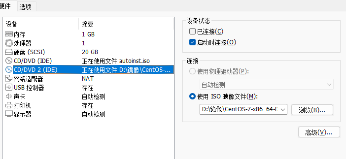
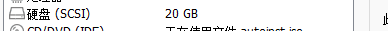
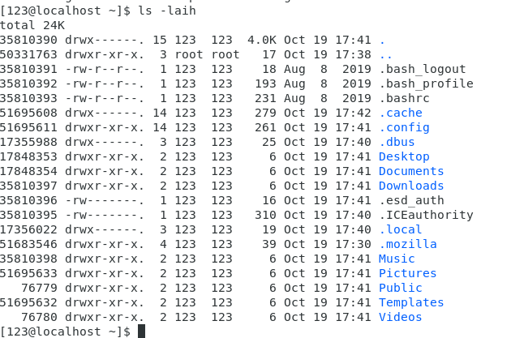

## 一、实验目的及要求

1. 掌握虚拟机的配置过程；
2. 掌握Linux系统的安装过程和简单配置方法；
3. 掌握与Linux相关的多操作系统的安装方法；
4. 掌握Linux系统的启动、关闭步骤；
5. 了解Linux文件系统和目录结构。

## 二、实验原理与内容

1. 安装虚拟机软件（如 VMware、Virtualbox）；
2. 在虚拟机软件中安装 Linux操作系统（如CENTOS 7）；
3. 配置Linux系统运行环境；
4. 正确地启动、关闭系统。

## 三、实验软硬件环境

台式电脑、VMware虚拟机、CENTOS 7以上版本。

## 四、实验过程（实验步骤、记录、数据、分析）

### 1. 安装虚拟机软件（VMware Workstation 6.0）

### 2. 在虚拟机软件中新建Linux虚拟机

#### 2.1 设置内存大小（建议大于256MB）

#### 2.2 设置虚拟硬盘大小（建议大于8GB）

#### 2.3 设置虚拟光驱（虚拟方式，镜像文件）

#### 2.4 设置网络连接模式（建议采用桥接方式）

#### 2.5 设置共享目录（建议英文目录名）

### 3. 在Linux虚拟机中安装Linux操作系统（CENTOS 7）

#### 3.1 选择安装界面

#### 3.2 检测安装介质（建议跳过）

#### 3.3 安装过程中的语言、键盘选择

#### 3.4 磁盘分区（采用自动分区，总大小与2.2相匹配）

#### 3.5 引导程序选择（采用GRUB）

#### 3.6 注意事项（禁用SELinux）

通过相关命令实现对操作系统的登录、退出与关机。

使用文件浏览器查看Linux操作系统目录结构。

## 五、实验结论与体会

### 实验结论

1. 成功完成VMware Workstation 6.0的安装与配置，按要求设置256MB以上内存、8GB以上虚拟硬盘，通过桥接模式实现网络连接，完成CENTOS 7系统安装。
2. 掌握Linux系统基础操作，能通过命令登录、退出及关机，借助文件浏览器清晰了解其目录结构，验证型实验目标全部达成。

### 实验体会

本次实验让我切实掌握Linux安装与启动核心流程，虚拟机配置时的内存、硬盘分配，以及安装中禁用SELinux等细节，让我明白系统操作需严谨。同时也发现自身对Linux命令的熟练度不足，后续会加强练习，为后续Linux应用学习筑牢基础。