## 一、实验目的及要求

1. 了解Shell的原理，熟练掌握利用通配符操作文件；
2. 了解输入/输出的基本原理，熟练掌握各种重定向操作；
3. 掌握管道的基本操作。

## 二、实验原理与内容

1. 不同shell的切换以及内部外部命令的区别；
2. 利用通配符查找文件；
3. 将ls命令的输出重定向到一个新建文件，将某文件的数据重定向到标准输出；
4. 利用管道将命令1的标准输出重定向为命令2的输入。

## 三、实验软硬件环境

台式电脑、VMware虚拟机、CENTOS 7以上版本。

## 四、实验过程（实验步骤、记录、数据、分析）

### 1. Shell及通配符操作

#### 1.1 确定当前用户所使用的shell

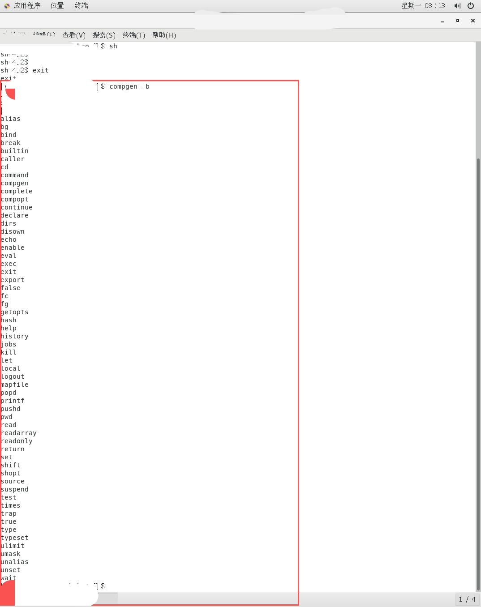

#### 1.2 查看Linux中所有的Shell

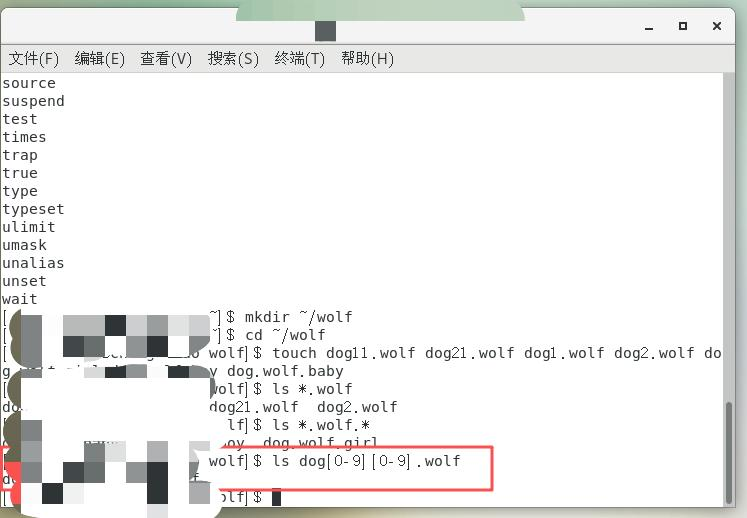

#### 1.3 不同Shell之间的切换

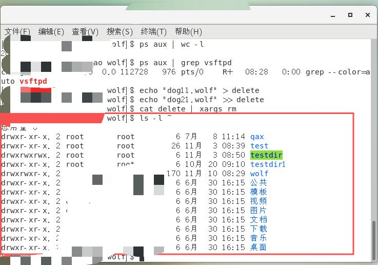

#### 1.4 查看Shell中所有的内部命令

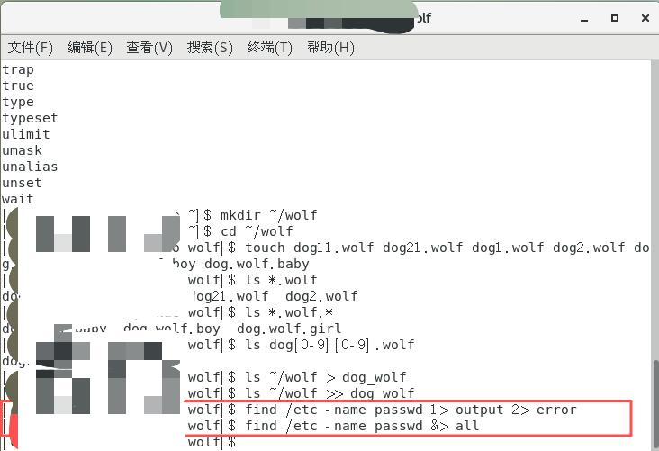

#### 1.5 判断内部还是外部命令

判断ping是内部还是外部命令。

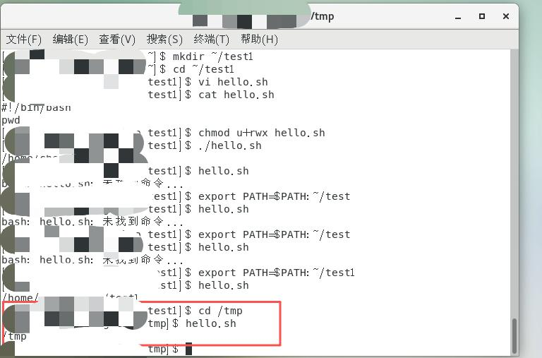

#### 1.6 通配符文件操作

在当前用户的家目录下新建wolf目录，在wolf目录下新建以下文件：

```
dog11.wolf  dog21.wolf  dog1.wolf  dog2.wolf
dog.wolf.girl  dog.wolf.boy  dog.wolf.baby
```


##### 1.6.1 列出所有以".wolf"结尾的文件

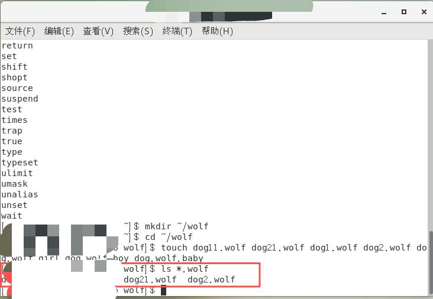

##### 1.6.2 列出文件名中间含有".wolf."的文件

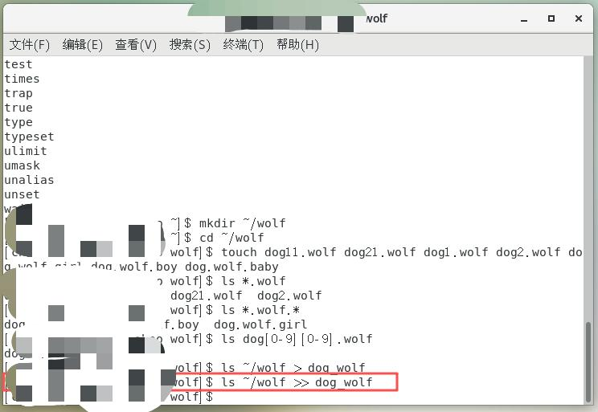

##### 1.6.3 列出以dog开头，两个数字后以".wolf"结尾的文件

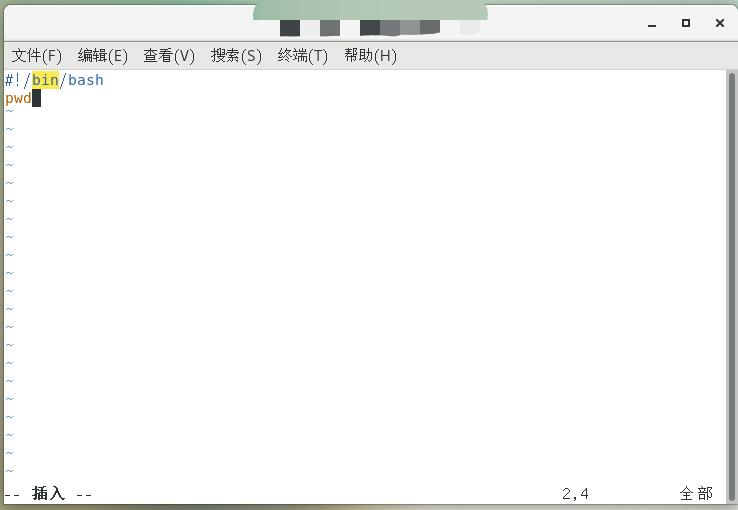

### 2. 重定向操作

#### 2.1 输出重定向（覆盖）

将wolf目录下的文件列表写入dog_wolf文件中。


#### 2.2 追加重定向

再一次将wolf目录下的文件列表添加到dog_wolf文件中。

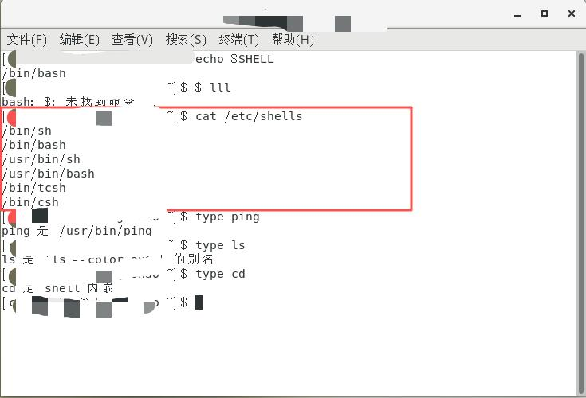

#### 2.3 标准输出与错误重定向

搜索/etc目录下的passwd文件，将标准输出重定向到文件output中，将标准错误重定向到error文件中，将标准输出和标准错误重定向到all文件中。

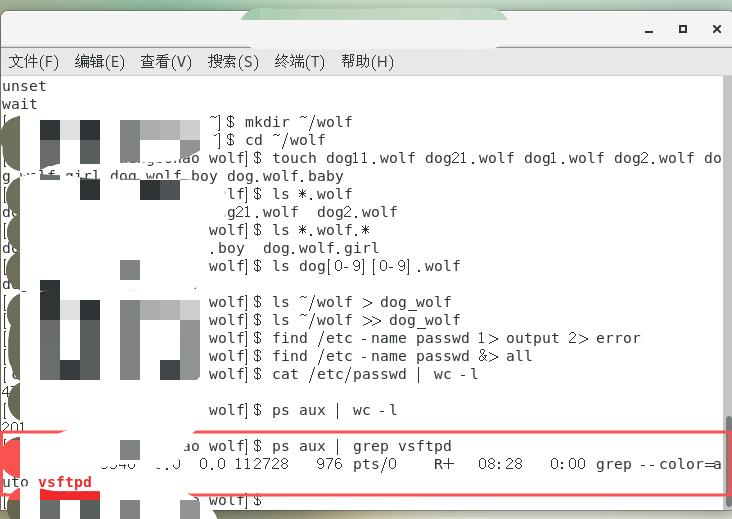

### 3. 管道操作

#### 3.1 统计Linux中所有用户数

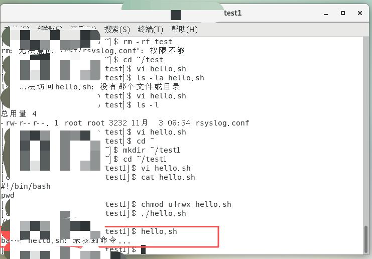

#### 3.2 统计Linux中正在运行的进程数量

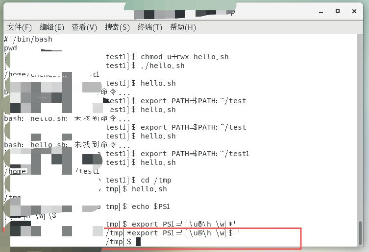

#### 3.3 查看进程中是否包含vsftpd

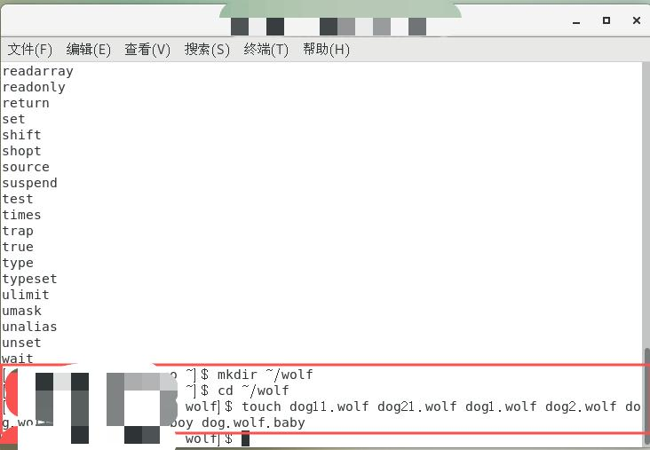

#### 3.4 通过管道删除文件

在wolf目录下新建文件delete，文件中包含dog11.wolf、dog21.wolf，然后通过管道的方式删除此两文件。

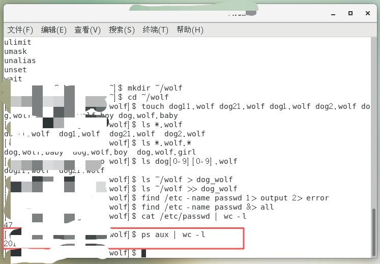

### 4. 管道及cut命令操作

#### 4.1 列出文件及目录信息

使用 `ls -l` 命令列出当前用户家目录下的所有文件及目录信息。

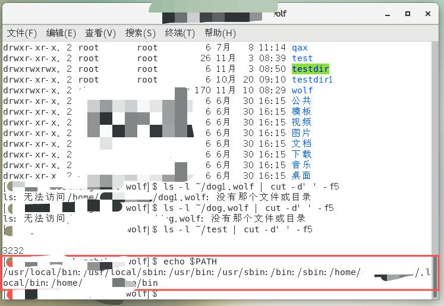

#### 4.2 使用cut提取文件大小

使用cut命令及管道提取出其中某个文件的文件大小。

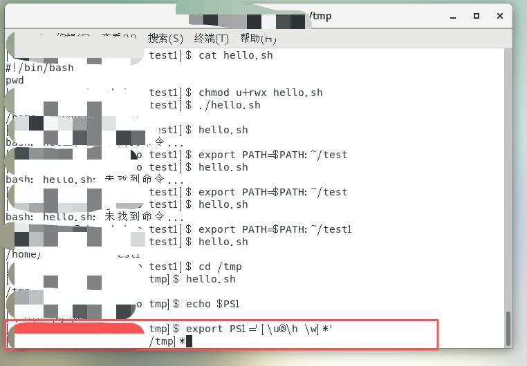

### 5. 环境变量的理解及操作

#### 5.1 查看PATH环境变量

使用 `echo $PATH` 查看环境变量 `$PATH` 的值。

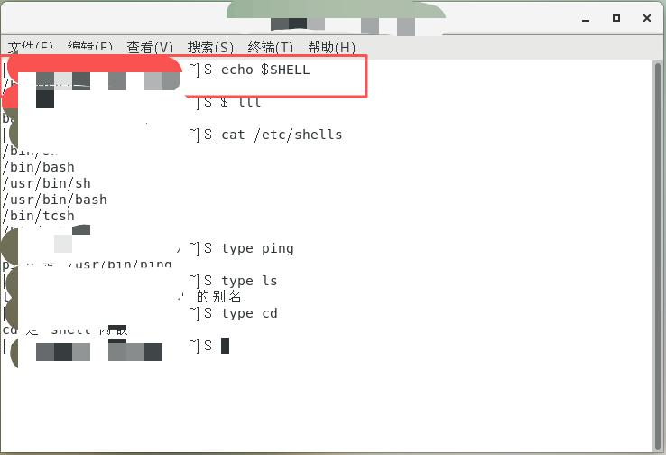

#### 5.2 创建Shell脚本

使用VI编辑器在当前用户的家目录下新建test子目录，并在test目录下使用编辑器新建脚本文件hello.sh，脚本功能为显示当前目录。

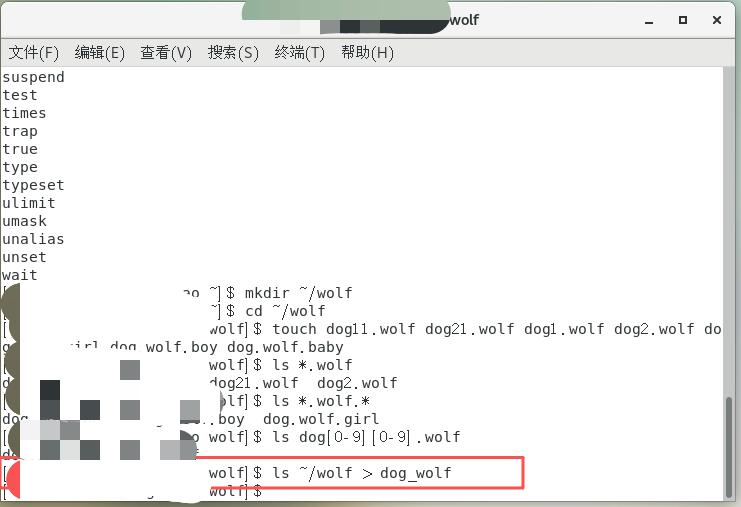

#### 5.3 修改权限并执行

使用 `chmod` 命令修改hello.sh文件属主的权限为可读可写可执行，然后在test目录下使用 `./hello.sh` 执行脚本。

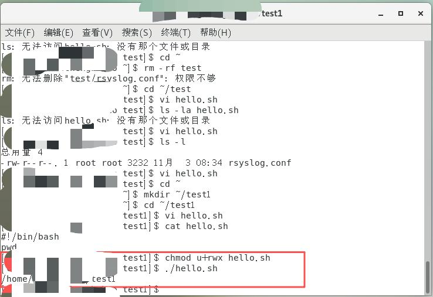

#### 5.4 直接执行脚本测试

在test目录下使用 `hello.sh` 尝试执行脚本，是否可执行？为什么？

> **不可执行**。因为当前目录不在 `$PATH` 中。

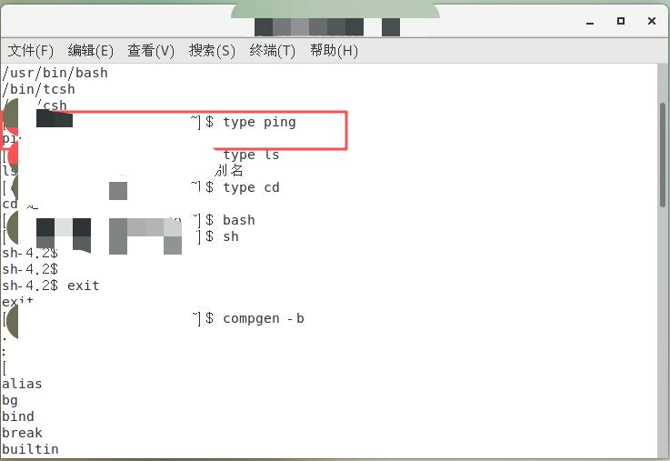

#### 5.5 将目录加入PATH

把目录 `~/test` 加入到环境变量 `$PATH` 中，然后在test目录下执行 `hello.sh` 脚本，是否可以执行？为什么？再换一个另外的其他目录执行 `hello.sh` 脚本，是否可以执行？为什么？

> 把目录 `~/test` 加入到环境变量 `$PATH` 中后，在test目录下执行 `hello.sh` 脚本**可以执行**，因为其所在路径已加入 `$PATH`。

> 再换一个另外的其他目录执行 `hello.sh` 脚本，**也可以执行**，因为 `~/test` 已经添加到 `$PATH` 环境变量中，当在任何目录输入 `hello.sh` 时，系统会在 `$PATH` 包含的所有目录中查找可执行文件，系统会在 `~/test` 目录中找到 `hello.sh` 并执行。

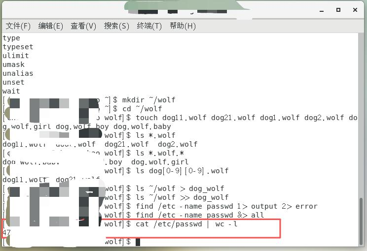

#### 5.6 查看PS1环境变量

使用 `echo $PS1` 查看环境变量 `$PS1` 的值。

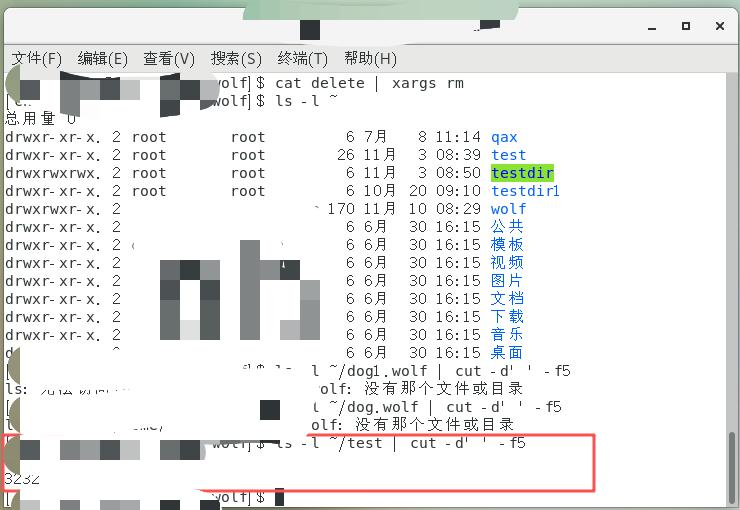

#### 5.7 修改提示符

将当前用户的指示图标 `[user@localhost ~]$` 中的 `$` 换成 `*`。

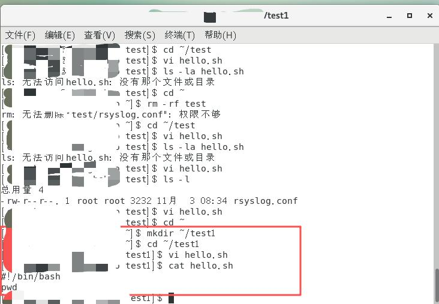

#### 5.8 转换路径显示

将当前用户的相对路径转换成完整的工作目录名称。

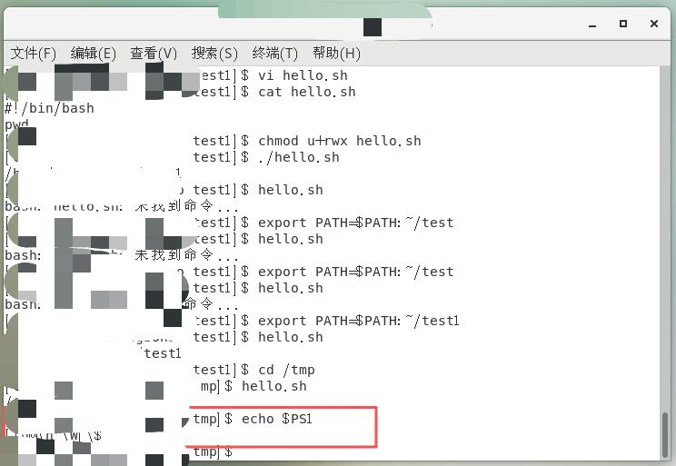

## 五、实验结论与体会

### 实验结论

1. **Shell通配符操作**：通配符（`*`、`?`、`[]`）是Shell中强大的文件匹配工具，能够高效地进行批量文件操作，显著提高了文件管理效率。

2. **重定向机制**：
   - 标准输出重定向（`>`）会覆盖目标文件，而追加重定向（`>>`）会在文件末尾添加内容
   - 标准错误重定向（`2>`）可以分离正常输出和错误信息
   - 合并重定向（`&>`）便于统一处理所有输出信息

3. **管道操作**：管道（`|`）是Unix哲学的核心体现，通过将多个简单命令组合，可以完成复杂的数据处理任务，体现了"组合优于复杂"的设计理念。

4. **环境变量配置**：
   - `$PATH` 环境变量决定了系统查找可执行文件的路径顺序
   - 将自定义脚本目录加入 `$PATH` 后，可以在任意位置直接调用脚本
   - `$PS1` 变量可以自定义Shell提示符的显示格式

### 实验体会

1. **命令组合的威力**：通过管道将 `grep`、`wc`、`cut` 等命令组合使用，展现了Linux"小工具组合成大功能"的设计哲学。

2. **权限管理的重要性**：在脚本执行过程中深刻体会到Linux权限系统的严谨性，正确的权限设置是脚本正常运行的前提。

3. **环境变量的实用性**：理解了环境变量在系统配置中的关键作用，合理配置环境变量可以极大提高工作效率。

4. **VI编辑器的熟练度**：通过反复练习，加深了对VI编辑器模式切换和基本操作的理解，提高了在命令行环境下的文本编辑能力。

5. **问题排查能力**：在遇到"无法打开并写入文件"等错误时，学会了通过检查权限、路径和文件状态来定位和解决问题。

### 学习收获

本次实验不仅巩固了Shell基础操作的理论知识，更重要的是通过动手实践加深了对Linux系统工作原理的理解。特别是管道和重定向的概念，为后续学习更复杂的Shell脚本编程打下了坚实基础。同时，对环境变量的配置和管理有了更深入的认识，这对日常的Linux系统使用和维护都具有重要意义。