## 一、实验目的及要求

1. 了解shell 的作用和主要分类。
2. 掌握shell环境变量、管道、输入输出重定向的使用方法。
3. 掌握shell脚本的建立和执行方式。
4. 熟悉shell脚本的基本结构。

## 二、实验原理与内容

1. 使用shell变量、位置参数和环境变量；
2. 建立shell脚本并执行；
3. 使用shell一般控制结构编写脚本。

## 三、实验软硬件环境

电脑、VMware虚拟机、CENTOS 7以上版本。

## 四、实验过程（实验步骤、记录、数据、分析）

### 1. 了解Shell变量、位置参数和环境变量

#### 1.1 变量定义与引用

输入以下命令，记录输出结果并分析：

```bash
$ dir=/root
$ echo $dir
$ echo dir
```

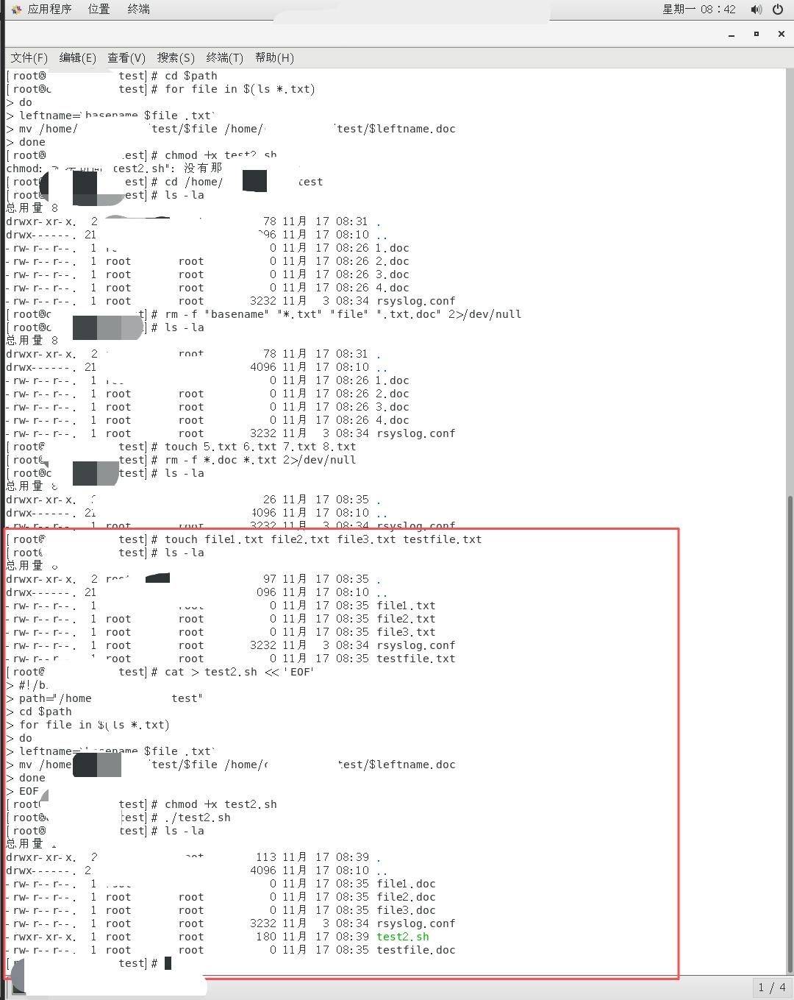

#### 1.2 read命令和位置参数

输入以下命令，记录输出结果并分析：

```bash
$ read a b c d
$ www lingnan edu cn
$ echo "Web : $a. $b. $c. $c$d"
```

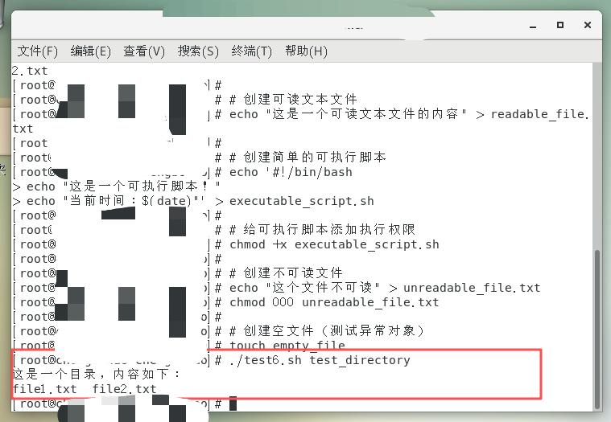

### 2. 建立简单Shell脚本文件

#### 2.1 批量文件重命名脚本test2.sh

新建Shell脚本文件test2.sh，在 `/home/user/自定义` 目录下新建数个文件名后缀为 `*.txt` 的文件，编辑如下脚本程序：

```bash
#!/bin/bash
path="/home/user/自定义"
cd $path
for file in $(ls *.txt)
do
    leftname=`basename $file .txt`
    mv /home/user/自定义/$file /home/user/自定义/$leftname.doc
done
```

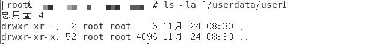

### 3. 简单Shell脚本文件改良

#### 3.1 改良版脚本test3.sh

新建shell脚本test3.sh，编辑内容如下：

```bash
#!/bin/bash
cd $1
for file in $(ls *.txt)
do
    leftname=`basename $file .txt`
    mv $1/$file $1/$leftname.doc
done
```

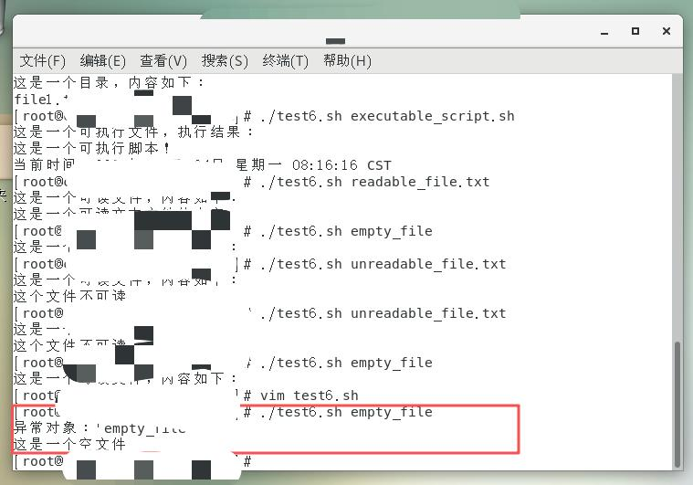

#### 3.2 test2与test3对比分析

**test2.sh 各行说明**：

| 代码 | 作用 |
|------|------|
| `#!/bin/bash` | 指定脚本解释器，告诉系统使用 `/bin/bash` 来执行脚本 |
| `path="/home/user/自定义"` | 定义变量path，设置为要处理的目录路径 |
| `cd $path` | 改变当前工作目录到 `$path` 变量指向的路径 |
| `for file in $(ls *.txt)` | 开始for循环，遍历所有.txt文件 |
| `leftname=\`basename $file .txt\`` | 获取文件的基本名（去掉.txt后缀） |
| `mv /home/user/自定义/$file ...` | 重命名文件，将.txt改为.doc |
| `done` | for循环结束标记 |

**test2.sh 与 test3.sh 的区别**：

- test2.sh 使用硬编码路径，只能处理固定目录
- test3.sh 使用位置参数 `$1`，可处理任意通过命令行参数传入的目录，更加灵活通用

### 4. 随机数生成脚本test4.sh

```bash
#!/bin/bash
function rand(){
    min=$1
    max=$(($2-$min+1))
    num=$(($RANDOM+1000000000))    #增加一个10位的数再求余
    echo $(($num%$max+$min))
}
rnd=$(rand 400000 500000)
echo $rnd
```


> **脚本功能说明**：生成一个介于 400,000 到 500,000 之间（包含两端）的随机整数。

### 5. 进程检测脚本test5.sh

设计脚本程序，判断Linux计算机上是否正在运行sshd进程，如果该进程正在运行，则显示"running"，如果不在运行则显示"not running"。

```bash
#!/bin/bash
ps_out=`ps -ef | grep $1 | grep -v 'grep' | grep -v $0`
result=$(echo $ps_out | grep "$1")
if [ "$result" != "" ];then
    echo "Running"
else
    echo "Not Running"
fi
```

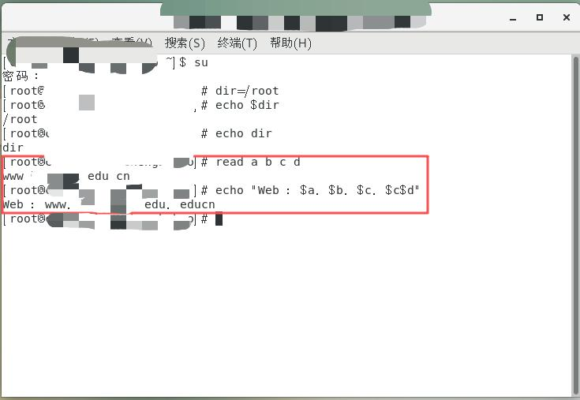

### 6. 文件类型智能识别脚本test6.sh

编写一个shell脚本程序，它能根据输入的命令行参数采取不同的动作：
- 如果是目录，则列出该目录中的文件
- 如果是可执行的文件，则用shell执行之
- 如果是可读的文件，则cat显示其内容
- 如果不是以上三种类型，则显示"异常对象"

```bash
#!/bin/bash
if [ -d "$1" ]; then
    ls "$1"                    # 如果是目录，列出目录中的文件
elif [ -x "$1" ]; then
    ./"$1"                     # 如果是可执行文件，用shell执行
elif [ -r "$1" ]; then
    cat "$1"                   # 如果是可读文件，cat显示内容
else
    echo "异常对象"             # 其他类型，显示异常
fi
```

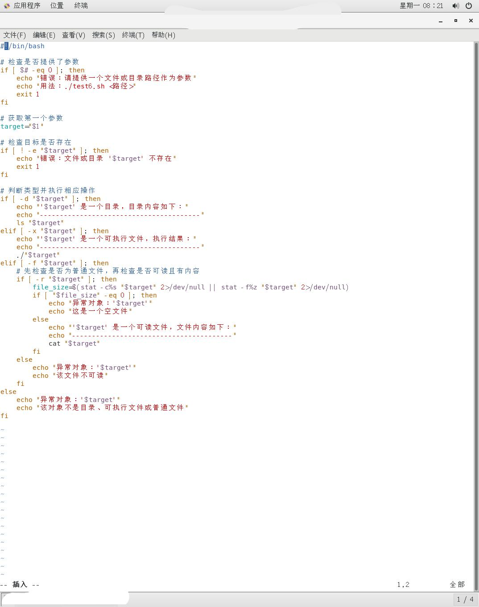

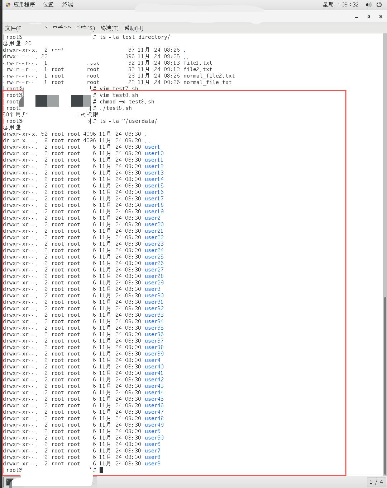

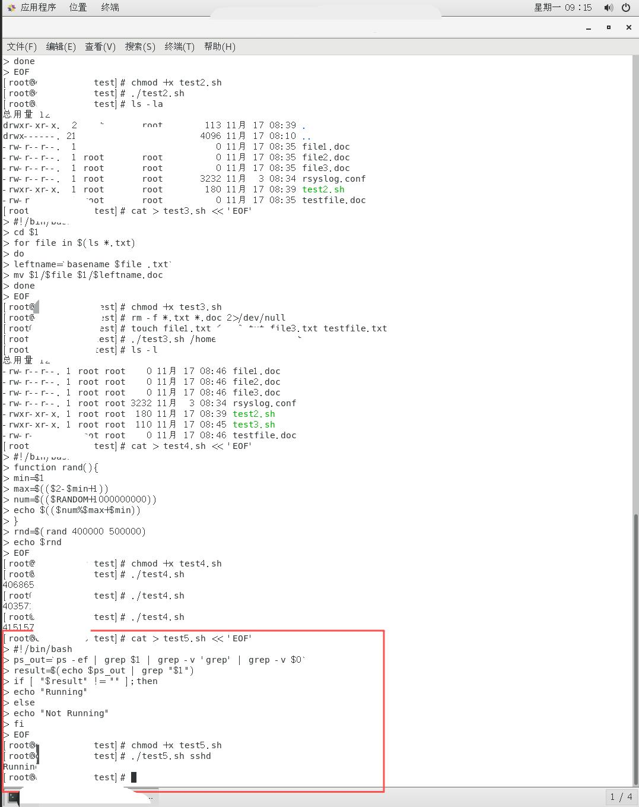

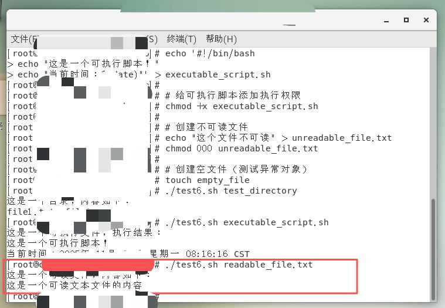

### 7. 空文件删除脚本test7.sh

设计脚本程序，删除指定目录下文件大小为0的文件。

**设计步骤**：
1. 使用for循环列出指定目录下所有对象
2. 判断变量列出的对象是不是普通文件
3. 如果是普通文件，通过 `ls -l $file | cut -f5 -d" "` 获取文件大小
4. 如果文件大小为0则删除该文件

```bash
#!/bin/bash
for file in $(ls "$1"); do
    if [ -f "$1/$file" ]; then
        size=$(ls -l "$1/$file" | cut -f5 -d" ")
        if [ "$size" = "0" ]; then
            rm "$1/$file"
            echo "已删除空文件: $file"
        fi
    fi
done
```

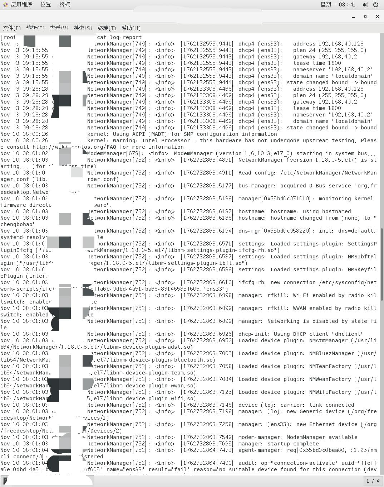

### 8. 批量创建用户目录脚本test8.sh

在家目录下建立userdata文件夹，然后自动创建50个文件夹（user1～user50），并设置权限：
- 其他用户权限：读
- 文件所有者权限：读、写、运行
- 文件所有者所在组权限：读、运行

```bash
#!/bin/bash
mkdir -p ~/userdata
cd ~/userdata
for i in $(seq 1 50); do
    mkdir user$i
    chmod 754 user$i
done
```

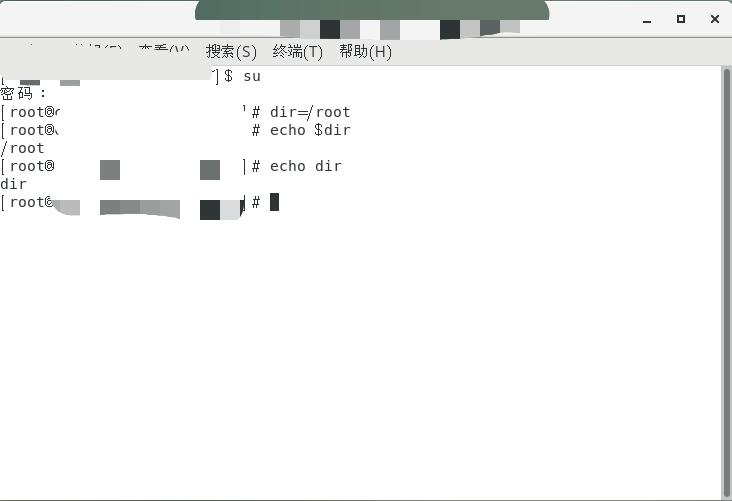

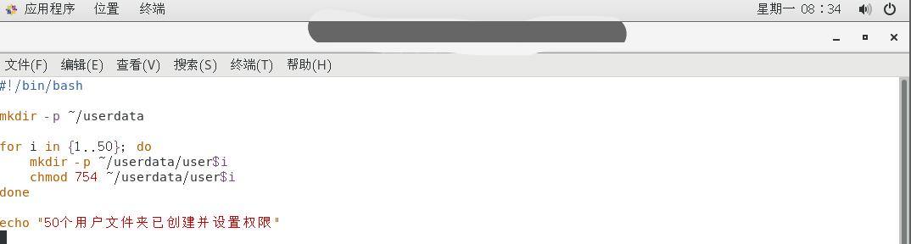

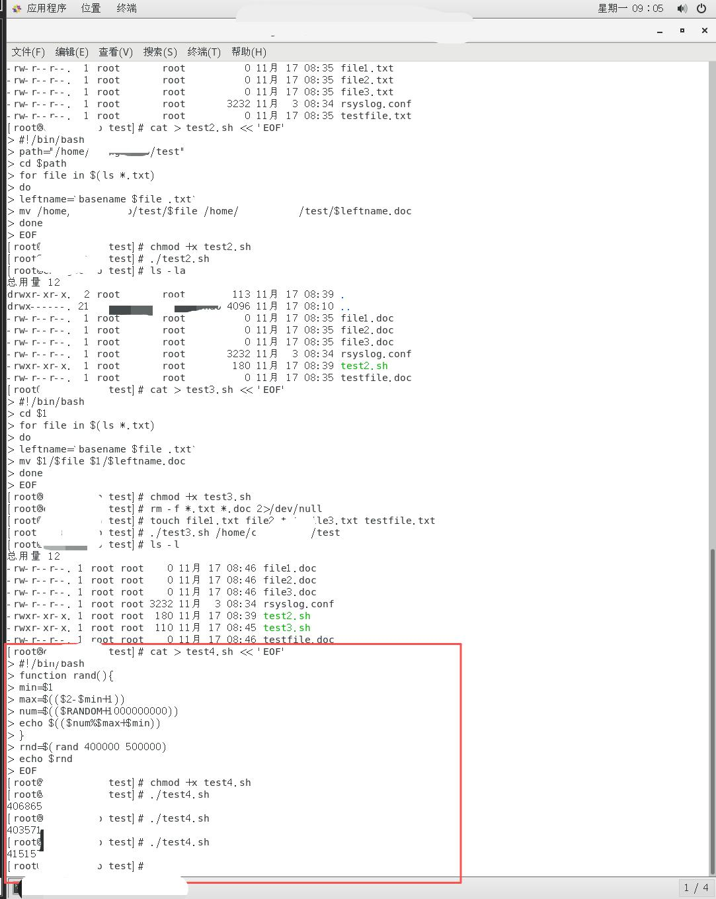

### 9. 日志分析脚本test9.sh

编写脚本接受一个日志文件路径（`/var/log/messages`）和一个关键词（"info"）作为预定义参数：
1. 统计并输出该关键词在日志文件中出现的总次数
2. 输出日志文件包含该关键词的所有行，并保存到新文件log-report中

```bash
#!/bin/bash
logfile=$1
keyword=$2
count=$(grep -c "$keyword" "$logfile")
echo "关键词 '$keyword' 在日志中出现了 $count 次。"
grep "$keyword" "$logfile" > log-report
echo "相关行已保存至 log-report中。"
```

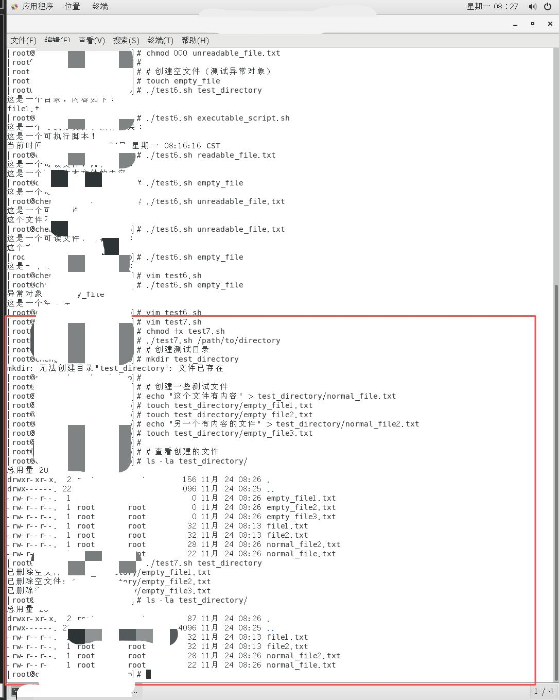

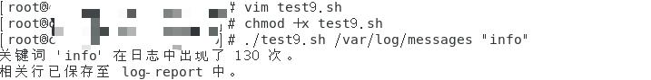

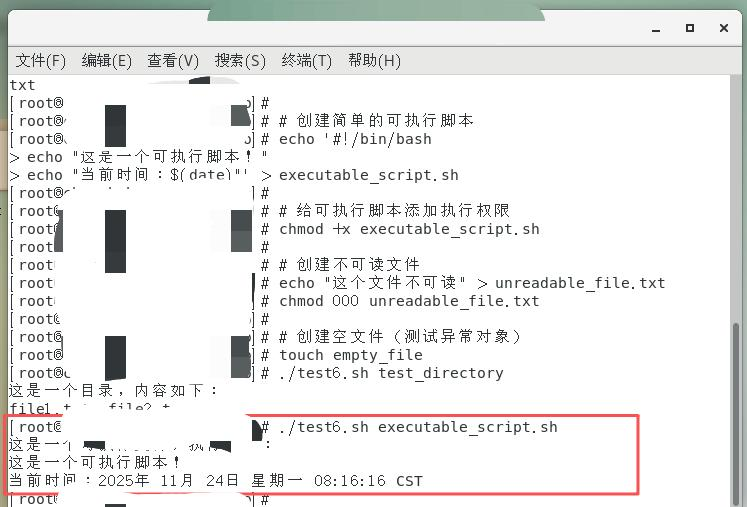

### 10. 简易计算器脚本test10.sh

按如下要求设计简易计算器脚本：

```bash
#!/bin/bash
while true; do
    echo "简易计算器请选择操作:"
    echo "1. 加法"
    echo "2. 减法"
    echo "3. 乘法"
    echo "4. 除法"
    echo "5. 退出"
    read -p "请输入选择 (1-5): " choice
    case $choice in
        1) read -p "请输入第一个数字: " a
           read -p "请输入第二个数字: " b
           echo "计算结果为: $a + $b = $(($a+$b))" ;;
        2) read -p "请输入第一个数字: " a
           read -p "请输入第二个数字: " b
           echo "计算结果为: $a - $b = $(($a-$b))" ;;
        3) read -p "请输入第一个数字: " a
           read -p "请输入第二个数字: " b
           echo "计算结果为: $a * $b = $(($a*$b))" ;;
        4) read -p "请输入第一个数字: " a
           read -p "请输入第二个数字: " b
           echo "计算结果为: $a / $b = $(($a/$b))" ;;
        5) echo "退出计算器"; exit 0 ;;
        *) echo "无效选择，请重新输入" ;;
    esac
done
```

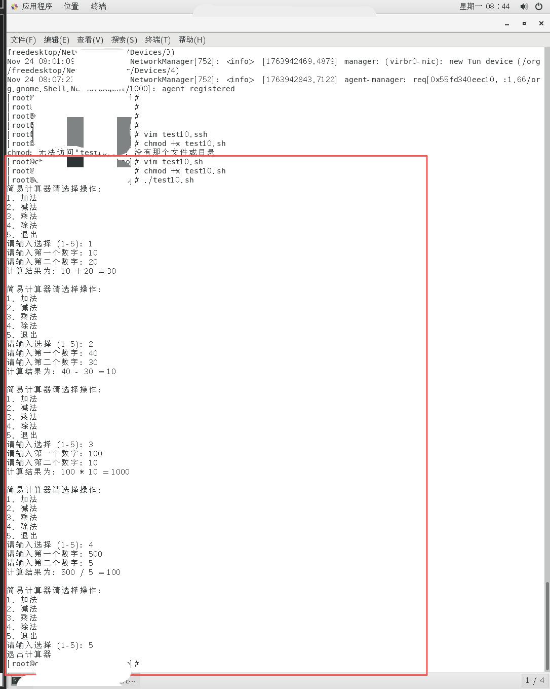


## 五、实验结论与体会

### 实验成果总结

1. **Shell变量与环境变量**：掌握了变量的定义、引用和使用方法，理解了位置参数（$1, $2...）和环境变量的作用机制。

2. **Shell脚本基础结构**：熟悉了Shell脚本的基本结构，包括shebang（#!/bin/bash）、注释、变量定义、流程控制等要素。

3. **文件操作与权限管理**：成功实现了文件类型判断、内容读取、执行等操作，掌握了目录创建、文件重命名、权限设置（chmod）等关键命令，理解了Linux文件权限系统（755、754等数字权限的含义）。

4. **流程控制结构**：熟练运用if-else条件判断进行文件类型检测和错误处理，使用for循环批量创建文件和目录，实现了while循环的菜单交互功能。

5. **文本处理能力**：使用grep进行关键词搜索和统计，掌握管道（|）和重定向（>）的使用，实现了日志分析、文件过滤等实用功能。

### 技术亮点

- **test6.sh**：实现了智能文件类型识别，能够根据不同的文件类型执行相应操作
- **test7.sh**：通过文件大小检测和自动删除，展示了Shell在系统管理中的实用性
- **test8.sh**：批量创建目录并设置权限，体现了Shell在自动化运维中的高效性
- **test9.sh**：日志分析和报告生成，展示了Shell在数据处理方面的能力
- **test10.sh**：交互式计算器，体现了Shell在用户界面设计方面的灵活性

### 遇到的问题与解决方案

1. **权限问题**：在访问系统日志文件时遇到权限限制，通过文件复制和权限修改解决。
2. **空文件判断**：最初将空文件误判为可读文件，通过添加文件大小检测完善了逻辑。
3. **参数验证**：学会了在脚本开头进行参数数量和有效性的检查，提高脚本的健壮性。
4. **错误处理**：添加了详细的错误提示和退出机制，使脚本更加用户友好。

### 学习体会

通过亲手编写和调试每个脚本，深刻体会到：理论与实践结合的重要性——只有通过实际编码，才能真正掌握Shell编程技巧；细节决定成败——一个空格、一个符号的错误都可能导致脚本失败；调试能力的提升——学会了使用echo调试、错误信息分析等方法；问题解决能力的增强——面对错误时，能够独立思考并寻找解决方案。