## 一、实验目的及要求

1. 了解Linux磁盘操作管理原理和方法。
2. 掌握FTP服务配置过程。
3. 掌握Apache服务器配置过程。

## 二、实验原理与内容

1. 使用磁盘操作的相关命令；
2. 使用FTP服务配置的相关命令；
3. 掌握WEB服务器配置的相关操作。

## 三、实验软硬件环境

台式电脑、VMware虚拟机、CENTOS 7.0以上版本。

## 四、实验过程（实验步骤、记录、数据、分析）

### 1. U盘挂载操作（NTFS文件系统格式）

#### 1.1 查看U盘设备名

插入U盘，使用 `fdisk -l` 命令查看U盘设备名。


#### 1.2 挂载U盘

使用 `mount` 命令挂载U盘。


#### 1.3 查看U盘数据

进入到 `/mnt` 目录，查看是否有U盘的数据文件。

### 2. FTP服务器及客户端的配置

#### 2.1 安装FTP服务器端

##### 2.1.1 查看vsftpd是否安装

```bash
rpm -qa | grep vsftpd
```

如果没安装，使用 `yum install vsftpd` 安装FTP服务器端，再使用 `yum install ftp` 安装FTP客户端。

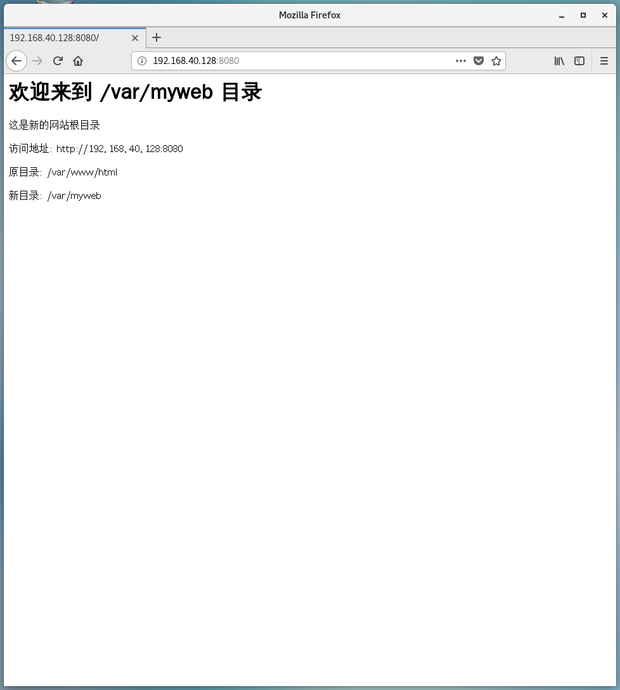

##### 2.1.2 启动FTP服务器

```bash
systemctl start vsftpd
```

然后使用 `ps -ef | grep vsftpd | grep -v grep` 查看FTP服务器是否启动。

**检查服务状态的方法**：

```bash
sudo systemctl status vsftpd
# 或
ps -ef | grep vsftpd | grep -v grep
# 或
netstat -tuln | grep :21
```

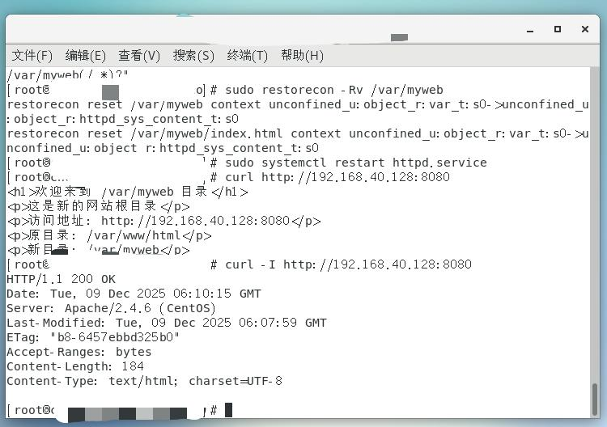

##### 2.1.3 本地用户登录FTP

使用服务器本地用户名登录FTP服务器，查看登录FTP服务器之后所在的目录。

```bash
ftp 127.0.0.1
```

> 注意是使用本地用户！

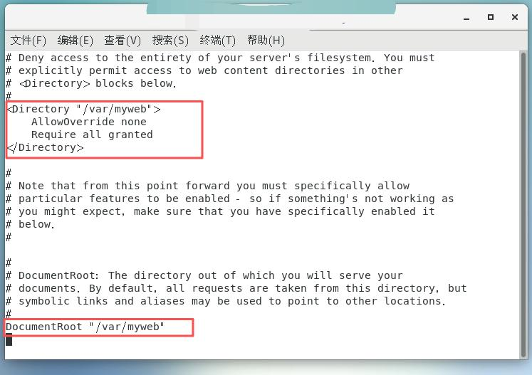

##### 2.1.4 匿名用户登录FTP

使用匿名用户登录FTP服务器，查看登录之后所在的目录。

```bash
ftp 127.0.0.1
```

> 用户名为anonymous和ftp

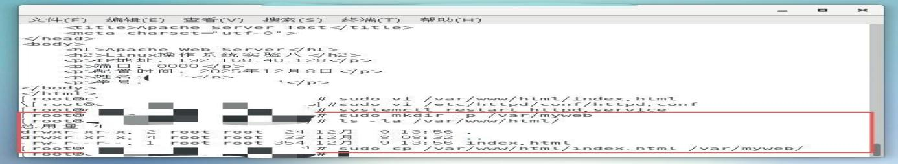

#### 2.2 修改匿名用户默认目录

修改FTP服务器的配置文件，使得匿名用户登录FTP服务器后的工作目录从 `/var/ftp` 变为 `/srv/anonyhome`。

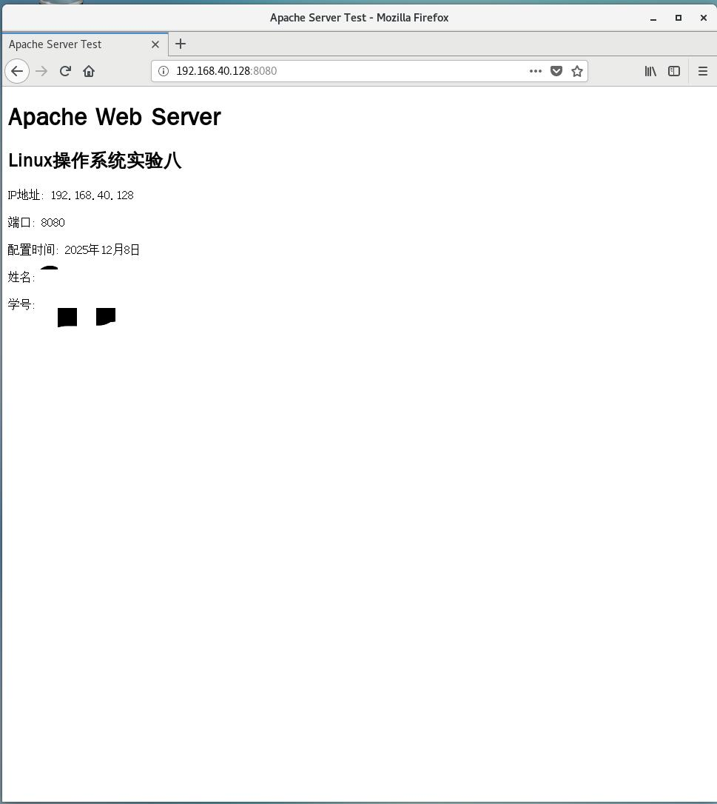

#### 2.3 匿名用户下载文件测试

在目录 `/srv/anonyhome` 创建几个文件，使用匿名用户登录后使用 `get` 命令下载文件到本地机器。

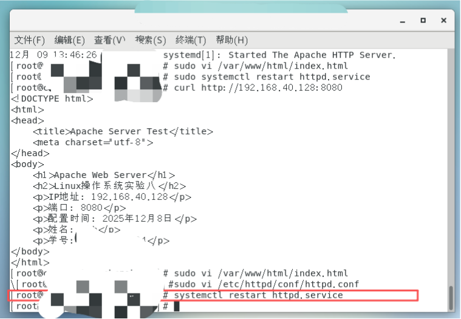

### 3. Apache服务器的配置和管理

#### 3.1 Apache服务器基本配置

##### 3.1.1 查看httpd是否安装

```bash
rpm -qa | grep httpd
```

如果没有安装，则使用命令 `yum install httpd` 安装（需提前配置好yum命令的配置文件）。

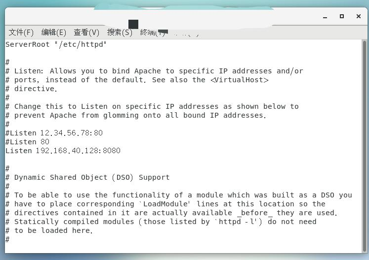

##### 3.1.2 启动httpd服务

```bash
systemctl start httpd.service
```

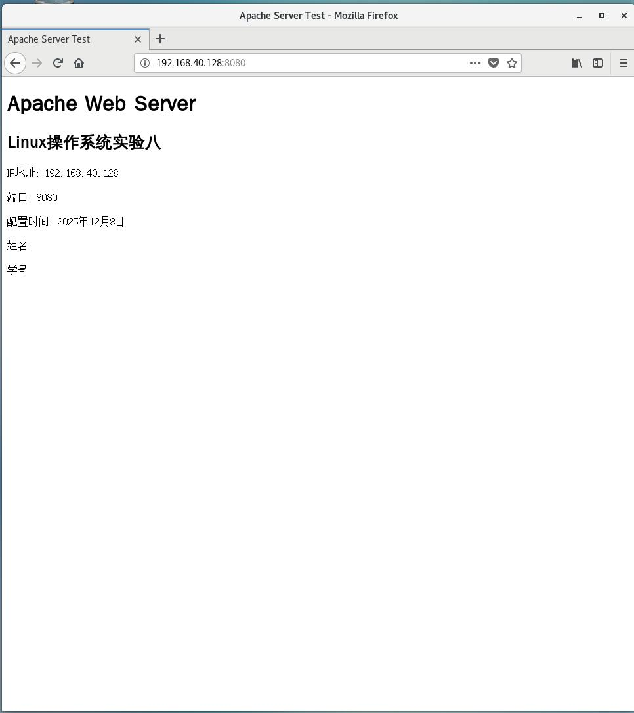

##### 3.1.3 设置httpd服务为自动启动

```bash
chkconfig httpd on
```

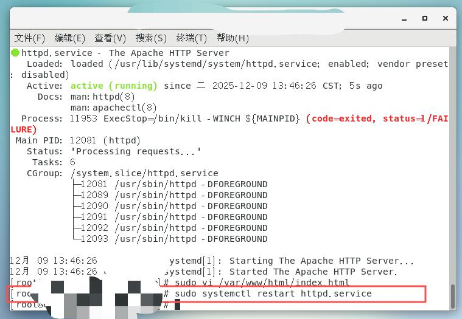

##### 3.1.4 编辑Apache主配置文件

编辑 `/etc/httpd/conf/httpd.conf`，关键配置说明如下：

| 配置项 | 说明 |
|--------|------|
| `ServerRoot "/etc/httpd"` | Apache的工作目录，不需修改 |
| `KeepAlive On` | 修改为On，使得一次TCP连接可以传输多个文件 |
| `Listen IP地址:8080` | 修改HTTP服务监听IP地址和端口号 |
| `Include conf.d/*.conf` | 附加配置文件，不需修改 |
| `ServerAdmin root@localhost` | 管理员邮箱，可修改为自己的邮箱 |
| `ServerName IP地址:80` | 设置服务器名称 |
| `DocumentRoot "/var/www/html"` | 网站文档主目录，建议保留 |

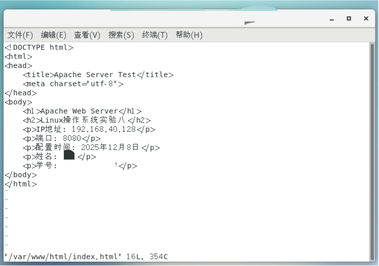

##### 3.1.5 设置主页文件内容

```bash
vi /var/www/html/index.html
```

添加主页文件，随意输入内容。

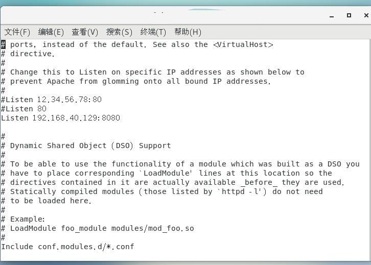

##### 3.1.6 重启Apache服务器

```bash
systemctl restart httpd.service
```

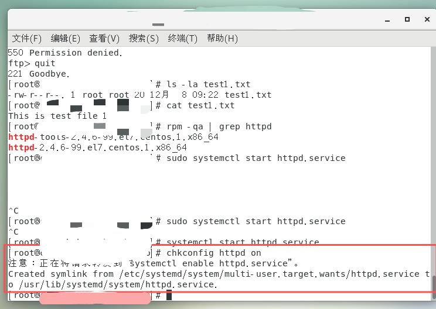

#### 3.2 测试httpd服务

##### 3.2.1 浏览器访问主页

在操作系统中利用浏览器访问 `http://本机IP地址`，测试能否显示主页文件index.html。

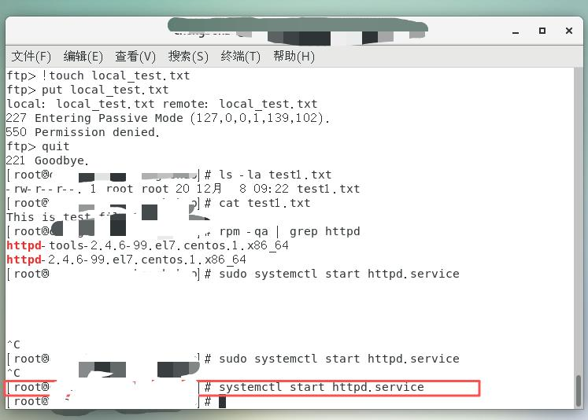

##### 3.2.2 修改监听端口

重新编辑主配置文件，修改监听端口：

```
Listen 本机IP地址:8080
```

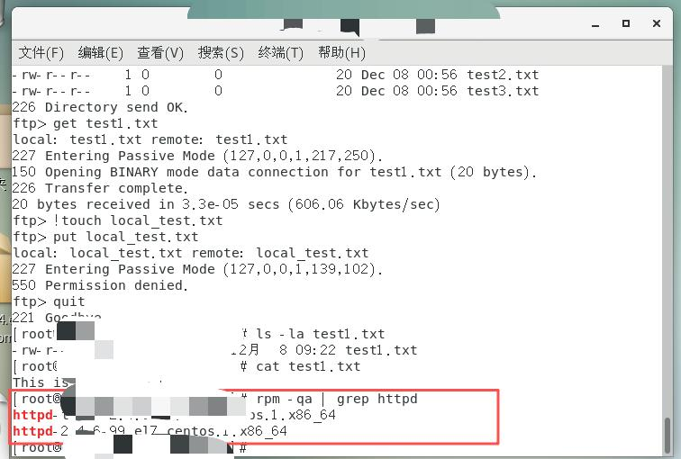

##### 3.2.3 重启Apache

```bash
systemctl restart httpd.service
```

##### 3.2.4 访问新端口

访问 `http://本机IP地址:8080/`，测试能否显示主页文件index.html。

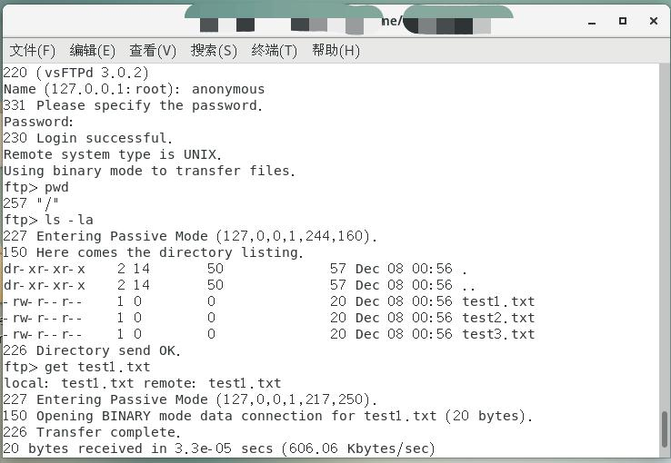

#### 3.3 修改网站根目录

在 `/var` 目录下新建myweb子目录，然后把 `/var/www/html` 的index.html文件转移至 `/var/myweb` 目录，修改配置文件使得访问 `http://本机IP地址:8080/` 可以访问网页。

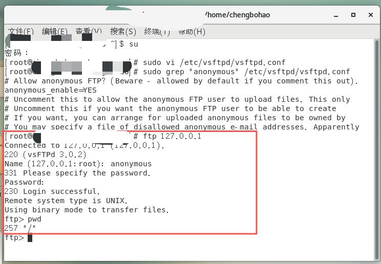

## 五、实验结论与体会

### 实验结论

**1. U盘挂载与管理**
- 成功识别NTFS格式U盘设备（/dev/sdb1）
- 掌握 `mount`、`umount`、`fdisk -l` 等磁盘管理命令
- 理解不同文件系统（NTFS、FAT32）在Linux下的挂载差异
- 解决了U盘因Windows快速启动导致的挂载冲突问题

**2. FTP服务器配置**
- 安装并配置了vsftpd服务器
- 实现本地用户和匿名用户两种登录方式
- 成功修改匿名用户默认工作目录（`/var/ftp` → `/srv/anonyhome`）
- 掌握了FTP权限配置、目录权限管理和SELinux上下文设置
- 通过实际文件传输测试验证了服务可用性

**3. Apache Web服务器配置**
- 完成httpd服务的安装、启动和开机自启配置
- 掌握Apache主配置文件（httpd.conf）关键参数修改：
  - 监听地址和端口配置（`Listen 192.168.40.128:8080`）
  - 服务器名称设置（`ServerName`）
  - 文档根目录修改（`DocumentRoot "/var/myweb"`）
- 成功修改网站根目录并解决SELinux权限问题
- 通过curl和浏览器测试验证Web服务正常运行

**4. 系统调试能力**
- 网络故障排查（IP地址变化、网络不可达）
- 服务启动失败诊断（端口冲突、配置文件错误）
- SELinux策略调整与防火墙配置
- 系统日志分析（journalctl、/var/log/目录）

### 实验体会

**技术收获**：将课堂学习的Linux服务管理理论应用于实际操作，加深了对服务启动流程、配置文件作用的理解。

**问题解决能力**：实验中遇到多个实际问题（网络配置、IP变化、SELinux限制、权限冲突），通过查阅资料、分析日志、逐步排查，最终解决了所有问题，提升了系统调试能力。

**安全意识**：认识到Linux系统安全机制的重要性，特别是SELinux和防火墙在服务配置中的关键作用。学会了如何在安全性和便利性之间取得平衡。

**服务配置规范性**：掌握了标准化的服务配置流程：安装 → 配置 → 权限设置 → SELinux/防火墙 → 测试 → 文档记录。