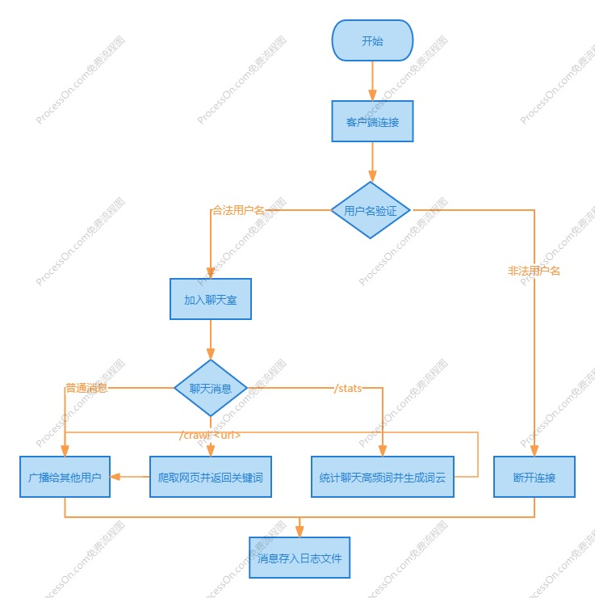
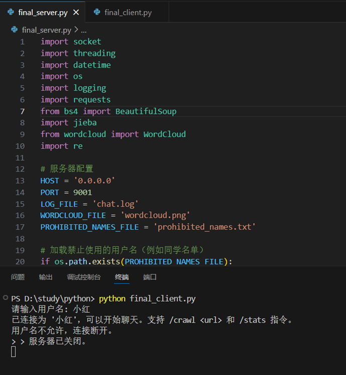
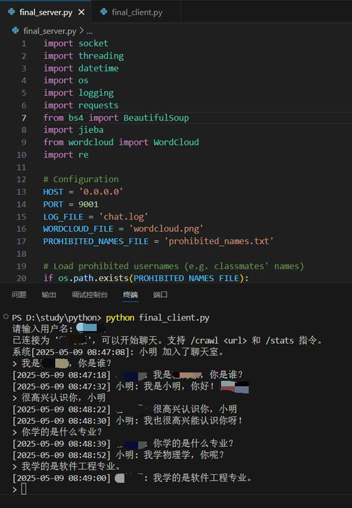
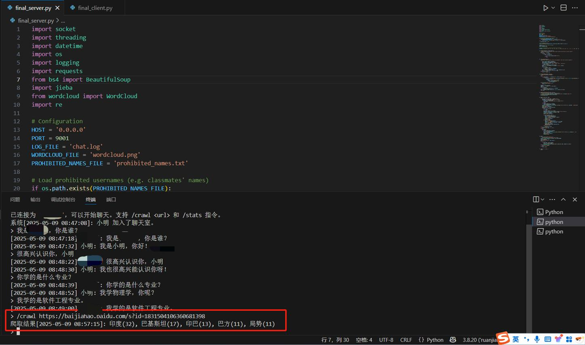
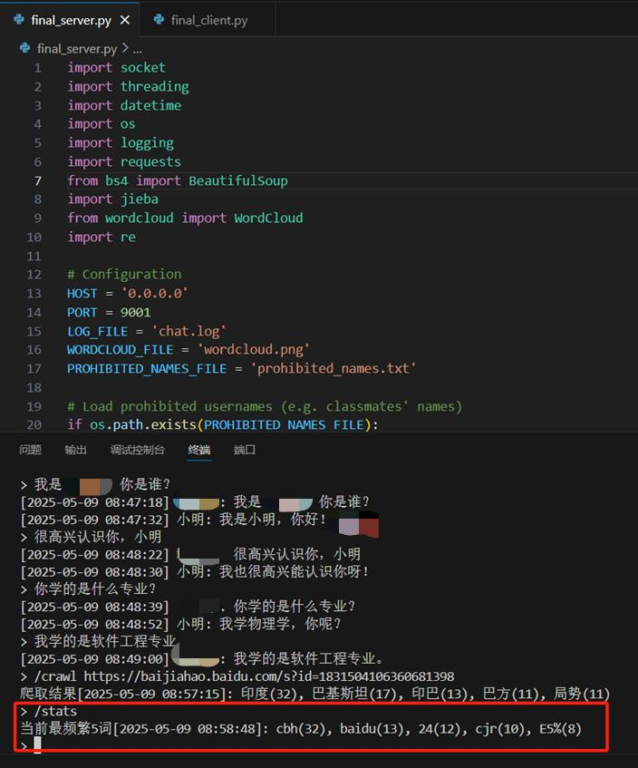
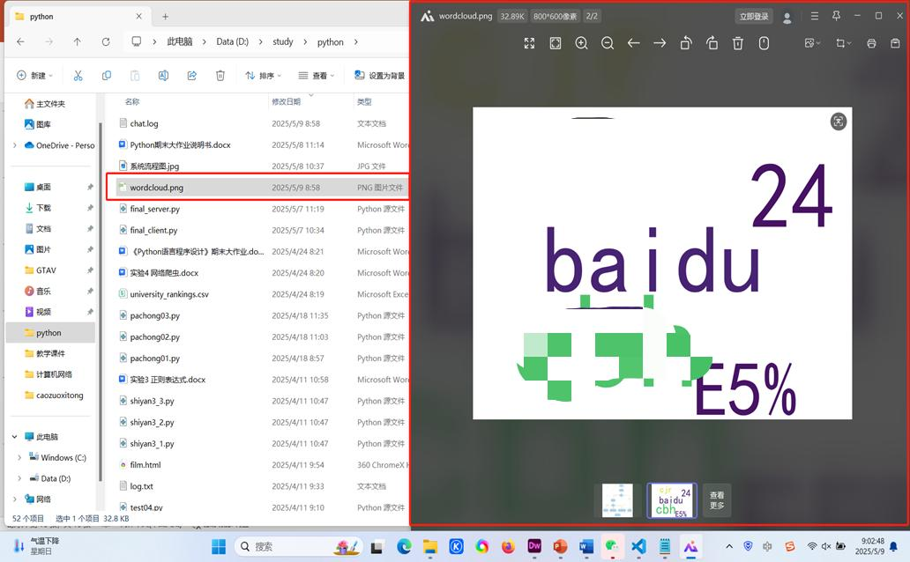

《Python语言程序设计》期末综合大作业说明书

作品评阅成绩表

# 1 技术综述

本项目是基于Python语言的网络聊天系统，融合了多种Python相关技术，包括：

Python基本语法：变量定义、基本运算、字符串处理、输入输出等基本语法要素。实现用户交互、数据格式化处理。

基本数据类型：字符串：用于处理聊天消息、用户名以及系统通知。列表：存储客户端连接。字典：记录用户名与对应的连接。

程序的控制结构：条件判断：处理客户端连接请求、用户名过滤。循环结构：实现聊天信息的实时接收与广播。

函数和代码复用：采用函数封装各功能模块，简化代码结构。包含消息广播、用户验证、日志记录等。

组合数据类型：列表：存储在线用户列表。字典：存储用户与连接的映射关系。

文件和数据格式化：文件读写：保存聊天记录到 chat.log 文件。词云图生成：使用 WordCloud 库生成词频可视化图。

正则表达式：re 库用于解析聊天内容，提取用户消息。

对象式程序设计：面向对象的模块化设计，优化了系统结构。

网络爬虫：requests 库用于实现基本网页爬取。BeautifulSoup 用于解析 HTML 文档，提取有价值的信息。

Python多线程编程技术：threading 模块实现多客户端并发处理。

Socket编程：socket 库实现TCP网络通信。

# 2 系统流程设计

## 2.1 系统架构

客户端通过Socket连接服务器，进行用户名验证后进入聊天室。

服务器负责接收并转发消息，处理命令（/crawl和/stats），并将聊天记录存入本地文件。

## 2.2 系统流程详细说明

2.2.1.客户端连接阶段

·客户端启动后尝试连接服务器，建立TCP连接。

·服务器接受连接请求，创建一个新的线程处理该客户端连接。

·服务器向客户端发送用户名输入提示。

·客户端输入用户名，并将其发送给服务器。

·服务器检查用户名是否在禁用名单中，如果合法则允许加入聊天室。（禁用名单文件：prohibited_names.txt）

2.2.2.消息处理阶段

·普通消息：

·用户输入普通消息后，服务器接收并记录到 chat.log 文件。

·消息格式：[时间戳] 用户名: 消息内容。

·服务器将该消息广播给其他在线用户。

·爬虫指令：

·以 /crawl <URL> 格式的指令会触发服务器对指定 URL 进行网页爬取。

·服务器抓取网页正文并统计前5个高频词，结果广播给所有在线用户。

·词频统计指令：

·以 /stats 触发服务器统计当前聊天记录中的高频词。

·生成词云图，并将统计结果广播给所有在线用户。

2.2.3.断开连接阶段

·客户端主动断开或意外断开连接后，服务器会清理该客户端的相关资源。

·向其他在线用户广播用户离线消息，并从在线用户列表中移除。

## 2.3 系统流程图

系统流程图如图1所示。

图1 系统流程图

# 3  系统详细设计分析

## 3.1 用户连接与验证

### 3.1.1 功能

验证用户名合法性，拒绝禁止访问的用户。

禁用名单文件：prohibited_names.txt

### 3.1.2 关键代码

代码 1 用户连接与验证

### 3.1.3 演示效果

演示效果如图2所示。

图2 验证用户名合法性图

## 3.2 消息广播

### 3.2.1 功能

将用户发送的消息广播给其他在线用户。

### 3.2.2 关键代码

代码 2 消息广播

### 3.2.3 演示效果

演示效果如图3所示。

图3 将消息广播给其他用户图

## 3.3 网页爬虫

### 3.3.1 功能

从指定URL爬取网页内容并返回前5个高频词。

### 3.3.2 关键代码

代码 3 网页爬虫

### 3.3.3 演示效果

演示效果如图4所示。

图4 爬取网页并返回高频词图

## 3.4 聊天记录统计与词云生成

### 3.4.1 功能

统计聊天记录中的高频词，并生成词云图。

### 3.4.2 关键代码

代码 4 聊天记录统计与词云生成

### 3.4.3 演示效果

统计聊天记录中的高频词如图5所示。

图5 统计聊天记录中的高频词图

生成词云图如图6所示。

图6 生成词云图

# 4  总结与建议

技术总结：

本项目通过Python语言的综合应用，成功实现了一个具有实时聊天、关键词提取和词云展示功能的网络聊天系统。

技术点包括：Python多线程编程、Socket编程、网页爬虫、词频统计、词云生成、文件操作和正则表达式。

教学建议：

可以多讲解一些现实中企业的必备技能，帮助同学们以后找工作更轻松。

| 学号： | 20230876**** | 姓名： | *** |

| 类别 | 技术综述 | 系统流程设计 | 系统详细设计分析 | 总结与建议 | 排版 | PPT、视频 | 代码附件、词云图 | 总分 | 总评人 | 复查人 |
| 分值 | 10 | 10 | 30 | 10 | 5 | 15 | 20 | 100 |  |  |
| 得分 |  |  |  |  |  |  |  | 0 |  |  |

| 作业题目： | 基于Python的多功能网络聊天系统 |

| conn.sendall('请输入用户名: '.encode('utf-8')) username = conn.recv(1024).decode('utf-8').strip() if username in prohibited_names:     conn.sendall('用户名不允许，连接断开。'.encode('utf-8'))     conn.close()     return |

| def broadcast(message, exclude_conn=None):     print(f"[广播] {message}")     with lock:         for conn, _ in clients:             if conn != exclude_conn:                 try:                     conn.sendall(message.encode('utf-8'))                 except:                     pass |

| def crawl_and_process(url):     resp = requests.get(url, timeout=5)     resp.encoding = resp.apparent_encoding     soup = BeautifulSoup(resp.text, 'html.parser')     for tag in soup(['script', 'style', 'meta', 'link', 'noscript']):         tag.decompose()     content = ' '.join(soup.stripped_strings)     words = jieba.lcut(content) + re.findall(r"\b\w+\b", content)     freq = {w: words.count(w) for w in set(words) if len(w) > 1}     top = sorted(freq.items(), key=lambda x: x[1], reverse=True)[:5]     return ', '.join(f"{w}({c})" for w, c in top) |

| def get_top_words(logfile, top_n=5):     with open(logfile, 'r', encoding='utf-8', errors='ignore') as f:         text = f.read()     words = jieba.lcut(text) + re.findall(r"\w+", text.lower())     freq = {w: words.count(w) for w in set(words) if len(w) > 1}     top = sorted(freq.items(), key=lambda x: x[1], reverse=True)[:top_n]     return top |