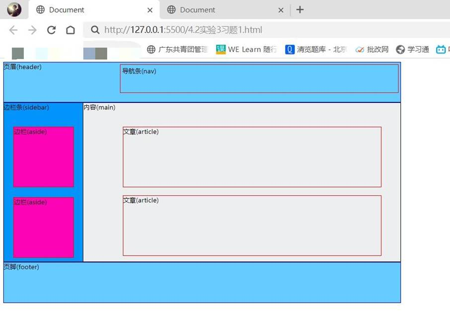
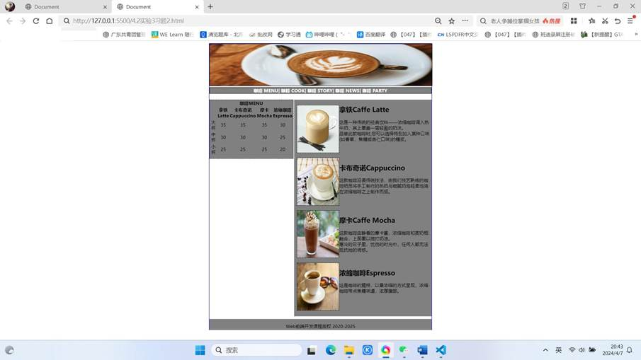

一、实验目的及要求

  1.掌握浮动定位。

  2.实现课本103页课后习题1、2。

  

 

 

  

  二、实验原理与内容

  完成课本103页课后习题1、2。

   

   

  

 

 

  

  三、实验软硬件环境

  Win10 

  VS Code

   

  

 

 

  

  四、实验过程（实验步骤、记录、数据、分析）

  习题1：

  &lt;!DOCTYPE html&gt;

  &lt;html lang=&quot;en&quot;&gt;

  &lt;head&gt;

   

    &lt;meta charset=&quot;UTF-8&quot;&gt;

   

    &lt;meta name=&quot;viewport&quot; content=&quot;width=device-width,

  initial-scale=1.0&quot;&gt;

   

    &lt;title&gt;Document&lt;/title&gt;

   

    &lt;style&gt;

   

        #header{

   

            width: 1000px;

   

            height: 100px;

   

            border: 2px solid blue;

   

            background: #6cf;

   

        }

   

        #nav{

   

           

   

            width: 700px;

   

            height: 70px;

   

            margin: 5px;

   

            

   

        }

   

        #sidebar{

   

            float: left;

   

            width: 200px;

   

            height: 400px;

   

            border: 2px solid black;

   

            background: rgb(2, 147, 251);

   

        }

   

        #aside{

   

            float: left;

   

            width: 150px;

   

            height: 150px;

   

            background: rgb(252, 3, 182);

   

        }

   

        #main{

   

            

   

            width: 1000px;

   

            height: 400px;

   

            border: 2px solid black;

   

            background: rgb(237, 238, 239);

   

        }

   

        #article{

   

            width: 650px;

   

            height: 150px;

   

        }

   

        #box1{

   

            float: right;

   

            width: 700px;

   

            height: 70px;

   

            margin: 5px;

   

            

   

            border: 1px solid red;

   

        }

   

        #box2{

   

            float: left;

   

            width: 150px;

   

            height: 150px;

   

            margin: 5px;

   

            margin-top: 40px;

   

            margin-left: 25px;

   

            border: 1px solid red;

   

        }

   

        #box3{

   

            float: left; 

   

            width: 150px;

   

            height: 150px;

   

            margin: 5px;

   

            margin-top: 20px;

   

            margin-left: 25px;

   

            border: 1px solid red;

   

        }

   

        #box4{

   

            margin-left: 300px;

   

            width: 650px;

   

            height: 150px;

   

            margin-top: 40px;

   

            border: 1px solid red;

   

        }

   

        #box5{

   

            margin-left: 300px;

   

            width: 650px;

   

            height: 150px;

   

            margin-top: 20px;

   

            border: 1px solid red;

   

        }

   

        #footer{

   

            width: 1000px;

   

            height: 100px;

   

            border: 2px solid blue;

   

            background: #6cf;

   

        }

   

    &lt;/style&gt;

  &lt;/head&gt;

  &lt;body&gt;

   

    &lt;header&gt;

   

        &lt;div id=&quot;header&quot;&gt;页眉(header)&lt;div id=&quot;box1&quot;&gt;&lt;div id=&quot;nav&quot;&gt;导航条(nav)&lt;/div&gt;&lt;/div&gt;&lt;/div&gt;

   

    &lt;/header&gt;

   

    &lt;main&gt;

   

        &lt;div id=&quot;sidebar&quot;&gt;边栏条(sidebar)

   

            &lt;div id=&quot;box2&quot;&gt;&lt;div id=&quot;aside&quot;&gt;边栏(aside)&lt;/div&gt;&lt;/div&gt;

   

            &lt;div id=&quot;box3&quot;&gt;&lt;div id=&quot;aside&quot;&gt;边栏(aside)&lt;/div&gt;&lt;/div&gt;

   

        &lt;/div&gt;

   

        &lt;div id=&quot;main&quot;&gt;内容(main)

   

            &lt;div id=&quot;box4&quot;&gt;&lt;div id=&quot;article&quot;&gt;文章(article)&lt;/div&gt;&lt;/div&gt;

   

            &lt;div id=&quot;box5&quot;&gt;&lt;div id=&quot;article&quot;&gt;文章(article)&lt;/div&gt;&lt;/div&gt;

   

        &lt;/div&gt;

   

    &lt;/main&gt;

   

    &lt;footer&gt;

   

        &lt;div id=&quot;footer&quot;&gt;页脚(footer)&lt;/div&gt;

   

    &lt;/footer&gt;

  &lt;/body&gt;

  &lt;/html&gt;

   

  习题2：

  &lt;!DOCTYPE html&gt;

  &lt;html lang=&quot;en&quot;&gt;

  &lt;head&gt;

   

    &lt;meta charset=&quot;UTF-8&quot;&gt;

   

    &lt;meta name=&quot;viewport&quot; content=&quot;width=device-width,

  initial-scale=1.0&quot;&gt;

   

    &lt;title&gt;Document&lt;/title&gt;

   

    &lt;style&gt;

   

         .box{

   

            margin: 0 auto;

   

            width: 800px;

   

            height: 1030px;

   

            border: 2px solid blue;

   

        }

   

        .box1{

   

            float: left;

   

            width: 300px;

   

            height: 210px;

   

            background-color: gray;

   

            border: 1px dashed black;

   

        }

   

        .box2{

   

            float: right;

   

            width: 495px;

   

            height: 780px;

   

            background-color: gray;

   

            /* border: 2px dashed black; */

   

        }

   

        .box3{

   

            margin: 0 auto;

   

            text-align: center;

   

            margin-top: 811px;

   

            width: 800px;

   

            height: 40px;

   

            position: relative;

   

            background-color: gray;

   

        }

   

        .box4{

   

            margin: 0 auto;

   

            text-align: center;

   

            width: 800px;

   

            height: 40px;

   

            position: absolute;

   

            background-color: gray;

   

        }

   

      .photo{

   

        font-size: 0;

   

      }

   

      .photo img{

   

        height: 150px;

   

        width: 800px;

   

        margin: 0 auto;

   

        border: 1px solid black;

   

        

   

      }

   

      .newsimaglist{

   

        font-size: 0;

   

      }

   

      .newsimaglist img{

   

        height: 170px;

   

        width: 150px;

   

        float: left;

   

        margin-left: 10px;

   

        /* margin-top: 1px; */

   

        border: 1px dashed black;

   

      }

   

      h4{

   

        margin-top: 5px;

   

        text-align: center;

   

        color: white;

   

        background-color: gray;

   

        border: 1px solid black;

   

      }

   

      h5{

   

        position: absolute;

   

        text-align: center;

   

      }

   

    &lt;/style&gt;

  &lt;/head&gt;

  &lt;body&gt;

   

    &lt;div class=&quot;box&quot;&gt;

   

        &lt;div class=&quot;photo&quot;&gt;

   

            &lt;img src=&quot;咖啡.jpeg&quot; alt=&quot;&quot;&gt;

   

        &lt;/div&gt;

   

        &lt;h4&gt;咖啡 MENU| 咖啡 COOK| 咖啡 STORY| 咖啡 NEWS| 咖啡 PARTY&lt;/h4&gt;

   

        &lt;div class=&quot;box1&quot;&gt;

   

            &lt;table border=&quot;0&quot;&gt;

   

                &lt;thead&gt;

   

                    &lt;tr align=&quot;center&quot;&gt;

   

                       

   &lt;th colspan=&quot;5&quot;&gt;咖啡MENU&lt;/th&gt;

   

                    &lt;/tr&gt;

   

                    

   

                    &lt;tr align=&quot;center&quot;&gt;

   

                        &lt;th rowspan=&quot;2&quot;&gt;&lt;/th&gt;

   

                        &lt;th &gt;拿铁&lt;br&gt;Latte&lt;/th&gt;

   

                        &lt;th&gt;卡布奇诺&lt;br&gt;Cappuccino&lt;/th&gt;

   

                        &lt;th&gt;摩卡&lt;br&gt;Mocha&lt;/th&gt;

   

                        &lt;th&gt;浓缩咖啡&lt;br&gt;Espresso&lt;/th&gt;

   

                    &lt;/tr&gt;

   

                    &lt;tbody&gt;

   

                        

   

                        &lt;tr align=&quot;center&quot;&gt;

   

                       

      &lt;td&gt;大杯&lt;/td&gt;

   

                       

      &lt;td&gt;35&lt;/td&gt;

   

                       

      &lt;td&gt;35&lt;/td&gt;

   

                       

      &lt;td&gt;35&lt;/td&gt;

   

                       

      &lt;td&gt;30&lt;/td&gt;

   

                        &lt;/tr&gt;

   

                        &lt;tr align=&quot;center&quot;&gt;

   

                       

      &lt;td&gt;中杯&lt;/td&gt;

   

                       

      &lt;td&gt;30&lt;/td&gt;

   

                       

      &lt;td&gt;30&lt;/td&gt;

   

                       

      &lt;td&gt;30&lt;/td&gt;

   

                       

      &lt;td&gt;25&lt;/td&gt;

   

                        &lt;/tr&gt;

   

                        &lt;tr align=&quot;center&quot;&gt;

   

                       

      &lt;td&gt;小杯&lt;/td&gt;

   

                       

      &lt;td&gt;25&lt;/td&gt;

   

                       

      &lt;td&gt;25&lt;/td&gt;

   

                       

      &lt;td&gt;25&lt;/td&gt;

   

                       

      &lt;td&gt;20&lt;/td&gt;

   

                        &lt;/tr&gt;

   

                    &lt;/tbody&gt;

   

                &lt;/thead&gt;

   

            &lt;/table&gt;

   

        &lt;/div&gt;

   

        &lt;div class=&quot;box2&quot;&gt;

   

            &lt;article&gt;

   

                &lt;div class=&quot;newsimaglist&quot;&gt;

   

                    &lt;img src=&quot;拿铁.jpeg&quot; alt=&quot;&quot;&gt;

   

                &lt;/div&gt;

   

                    &lt;h2&gt;拿铁Caffe Latte&lt;/h2&gt;

   

                    &lt;p&gt;这是一种传统的经典饮料&#8212;&#8212;浓缩咖啡调入热牛奶，其上覆盖一层轻盈的奶沫。&lt;br&gt;品尝此款咖啡时,您可以选择特别加入某种口味(如香草，焦糖或杏仁口味)的糖浆。&lt;/p&gt;&lt;br&gt;

   

                    &lt;br&gt;

   

                &lt;div class=&quot;newsimaglist&quot;&gt;

   

                    &lt;img src=&quot;卡布奇诺.jpg&quot; alt=&quot;&quot;&gt;

   

                &lt;/div&gt;

   

                &lt;h2&gt;卡布奇诺Cappuccino&lt;/h2&gt;

   

                &lt;p&gt;这款咖啡沿袭传统技法，由我们技艺熟练的咖啡吧员将手工制作的热奶与细腻奶泡轻柔地浇在浓缩咖啡之上制作而成。&lt;/p&gt;

   

                &lt;br&gt;

   

                &lt;br&gt;

   

                &lt;div class=&quot;newsimaglist&quot;&gt;

   

                    &lt;img src=&quot;摩卡.jpg&quot; alt=&quot;&quot;&gt;

   

                &lt;/div&gt;

   

                &lt;h2&gt;摩卡Caffe Mocha&lt;/h2&gt;

   

                &lt;p&gt;这款咖啡由静香的摩卡酱，浓缩咖啡和蒸奶相融合，上面覆以揽打奶油。&lt;br&gt;寒冷的日子里，忧伤的时光中，任何人都无法抵抗她的诱惑。&lt;/p&gt;

   

                &lt;br&gt;

   

                &lt;div class=&quot;newsimaglist&quot;&gt;

   

                    &lt;img src=&quot;浓缩咖啡.jpg&quot; alt=&quot;&quot;&gt;

   

                &lt;/div&gt;

   

                &lt;h2&gt;浓缩咖啡Espresso&lt;/h2&gt;

   

                &lt;p&gt;这是咖啡的精梓，以最浓缩的方式呈现，浓缩咖啡带点焦糖味道，浓厚腹部。&lt;/p&gt;

   

                

   

            &lt;/article&gt;

   

        &lt;/div&gt;

   

        &lt;div class=&quot;box3&quot;&gt;

   

            &lt;div class=&quot;box4&quot;&gt;

   

                &lt;p&gt;Web前端开发课程版权 2020-2025&lt;/p&gt;

   

            &lt;/div&gt;

   

        &lt;/div&gt;

   

    &lt;/div&gt;

  &lt;/body&gt;

  &lt;/html&gt;

   

   

  

 

 

  

  五、测试/调试及实验结果分析

  习题1：

  

  

   

    

   

   

    

    

   

  

   

   

   

   

   

   

   

   

   

   

   

   

   

   

   

   

   

  

  习题2：

  

  

   

    

   

   

    

    

   

  

   

   

   

   

   

   

   

   

   

   

   

   

   

   

  

 

 

  

  六、实验结论与体会

  利用上述知识成功编写出所要的页面。过程虽然有些困难，但我借助书本一步一步地编写出来，成就感十足！

   

   

  2024年 4 月 6日