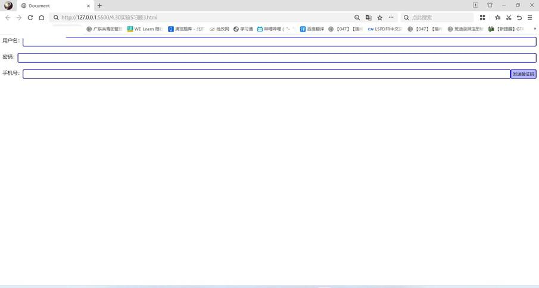
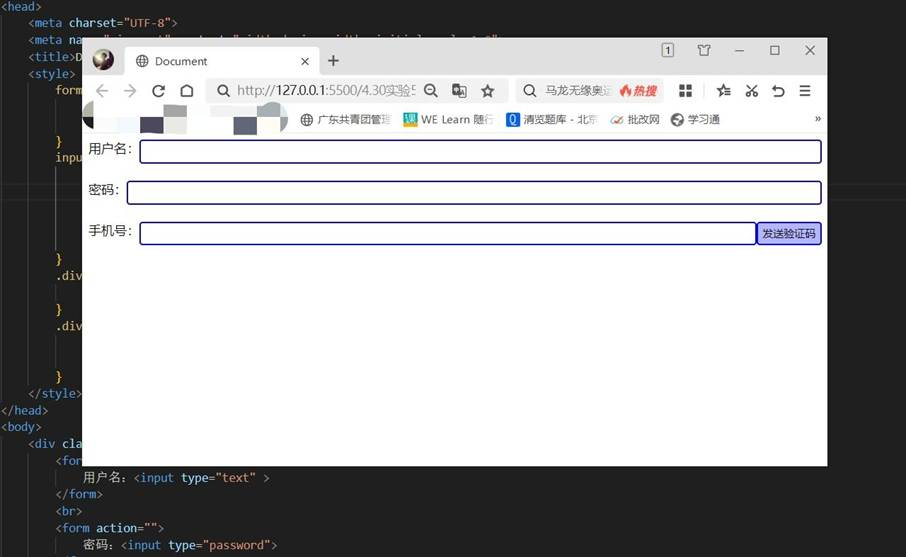
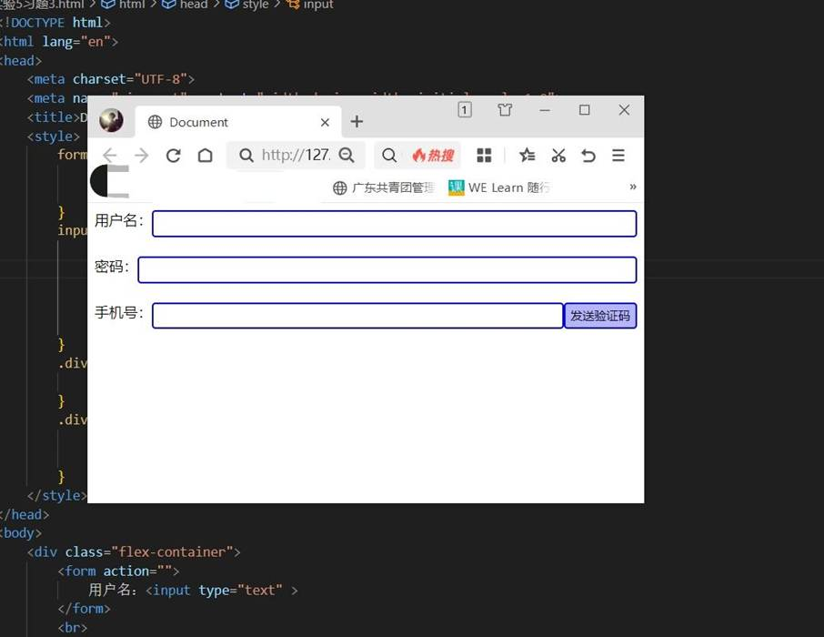

一、实验目的及要求

  1.掌握弹性盒子和网格布局。

  2.实现课本125页课后习题3、4。

  

 

 

  

  二、实验原理与内容

  实现课本125页课后习题3、4。

   

   

  

 

 

  

  三、实验软硬件环境

  Win10 

  VS Code

   

  

 

 

  

  四、实验过程（实验步骤、记录、数据、分析）

  习题3：

  &lt;!DOCTYPE html&gt;

  &lt;html lang=&quot;en&quot;&gt;

  &lt;head&gt;

   

    &lt;meta charset=&quot;UTF-8&quot;&gt;

   

    &lt;meta name=&quot;viewport&quot; content=&quot;width=device-width,

  initial-scale=1.0&quot;&gt;

   

    &lt;title&gt;Document&lt;/title&gt;

   

    &lt;style&gt;

   

        form{

   

            display: flex;

   

            height: 30px;

   

        }

   

        input {

   

            border: 2px solid blue;

   

            border-radius: 4px;

   

            flex-basis: 100px;

   

            flex: 1 1;

   

            

   

        }

   

        .div{

   

            float: right;

   

        }

   

        .div input{

   

            height: 30px;

   

            background-color: rgba(0, 0, 255, 0.29);

   

        }

   

    &lt;/style&gt;

  &lt;/head&gt;

  &lt;body&gt;

   

    &lt;div class=&quot;flex-container&quot;&gt;

   

        &lt;form action=&quot;&quot;&gt;

   

            用户名：&lt;input type=&quot;text&quot; &gt;

   

        &lt;/form&gt;

   

        &lt;br&gt;

   

        &lt;form action=&quot;&quot;&gt;

   

            密码：&lt;input type=&quot;password&quot;&gt;

   

        &lt;/form&gt;

   

        &lt;br&gt;

   

        &lt;form action=&quot;&quot;&gt;

   

            手机号：&lt;input type=&quot;text&quot;&gt;

   

            &lt;div class=&quot;div&quot;&gt;&lt;input type=&quot;submit&quot; value=&quot;发送验证码&quot; &gt;&lt;/div&gt;

   

        &lt;/form&gt;

   

        

   

    &lt;/div&gt;

   

   

  &lt;/body&gt;

  &lt;/html&gt;

   

   

  习题4：

  &lt;!DOCTYPE html&gt;

  &lt;html lang=&quot;en&quot;&gt;

  &lt;head&gt;

   

    &lt;meta charset=&quot;UTF-8&quot;&gt;

   

    &lt;meta name=&quot;viewport&quot; content=&quot;width=device-width,

  initial-scale=1.0&quot;&gt;

   

    &lt;title&gt;习题4&lt;/title&gt;

   

    &lt;style&gt;

   

        p{

   

            margin: 15px;

   

        }

   

        .grid-container{

   

            height: 700px;

   

            display: grid;

   

            justify-content: center;

   

            align-content: center;

   

            grid-template-columns: repeat(4,300px);

   

            grid-template-rows: repeat(2,300px);

   

            grid-gap: 20px;

   

            background: #efefef;

   

        }

   

        .grid-item{

   

            background:white;

   

        }

   

        .grid-item:nth-child(1){

   

            grid-column: 1/3;

   

            grid-row: 1/2;

   

        }

   

        *{

   

            margin: 0;

   

            padding: 0;

   

        }

   

        .carousel_map{

   

            width: 620px;

   

            height: 300px;

   

        }

   

        .slide{

   

            width: inherit;

   

            height: inherit;

   

            overflow: hidden;

   

            position: relative;

   

        }

   

        .slide:hover.labels{

   

            display: flex;

   

        }

   

        .slide:hover.list{

   

            animation: none;

   

        }

   

        .slide input{

   

            display: none;

   

        }

   

        .labels{

   

            position: absolute;

   

            bottom: 0.5em;

   

            z-index: 1;

   

            width: inherit;

   

            justify-content: center;

   

            display: none;

   

        }

   

        .labels label{

   

            width: 1rem;

   

            height: 1rem;

   

            border-radius: 50%;

   

            margin: 0 0.3rem;

   

            border: 0.1rem solid #fff;

   

            background-color: transparent;

   

            box-sizing: border-box;

   

            cursor: pointer;

   

        }

   

        input[id=pic1]:checked~.labels label[for=pic1],

   

        input[id=pic2]:checked~.labels label[for=pic2],

   

        input[id=pic3]:checked~.labels label[for=pic3],

   

        input[id=pic4]:checked~.labels label[for=pic4],

   

        input[id=pic5]:checked~.labels label[for=pic5],

   

        input[id=pic6]:checked~.labels label[for=pic6],

   

        input[id=pic7]:checked~.labels label[for=pic7],

   

        input[id=pic8]:checked~.labels label[for=pic8]{

   

            background-color: #fff;

   

            border: 0.1rem solid #fff;

   

        }

   

        input[id=pic1]:checked~.list{

   

            transform: translate(calc(0*620px));

   

        }

   

        input[id=pic2]:checked~.list{

   

            transform: translate(calc(-1*620px));

   

        }

   

        input[id=pic3]:checked~.list{

   

            transform: translate(calc(-2*620px));

   

        }

   

        input[id=pic4]:checked~.list{

   

            transform: translate(calc(-3*620px));

   

        }

   

        input[id=pic5]:checked~.list{

   

            transform: translate(calc(-4*620px));

   

        }

   

        input[id=pic6]:checked~.list{

   

            transform: translate(calc(-5*620px));

   

        }

   

        input[id=pic7]:checked~.list{

   

            transform: translate(calc(-6*620px));

   

        }

   

        input[id=pic8]:checked~.list{

   

            transform: translate(calc(-7*620px));

   

        }

   

        ul{

   

            list-style: none;

   

        }

   

        .list{

   

            width: calc(8*620px);

   

            height: inherit;

   

            position: relative;

   

            animation: move 15s ease 1.5s infinite;

   

        }

   

        @keyframes move{

   

            0%{

   

                transform: translate(calc(0*620px));

   

            }

   

            12.5%{

   

                transform: translate(calc(-1*620px));

   

            }

   

            25%{

   

                transform: translate(calc(-2*620px));

   

            }

   

            37.5%{

   

                transform: translate(calc(-3*620px));

   

            }

   

            50%{

   

                transform: translate(calc(-4*620px));

   

            }

   

            62.5%{

   

                transform: translate(calc(-5*620px));

   

            }

   

            75%{

   

                transform: translate(calc(-6*620px));

   

            }

   

            87.5%{

   

                transform: translate(calc(-7*620px));

   

            }

   

            100%{

   

                transform: translate(calc(-8*620px));

   

            }

   

        }

   

        .item{

   

            width: 620px;

   

            height: 300px;

   

            float: left;

   

        }

   

    &lt;/style&gt;

  &lt;/head&gt;

  &lt;body&gt;

   

    &lt;div class=&quot;grid-container&quot;&gt;

   

        &lt;div class=&quot;grid-item&quot;&gt;

   

            &lt;div class=&quot;carousel_map&quot;&gt;

   

                &lt;div class=&quot;slide&quot;&gt;

   

                    &lt;input type=&quot;radio&quot; name=&quot;pic&quot; id=&quot;pic1&quot; checked&gt;

   

                    &lt;input type=&quot;radio&quot; name=&quot;pic&quot; id=&quot;pic2&quot;&gt;

   

                    &lt;input type=&quot;radio&quot; name=&quot;pic&quot; id=&quot;pic3&quot;&gt;

   

                    &lt;input type=&quot;radio&quot; name=&quot;pic&quot; id=&quot;pic4&quot;&gt;

   

                    &lt;input type=&quot;radio&quot; name=&quot;pic&quot; id=&quot;pic5&quot;&gt;

   

                    &lt;input type=&quot;radio&quot; name=&quot;pic&quot; id=&quot;pic6&quot;&gt;

   

                    &lt;input type=&quot;radio&quot; name=&quot;pic&quot; id=&quot;pic7&quot;&gt;

   

                    &lt;input type=&quot;radio&quot; name=&quot;pic&quot; id=&quot;pic8&quot;&gt;

   

                    &lt;div class=&quot;labels&quot;&gt;

   

                        &lt;label for=&quot;pic1&quot;&gt;&lt;/label&gt;

   

                        &lt;label for=&quot;pic2&quot;&gt;&lt;/label&gt;

   

                        &lt;label for=&quot;pic3&quot;&gt;&lt;/label&gt;

   

                        &lt;label for=&quot;pic4&quot;&gt;&lt;/label&gt;

   

                        &lt;label for=&quot;pic5&quot;&gt;&lt;/label&gt;

   

                        &lt;label for=&quot;pic6&quot;&gt;&lt;/label&gt;

   

                        &lt;label for=&quot;pic7&quot;&gt;&lt;/label&gt;

   

                        &lt;label for=&quot;pic8&quot;&gt;&lt;/label&gt;

   

                    &lt;/div&gt;

   

                    &lt;ul class=&quot;list&quot;&gt;

   

                        &lt;li class=&quot;item&quot;&gt;

   

                       

      &lt;a href=&quot;###&quot;&gt;

   

                       

          &lt;img src=&quot;1.jpeg&quot; alt=&quot;&quot; height=&quot;300px&quot; width=&quot;620px&quot;&gt;

   

                       

      &lt;/a&gt;

   

                        &lt;/li&gt;

   

                        &lt;li class=&quot;item&quot;&gt;

   

                       

      &lt;a href=&quot;###&quot;&gt;

   

                       

          &lt;img src=&quot;2.jpg&quot; alt=&quot;&quot; height=&quot;300px&quot; width=&quot;620px&quot;&gt;

   

                       

      &lt;/a&gt;

   

                        &lt;/li&gt;

   

                        &lt;li class=&quot;item&quot;&gt;

   

                       

      &lt;a href=&quot;###&quot;&gt;

   

                       

          &lt;img src=&quot;3.jpg&quot; alt=&quot;&quot; height=&quot;300px&quot; width=&quot;620px&quot;&gt;

   

                       

      &lt;/a&gt;

   

                        &lt;/li&gt;

   

                        &lt;li class=&quot;item&quot;&gt;

   

                       

      &lt;a href=&quot;###&quot;&gt;

   

                       

          &lt;img src=&quot;4.jpeg&quot; alt=&quot;&quot; height=&quot;300px&quot; width=&quot;620px&quot;&gt;

   

                       

      &lt;/a&gt;

   

                        &lt;/li&gt;

   

                        &lt;li class=&quot;item&quot;&gt;

   

                       

      &lt;a href=&quot;###&quot;&gt;

   

                       

          &lt;img src=&quot;5.jpg&quot; alt=&quot;&quot; height=&quot;300px&quot; width=&quot;620px&quot;&gt;

   

                       

      &lt;/a&gt;

   

                        &lt;/li&gt;

   

                        &lt;li class=&quot;item&quot;&gt;

   

                       

      &lt;a href=&quot;###&quot;&gt;

   

                       

          &lt;img src=&quot;6.jpeg&quot; alt=&quot;&quot; height=&quot;300px&quot; width=&quot;620px&quot;&gt;

   

                       

      &lt;/a&gt;

   

                        &lt;/li&gt;

   

                        &lt;li class=&quot;item&quot;&gt;

   

                       

      &lt;a href=&quot;###&quot;&gt;

   

                       

          &lt;img src=&quot;7.jpg&quot; alt=&quot;&quot; height=&quot;300px&quot; width=&quot;620px&quot;&gt;

   

                       

      &lt;/a&gt;

   

                        &lt;/li&gt;

   

                        &lt;li class=&quot;item&quot;&gt;

   

                       

      &lt;a href=&quot;###&quot;&gt;

   

                       

          &lt;img src=&quot;8.jpg&quot; alt=&quot;&quot; height=&quot;300px&quot; width=&quot;620px&quot;&gt;

   

                       

      &lt;/a&gt;

   

                        &lt;/li&gt;

   

                    &lt;/ul&gt;

   

                &lt;/div&gt;

   

            &lt;/div&gt;

   

        &lt;/div&gt;

   

        &lt;div class=&quot;grid-item&quot;&gt;

   

            &lt;img src=&quot;公主号.jpg&quot; alt=&quot;&quot; height=&quot;150px&quot; width=&quot;300px&quot;&gt;&lt;br&gt;

   

        &lt;p&gt;

   

            &lt;a href=&quot;#&quot;&gt;国际&lt;/a&gt;&lt;br&gt;

   

            图说天下|又一“公主号”邮轮中招：3000人被困海上 加州进入紧急状态&lt;br&gt;

   

            &lt;br&gt;

   

            &lt;br&gt;

   

            &lt;img src=&quot;msn.jpg&quot; alt=&quot;&quot; height=&quot;20px&quot; width=&quot;20px&quot;&gt;MSN

   

        &lt;/p&gt;

   

        &lt;/div&gt;

   

        &lt;div class=&quot;grid-item&quot;&gt;

   

            &lt;img src=&quot;佟丽娅.jpg&quot; alt=&quot;&quot; height=&quot;150px&quot; width=&quot;300px&quot;&gt;&lt;br&gt;

   

            &lt;p&gt;

   

                &lt;a href=&quot;#&quot;&gt;娱乐&lt;/a&gt;&lt;br&gt;

   

                佟丽娅大胆掀开被子，却忘了自己穿着“睡裤”，网友：沦陷了啊！&lt;br&gt;

   

                &lt;br&gt;

   

                &lt;br&gt;

   

                &lt;img src=&quot;哥有料.jpg&quot; alt=&quot;&quot; height=&quot;20px&quot; width=&quot;20px&quot;&gt;哥有料

   

            &lt;/p&gt;

   

        &lt;/div&gt;

   

        &lt;div class=&quot;grid-item&quot;&gt;

   

            &lt;img src=&quot;乔布斯遗孀.jpg&quot; alt=&quot;&quot; height=&quot;150px&quot; width=&quot;300px&quot;&gt;&lt;br&gt;

   

            &lt;p&gt;

   

                &lt;a href=&quot;#&quot;&gt;财经&lt;/a&gt;&lt;br&gt;

   

                乔布斯遗孀将裸捐250亿美元，自称没兴趣积累财富&lt;br&gt;

   

                &lt;br&gt;

   

                &lt;br&gt;

   

                &lt;img src=&quot;哥有料.jpg&quot; alt=&quot;&quot; height=&quot;20px&quot; width=&quot;20px&quot;&gt;哥有料

   

            &lt;/p&gt;

   

        &lt;/div&gt;

   

        &lt;div class=&quot;grid-item&quot;&gt;

   

            &lt;img src=&quot;天猫.jpg&quot; alt=&quot;&quot; height=&quot;150px&quot; width=&quot;300px&quot;&gt;&lt;br&gt;

   

            &lt;p&gt;

   

                天猫3.8主会场|满300减30，快来加购&lt;br&gt;

   

                &lt;br&gt;

   

                &lt;br&gt;

   

                &lt;br&gt;

   

                &lt;br&gt;

   

                &lt;img src=&quot;天猫 (1).jpg&quot; alt=&quot;&quot; height=&quot;20px&quot; width=&quot;20px&quot;&gt;天猫精选

   

            &lt;/p&gt;

   

        &lt;/div&gt;

   

        &lt;div class=&quot;grid-item&quot;&gt;

   

            &lt;img src=&quot;杨迪.jpeg&quot; alt=&quot;&quot; height=&quot;150px&quot; width=&quot;300px&quot;&gt;&lt;br&gt;

   

            &lt;p&gt;

   

                &lt;a href=&quot;#&quot;&gt;生活&lt;/a&gt;&lt;br&gt;

   

                有种“不公平”叫杨迪兄妹，哥哥长得像“小丑”，妹妹却貌美如花&lt;br&gt;

   

                &lt;br&gt;

   

                &lt;br&gt;

   

                &lt;img src=&quot;东方头条.png&quot; alt=&quot;&quot; height=&quot;20px&quot; width=&quot;20px&quot;&gt;东方头条

   

            &lt;/p&gt;

   

        &lt;/div&gt;

   

        &lt;div class=&quot;grid-item&quot;&gt;

   

            &lt;img src=&quot;孙杨.jpeg&quot; alt=&quot;&quot; height=&quot;150px&quot; width=&quot;300px&quot;&gt;&lt;br&gt;

   

            &lt;p&gt;

   

                &lt;a href=&quot;#&quot;&gt;体育&lt;/a&gt;&lt;br&gt;

   

                孙杨还有可能参加东京奥运会吗，该如何上诉？体育法专家、CAS仲裁员深度解读...&lt;br&gt;

   

                &lt;br&gt;

   

                &lt;img src=&quot;解放日报.jpeg&quot; alt=&quot;&quot; height=&quot;20px&quot; width=&quot;20px&quot;&gt;解放日报

   

            &lt;/p&gt;

   

        &lt;/div&gt;

   

    &lt;/div&gt;

  &lt;/body&gt;

  &lt;/html&gt;

   

   

  

 

 

  

  五、测试/调试及实验结果分析

  习题3：

  

  

   

    

    

    

    

   

   

    

    

   

   

    

   

   

    

    

    

   

   

    

   

   

    

    

    

   

  

   

   

   

   

   

   

   

   

   

   

   

   

   

   

   

   

   

   

   

   

   

   

   

   

   

   

   

   

   

   

   

   

   

   

   

   

   

   

   

   

   

   

   

   

   

   

   

   

   

   

   

   

   

  

  习题4：

  

  

   

    

   

   

    

    

   

  

   

   

   

   

   

   

   

   

   

   

   

   

   

   

  

 

 

  

  六、实验结论与体会

  利用上述知识成功编写出所要的页面。过程虽然有些困难，但我借助书本一步一步地编写出来，成就感十足！

   

   

  2024年 5 月1 日