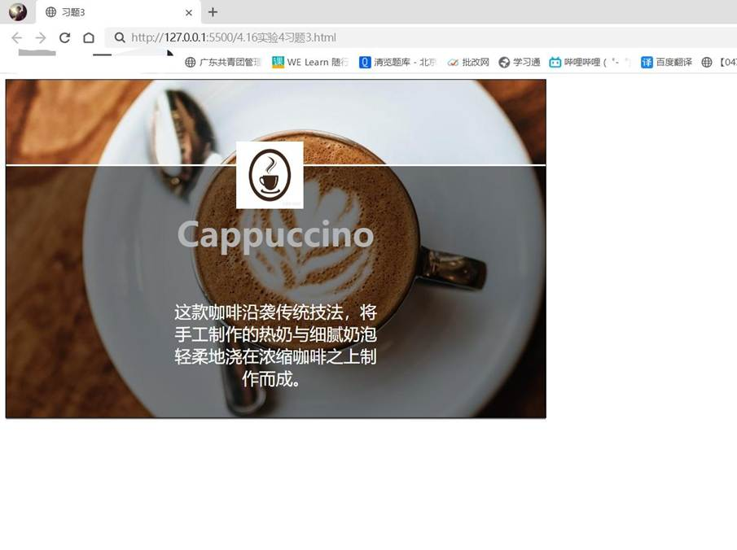
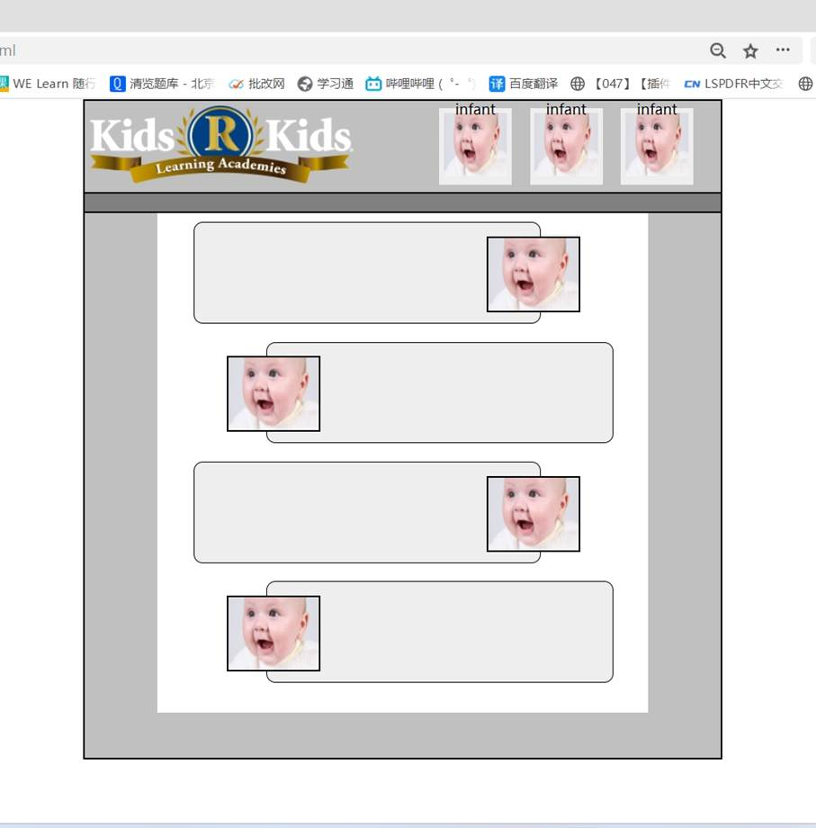

一、实验目的及要求

  1.掌握绝对定位和相对定位。

  2.实现课本103页课后习题3、4。

  

 

 

  

  二、实验原理与内容

  实现课本103页课后习题3、4。

   

   

  

 

 

  

  三、实验软硬件环境

  Win10 

  VS Code

   

  

 

 

  

  四、实验过程（实验步骤、记录、数据、分析）

  习题3：

  &lt;!DOCTYPE html&gt;

  &lt;html lang=&quot;en&quot;&gt;

  &lt;head&gt;

   

    &lt;meta charset=&quot;UTF-8&quot;&gt;

   

    &lt;meta name=&quot;viewport&quot; content=&quot;width=device-width,

  initial-scale=1.0&quot;&gt;

   

    &lt;title&gt;习题3&lt;/title&gt;

   

    &lt;style type=&quot;text/css&quot;&gt;

   

        .pic1{

   

            position: relative;

   

            width: 800px;

   

            height: 500px;

   

            border: 1px solid;

   

        }

   

        .pic2{

   

            position: absolute;

   

            top: 100px;

   

            left: 350px;

   

            width: 40px;

   

            height: 40px;

   

        }

   

        p{

   

            position: absolute;

   

            top: 100px;

   

            width: 800px;

   

            height: 375px;

   

            font-size: 25px;

   

            color: white;

   

            background-color: rgba(0, 0, 0, 0.5);

   

            text-align: center;

   

            border-top: 3px solid white;

   

        }

   

        p1{

   

            font-size: 50px;

   

            font-weight: bold;

   

            color: rgb(178, 179, 180);

   

        }

   

    &lt;/style&gt;

  &lt;/head&gt;

  &lt;body&gt;

   

    &lt;div class=&quot;pic1&quot;&gt;

   

        &lt;img src=&quot;咖啡.jpeg&quot; alt=&quot;咖啡背景图&quot;&gt;

   

        &lt;p&gt;

   

            &lt;br&gt;&lt;br&gt;&lt;p1&gt;Cappuccino&lt;/p1&gt;

   

            &lt;br&gt;&lt;br&gt;&lt;br&gt;这款咖啡沿袭传统技法，将&lt;br&gt;手工制作的热奶与细腻奶泡&lt;br&gt;轻柔地浇在浓缩咖啡之上制&lt;br&gt;作而成。

   

        &lt;/p&gt;

   

    &lt;/div&gt;

   

    &lt;div class=&quot;pic2&quot;&gt;

   

        &lt;img src=&quot;咖啡图标.jpeg&quot; alt=&quot;咖啡图标&quot; width=&quot;100px&quot; height=&quot;100px&quot;&gt; 

   

    &lt;/div&gt;

  &lt;/body&gt;

  &lt;/html&gt;

   

  习题4：

  &lt;!DOCTYPE html&gt;

  &lt;html lang=&quot;en&quot;&gt;

  &lt;head&gt;

   

    &lt;meta charset=&quot;UTF-8&quot;&gt;

   

    &lt;meta name=&quot;viewport&quot; content=&quot;width=device-width,

  initial-scale=1.0&quot;&gt;

   

    &lt;title&gt;习题4&lt;/title&gt;

   

    &lt;style&gt;

   

    *{

   

        padding: 0;

   

        margin: 0;

   

       }

   

       #container{

   

           width: 700px;

   

           margin: 0 auto;

   

       }

   

       main{

   

        height: 600px;

   

        width: 700px;

   

        background-color: rgb(192,192,192);

   

        border: 2px solid black;

   

        border-top: 0px; ;

   

       }

   

       header{

   

        height: 100px;

   

        width: 700px; 

   

        border: 2px solid black;

   

        background-color: rgb(192,192,192);

   

        position: relative;

   

       }

   

        img{

   

        margin: 5px ;

   

       }

   

       #newimg1{

   

        position: absolute;

   

        bottom: 7.5px;

   

        right: 30px;

   

        background-color: #eee;

   

       }

   

        #newimg2{

   

        position: absolute;

   

        bottom: 7.5px;

   

        right: 130px;

   

        background-color: #eee;

   

        }

   

        #newimg3{

   

        position: absolute;

   

        bottom: 7.5px;

   

        right: 230px;

   

        background-color: #eee;

   

       }

   

       p{

   

        position: absolute;

   

        top: -10px ;

   

        width: 80px;

   

        text-align: center;

   

       }

   

       nav{

   

        position: relative;

   

        height: 20px;

   

        width: 700px; 

   

        border: 2px solid black;

   

        border-top: 0px;

   

        background-color: rgb(128, 128, 128);

   

       }

   

       #box1{

   

        position: absolute;

   

        height: 550px;

   

        width: 540px;

   

   

        border-top: 0px;

   

        margin-top:0;

   

        margin-left: 80px ;

   

        background-color: white;

   

       }

   

       #box2{

   

        position: relative;

   

        height: 110px;

   

        width: 380px;

   

        background-color: #eee;

   

        border: 1px solid black ;

   

        border-radius: 10px;

   

        margin-left: 40px;

   

        margin-top: 10px

   

       }

   

       #box3{

   

        position: relative;

   

        height: 110px;

   

        width: 380px;

   

        background-color: #eee;

   

        border: 1px solid black ;

   

        border-radius: 10px;

   

        margin-left: 120px;

   

        margin-top: 20px

   

       }

   

       #box4{

   

        position: relative;

   

        height: 110px;

   

        width: 380px;

   

        background-color: #eee;

   

        border: 1px solid black ;

   

        border-radius: 10px;

   

        margin-left: 40px;

   

        margin-top: 20px

   

       }

   

       #box5{

   

        position: relative;

   

        height: 110px;

   

        width: 380px;

   

        background-color: #eee;

   

        border: 1px solid black ;

   

        border-radius: 10px;

   

        margin-left: 120px;

   

        margin-top: 20px

   

       }

   

       #newimg4{

   

        position: absolute;

   

        right:-50px;

   

        top: 10px;

   

       }

   

       #newimg5{

   

        position: absolute;

   

        left: -50px;

   

        top: 10px;

   

       }

   

       #newimg6{

   

        position: absolute;

   

        right:-50px;

   

        top: 10px;

   

       }

   

       #newimg7{

   

        position: absolute;

   

        left:-50px;

   

        top: 10px;

   

       }

   

       #newimg4 img{

   

        height: 80px ;

   

        width: 100px;

   

        border: 2px solid black;

   

       }

   

       #newimg5 img{

   

        height: 80px ;

   

        width: 100px;

   

        border: 2px solid black;

   

       }

   

       #newimg6 img{

   

        height: 80px ;

   

        width: 100px;

   

        border: 2px solid black;

   

       }

   

       #newimg7 img{

   

        height: 80px ;

   

        width: 100px;

   

        border: 2px solid black;

   

       }

   

    &lt;/style&gt;

  &lt;/head&gt;

  &lt;body&gt;

   

    &lt;div id=&quot;container&quot;&gt;

   

        &lt;header&gt;

   

            &lt;img src=&quot;logo.png&quot; alt=&quot;666&quot;  &gt;

   

            &lt;div id=&quot;newimg1&quot;&gt;

   

                &lt;img src=&quot;baby.jpg&quot; alt=&quot;666&quot; width=&quot;70px&quot; height=&quot;70px&quot;&gt;

   

                &lt;p&gt;infant&lt;/p&gt;

   

            &lt;/div&gt;

   

            &lt;div id=&quot;newimg2&quot;&gt;

   

                &lt;img src=&quot;baby.jpg&quot; alt=&quot;666&quot; width=&quot;70px&quot; height=&quot;70px&quot;&gt;

   

                &lt;p&gt;infant&lt;/p&gt;

   

            &lt;/div&gt;

   

            &lt;div id=&quot;newimg3&quot;&gt;

   

                &lt;img src=&quot;baby.jpg&quot; alt=&quot;666&quot; width=&quot;70px&quot; height=&quot;70px&quot;&gt;

   

                &lt;p&gt;infant&lt;/p&gt;

   

            &lt;/div&gt;

   

        &lt;/header&gt;

   

        &lt;nav&gt;&lt;/nav&gt;

   

        &lt;main&gt;

   

            &lt;div id=&quot;box1&quot;&gt;

   

                &lt;div id=&quot;box2&quot;&gt;

   

                    &lt;div id=&quot;newimg4&quot;&gt;

   

                    &lt;img src=&quot;baby.jpg&quot; alt=&quot;666&quot; &gt;

   

                &lt;/div&gt;

   

                    &lt;/div&gt;

   

                &lt;div id=&quot;box3&quot;&gt;

   

                    &lt;div id=&quot;newimg5&quot;&gt;

   

                        &lt;img src=&quot;baby.jpg&quot; alt=&quot;666&quot; &gt;

   

                    &lt;/div&gt;

   

                &lt;/div&gt;

   

                &lt;div id=&quot;box4&quot;&gt;

   

                    &lt;div id=&quot;newimg6&quot;&gt;

   

                        &lt;img src=&quot;baby.jpg&quot; alt=&quot;666&quot; &gt;

   

                    &lt;/div&gt;

   

                &lt;/div&gt;

   

                &lt;div id=&quot;box5&quot;&gt;

   

                    &lt;div id=&quot;newimg7&quot;&gt;

   

                        &lt;img src=&quot;baby.jpg&quot; alt=&quot;666&quot; &gt;

   

                    &lt;/div&gt;

   

                &lt;/div&gt;

   

            &lt;/div&gt;

   

        &lt;/main&gt;

   

    &lt;/div&gt;

  &lt;/body&gt;

  &lt;/html&gt;

   

   

  

 

 

  

  五、测试/调试及实验结果分析

  习题3：

  

  

   

    

   

   

    

    

   

  

   

   

   

   

   

   

   

   

   

   

   

   

   

   

   

   

   

  

  习题4：

  

  

   

    

   

   

    

    

   

  

   

   

   

   

   

   

   

   

   

   

   

   

   

   

   

   

   

   

   

   

   

   

   

   

  

 

 

  

  六、实验结论与体会

  利用上述知识成功编写出所要的页面。过程虽然有些困难，但我借助书本一步一步地编写出来，成就感十足！

   

   

  2024年4 月21日