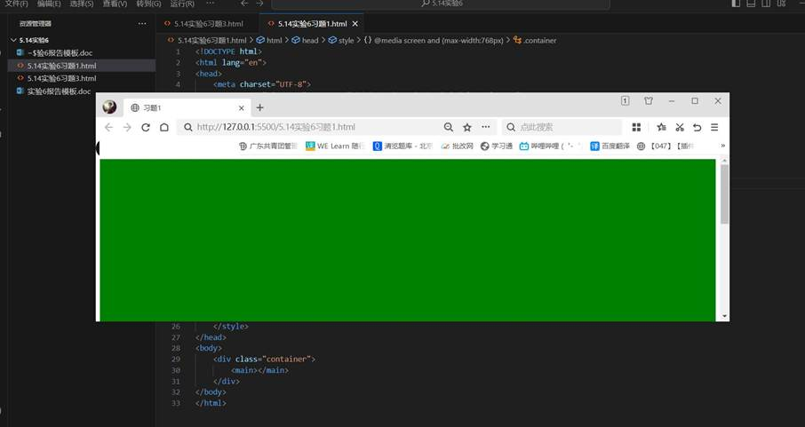
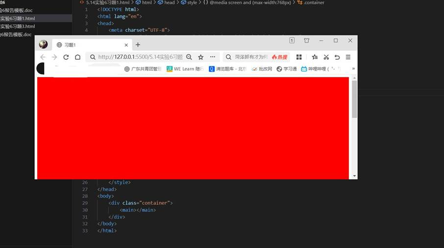
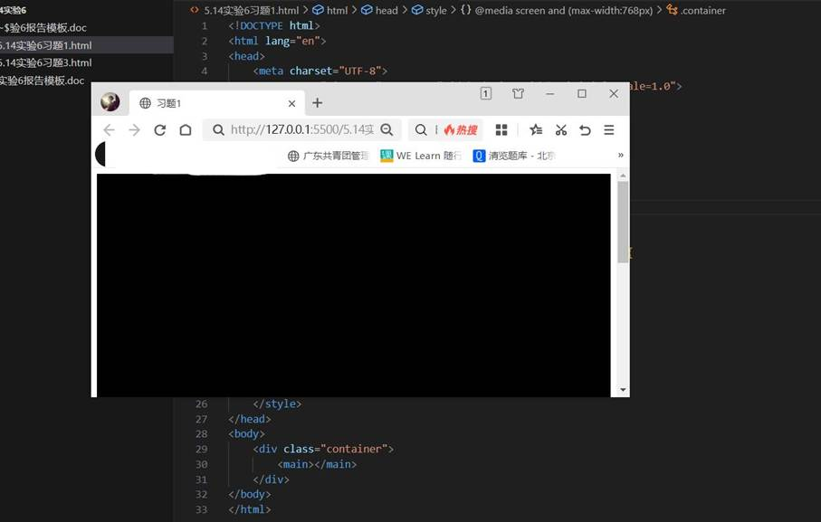
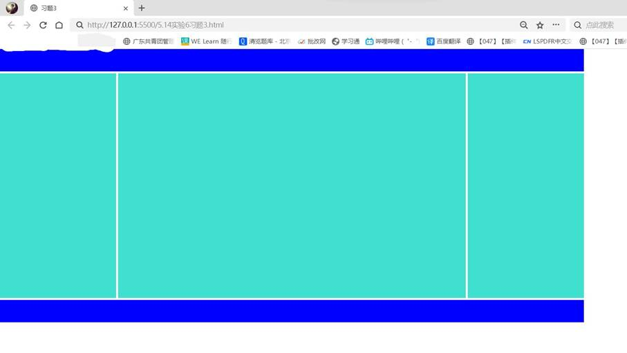
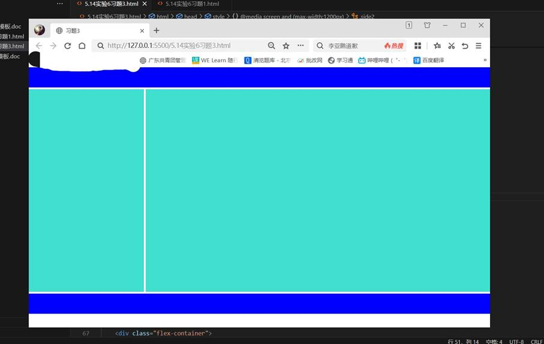
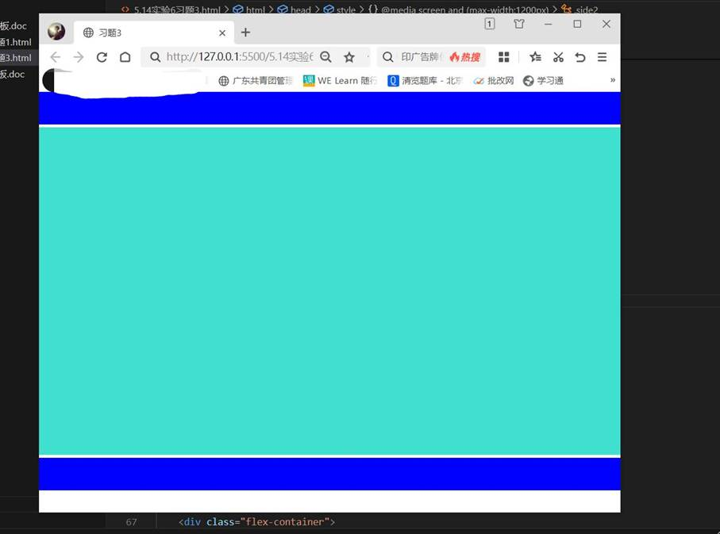

一、实验目的及要求

  1.掌握响应式布局设计网页。

  2.实现课本136页课后习题1、3。

  

 

 

  

  二、实验原理与内容

  实现课本136页课后习题1、3。

   

   

  

 

 

  

  三、实验软硬件环境

  Win10 

  VS Code

   

  

 

 

  

  四、实验过程（实验步骤、记录、数据、分析）

  习题1：

  &lt;!DOCTYPE html&gt;

  &lt;html lang=&quot;en&quot;&gt;

  &lt;head&gt;

   

    &lt;meta charset=&quot;UTF-8&quot;&gt;

   

    &lt;meta name=&quot;viewport&quot; content=&quot;width=device-width,

  initial-scale=1.0&quot;&gt;

   

    &lt;title&gt;习题1&lt;/title&gt;

   

    &lt;style&gt;

   

        .container{

   

            height: 780px;

   

        }

   

        @media screen and (max-width:768px){

   

            .container{

   

                background-color: black;

   

            }

   

        }

   

        @media screen and (min-width:768px) and (max-width:992px){

   

            .container{

   

                background-color: red;

   

            }

   

        }

   

        @media screen and (min-width:992px){

   

            .container{

   

                background-color: green;

   

            }

   

        }

   

    &lt;/style&gt;

  &lt;/head&gt;

  &lt;body&gt;

   

    &lt;div class=&quot;container&quot;&gt;

   

        &lt;main&gt;&lt;/main&gt;

   

    &lt;/div&gt;

  &lt;/body&gt;

  &lt;/html&gt;

   

   

  习题3：

  &lt;!DOCTYPE html&gt;

  &lt;html lang=&quot;en&quot;&gt;

  &lt;head&gt;

   

    &lt;meta charset=&quot;UTF-8&quot;&gt;

   

    &lt;meta name=&quot;viewport&quot; content=&quot;width=device-width,

  initial-scale=1.0&quot;&gt;

   

    &lt;title&gt;习题3&lt;/title&gt;

   

    &lt;style&gt;

   

        *{

   

            margin: 0;

   

            padding: 0;

   

        }

   

        .flex-container{

   

            max-width: 1300px;

   

            display: flex;

   

        }

   

        nav{

   

            max-width: 1300px;

   

            background-color: blue;

   

            height: 50px;

   

            border-bottom: 5px solid white;

   

        }

   

        main{

   

            background-color: turquoise;

   

            flex: 3;

   

            order: 2;

   

            height: 500px;

   

        }

   

        .side1{

   

            border-right: 5px solid white;

   

            background-color: turquoise;

   

            flex: 1;

   

            order: 1;

   

            height: 500px;

   

        }

   

        .side2{

   

            border-left: 5px solid white;

   

            background-color: turquoise;

   

            flex: 1;

   

            order: 3;

   

            height: 500px;

   

        }

   

        footer{

   

            max-width: 1300px;

   

            background-color: blue;

   

            height: 50px;

   

            border-top: 5px solid white;

   

        }

   

        @media screen and (max-width:1200px){

   

            .side2{

   

                display: none;

   

            }

   

        }

   

        @media screen and (max-width:992px){

   

            .side1{

   

                display: none;

   

            }

   

            .side2{

   

                display: none;

   

            }

   

        }

   

    &lt;/style&gt;

  &lt;/head&gt;

  &lt;body&gt;

   

    &lt;header&gt;

   

        &lt;nav&gt;&lt;/nav&gt;

   

    &lt;/header&gt;

   

    &lt;div class=&quot;flex-container&quot;&gt;

   

        &lt;main&gt;&lt;/main&gt;

   

        &lt;aside class=&quot;side1&quot;&gt;&lt;/aside&gt;

   

        &lt;aside class=&quot;side2&quot;&gt;&lt;/aside&gt;

   

    &lt;/div&gt;

   

    &lt;footer&gt;&lt;/footer&gt;

  &lt;/body&gt;

  &lt;/html&gt;

   

   

  

 

 

  

  五、测试/调试及实验结果分析

  习题1：

  

  

   

    

    

    

    

   

   

    

    

    

   

   

    

   

   

    

    

    

   

   

    

   

   

    

    

   

  

   

   

   

   

   

   

   

   

   

   

   

   

   

   

   

   

   

   

   

   

   

   

   

   

   

   

   

   

   

   

   

   

   

   

   

   

   

   

   

   

   

   

   

  

  习题3：

  

  

   

    

    

   

   

    

    

   

   

    

   

   

    

    

   

   

    

   

   

    

    

   

  

   

   

   

   

   

   

   

   

   

   

   

   

   

   

   

   

   

   

   

   

   

   

   

   

   

   

   

   

   

   

   

   

   

   

   

   

   

   

   

   

   

   

   

   

   

   

   

   

   

   

   

   

  

 

 

  

  六、实验结论与体会

  利用上述知识成功编写出所要的页面。过程虽然有些困难，但我借助书本一步一步地编写出来，成就感十足！

   

  2024年5月14日