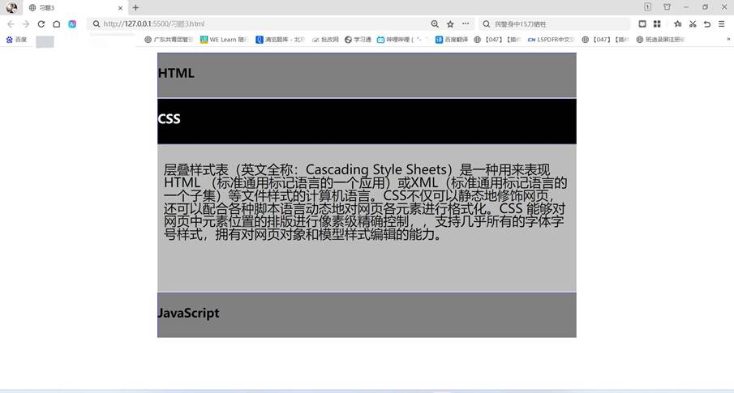
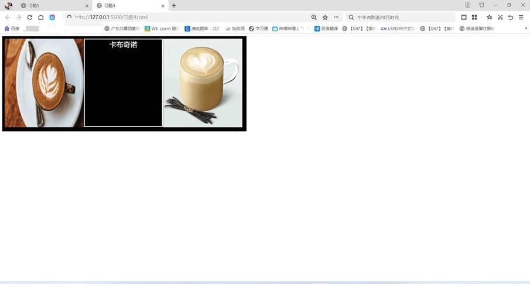

一、实验目的及要求

  1.掌握CSS3样式。

  2.实现课本155页课后习题3、4。

  

 

 

  

  二、实验原理与内容

  实现课本155页课后习题3、4。

   

   

  

 

 

  

  三、实验软硬件环境

  Win10 

  VS Code

   

  

 

 

  

  四、实验过程（实验步骤、记录、数据、分析）

  习题3：

  &lt;!DOCTYPE html&gt;

  &lt;html lang=&quot;en&quot;&gt;

  &lt;head&gt;

   

    &lt;meta charset=&quot;UTF-8&quot;&gt;

   

    &lt;meta name=&quot;viewport&quot; content=&quot;width=device-width,

  initial-scale=1.0&quot;&gt;

   

    &lt;title&gt;习题3&lt;/title&gt;

   

    &lt;style&gt;

   

        .wrap{

   

        width:650px;

   

        height:70px;

   

        margin: 0 auto;

   

        position:relative;

   

        overflow:hidden;

   

        border: 1px solid white;

   

        font-family: &quot;Microsoft YaHei&quot;;

   

        }

   

        .wrap .h3{

   

        width:650px;

   

        height:70px;

   

        background-color: gray;

   

        border:1px solid blue;

   

        transition:top 0.6s ease-in-out;

   

        }

   

        .wrap .text{

   

        width:650px;

   

        height:230px;

   

        padding:0;

   

        margin:0;

   

        position:absolute ;

   

        top:100px;

   

        background-color:rgba(128, 128, 128, 0.53);

   

        font-size:20px;

   

        line-height:16px;

   

        transition:top 0.8s ease-in-out;

   

        }

   

        .wrap p{

   

        padding:10px;

   

        line-height:20px;

   

        }

   

        .wrap:hover .text{

   

        top: 70px;

   

        }

   

        .wrap:hover .h3{

   

        color: aliceblue;

   

        background-color:black;

   

        }

   

        .wrap:hover{

   

            height: 300px;

   

        }

   

        &lt;/style&gt;

   

        

  &lt;/head&gt;

  &lt;body&gt;

   

        &lt;div class=&quot;wrap&quot;&gt;

   

               &lt;div class=&quot;h3&quot;&gt;&lt;h3&gt;HTML&lt;/h3&gt;&lt;/div&gt;

   

                &lt;div class=&quot;text&quot;&gt;

   

                &lt;p&gt;

   

                    HTML的全称为超文本标记语言，是一种标记语言。它包括一系列标签，通过这些标签可以将网络上的文档格式统一，使分散的Internet资源连接为一个逻辑整体。HTML文本是由HTML命令组成的描述性文本，HTML命令可以说明文字，图形、动画、声音、表格、链接等。

   

                &lt;/p&gt;

   

                &lt;/div&gt;

   

          &lt;/div&gt;

   

       &lt;div class=&quot;wrap&quot;&gt;

   

               

   

                &lt;div class=&quot;h3&quot;&gt;&lt;h3&gt;CSS&lt;/h3&gt;&lt;/div&gt;

   

                &lt;div class=&quot;text&quot;&gt;

   

                &lt;p&gt;

   

                    层叠样式表（英文全称：Cascading Style Sheets）是一种用来表现HTML （标准通用标记语言的一个应用）或XML（标准通用标记语言的一个子集）等文件样式的计算机语言。CSS不仅可以静态地修饰网页，还可以配合各种脚本语言动态地对网页各元素进行格式化。CSS 能够对网页中元素位置的排版进行像素级精确控制，，支持几乎所有的字体字号样式，拥有对网页对象和模型样式编辑的能力。

   

                &lt;/p&gt;

   

                &lt;/div&gt;

   

          &lt;/div&gt;

   

         &lt;div class=&quot;wrap&quot;&gt;

   

               

   

               &lt;div class=&quot;h3&quot;&gt;&lt;h3&gt;JavaScript&lt;/h3&gt;&lt;/div&gt;

   

               &lt;div class=&quot;text&quot;&gt;

   

                &lt;p&gt;

   

                    JavaScript（简称“JS”）是一种具有函数优先的轻量级，解释型或即时编译型的编程语言。虽然它是作为开发Web页面的脚本语言而出名，但是它也被用到了很多非浏览器环境中，JavaScript基于原型编程、多范式的动态脚本语言，并且支持面向对象、命令式、声明式、函数式编程范式。

   

                &lt;/p&gt;

   

                &lt;/div&gt;

   

          &lt;/div&gt;

  &lt;/body&gt;

  &lt;/html&gt;

   

   

  习题4：

  &lt;!DOCTYPE html&gt;

  &lt;html lang=&quot;en&quot;&gt;

  &lt;head&gt;

   

    &lt;meta charset=&quot;UTF-8&quot;&gt;

   

    &lt;meta name=&quot;viewport&quot; content=&quot;width=device-width,

  initial-scale=1.0&quot;&gt;

   

    &lt;title&gt;习题4&lt;/title&gt;

   

    &lt;style&gt;

   

        *{

   

        padding:0;

   

        margin:0;

   

        }

   

        .container{

   

        width:524px;

   

        height: 204px;

   

        margin:0 auto;

   

        background-color:black;

   

        margin: 5px;

   

         float: left;

   

        }

   

        .wrap{

   

        width:170px;

   

        height:190px;

   

        position:relative;

   

        float: left;

   

        }

   

        .wrap img{

   

            width: 170px;

   

            height: 190px;

   

        }

   

        .wrap .front{

   

        width:170px;

   

        height:190px;

   

        position:absolute;

   

        margin: 5px;

   

        float: left;

   

        backface-visibility:hidden;

   

        transform-style:preserve-3d;

   

        transition: all 1s ease-in;

   

        }

   

        .wrap .back{

   

        width:170px;

   

        height:190px;

   

        font-size:10px;

   

        background-color:black;

   

        color: aliceblue;

   

        text-align: center;

   

        font-size: 15px;

   

        position:absolute;

   

        margin: 5px;

   

        float:left;

   

        transform:rotateY(180deg);

   

        backface-visibility:hidden;

   

        transform-style:preserve-3d;

   

        transition:all 1s ease-in;

   

        }

   

        .wrap:hover .front{

   

        transform:rotateY(180deg);

   

        }

   

        .wrap:hover .back{

   

        transform:rotateY(0deg);

   

        }

   

        p{

   

            width: 166px;

   

            height: 186px;

   

            border: 2px solid white;

   

        }

   

        &lt;/style&gt;

   

        

  &lt;/head&gt;

  &lt;body&gt;

   

    &lt;div class=&quot;container&quot;&gt;

   

    &lt;div class=&quot;wrap&quot;&gt;

   

           &lt;div class=&quot;front&quot;&gt;

   

           &lt;img src=&quot;咖啡.jpeg&quot; alt=&quot;&quot;&gt;

   

           &lt;/div&gt;

   

            &lt;div class=&quot;back&quot;&gt;

   

            &lt;p&gt;咖啡&lt;/p &gt;

   

            &lt;/div&gt;

   

      &lt;/div&gt;

   

   &lt;div class=&quot;wrap&quot;&gt;

   

           &lt;div class=&quot;front&quot;&gt;

   

           &lt;img src=&quot;卡布奇诺.jpg&quot; alt=&quot;&quot;&gt;

   

           &lt;/div&gt;

   

            &lt;div class=&quot;back&quot;&gt;

   

            &lt;p&gt;卡布奇诺&lt;/p &gt;

   

            &lt;/div&gt;

   

      &lt;/div&gt;

  &lt;div class=&quot;wrap&quot;&gt;

   

           &lt;div class=&quot;front&quot;&gt;

   

           &lt;img src=&quot;拿铁.jpeg&quot; alt=&quot;&quot;&gt;

   

           &lt;/div&gt;

   

            &lt;div class=&quot;back&quot;&gt;

   

            &lt;p&gt;拿铁&lt;/p &gt;

   

            &lt;/div&gt;

   

      &lt;/div&gt;

   

      

  &lt;/div&gt;

  &lt;/body&gt;

  &lt;/html&gt;

   

   

  

 

 

  

  五、测试/调试及实验结果分析

  习题3：

  

  

   

    

   

   

    

    

   

  

   

   

   

   

   

   

   

   

   

   

   

   

   

  

  习题4：

  

  

   

    

   

   

    

    

   

  

   

   

   

   

   

   

   

   

   

   

   

   

   

  

 

 

  

  六、实验结论与体会

  利用上述知识成功编写出所要的页面。过程虽然有些困难，但我借助书本一步一步地编写出来，成就感十足！

   

  2024年5 月31 日