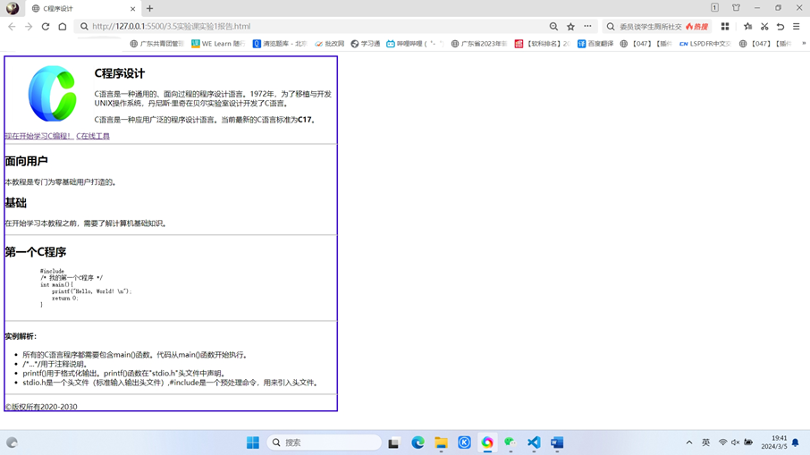
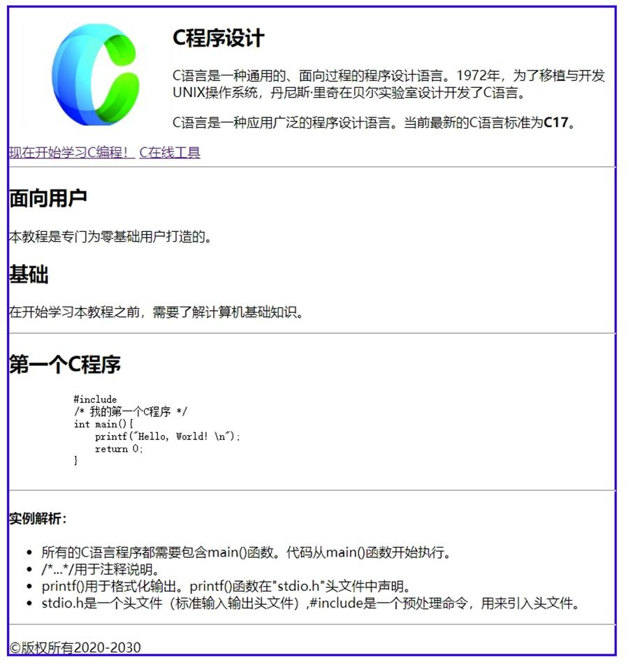

一、实验目的及要求

  1.熟悉常用HTML标签的使用方法

  2.实现课本45页图3-26所示网页

  

 

 

  

  二、实验原理与内容

  使用到了&lt;style&gt;设定页面的宽度、图片的悬浮位置和页面边框的属性。使用了div标签、pre、虚拟超链接、img标签、无序列表。通过以上组合，完成了页面的编写。

   

   

  

 

 

  

  三、实验软硬件环境

  Win10 

  VS Code

   

  

 

 

  

  四、实验过程（实验步骤、记录、数据、分析）

  &lt;!DOCTYPE html&gt;

  &lt;html lang=&quot;en&quot;&gt;

  &lt;head&gt;

   

    &lt;meta charset=&quot;UTF-8&quot;&gt;

   

    &lt;meta name=&quot;viewport&quot; content=&quot;width=device-width,

  initial-scale=1.0&quot;&gt;

   

    &lt;title&gt;C程序设计&lt;/title&gt;

   

    &lt;style&gt;

   

        body{

   

            width: 50%;

   

        }

   

        img{

   

            float: left;

   

        }

   

        .border-box{

   

            width: 740px;

   

            height: 790px;

   

            border: 3px solid #3c05f2;

   

        }

   

    &lt;/style&gt;

  &lt;/head&gt;

  &lt;body&gt;

   

    &lt;div class=&quot;border-box&quot;&gt;

   

    &lt;article&gt;

   

        &lt;img src=&quot;C.png&quot; alt=&quot;C logo&quot; width=&quot;200&quot;/&gt;

   

        &lt;h1&gt;C程序设计&lt;/h1&gt;

   

        &lt;p&gt;C语言是一种通用的、面向过程的程序设计语言。1972年，为了移植与开发UNIX操作系统，丹尼斯&middot;里奇在贝尔实验室设计开发了C语言。&lt;/p&gt;

   

        &lt;p&gt;C语言是一种应用广泛的程序设计语言。当前最新的C语言标准为&lt;strong&gt;C17&lt;/strong&gt;。&lt;/p&gt;

   

    &lt;/article&gt;

   

    &lt;nav&gt;

   

        &lt;a href=&quot;#&quot;&gt;现在开始学习C编程！&lt;/a&gt; &lt;a href=&quot;#&quot;&gt;C在线工具&lt;/a&gt;

   

    &lt;/nav&gt;

   

    &lt;hr width=&quot;740&quot; align=&quot;left&quot; /&gt;

   

    &lt;article&gt;

   

        &lt;h2&gt;面向用户&lt;/h2&gt;

   

        &lt;p&gt;本教程是专门为零基础用户打造的。&lt;/p&gt;

   

        &lt;h2&gt;基础&lt;/h2&gt;

   

        &lt;p&gt;在开始学习本教程之前，需要了解计算机基础知识。&lt;/p&gt;

   

        &lt;hr width=&quot;740&quot; align=&quot;left&quot; /&gt;

   

        &lt;h2&gt;第一个C程序&lt;/h2&gt;

   

        &lt;pre&gt;

   

            #include

   

            /* 我的第一个C程序 */

   

            int main(){

   

                printf(&quot;Hello, World!

  \n&quot;);

   

                return 0;

   

            }

   

        &lt;/pre&gt;

   

        &lt;hr width=&quot;740&quot; align=&quot;left&quot; /&gt;

   

        &lt;h4&gt;实例解析：&lt;/h4&gt;

   

        &lt;ul&gt;

   

            &lt;li&gt;所有的C语言程序都需要包含main()函数。代码从main()函数开始执行。&lt;/li&gt;

   

            &lt;li&gt;/*...*/用于注释说明。&lt;/li&gt;

   

            &lt;li&gt;printf()用于格式化输出。printf()函数在&quot;stdio.h&quot;头文件中声明。&lt;/li&gt;

   

            &lt;li&gt;stdio.h是一个头文件（标准输入输出头文件）,#include是一个预处理命令，用来引入头文件。&lt;/li&gt;

   

        &lt;/ul&gt;

   

        &lt;hr width=&quot;740&quot; align=&quot;left&quot; /&gt;

   

        &lt;p&gt;

   

            &copy;版权所有2020-2030

   

        &lt;/p&gt;        

   

    &lt;/article&gt;

  &lt;/div&gt;

  &lt;/body&gt;

  &lt;/html&gt;

   

  

 

 

  

  

五、测试/调试及实验结果分析

   

   

   

   

   

   

   

   

   

   

   

   

   

   

   

   

  

  

 

 

  

  六、实验结论与体会

  利用上述知识成功编写出所要的页面。过程虽然有些困难，但我借助书本一步一步地编写出来，成就感十足！

   

  2024年 3 月 5 日