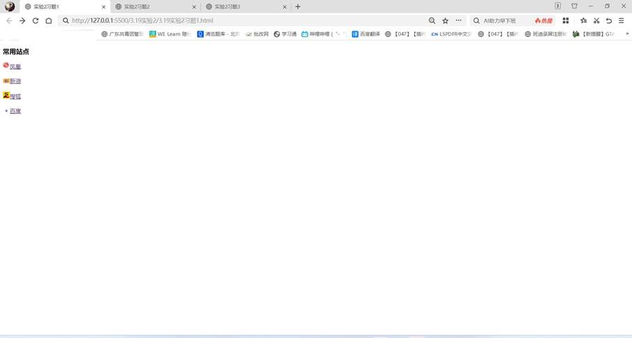
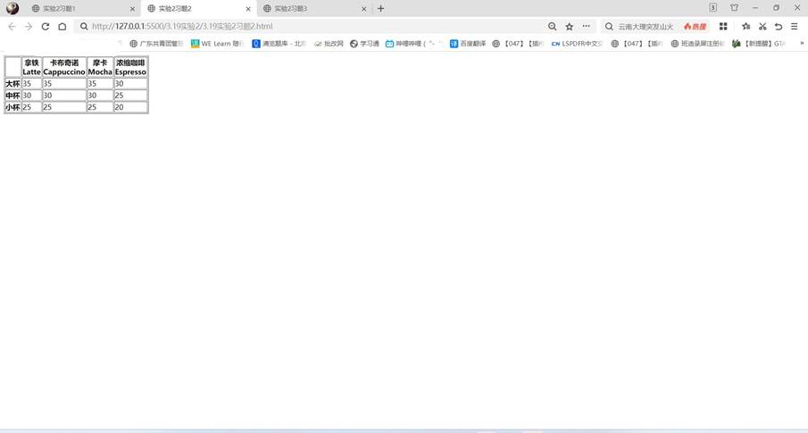
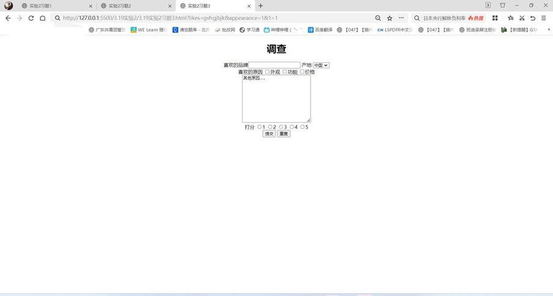

一、实验目的及要求

  1.熟悉超链接、表格和表单的使用方法。

  2.实现课本44页课后习题1、2、3的内容。

  

 

 

  

  二、实验原理与内容

  使用到了超链接、表格、表单等知识，并使用了ID选择器完成居中显示的操作。通过以上组合，完成了页面的编写。

   

   

   

  

 

 

  

  三、实验软硬件环境

  Win10 

  VS Code

   

  

 

 

  

  四、实验过程（实验步骤、记录、数据、分析）

  习题1代码：

  &lt;!DOCTYPE html&gt;

  &lt;html lang=&quot;en&quot;&gt;

  &lt;head&gt;

   

    &lt;meta charset=&quot;UTF-8&quot;&gt;

   

    &lt;meta name=&quot;viewport&quot; content=&quot;width=device-width,

  initial-scale=1.0&quot;&gt;

   

    &lt;title&gt;实验2习题1&lt;/title&gt;

  &lt;/head&gt;

  &lt;body&gt;

   

    &lt;h3&gt;&lt;strong&gt;常用站点&lt;/strong&gt;&lt;/h3&gt;

   

    &lt;img src=&quot;凤凰logo.png&quot; alt=&quot;fenghuanglogo&quot; width=&quot;20&quot;&gt;&lt;a href=&quot;https://www.ifeng.com/&quot;&gt;凤凰&lt;/a&gt;&lt;br/&gt;&lt;br/&gt;

   

    &lt;img src=&quot;新浪logo.jpeg&quot; alt=&quot;xinlanglogo&quot; width=&quot;20&quot;&gt;&lt;a href=&quot;https://www.sina.com.cn/&quot;&gt;新浪&lt;/a&gt;&lt;br/&gt;&lt;br/&gt;

   

    &lt;img src=&quot;搜狐logo.jpeg&quot; alt=&quot;souhulogo&quot; width=&quot;20&quot;&gt;&lt;a href=&quot;https://www.sohu.com/&quot;&gt;搜狐&lt;/a&gt;&lt;br/&gt;&lt;br/&gt;

   

    &lt;img src=&quot;百度logo.jpeg&quot; alt=&quot;baidulogo&quot; width=&quot;20&quot;&gt;&lt;a href=&quot;https://www.baidu.com/&quot;&gt;百度&lt;/a&gt;

  &lt;/body&gt;

  &lt;/html&gt;

   

  习题2代码：

  &lt;!DOCTYPE html&gt;

  &lt;html lang=&quot;en&quot;&gt;

  &lt;head&gt;

   

    &lt;meta charset=&quot;UTF-8&quot;&gt;

   

    &lt;meta name=&quot;viewport&quot; content=&quot;width=device-width,

  initial-scale=1.0&quot;&gt;

   

    &lt;title&gt;实验2习题2&lt;/title&gt;

  &lt;/head&gt;

  &lt;body&gt;

   

    &lt;table border=&quot;1&quot;&gt;

   

        &lt;thead&gt;

   

            &lt;tr&gt;

   

                &lt;th&gt;&lt;/th&gt;

   

                &lt;th&gt;拿铁&lt;br/&gt;Latte&lt;/th&gt;

   

                &lt;th&gt;卡布奇诺&lt;br/&gt;Cappuccino&lt;/th&gt;

   

                &lt;th&gt;摩卡&lt;br/&gt;Mocha&lt;/th&gt;

   

                &lt;th&gt;浓缩咖啡&lt;br/&gt;Espresso&lt;/th&gt;

   

            &lt;/tr&gt;

   

        &lt;/thead&gt;

   

        &lt;tbody&gt;

   

            &lt;tr&gt;

   

                &lt;td&gt;&lt;strong&gt;大杯&lt;/strong&gt;&lt;/td&gt;

   

                &lt;td&gt;35&lt;/td&gt;

   

                &lt;td&gt;35&lt;/td&gt;

   

                &lt;td&gt;35&lt;/td&gt;

   

                &lt;td&gt;30&lt;/td&gt;

   

            &lt;/tr&gt;

   

            &lt;tr&gt;

   

                &lt;td&gt;&lt;strong&gt;中杯&lt;/strong&gt;&lt;/td&gt;

   

                &lt;td&gt;30&lt;/td&gt;

   

                &lt;td&gt;30&lt;/td&gt;

   

                &lt;td&gt;30&lt;/td&gt;

   

                &lt;td&gt;25&lt;/td&gt;

   

            &lt;/tr&gt;

   

            &lt;tr&gt;

   

                &lt;td&gt;&lt;strong&gt;小杯&lt;/strong&gt;&lt;/td&gt;

   

                &lt;td&gt;25&lt;/td&gt;

   

                &lt;td&gt;25&lt;/td&gt;

   

                &lt;td&gt;25&lt;/td&gt;

   

                &lt;td&gt;20&lt;/td&gt;

   

            &lt;/tr&gt;

   

        &lt;/tbody&gt;

   

    &lt;/table&gt;

  &lt;/body&gt;

  &lt;/html&gt;

   

  习题3代码：

  &lt;!DOCTYPE html&gt;

  &lt;html lang=&quot;en&quot;&gt;

  &lt;head&gt;

   

    &lt;meta charset=&quot;UTF-8&quot;&gt;

   

    &lt;meta name=&quot;viewport&quot; content=&quot;width=device-width,

  initial-scale=1.0&quot;&gt;

   

    &lt;title&gt;实验2习题3&lt;/title&gt;

   

    &lt;style&gt;

   

        #center{

   

            text-align: center;

   

        }

   

    &lt;/style&gt;

  &lt;/head&gt;

  &lt;body&gt;

   

    &lt;div id=&quot;center&quot;&gt;

   

        &lt;h1&gt;调查&lt;/h1&gt;

   

    &lt;form&gt;

   

        喜欢的品牌&lt;input type=&quot;text&quot; name=&quot;likes&quot;/&gt; 产地

   

        &lt;select&gt;

   

            &lt;option&gt;其他&lt;/option&gt;

   

            &lt;option selected=&quot;selected&quot;&gt;中国&lt;/option&gt;

   

        &lt;/select&gt;&lt;br/&gt;

   

        喜欢的原因

   

        &lt;input type=&quot;checkbox&quot; value=&quot;1&quot; name=&quot;appearance&quot;/&gt;外观

   

        &lt;input type=&quot;checkbox&quot; value=&quot;2&quot; name=&quot;function&quot;/&gt;功能

   

        &lt;input type=&quot;checkbox&quot; value=&quot;3&quot; name=&quot;price&quot;/&gt;价格&lt;br/&gt;

   

        &lt;textarea name=&quot;&quot; id=&quot;&quot; cols=&quot;30&quot; rows=&quot;10&quot;&gt;其他原因...&lt;/textarea&gt;&lt;br/&gt;

   

        打分

   

        &lt;input type=&quot;radio&quot; value=&quot;1&quot; name=&quot;1&quot;/&gt;1

   

        &lt;input type=&quot;radio&quot; value=&quot;2&quot; name=&quot;2&quot;/&gt;2

   

        &lt;input type=&quot;radio&quot; value=&quot;3&quot; name=&quot;3&quot;/&gt;3

   

        &lt;input type=&quot;radio&quot; value=&quot;4&quot; name=&quot;4&quot;/&gt;4

   

        &lt;input type=&quot;radio&quot; value=&quot;5&quot; name=&quot;5&quot;/&gt;5&lt;br/&gt;

   

        &lt;input type=&quot;submit&quot; value=&quot;提交&quot;/&gt;

   

        &lt;input type=&quot;reset&quot; value=&quot;重置&quot;/&gt;

   

    &lt;/form&gt;

  &lt;/div&gt;

  &lt;/body&gt;

  &lt;/html&gt;

   

  

 

 

  

  五、测试/调试及实验结果分析

  习题1结果：

  

  

   

    

   

   

    

    

   

  

   

   

   

   

   

   

   

   

   

   

   

   

   

  

  习题2结果：

  

  

   

    

   

   

    

    

   

  

   

   

   

   

   

   

   

   

   

   

   

   

   

   

   

   

  

  习题3结果：

  

  

   

    

   

   

    

    

   

  

   

   

   

   

   

   

   

   

   

   

   

   

   

   

  

 

 

  

  六、实验结论与体会

  通过本次实验，我熟练地掌握了超链接、表格、表单等知识和使用方法，并掌握了ID选择器的知识，完成了居中显示的操作。

   

  2024年03月19日