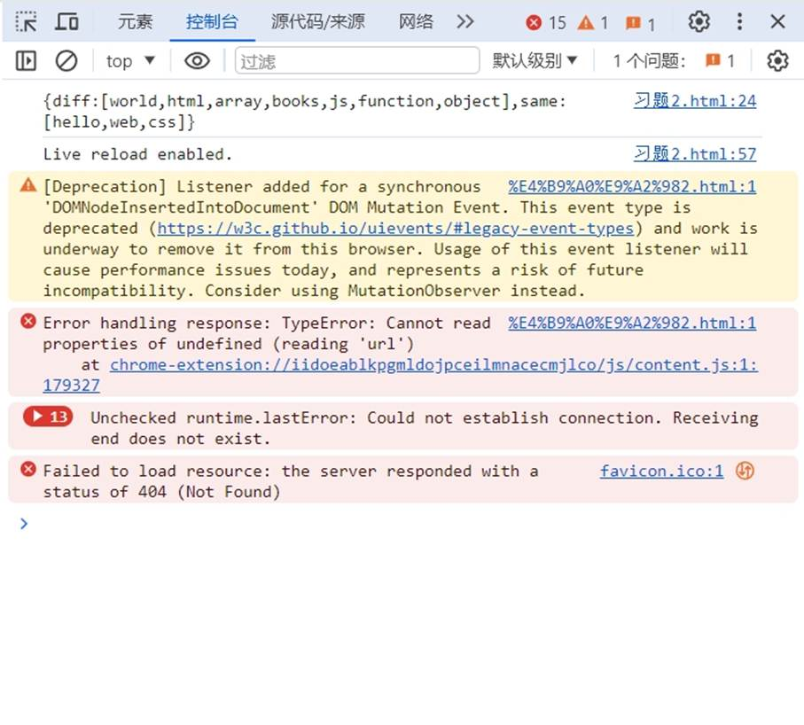
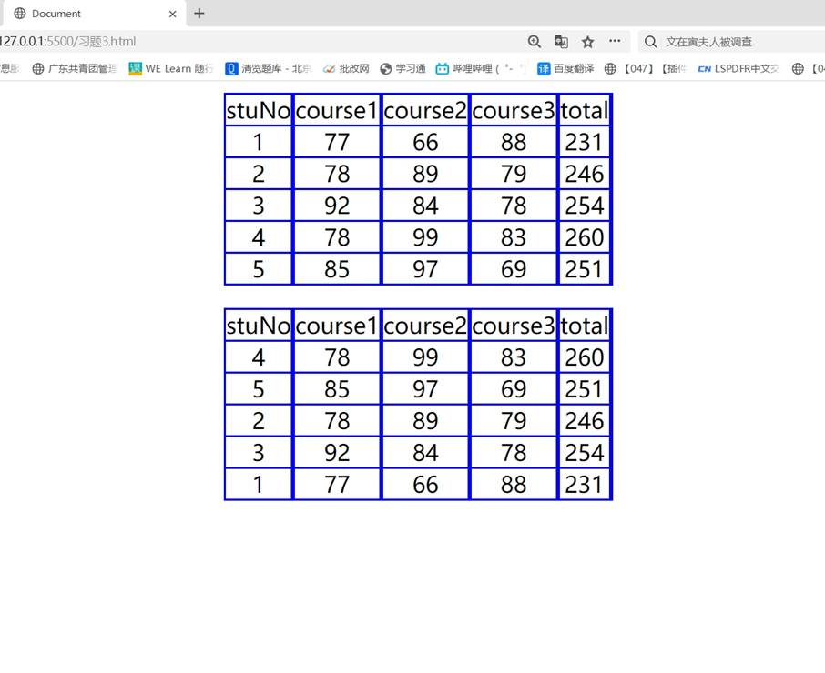

一、实验目的及要求

  1.掌握DOM。

  2.实现课本202页课后习题2、3。

  

 

 

  

  二、实验原理与内容

  实现课本202页课后习题2、3。

   

   

  

 

 

  

  三、实验软硬件环境

  Win10 

  VS Code

   

  

 

 

  

  四、实验过程（实验步骤、记录、数据、分析）

  习题2：

  &lt;!DOCTYPE html&gt;

  &lt;html lang=&quot;en&quot;&gt;

  &lt;head&gt;

   

    &lt;meta charset=&quot;UTF-8&quot;&gt;

   

    &lt;meta name=&quot;viewport&quot; content=&quot;width=device-width,

  initial-scale=1.0&quot;&gt;

   

    &lt;title&gt;习题2&lt;/title&gt;

  &lt;/head&gt;

  &lt;body&gt;

   

    &lt;script&gt;

   

        var arr1 = [&quot;hello&quot;,&quot;world&quot;,&quot;web&quot;,&quot;css&quot;,&quot;html&quot;,&quot;array&quot;];

   

        var arr2 = [&quot;hello&quot;,&quot;books&quot;,&quot;js&quot;,&quot;web&quot;,&quot;css&quot;,&quot;function&quot;,&quot;object&quot;];

   

        function getArrDifference(arr1,arr2){

   

            return arr1.concat(arr2).filter(function(v,i,arr){

   

                return arr.indexOf(v) === arr.lastIndexOf(v);

   

            });

   

        }

   

        function getArrSame(arr1,arr2){

   

            return arr1.filter(item=&gt;{

   

                return arr2.some(i=&gt;item==i)

   

            });

   

        }

   

        const arr3 = Object.values(getArrDifference(arr1,arr2));

   

        const arr4 = Object.values(getArrSame(arr1,arr2));

   

        console.log(&quot;{diff:[&quot;+arr3+&quot;],same:[&quot;+arr4+&quot;]}&quot;);

   

        // console.log(&quot;diff:&quot;+getArrDifference(arr1,arr2));

   

        // console.log(&quot;same:&quot;+getArrSame(arr1,arr2));

   

        

   

    &lt;/script&gt;

  &lt;/body&gt;

  &lt;/html&gt;

   

  习题3：

  &lt;!DOCTYPE html&gt;

  &lt;html lang=&quot;en&quot;&gt;

  &lt;head&gt;

   

    &lt;meta charset=&quot;UTF-8&quot;&gt;

   

    &lt;meta name=&quot;viewport&quot; content=&quot;width=device-width,

  initial-scale=1.0&quot;&gt;

   

    &lt;title&gt;Document&lt;/title&gt;

   

    &lt;style&gt;

   

        table {

   

            border-collapse: collapse;

   

        border: 2px solid blue;

   

        padding: 0px;

   

        margin: 10px auto;

   

        }

   

        tr, td {

   

        border: 2px solid blue;

   

        /* border-collapse: collapse; */

   

        padding: 0px;

   

        text-align: center;

   

        font-size: 20px;

   

        

   

        }

   

        

   

    &lt;/style&gt;

  &lt;/head&gt;

  &lt;body&gt;

   

    &lt;script&gt;

   

        let student1={

   

            stuNo:1,

   

            course1:77,

   

            course2:66,

   

            course3:88,

   

            total:&quot;&quot;}

   

       let student2={

   

            stuNo:2,

   

            course1:78,

   

            course2:89,

   

            course3:79,

   

            total:&quot;&quot;}

   

        let student3={

   

            stuNo:3,

   

            course1:92,

   

            course2:84,

   

            course3:78,

   

            total:&quot;&quot;}

   

        let student4={

   

            stuNo:4,

   

            course1:78,

   

            course2:99,

   

            course3:83,

   

            total:&quot;&quot;}

   

        let student5={

   

            stuNo:5,

   

            course1:85,

   

            course2:97,

   

            course3:69,

   

            total:&quot;&quot;}

   

        let stu=[student1,student2,student3,student4,student5]

   

        let stu1=[student1,student2,student3,student4,student5]

   

        let stu2=[&quot;stuNo&quot;,&quot;course1&quot;,&quot;course2&quot;,&quot;course3&quot;,&quot;total&quot;]

   

        console.log(stu1)

   

        for(let i=0;i&lt;stu.length;i++){

   

            let result=sum(stu[i].course1,stu[i].course2,stu[i].course3)

   

            stu[i].total=result

   

        }

   

        function sum(x,y,z){

   

            return x+y+z

   

        }

   

        

   

        let arr=[]

   

            for(let i=0;i&lt;stu.length;i++){

   

            arr.push(stu[i].total)

   

           }

   

            for(let i=0;i&lt;stu.length-1;i++){

   

            let min=i

   

            for(let j=i+1;j&lt;=stu.length;j++){

   

                if(stu[min].total &lt; arr[j]){

   

                    min=j

   

                }

   

            }

   

            if(i!==min){

   

               let tamp=stu[i]

   

               stu[i]=stu[min]

   

               stu[min]=tamp

   

            }

   

            }

   

            console.log(stu)

   

        

   

        let row=6;

   

        let col=5;

   

        Table(row,col);

   

        function Table(row,col){

   

            document.write(&quot;&lt;table&gt;&quot;);

   

                for(let i=0;i&lt;row;i++){

   

                    document.write(&quot;&lt;tr&gt;&quot;);

   

                        if(i==0){

   

                       

      for(let j=0;j&lt;col;j++){

   

                       

          document.write(&quot;&lt;td&gt;&quot;);

   

                       

      document.write(stu2[j]);

   

                       

      document.write(&quot;&lt;td&gt;&quot;);}    

                       

                       

           

   

                       

  }

   

                       

         

   

                        if(i&gt;0){

   

                       

          document.write(&quot;&lt;td&gt;&quot;);

   

                       

      document.write(stu1[i-1].stuNo);

   

                       

      document.write(&quot;&lt;td&gt;&quot;);

   

                       

          document.write(&quot;&lt;td&gt;&quot;);

   

                       

      document.write(stu1[i-1].course1);

   

                       

      document.write(&quot;&lt;td&gt;&quot;);

   

                       

          document.write(&quot;&lt;td&gt;&quot;);

   

                       

      document.write(stu1[i-1].course2);

   

                       

      document.write(&quot;&lt;td&gt;&quot;);

   

                       

          document.write(&quot;&lt;td&gt;&quot;);

   

                       

      document.write(stu1[i-1].course3);

   

                       

      document.write(&quot;&lt;td&gt;&quot;);

   

                       

          document.write(&quot;&lt;td&gt;&quot;);

   

                       

      document.write(stu1[i-1].total);

   

                       

      document.write(&quot;&lt;td&gt;&quot;);

   

                       

      }

   

                        document.write(&quot;&lt;tr&gt;&quot;);

   

                       

      

   

                }

   

                document.write(&quot;&lt;table&gt;&quot;);

   

        }

   

       

   

        Table1(row,col);

   

        function Table1(row,col){

   

            document.write(&quot;&lt;table&gt;&quot;);

   

                for(let i=0;i&lt;row;i++){

   

                    document.write(&quot;&lt;tr&gt;&quot;);

   

                        if(i==0){

   

                       

      for(let j=0;j&lt;col;j++){

   

                       

          document.write(&quot;&lt;td&gt;&quot;);

   

                       

      document.write(stu2[j]);

   

                       

      document.write(&quot;&lt;td&gt;&quot;);}    

                       

                       

           

   

                       

  }

   

                       

         

   

                        if(i&gt;0){

   

                       

          document.write(&quot;&lt;td&gt;&quot;);

   

                       

      document.write(stu[i-1].stuNo);

   

                       

      document.write(&quot;&lt;td&gt;&quot;);

   

                       

          document.write(&quot;&lt;td&gt;&quot;);

   

                       

      document.write(stu[i-1].course1);

   

                       

      document.write(&quot;&lt;td&gt;&quot;);

   

                       

          document.write(&quot;&lt;td&gt;&quot;);

   

                       

      document.write(stu[i-1].course2);

   

                       

      document.write(&quot;&lt;td&gt;&quot;);

   

                       

          document.write(&quot;&lt;td&gt;&quot;);

   

                       

      document.write(stu[i-1].course3);

   

                       

      document.write(&quot;&lt;td&gt;&quot;);

   

                       

          document.write(&quot;&lt;td&gt;&quot;);

   

                       

      document.write(stu[i-1].total);

   

                       

      document.write(&quot;&lt;td&gt;&quot;);

   

                       

      }

   

                        document.write(&quot;&lt;tr&gt;&quot;);

   

                       

      

   

                }

   

                document.write(&quot;&lt;table&gt;&quot;);

   

        }

   

    

   

        

   

        

   

    &lt;/script&gt;

   

  

  &lt;/body&gt;

  &lt;/html&gt;

   

   

   

  

 

 

  

  五、测试/调试及实验结果分析

  习题2：

  

  

   

    

   

   

    

    

   

  

   

   

   

   

   

   

   

   

   

   

   

   

   

   

   

   

   

   

   

   

   

   

   

   

   

  

  习题3：

  

  

   

    

   

   

    

    

   

  

   

   

   

   

   

   

   

   

   

   

   

   

   

   

   

   

   

   

   

   

   

  

 

 

  

  六、实验结论与体会

  利用上述知识成功编写出所要的页面。过程虽然有些困难，但我借助书本一步一步地编写出来，成就感十足！

   

   

  2024年6月15日