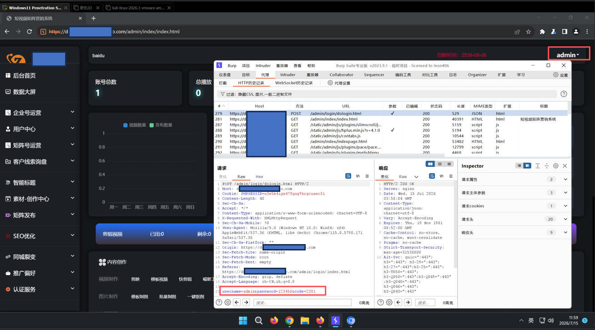
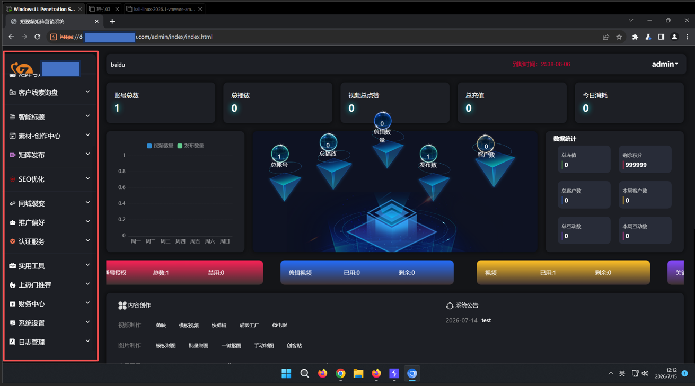
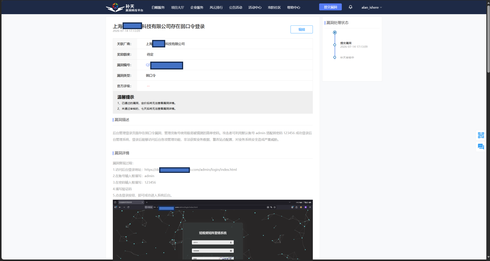

上海XXXX科技有限公司后台管理登录页存在弱口令漏洞

基础信息

1.漏洞标题：上海XXXX科技有限公司后台管理登录页存在弱口令漏洞，可直接获取管理员权限

2.漏洞大类：事件型漏洞

3.漏洞类型：弱口令

4.漏洞等级：中危

5.厂商名称：上海XXXX科技有限公司

6.目标域名：zxxxxxxxxxxxo.com

7.漏洞 URL：http://dxxxxn.zxxxxxxxxxxxo.com

8.测试账号：admin / 123456

二、简要描述

短视频矩阵营销系统后台登录页面使用默认管理员账号 admin 搭配弱密码 123456，未做密码强度管控，攻击者无需爆破，直接输入账号密码即可登录完整后台，拥有全部管理权限，可操作会员、文件上传、业务配置等所有功能，存在数据泄露、恶意篡改等高风险。

详细细节

目标资产与环境基础信息

2. 漏洞原理

厂商上线系统后未修改后台默认管理员密码，密码为通用弱口令 123456，登录仅简单校验账号密码，未配置密码复杂度策略、登录失败锁定机制，攻击者可直接手动登录后台获取最高管理员权限。

3. 完整复现步骤

1.访问后台登录页面http://dxxxxn.zxxxxxxxxxxxo.com

2.账号输入框填写admin，密码输入框填写123456，填写页面验证码；

3.点击登录按钮提交登录请求；

4.服务器校验通过，直接跳转后台管理首页，成功获得管理员操作权限；

5.登录后可访问财务设置、会员管理、素材上传等全部后台功能模块。

4.POC（完整登录 HTTP 请求包）：

POST /admin/login/dologin.html HTTP/2

Host: dxxxxn.zxxxxxxxxxxxo.com

Cookie: PHPSESSID=u3e5b4iga47fgag9hrgcuaeo3l

Content-Length: 40

Sec-Ch-Ua:

Accept: */*

Content-Type: application/x-www-form-urlencoded; charset=UTF-8

X-Requested-With: XMLHttpRequest

Sec-Ch-Ua-Mobile: ?0

User-Agent: Mozilla/5.0 (Windows NT 10.0; Win64; x64) AppleWebKit/537.36 (KHTML, like Gecko) Chrome/115.0.5790.171 Safari/537.36

Sec-Ch-Ua-Platform: ""

Origin: https://dxxxxn.zxxxxxxxxxxxo.com

Sec-Fetch-Site: same-origin

Sec-Fetch-Mode: cors

Sec-Fetch-Dest: empty

Referer: https://dxxxxn.zxxxxxxxxxxxo.com/admin/login/index.html

Accept-Encoding: gzip, deflate

Accept-Language: zh-CN,zh;q=0.9

username=admin&password=123456&code=2381

利用方式：浏览器访问登录页，填入账号密码验证码提交即可登录后台。

5. 漏洞危害

攻击者直接获取全站后台管理员权限，无需任何复杂漏洞利用；

可管理全部会员账号、修改用户密码、篡改平台业务数据；

可利用后台文件上传功能上传恶意脚本，控制服务器；

窃取企业客户联系方式、业务订单等核心隐私数据，造成企业信息泄露与经济损失。

修复方案

1.立即修改管理员账号密码，密码长度≥12 位，必须包含大小写字母、数字、特殊符号，禁用 123456、admin 等弱口令；

2.开启登录图形验证码，所有后台登录强制验证；

3.配置登录失败锁定策略，连续 5 次密码错误临时冻结账号 10 分钟；

4.后台增加 IP 白名单访问限制，仅允许企业办公内网、运维固定 IP 访问登录地址；

5.定期巡检所有后台管理账号，清理闲置账号，强制全员定期更换高强度密码。

补天平台提交漏洞截图：

| 信息项 | 详情 |
| 所属厂商 | 上海XXXX科技有限公司 |
| 备案信息 | 沪 ICP 备 1xxxxxx0 号 - 1 |
| 一级域名 | zxxxxxxxxxxxo.com |
| 漏洞子域名 | dxxxxn.zxxxxxxxxxxxo.com |
| 服务器 IP | 122.xx.xx.xx（阿里云上海节点） |
| 操作系统 | Linux |
| Web 服务 | nginx |
| 后端环境 | PHP + ThinkPHP 框架 |
| 服务端口 | 443（HTTPS） |
| 系统名称 | 短视频矩阵营销系统 |
| 系统定位 | 短视频矩阵营销管理平台，服务于抖音等短视频平台的矩阵号运营 |
| SSL 证书状态 | 已过期，浏览器访问会显示不安全警告 |