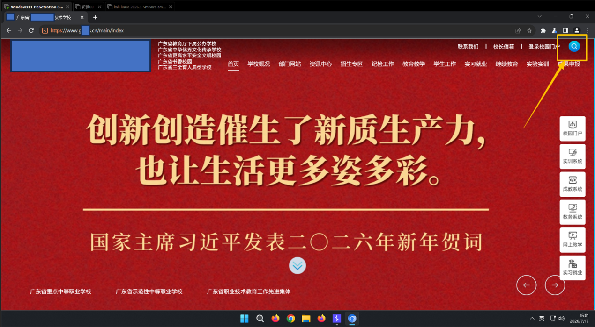
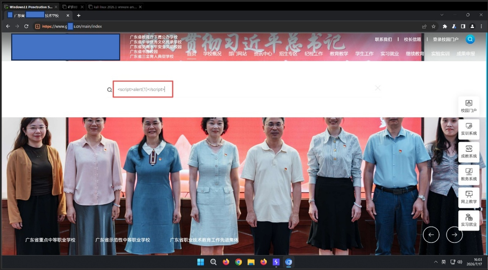
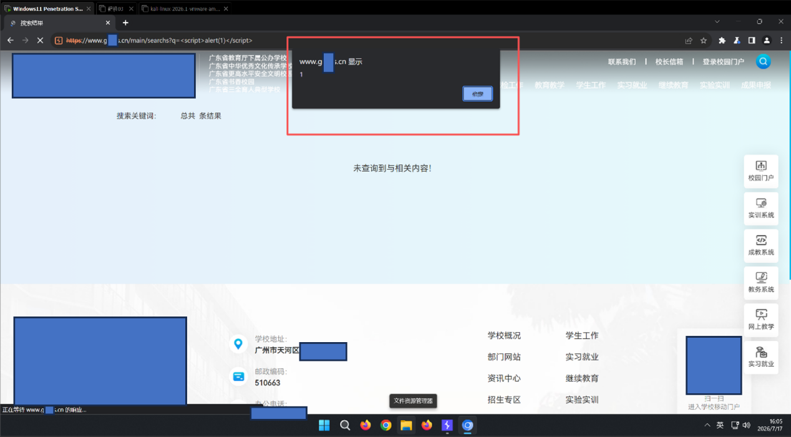
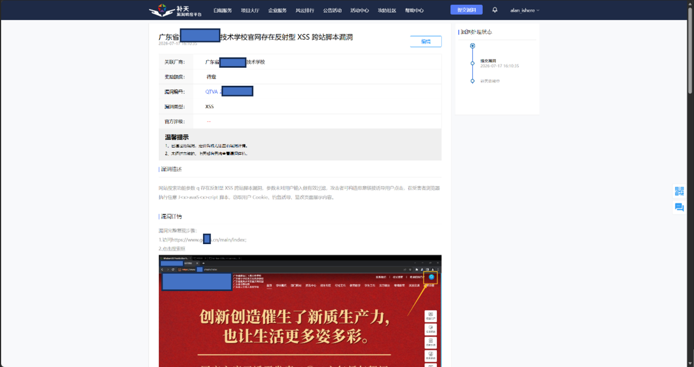

广东省XXXXXX技术学校官网存在反射型 XSS 漏洞

一、基础信息

1.漏洞标题：广东省XXXXXX技术学校官网搜索功能存在反射型 XSS 跨站脚本漏洞

2.漏洞大类：事件型漏洞

3.漏洞类型：XSS

4.漏洞等级：低危

5.厂商名称：广东省XXXXXX技术学校

6.目标域名：gxxxs.cn

7.漏洞 URL：https://www.gxxxs.cn/main/searchs?q=%3Cscript%3Ealert(1)%3C/script%3E

8.漏洞参数：q（GET 参数）

二、简要描述

学校官网搜索功能 GET 参数q存在反射型 XSS 跨站脚本漏洞，参数未对用户输入的特殊 HTML、JS 字符做有效过滤转义，输入内容直接反射输出至页面 HTML 源码中。攻击者可构造携带恶意 JS 代码的 URL 链接，诱导用户点击访问，在受害者浏览器中执行任意 JavaScript 脚本，窃取用户 Cookie、钓鱼诱导、篡改页面展示内容。

三、详细细节

1. 目标资产与环境基础信息

2. 漏洞原理

官网搜索接口 GET 参数q接收用户可控输入，后端未对< > " ' &等特殊 HTML 字符以及

4.按回车键，页面加载完成后，浏览器成功弹出alert(1)弹窗，证明 JS 脚本被执行，漏洞稳定复现。

4. POC

漏洞利用 POC 链接

https://www.gxxxs.cn/main/searchs?q=

HTTP 原始请求包：

GET /main/searchs?q=%3Cscript%3Ealert(1)%3C/script%3E HTTP/1.1

Host: www.gxxxs.cn

Cookie: .AspNetCore.Antiforgery.KKF0iQjHTlo=CfDJ8PWyWdRnJ-FBhJ0UYACQ19HchRKWYlYP2LguEFqYL_BaUbiD1cR86yzasIWo5sPJaX-RSpWkPedcL1lLT1nqnvkMnnYIekbMC1L5RsUFLGRpaj1KMHZ_wRuNoyBhhWkzGWOO6VZRpgPSI1lUnye67R0

Upgrade-Insecure-Requests: 1

User-Agent: Mozilla/5.0 (Windows NT 10.0; Win64; x64) AppleWebKit/537.36 (KHTML, like Gecko) Chrome/115.0.5790.171 Safari/537.36

Accept: text/html,application/xhtml+xml,application/xml;q=0.9,image/avif,image/webp,image/apng,*/*;q=0.8,application/signed-exchange;v=b3;q=0.7

Sec-Fetch-Site: same-origin

Sec-Fetch-Mode: navigate

Sec-Fetch-User: ?1

Sec-Fetch-Dest: document

Sec-Ch-Ua:

Sec-Ch-Ua-Mobile: ?0

Sec-Ch-Ua-Platform: ""

Referer: https://www.gxxxs.cn/main/index

Accept-Encoding: gzip, deflate

Accept-Language: zh-CN,zh;q=0.9

Connection: close

5. 漏洞危害

Cookie 窃取风险：攻击者可编写脚本窃取受害者浏览器 Cookie，若站点存在登录会话凭证，可劫持用户登录会话；

钓鱼诱导风险：利用 XSS 篡改页面内容，伪造虚假通知、登录入口，诱导师生输入账号密码，造成账号被盗；

页面篡改风险：恶意篡改学校官网页面展示内容，发布虚假信息，破坏学校官方形象与公信力；

恶意跳转风险：植入恶意脚本自动跳转至钓鱼、诈骗网站，诱导访客访问恶意站点；

内网探测风险：结合浏览器特性，可利用 XSS 探测学校内网资产，为后续攻击做铺垫。

四、修复方案

1.输出端 HTML 实体转义：所有用户可控参数输出到 HTML 页面时，统一对< > " ' &等特殊字符进行 HTML 实体转义（如<转义为&lt;，>转义为&gt;）；

2.输入端参数过滤：针对搜索参数q配置安全过滤规则，拦截<script>、javascript:、onerror、onload等危险标签与事件属性；

3.配置 CSP 内容安全策略：在 HTTP 响应头中添加Content-Security-Policy，限制页面内脚本执行来源，禁止非信任内联 JS 执行，大幅降低 XSS 漏洞危害；

4.设置 HttpOnly Cookie 属性：对登录会话 Cookie 添加 HttpOnly 标记，防止 XSS 漏洞窃取会话凭证；

5.全站风险排查：定期扫描全站所有搜索、查询、跳转类可控参数输出点，排查同类反射型 XSS 风险；

6.输入长度限制：对搜索参数增加合理的长度限制，减少复杂 XSS Payload 的注入空间。

补天平台提交漏洞截图：

| 信息项 | 详情 |
| 所属厂商 | 广东省XXXXXX技术学校 |
| 备案信息 | 粤 ICP 备 07xxxx30 号 |
| 一级域名 | gxxxs.cn |
| 漏洞子域名 | www.gxxxs.cn |
| 服务器 IP | 58.xx.xx.24（广州移动机房） |
| 操作系统 | Linux |
| Web 服务 | nginx/1.20.1 |
| 服务端口 | 443（HTTPS） |
| 系统名称 | 广东省XXXXXX技术学校官网 |
| 系统定位 | 学校官方门户网站，用于学校信息发布、招生宣传、师生服务 |
| SSL 证书状态 | 有效，DNSPod DV TLS RSA 泛域名证书，到期时间 2027-02-16 |