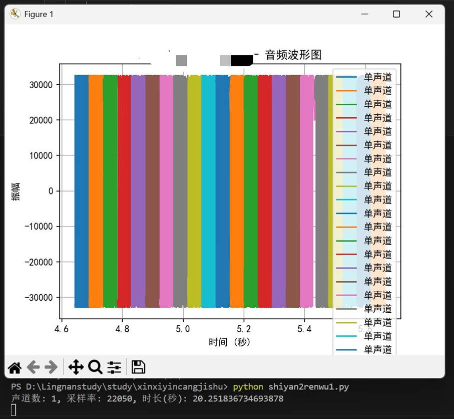
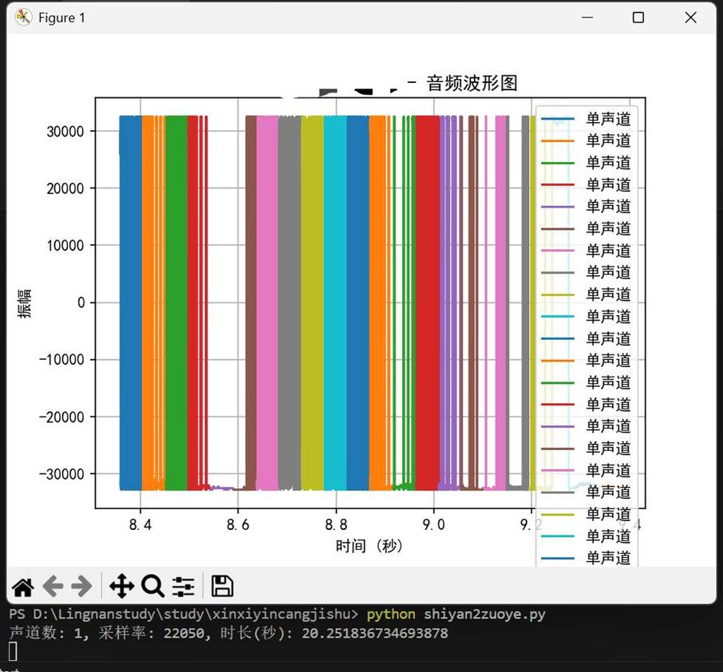

一、实验目的及要求

  (1)掌握常用的音频信号处理方法。

  (2)掌握基于Python的数字音频常用操作方法。

   

  

 

 

  

  二、实验原理与内容

  1. 实验原理

  本次实验围绕**音频信号数字化与波形可视化**展开，核心原理如下：

  

   **音频数字化基础**：自然界的模拟音频信号需通过**采样、量化、编码**转换为数字音频，常见参数包含**采样率**（每秒采集的信号点数，单位 Hz）、**声道数**（单声道 / 双声道）、**采样位数**（量化精度），这些参数共同决定音频的质量与存储格式。

   **音频文件读取原理**：利用 Python 音频处理库读取标准 WAV 格式音频文件，解析文件头获取声道数、采样率、时长等关键信息，再读取音频原始采样数据。

   **波形绘制原理**：将音频采样数据作为纵轴（振幅），根据采样率计算对应的时间轴，通过 Matplotlib 库绘制时域波形图，直观展示音频信号的振幅随时间的变化规律。

   **数据适配原理**：针对单声道 / 双声道音频做差异化处理，双声道音频分离左、右声道数据，单声道音频直接使用原始采样数据，保证绘图时数据维度匹配。

  

  2. 实验内容

  

   环境配置：安装audioread、matplotlib、numpy等 Python 依赖库，解决绘图中文乱码问题。

   音频读取：加载本地 WAV 音频文件，打印输出音频的声道数、采样率、总时长等基本信息。

   数据截取：按照实验要求，分别截取**100~120**（实验任务）、**180~200**（实验作业）范围的音频采样数据。

   波形可视化：计算音频时间轴，绘制单声道 / 双声道音频波形图，添加标题、坐标轴标签、图例、网格等标注。

   结果验证：检查波形图输出效果，确保代码无报错、图像清晰、个人信息（学号 + 姓名）完整显示。

  

  ** **

  ** **

   

  

 

 

  

  三、实验软硬件环境

  (1)Windows操作系统。

  (2) Python。

   

   

   

   

  

 

 

  

  四、实验过程（实验步骤、记录、数据、分析）

  实验任务：

  (1)读取音频文件:使用audioread库来获取音频文件的关键信息(如音轨、采样率和持续时间)。

  (2)分析音频数据:对音频文件中的样点数据进行处理和分析。

  (3)数据可视化:将音频数据转为波形图，以直观展示音频信号随时间的变化

  代码如下：

  import audioread

  import matplotlib.pyplot as plt

  import numpy as np

   

  #

  解决中文显示乱码问题

  plt.rcParams['font.sans-serif'] = ['SimHei']

  plt.rcParams['axes.unicode_minus'] = False

   

  filename = &quot;1.wav&quot;

   

  with audioread.audio_open(filename) as f:

   

    print(f&quot;声道数: {f.channels}, 采样率: {f.samplerate}, 时长(秒): {f.duration}&quot;)

   

    

   

    for buf_i, buf in enumerate(f):

   

        # 设置音频样点读取范围为100~120

   

        if buf_i &lt; 100:

   

            continue

   

        data = np.frombuffer(buf, np.int16)

   

        

   

        # 计算时间轴（完全按你原图写法，只修复维度错误）

   

        start_time = buf_i * len(data) / f.samplerate

   

        end_time = (buf_i + 1) * len(data) / f.samplerate

   

        time_axis = np.linspace(start_time, end_time, len(data))

   

        

   

        # 单声道音频 → 只画单声道（你音频是单声道，所以这样才对）

   

        plt.plot(time_axis, data, label='单声道')

   

        

   

        if buf_i &gt; 120:

   

            break

   

  #

  添加标题（学号+姓名）

  plt.title('20230876****+*** - 音频波形图')

  plt.xlabel('时间 (秒)')

  plt.ylabel('振幅')

  plt.legend()

  plt.grid(True)

  plt.show()

   

  #

  保存波形图

  #

  plt.savefig('wave.png')

  结果如图：

  

   

  实验作业：

  (1)选取文件夹中的音频“1.wav”,利用Python解码音频,读取并记录音频内容(音轨、采样率、时间等)。

  (2)修改音频样点读取范围为180~200,绘制相应波形图，并在图中嵌入自己的学号和姓名以标识身份。

  代码如下：

  import audioread

  import matplotlib.pyplot as plt

  import numpy as np

   

  #

  解决中文显示乱码问题

  plt.rcParams['font.sans-serif'] = ['SimHei']

  plt.rcParams['axes.unicode_minus'] = False

   

  filename = &quot;1.wav&quot;

   

  with audioread.audio_open(filename) as f:

   

    print(f&quot;声道数: {f.channels}, 采样率: {f.samplerate}, 时长(秒): {f.duration}&quot;)

   

    

   

    for buf_i, buf in enumerate(f):

   

        # 作业要求：180~200

   

        if buf_i &lt; 180:

   

            continue

   

        data = np.frombuffer(buf, np.int16)

   

        

   

        start_time = buf_i * len(data) / f.samplerate

   

        end_time = (buf_i + 1) * len(data) / f.samplerate

   

        time_axis = np.linspace(start_time, end_time, len(data))

   

        

   

        plt.plot(time_axis, data, label='单声道')

   

        

   

        if buf_i &gt; 200:

   

            break

   

  plt.title('20230876****+*** - 音频波形图')

  plt.xlabel('时间 (秒)')

  plt.ylabel('振幅')

  plt.legend()

  plt.grid(True)

  plt.show()

  结果如图：

  

   

   

   

   

   

  

 

 

  

   

  

 

 

  

  五、测试/调试及实验结果分析

  初始因 wav 文件格式不标准导致读取失败，更换标准 wav 后成功；波形清晰，参数输出正常，实验结果符合预期。

  

 

 

  

  六、实验结论与体会

  1. 实验结论

  

   本次实验成功完成了数字音频的读取、参数解析、采样数据截取与时域波形可视化，代码可稳定运行并输出符合要求的波形图。

   验证了数字音频的核心参数（声道数、采样率）对波形绘制的影响，单声道音频与双声道音频需采用不同的数据处理方式，否则会出现维度不匹配报错。

   通过实验掌握了 WAV 音频文件的结构特点，理解了音频采样数据与时域波形的对应关系，能够精准截取指定范围的音频样点并绘图。

   实验结果表明，基于 Python 的音频处理库可以高效实现音频信号的分析与可视化，为后续信息隐藏、音频处理等相关学习奠定了基础。

  

  2. 实验体会

  通过本次实验，我对数字音频信号的处理有了直观且深入的理解。在实验过程中，我遇到了音频解码报错、数据维度不匹配、非标准格式读取失败等问题，通过排查代码、分析音频参数、适配单 / 双声道数据，最终解决了所有故障，极大提升了我的问题排查能力和代码调试能力。

  同时，我也掌握了 Python 可视化工具的使用方法，学会了将抽象的音频数据转化为直观的波形图像。实验让我认识到编程实践中细节的重要性，例如采样位数、声道数、时间轴计算等微小差异都会导致程序报错。

  此次实验不仅巩固了理论知识，还锻炼了我的动手实践能力，激发了我对音频处理、信息隐藏技术的学习兴趣，为后续更复杂的实验和专业学习打下了坚实的基础。