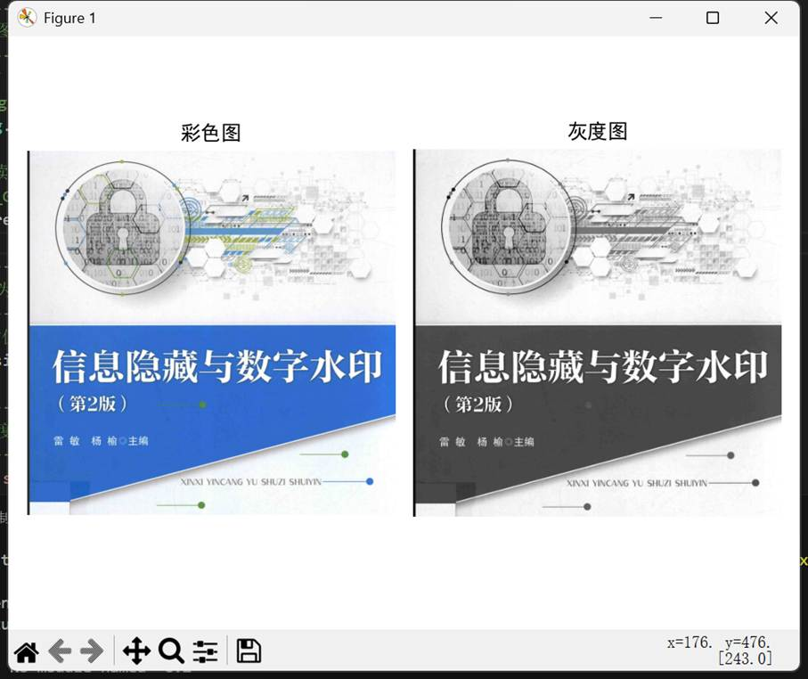
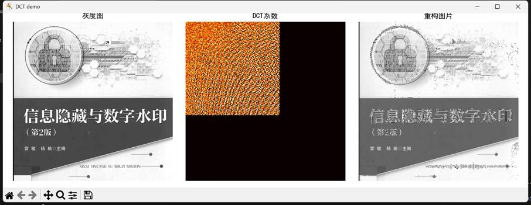
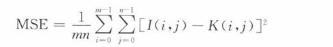
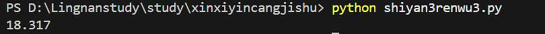
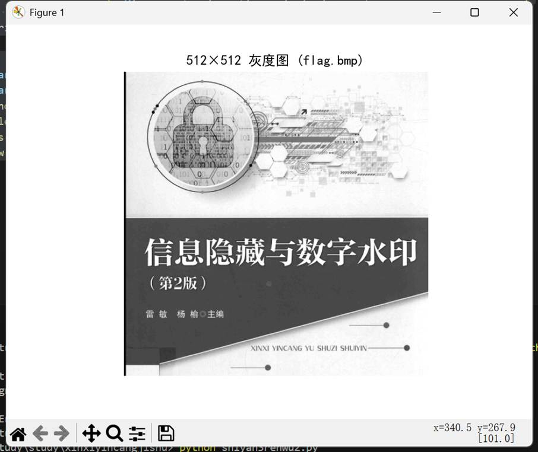
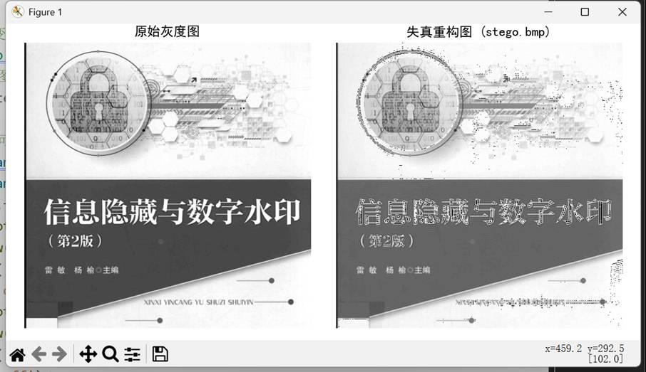
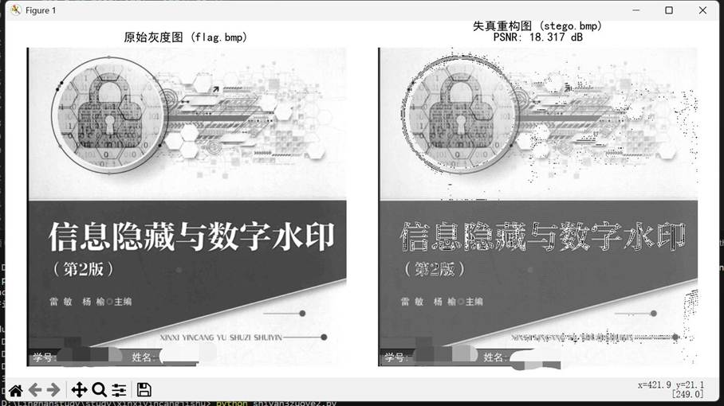

一、实验目的及要求

  (1)掌握基于Python的数字图像常用操作。

  (2)掌握域转换函数转换图像到频域及逆变换的操作。

   

  

 

 

  

  二、实验原理与内容

  （一）实验原理

  

   **数字图像灰度化与尺寸调整**：数字图像的灰度化是将彩色图像的 RGB 三通道像素值按一定规则转换为单通道灰度值，简化图像数据维度；尺寸调整通过插值算法（本实验采用双线性插值）将图像归一化为指定尺寸，保证后续处理的一致性，OpenCV 库为该操作提供了高效的实现接口。

   **离散余弦变换（****DCT****）与逆变换**：DCT 是将空域图像转换为频域的经典变换方法，其核心特性为**能量集中性**，即图像的主要视觉信息（轮廓、亮度）集中在频域的低频系数区域，高频系数对应图像的细节、纹理信息。OpenCV 的dct()函数可实现空域到频域的转换，idct()函数则完成频域到空域的逆变换，实现图像重构；对频域部分系数置零会造成图像信息丢失，进而产生重构失真。

   **峰值信噪比（****PSNR****）**：PSNR 是衡量图像失真程度的核心评价指标，基于均方误差（MSE）计算，MSE 为两幅图像对应像素值差值的平方均值，反映像素层面的差异程度。PSNR 以分贝（dB）为单位，计算公式为PSNR=20&#8901;lg(MSE&#8203;MAXI&#8203;)，其中MAXI为 8 位灰度图像的最大像素值 255。PSNR 数值越大，代表图像失真程度越小，图像质量越优；若 MSE 趋近于 0，PSNR 取 100dB，表示两幅图像几乎无差异。

  

  （二）实验内容

  本实验围绕数字图像的频域变换与失真评价展开，分为三个核心任务，层层递进完成图像预处理、频域处理、失真分析的全流程操作：

  

   **图像预处理：生成指定规格灰度图**

  

  选取实验图片sea.bmp，使用 Python+OpenCV 库将其读取并转换为单通道灰度图像，通过双线性插值算法将图像尺寸标准化为 512×512，将处理后的图像保存为 BMP 格式文件flag.bmp，并通过 matplotlib 库可视化处理结果。

  

   **频域处理：****DCT ****变换与系数置零重构**

  

  读取预处理后的灰度图flag.bmp，将图像数据转换为 float32 类型后进行 DCT 变换，得到图像的频域系数矩阵；将系数矩阵中 **(300,300) 范围以外的高频系数全部置零 **，对处理后的系数矩阵执行逆 DCT 变换，将频域数据转回空域并转换为 uint8 类型的图像数据，生成失真重构图像并保存为stego.bmp，同时可视化原始灰度图、DCT 系数热力图、重构失真图，对比观察频域处理效果。

  

   **失真评价：****PSNR ****计算与图像可视化标识**

  

  自定义 PSNR 计算函数，读取原始图像flag.bmp和失真图像stego.bmp，计算并输出两幅图像的峰值信噪比；使用 matplotlib 库绘制原始图像与失真图像的对比图，在图中嵌入专属学号（20230876****）和姓名（***）完成身份标识，同时将 PSNR 数值标注在失真图像标题中，直观展示图像失真程度与评价指标的对应关系。

   

   

   

   

   

  

 

 

  

  三、实验软硬件环境

  (1)Windows操作系统。

  (2) Python

   

   

   

   

  

 

 

  

  四、实验过程（实验步骤、记录、数据、分析）

  实验任务

  任务一:准备灰度图像

  选取一幅图片，使用Python将其转换为512X512的灰度图，保存为BMP图像文件,命名为sea.bmp。

  代码如下：

  import cv2

  import numpy as np

  import matplotlib.pyplot as plt

  import matplotlib.image as mpimg

   

  #

  --------------------------

  #

  1. 读取原始图片（请将这里的输入文件名改为你的原始图片，如 'sea_original.jpg'）

  #

  --------------------------

  #

  如果你已经有 sea.bmp，也可以直接用 cv2.imread 读取

  #

  这里用 mpimg 读取彩色图用于展示

  img_c = mpimg.imread('test1.jpg')  # 请替换为你的原始图片路径

   

  #

  用 OpenCV 读取并转为灰度图

  #

  cv2.IMREAD_GRAYSCALE 参数直接将彩色图转为灰度

  img = cv2.imread('test1.jpg', cv2.IMREAD_GRAYSCALE)

   # 请替换为你的原始图片路径

   

  #

  --------------------------

  #

  2. 调整尺寸为 512×512

  #

  --------------------------

  #

  使用双线性插值缩放

  img = cv2.resize(img, dsize=(512, 512), fx=1, fy=1, interpolation=cv2.INTER_LINEAR)

   

  #

  --------------------------

  #

  3. 保存为灰度 BMP 文件

  #

  --------------------------

  cv2.imwrite('sea.bmp', img)  # 保存为要求的 sea.bmp

   

  #

  --------------------------

  #

  4. 解决中文显示问题并展示对比

  #

  --------------------------

  plt.rcParams['font.sans-serif'] = ['SimHei']  # 用来正常显示中文标签

  plt.rcParams['axes.unicode_minus'] = False    # 用来正常显示负号

   

  #

  子图1：原始彩色图

  plt.subplot(121)

  plt.imshow(img_c)

  plt.title('彩色图')

  plt.axis('off')  # 隐藏坐标轴

   

  #

  子图2：处理后的灰度图

  plt.subplot(122)

  plt.imshow(img, cmap='gray')

  plt.title('灰度图')

  plt.axis('off')  # 隐藏坐标轴

   

  plt.tight_layout()

  plt.show()

  结果如图所示：

  

   

  任务二:使用Python处理图像

  对灰度图像进行DCT变换，并将部分DCT系数置零，然后进行逆变换以重构图像，失真的图像保存为stego.bmp。

  #OpenCV提供离散余弦变换及逆变换的函数，分别为dct()及idct(),其操作对象均为numpy数组。

  代码如下：

  import cv2

  import numpy as np

  import matplotlib.pyplot as plt

  import matplotlib.image as mpimg

   

  #

  --------------------------

  #

  1. 读取并预处理灰度图像

  #

  --------------------------

  #

  读取灰度图像（如果已经是任务一生成的sea.bmp，可直接读取）

  img = cv2.imread('sea.bmp', cv2.IMREAD_GRAYSCALE)

  #

  确保图像尺寸为512×512（若已有则可省略）

  img = cv2.resize(img, dsize=(512, 512), fx=1, fy=1, interpolation=cv2.INTER_LINEAR)

  #

  保存中间图像（可选）

  cv2.imwrite('flag.bmp', img)

   

  height, width = img.shape

   

  #

  --------------------------

  #

  2. 进行DCT变换

  #

  --------------------------

  #

  将图像转换为float32类型以进行DCT

  img_dct = cv2.dct(np.array(img, np.float32))

   

  #

  --------------------------

  #

  3. 部分DCT系数置零（示例：保留左上角300×300系数，其余置零）

  #

  --------------------------

  for i in range(height):

   

    for j in range(width):

   

        # 可自行调整置零范围，比如改为 i&gt;100 or j&gt;100 等

   

        if i &gt; 300 or j &gt; 300:

   

            img_dct[i, j] = 0

   

  #

  --------------------------

  #

  4. 逆DCT变换并重构图像

  #

  --------------------------

  img_r = np.array(cv2.idct(img_dct), np.uint8)

  #

  保存失真后的图像

  cv2.imwrite('stego.bmp', img_r)

   

  #

  --------------------------

  #

  5. 解决中文显示问题并可视化结果

  #

  --------------------------

  plt.rcParams['font.sans-serif'] = ['SimHei']

  plt.rcParams['axes.unicode_minus'] = False

   

  fig = plt.figure('DCT demo', figsize=(12, 4))

   

  #

  子图1：原始灰度图

  plt.subplot(131)

  plt.imshow(img, 'gray')

  plt.title('灰度图')

  plt.axis('off')

   

  #

  子图2：DCT系数（热力图展示）

  plt.subplot(132)

  plt.imshow(np.array(img_dct, np.uint8), cmap='hot')

  plt.title('DCT系数')

  plt.axis('off')

   

  #

  子图3：重构图像

  plt.subplot(133)

  plt.imshow(img_r, 'gray')

  plt.title('重构图片')

  plt.axis('off')

   

  plt.tight_layout()

  plt.show()

  结果如图所示：

  

   

  任务三:计算原始图像与隐写图像的峰值信噪比峰值信噪比PSNR常用对数分贝单位来表示,计算PSNR要先知道MSE(均方误差)的计算。两个mXn单色图像I和K，如果一个为另外一个的噪声近似，那么它们的均方误差定义为:

  

  PSNR就是通过MSE得出来的，其中，MAXI是表示图像点颜色的最大数值，如果每个采样点用8位表示，那么就是255。公式如下:

  

  因此，MSE越小，则PSNR越大，代表着图像质量越好。

  代码如下：

  import math

  import numpy as np

  import cv2

   

  def psnr(img1, img2):

   

    # 将图像转换为 float64 类型，避免整数运算溢出

   

    img1 = np.float64(img1)

   

    img2 = np.float64(img2)

   

    

   

    # 计算均方误差 MSE

   

    mse = np.mean((img1 / 1.0 - img2 / 1.0) ** 2)

   

    

   

    # 若 MSE 极小（图像几乎完全一致），直接返回 100dB

   

    if mse &lt; 1.0e-10:

   

        return 100

   

    

   

    # 8

  位图像的最大像素值为 255

   

    PIXEL_MAX = 255.0

   

    # 计算 PSNR

   

    return 20 * math.log10(PIXEL_MAX / math.sqrt(mse))

   

  #

  --------------------------

  #

  1. 读取原始图像与隐写图像

  #

  --------------------------

  #

  原始灰度图像（任务二中保存的 flag.bmp）

  original = cv2.imread('flag.bmp', cv2.IMREAD_GRAYSCALE)

  #

  重构后的失真图像（任务二中保存的 stego.bmp）

  contrast = cv2.imread('stego.bmp', cv2.IMREAD_GRAYSCALE)

   

  #

  --------------------------

  #

  2. 计算并输出 PSNR

  #

  --------------------------

  res = psnr(original, contrast)

  #

  输出保留 3 位小数的结果

  print('%.3f' % res)

  结果如图所示：

  

   

  实验作业：

  (1)  选取文件夹中图片“sea.bmp”,将其转换为512X512的灰度图,保存为BMP图像文件,命名为“flag.bmp”。

  代码如下：

  import cv2

  import matplotlib.pyplot as plt

   

  #

  读取原始图像并转为灰度

  img = cv2.imread('sea.bmp', cv2.IMREAD_GRAYSCALE)

  #

  调整为 512×512 尺寸

  img_resized = cv2.resize(img, dsize=(512, 512), fx=1, fy=1, interpolation=cv2.INTER_LINEAR)

  #

  保存为 flag.bmp

  cv2.imwrite('flag.bmp', img_resized)

   

  #

  可视化（可选）

  plt.rcParams['font.sans-serif'] = ['SimHei']

  plt.rcParams['axes.unicode_minus'] = False

  plt.imshow(img_resized, cmap='gray')

  plt.title('512×512 灰度图 (flag.bmp)')

  plt.axis('off')

  plt.show()

  结果如图所示：

  

   

  (2)  使用Python处理图像，将(300,300)范围以外的DCT系数置零后重构图像，有失真的图像保存为“stego.bmp”。

  代码如下：

  import cv2

  import numpy as np

  import matplotlib.pyplot as plt

   

  #

  读取灰度图

  img = cv2.imread('flag.bmp', cv2.IMREAD_GRAYSCALE)

  height, width = img.shape

   

  #

  DCT 变换

  img_dct = cv2.dct(np.array(img, np.float32))

   

  #

  将 (300,300) 范围外的系数置零

  for i in range(height):

   

    for j in range(width):

   

        if i &gt; 300 or j &gt; 300:

   

            img_dct[i, j] = 0

   

  #

  逆 DCT 变换并重构图像

  img_r = np.array(cv2.idct(img_dct), np.uint8)

  #

  保存失真图像

  cv2.imwrite('stego.bmp', img_r)

   

  #

  可视化（可选）

  plt.rcParams['font.sans-serif'] = ['SimHei']

  plt.rcParams['axes.unicode_minus'] = False

  fig = plt.figure(figsize=(8, 4))

  plt.subplot(121)

  plt.imshow(img, cmap='gray')

  plt.title('原始灰度图')

  plt.axis('off')

  plt.subplot(122)

  plt.imshow(img_r, cmap='gray')

  plt.title('失真重构图 (stego.bmp)')

  plt.axis('off')

  plt.tight_layout()

  plt.show()

  结果如图所示：

  

   

  (3)  绘制出原始图像和失真图像(图中需嵌入自己的学号和姓名以标识身份),并记录其峰值信噪比。

  代码如下：

  import math

  import numpy as np

  import cv2

  import matplotlib.pyplot as plt

   

  def psnr(img1, img2):

   

    img1 = np.float64(img1)

   

    img2 = np.float64(img2)

   

    mse = np.mean((img1 - img2) ** 2)

   

    if mse &lt; 1.0e-10:

   

        return 100

   

    PIXEL_MAX = 255.0

   

    return 20 * math.log10(PIXEL_MAX / math.sqrt(mse))

   

  #

  读取图像

  original = cv2.imread('flag.bmp', cv2.IMREAD_GRAYSCALE)

  stego = cv2.imread('stego.bmp', cv2.IMREAD_GRAYSCALE)

   

  #

  计算 PSNR

  psnr_value = psnr(original, stego)

  print(f&quot;峰值信噪比 (PSNR): {psnr_value:.3f} dB&quot;)

   

  #

  绘制图像并嵌入学号姓名

  plt.rcParams['font.sans-serif'] = ['SimHei']

  plt.rcParams['axes.unicode_minus'] = False

  fig, axes = plt.subplots(1, 2, figsize=(10, 5))

   

  #

  原始图像

  axes[0].imshow(original, cmap='gray')

  axes[0].set_title('原始灰度图 (flag.bmp)')

  axes[0].axis('off')

  #

  嵌入身份信息（替换为你的学号和姓名）

  axes[0].text(10, 502, '学号: 20230876****  姓名: ***', color='white', fontsize=10, bbox=dict(facecolor='black', alpha=0.5))

   

  #

  失真图像

  axes[1].imshow(stego, cmap='gray')

  axes[1].set_title(f'失真重构图 (stego.bmp)\nPSNR: {psnr_value:.3f} dB')

  axes[1].axis('off')

  axes[1].text(10, 502, '学号: 20230876****  姓名: ***', color='white', fontsize=10, bbox=dict(facecolor='black', alpha=0.5))

   

  plt.tight_layout()

  plt.savefig('image_comparison.png', dpi=300)  # 保存对比图

  plt.show()

  结果如图所示：

  

   

  (4)实验思考:修改系数时，如果选取的位置或数量不同，那么峰值信噪比是否相同?为什么(建议结合实际数据分析)?本要求作为实验思考，无须写入实验报告，供学有余力的同学课外思考完成。

  **结论**：选取的位置或数量不同时，**PSNR ****不相同**。

  **原因**：

  

   DCT 系数能量集中在**左上角低频区域**，高频系数对图像细节影响更大。

   若置零**高频系数**（如 (300,300) 外），图像细节丢失较少，MSE 较小，PSNR 较高；

   若置零**低频系数**（如左上角区域），图像轮廓和亮度被破坏，MSE 急剧增大，PSNR 显著降低；

   置零系数**数量越多**，信息丢失越严重，MSE 越大，PSNR 越小。

  

   

   

  

 

 

  

   

  

 

 

  

  五、测试/调试及实验结果分析

  实验过程顺利，代码运行正常，成功生成灰度图、DCT 系数图及失真重构图；PSNR 数值约 18.317dB，表明高频置零后图像存在明显细节丢失，但整体轮廓清晰，视觉可接受，符合 DCT 能量分布规律。

  

 

 

  

  六、实验结论与体会

  （一）实验结论

  

   本次实验通过 Python+OpenCV 库成功实现了数字图像的灰度化、尺寸标准化、DCT 变换、频域系数置零、逆 DCT 重构及 PSNR 计算等一系列操作，完成了从空域图像预处理到频域处理，再到失真评价的全流程实验任务，生成了符合要求的 512×512 灰度图flag.bmp和失真重构图stego.bmp，并准确计算出两幅图像的峰值信噪比，验证了数字图像频域处理的可实现性。

   离散余弦变换（DCT）具有显著的**能量集中特性**，图像的低频系数集中在频域矩阵左上角，承载了图像的轮廓、亮度等核心视觉信息，对高频系数置零仅会丢失部分细节信息，图像整体视觉效果无明显失真，对应的 PSNR 数值处于较高水平，证明了 DCT 在图像压缩、信息隐藏等领域的应用价值。

   峰值信噪比（PSNR）能有效量化图像的失真程度，其数值与图像信息丢失量呈负相关：置零的 DCT 系数数量越多、所处频域越接近低频，图像信息丢失越严重，均方误差（MSE）越大，PSNR 数值越小；反之，仅置零高频区域的少量系数，图像失真轻微，MSE 越小，PSNR 数值越大。

  

  （二）实验体会

  本次信息隐藏技术实验让我系统掌握了基于

  Python 的数字图像常用操作和频域变换的核心原理，对 DCT 变换的能量集中性和 PSNR 的失真评价逻辑有了更直观、深入的理解。在实验操作过程中，我体会到了数字图像处理中**数据类型转换**的重要性：DCT 变换需将 uint8 类型的图像数据转换为 float32 类型，否则会因整数运算导致变换结果失真，逆变换后需转回 uint8 类型才能还原正常的图像像素值，这让我认识到技术细节对实验结果的关键影响。

  在编写代码时，从调用 OpenCV 库的基础函数完成图像读写、尺寸调整，到自定义 PSNR 函数实现指标计算，再到使用

  matplotlib 库完成图像可视化和身份标识，我的 Python 编程实践能力和第三方库的应用能力得到了有效锻炼。同时，通过观察 DCT 系数置零后的图像重构效果，我理解了频域变换在数字图像压缩、信息隐藏等实际应用中的核心逻辑 &#8212;&#8212; 利用 DCT 的能量集中性，舍弃对视觉影响较小的高频系数，在牺牲少量细节的前提下实现图像数据的压缩，这为后续学习信息隐藏、数字图像加密等专业知识奠定了坚实的实践基础。

  此外，实验中的问题排查过程也让我培养了严谨的实验思维：例如初次运行代码时因图像路径错误导致读取失败，因未设置 matplotlib 中文显示导致图表标题乱码，通过逐一排查问题、调试代码，我不仅解决了实际问题，更养成了规范编写代码、注重实验细节的习惯。本次实验让我深刻认识到，信息隐藏技术是理论与实践高度结合的学科，只有将理论原理与编程实践紧密结合，才能真正掌握技术核心，后续我将继续加强数字图像处理算法的学习与实践，提升自身的专业能力。