一、实验目的及要求

  1.掌握利用黑白像素数量比较隐藏信息。

  2.用Python实现BMP文件的最低有效位信息嵌入与提取，并计算峰值信噪比（PSNR）。

  3.实现基于DCT系数关系的水印嵌入/提取，进行高斯噪声攻击，并计算余弦相似度评估鲁棒性。

   

  

 

 

  

  二、实验原理与内容

  1. 实验原理

  本实验围绕**二值图像信息隐藏**、**LSB ****最低有效位隐写**、**DCT ****域数字水印**三大核心技术展开，分别实现文本与图像水印的嵌入、提取、质量评价与鲁棒性测试。

  （1）二值图像分块与像素统计隐藏原理

  将二值图像按秘密信息长度均匀分块，每块嵌入 1 比特信息。

  

   嵌入比特 1：保证块内**白色像素数量**** &gt; ****黑色像素**

   嵌入比特 0：保证块内**黑色像素数量**** &gt; ****白色像素**

  

  提取时通过统计每块黑白像素数量，还原比特流，实现无密钥、高保真的信息提取。

  （2）LSB 最低有效位信息隐藏原理

  利用 RGB 图像每个通道像素值（0~255）的**最低二进制位**承载秘密信息。

  

   嵌入：修改 R/G/B 通道最低位为秘密比特，高位保持不变

   提取：逐像素读取最低位，重组为秘密信息

   评价：使用**PSNR ****峰值信噪比**衡量图像失真程度，值越高失真越小。

  

  （3）DCT 域数字水印原理

  将图像分为 8×8 块，对红色通道做**离散余弦变换**，利用中频系数（(4,1) 与 (3,2)）的大小关系嵌入水印：

  

   比特 0：强制 DCT (4,1) &lt; DCT

       (3,2)

   比特 1：强制 DCT (4,1) &gt; DCT

       (3,2)

  

  提取时判断系数大小关系恢复水印，并使用**NC ****归一化相关系数**评估鲁棒性。

  （4）高斯噪声攻击原理

  将图像归一化到 [0,1]，加入均值为 0、标准差为 0.002 的高斯噪声，再反归一化并裁剪到 [0,255]，模拟图像传输中的干扰，测试水印抗攻击能力。

  

  

  

  2. 实验内容

  

   **二值图像信息隐藏**

   

    将二值图像按秘密信息长度分块

    按黑白像素数量对比嵌入文本信息

    按相同分块规则提取信息并验证完整性

   

   **BMP ****图像**** LSB ****信息隐藏**

   

    对 sea1.bmp 进行 R/G/B 通道分离

    使用 LSB 算法嵌入学号、姓名与指定文本

    提取隐藏信息并对比验证

    计算原始图像与载密图像的 PSNR 值

   

   **DCT ****域图像水印嵌入与提取**

   

    读取 10×10 二值水印并一维化、二值化

    在 sea1.bmp 的 R 通道 DCT 域嵌入水印

    无攻击条件下提取水印并计算 NC 值

    加入高斯噪声攻击后再次提取水印，评估鲁棒性

   

  

  ** **

  ** **

   

  

 

 

  

  三、实验软硬件环境

  (1)Windows 操作系统。

  (2) Python。

  (3)二值图像文件。

   

   

   

   

  

 

 

  

  四、实验过程（实验步骤、记录、数据、分析）

  实验指导书6:二值图像信息隐藏

  任务一:隐藏信息

  代码如下：

  import cv2

  import numpy as np

  import random

   

  def str2bit(s):

   

    return [int(bit) for char in s for bit in format(char, '08b')]

   

  #

  读取你的文件

  with open('hidden.txt', 'r', encoding='utf-8') as f:

   

    msg = f.read().encode('utf-8')

   

  msg_bits = str2bit(msg)

  bit_len = len(msg_bits)

   

  #

  读取图像

  img = cv2.imread('hunter.bmp', 0)

  h, w = img.shape

  out = img.copy()

   

  #

  正确分块：顺序分块，不斜切

  block_h = h

  block_w = w // bit_len

   

  for i in range(bit_len):

   

    x1 = i * block_w

   

    x2 = x1 + block_w

   

    block = out[0:block_h, x1:x2]

   

    

   

    white = np.sum(block == 255)

   

    black = np.sum(block == 0)

   

    bit = msg_bits[i]

   

    half = (block.size // 2) + 1

   

   

    if bit == 1:

   

        while white &lt; half:

   

            coords = np.argwhere(block == 0)

   

            if len(coords) == 0: break

   

            y, x = random.choice(coords)

   

            out[y, x1 + x] = 255

   

            block = out[0:block_h, x1:x2]

   

            white += 1

   

    else:

   

        while black &lt; half:

   

            coords = np.argwhere(block == 255)

   

            if len(coords) == 0: break

   

            y, x = random.choice(coords)

   

            out[y, x1 + x] = 0

   

            block = out[0:block_h, x1:x2]

   

            black += 1

   

  cv2.imwrite('huntermarked_python.bmp', out)

  cv2.imshow('original', img)

  cv2.imshow('marked', out)

  cv2.waitKey(0)

  print(&quot;&#9989; 隐藏完成&quot;)

  
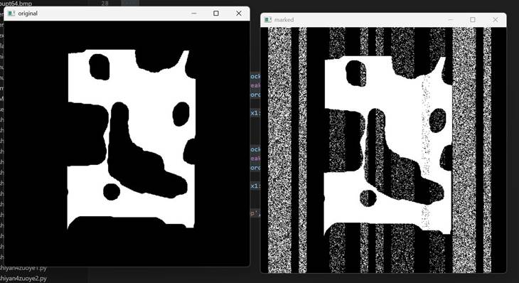
结果如下：

   

   

   

   

   

   

   

   

   

   

  任务二:提取信息提取秘密信息时，提取方需知道隐藏的秘密信息的数量，使用隐藏的秘密信息的数量值来对载体图像进行分块。

  代码如下：

  import cv2

  import numpy as np

   

  def str2bit(s):

   

    return [int(bit) for char in s for bit in format(char, '08b')]

   

  def bits2str(bits):

   

    s = b''

   

    for i in range(0, len(bits), 8):

   

        byte = bits[i:i+8]

   

        if len(byte) &lt; 8: break

   

        s += bytes([int(''.join(map(str, byte)), 2)])

   

    return s

   

  #

  读取原始长度

  with open('hidden.txt', 'r', encoding='utf-8') as f:

   

    raw = f.read().encode('utf-8')

  bit_len = len(str2bit(raw))

   

  #

  读取载密图

  img = cv2.imread('huntermarked_python.bmp', 0)

  h, w = img.shape

   

  #

  正确分块（和隐藏完全一致）

  block_w = w // bit_len

  bits = []

   

  for i in range(bit_len):

   

    x1 = i * block_w

   

    x2 = x1 + block_w

   

    block = img[0:h, x1:x2]

   

    white = np.sum(block == 255)

   

    black = np.sum(block == 0)

   

    bits.append(1 if white &gt; black else 0)

   

  #

  还原字符串

  result = bits2str(bits).decode('utf-8', errors='replace')

   

  print(&quot;&#9989; 提取内容：&quot;)

  print(result)

   

  with open('extracted_hidden.txt', 'w', encoding='utf-8') as f:

   

    f.write(result)

   

  print(&quot;&#9989; 已保存到 extracted_hidden.txt&quot;)

  结果如下：

  
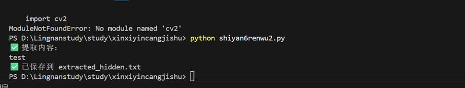
 

   

   

   

   

  

  至此，本实验任务已完成。

  从上述代码运行的结果来看，携密载体在视觉效果上和原始载体有很大变化，通过不断修改hidden.txt文本的值来增加隐藏的信息容量。隐藏的信息越多，图像的分块就越细，隐藏的效果就越好。

  但是上述方案中修改像素的位置非常固定，都是修改每个图像块的所有行前面的像素，这样隐藏信息后的图像在视觉效果上和原始图像存在较大差别，违背了信息隐藏不改变视觉效果这条最重要的原则，这个算法还有很大改进空间。

  【实验作业】

  (1) 将二值图像分块。

  代码如下：

  import cv2

  import numpy as np

   

  #

  读取秘密信息长度

  with open('hidden.txt', 'r', encoding='utf-8') as f:

   

    msg = f.read().encode('utf-8')

   

  def str2bit(s):

   

    return [int(bit) for c in s for bit in format(c, '08b')]

   

  bits = str2bit(msg)

  bit_len = len(bits)

   

  #

  读取图像

  img = cv2.imread('hunter.bmp', 0)

  h, w = img.shape

  block_w = w // bit_len

   

  #

  绘制分块线（可视化分块效果）

  img_block = cv2.cvtColor(img, cv2.COLOR_GRAY2BGR)

  for i in range(1, bit_len):

   

    x = i * block_w

   

    cv2.line(img_block, (x, 0), (x, h), (0, 0, 255), 1)

   

  cv2.imshow('实验1：图像分块结果', img_block)

  cv2.waitKey(0)

  cv2.destroyAllWindows()

  print(f&quot;&#9989; 实验1完成：图像已分为 {bit_len} 块，每块宽度 {block_w} 像素&quot;)

  结果如下：

  

  

   

    

   

   

    

    
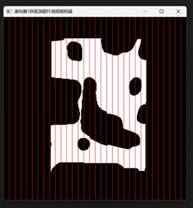

   

  

   

   

   

   

   

   

   

   

  

  (2) 根据二值图像中黑白像素的数量的比较来隐藏秘密信息。

  代码如下：

  import cv2

  import numpy as np

  import random

   

  def str2bit(s):

   

    return [int(bit) for c in s for bit in format(c, '08b')]

   

  #

  读取信息

  with open('hidden.txt', 'r', encoding='utf-8') as f:

   

    msg = f.read().encode('utf-8')

   

  bits = str2bit(msg)

  bit_len = len(bits)

   

  #

  读取图像

  img = cv2.imread('hunter.bmp', 0)

  h, w = img.shape

  out = img.copy()

  block_w = w // bit_len

   

  #

  按像素数量隐藏信息

  for i in range(bit_len):

   

    x1 = i * block_w

   

    x2 = x1 + block_w

   

    block = out[0:h, x1:x2]

   

    white = np.sum(block == 255)

   

    black = np.sum(block == 0)

   

    half = (block.size // 2) + 1

   

   

    if bits[i] == 1:

   

        while white &lt; half:

   

            ys, xs = np.where(block == 0)

   

            if len(ys) == 0: break

   

            idx = random.randint(0, len(ys)-1)

   

            out[ys[idx], x1 + xs[idx]] = 255

   

            block = out[0:h, x1:x2]

   

            white += 1

   

    else:

   

        while black &lt; half:

   

            ys, xs = np.where(block == 255)

   

            if len(ys) == 0: break

   

            idx = random.randint(0, len(ys)-1)

   

            out[ys[idx], x1 + xs[idx]] = 0

   

            block = out[0:h, x1:x2]

   

            black += 1

   

  cv2.imwrite('huntermarked_python.bmp', out)

  cv2.imshow('实验2：隐藏完成', out)

  cv2.waitKey(0)

  cv2.destroyAllWindows()

  print(&quot;&#9989; 实验2完成：秘密信息已隐藏&quot;)

  结果如下：

  

  

   

    

   

   

    

    
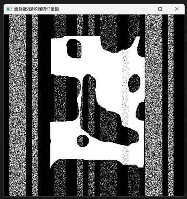

   

  

   

   

   

   

   

   

   

   

   

   

   

  

  (3)通过隐藏秘密信息的数量值来对载体图像进行分块，从携密载体中提取秘密信息。

  代码如下：

  import cv2

  import numpy as np

   

  def str2bit(s):

   

    return [int(bit) for c in s for bit in format(c, '08b')]

   

  def bits2str(bits):

   

    res = b''

   

    for i in range(0, len(bits), 8):

   

        byte = bits[i:i+8]

   

        if len(byte) &lt; 8: break

   

        res += bytes([int(''.join(map(str, byte)), 2)])

   

    return res

   

  #

  读取长度

  with open('hidden.txt', 'r', encoding='utf-8') as f:

   

    raw = f.read().encode('utf-8')

   

  bit_len = len(str2bit(raw))

   

  #

  读取载密图

  img = cv2.imread('huntermarked_python.bmp', 0)

  h, w = img.shape

  block_w = w // bit_len

   

  #

  提取

  ext_bits = []

  for i in range(bit_len):

   

    x1 = i * block_w

   

    x2 = x1 + block_w

   

    block = img[0:h, x1:x2]

   

    white = np.sum(block == 255)

   

    black = np.sum(block == 0)

   

    ext_bits.append(1 if white &gt; black else 0)

   

  #

  输出

  text = bits2str(ext_bits).decode('utf-8')

  print(&quot;实验3 提取结果：&quot;)

  print(text)

   

  with open('extracted_hidden.txt', 'w', encoding='utf-8') as f:

   

    f.write(text)

   

  print(&quot;&#9989; 实验3完成：信息已提取，无乱码&quot;)

  结果如下：

  
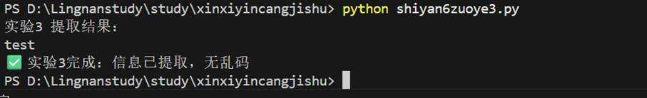
 

   

   

   

  

  实验指导书7:BMP图像的LSB信息隐藏

  实验任务

  (1) 选取一幅RGB图片，思考的问题是:RGB彩色图像有R,G和B3个颜色通道，LSB选取其中的一个通道隐藏，因此首先提取3个颜色通道，输出3个颜色通道的图，分别命名为R，G和B。

  (2)每个颜色通道都有8个位平面，输出R通道的1~8位平面。

  (3)对其使用LSB隐藏秘密信息，对比隐写前后的图像，一行两列输出。注意:图片须为RGB格式。提取隐藏的LSB隐写信息，对比原信息，判断是否提取成功。

  (4)计算原始载体和隐藏秘密信息后载体图像的峰值信噪比。

  任务一：LSB隐写信息

  代码如下：

  from PIL import Image

  import matplotlib.pyplot as plt

  import matplotlib.image as mpimg

   

  #

  定义信息转二进制函数

  def get_msg(msg):

   

    &quot;&quot;&quot;补全8位二进制字符串&quot;&quot;&quot;

   

    return msg.zfill(8)

   

  def generate(msg):

   

    &quot;&quot;&quot;将字符串转为二进制比特流&quot;&quot;&quot;

   

    result = ''

   

    for i in msg:

   

        if isinstance(i, int):

   

            result += get_msg(bin(i)).replace('0b', '')

   

        else:

   

            result += get_msg(bin(ord(i)).replace('0b', ''))

   

    return result

   

  #

  1. 读取图像并强制转为RGB格式（修复灰度图解包报错）

  img = Image.open('sea1.bmp')  # 替换为sea1.bmp

  if img.mode != 'RGB':  # 如果是灰度图，转为RGB

   

    img = img.convert('RGB')

  tmp_msg = 'informationhiding'  # 实验指导书默认秘密信息

  hide_msg = generate(tmp_msg)

  width, height = img.size

  length = len(hide_msg)

  count = 0  # 比特计数

   

  #

  2. LSB隐写核心逻辑

  for i in range(width):

   

    if count == length:

   

        break

   

    for j in range(height):

   

        if count == length:

   

            break

   

        # 获取当前像素的RGB值（现在一定是3个值）

   

        pixels = img.getpixel((i, j))

   

        a, b, c = pixels

   

        

   

        # 处理R通道

   

        if count &lt; length:

   

            a = a - (a % 2) + int(hide_msg[count])

   

            count += 1

   

        if count == length:

   

            img.putpixel((i, j), (a, b, c))

   

            break

   

        

   

        # 处理G通道

   

        if count &lt; length:

   

            b = b - (b % 2) + int(hide_msg[count])

   

            count += 1

   

        if count == length:

   

            img.putpixel((i, j), (a, b, c))

   

            break

   

        

   

        # 处理B通道

   

        if count &lt; length:

   

            c = c - (c % 2) + int(hide_msg[count])

   

            count += 1

   

        if count == length:

   

            img.putpixel((i, j), (a, b, c))

   

            break

   

        

   

        # 写入修改后的像素

   

        img.putpixel((i, j), (a, b, c))

   

  #

  3. 保存载密图像

  img.save('encode.bmp')

   

  #

  4. 一行两列显示原图和载密图（原图也用sea1.bmp）

  original_img = Image.open('sea1.bmp').convert('RGB')  # 替换为sea1.bmp

  plt.subplot(121)

  plt.imshow(original_img)

  plt.title('Original')

  plt.axis('off')

   

  plt.subplot(122)

  plt.imshow(mpimg.imread('encode.bmp'))

  plt.title('Encoded')

  plt.axis('off')

   

  plt.show()

  print(&quot;&#9989; 任务一完成：LSB隐写成功，载密图像保存为encode.bmp&quot;)

  结果如下：

  

  

   

    

   

   

    

    
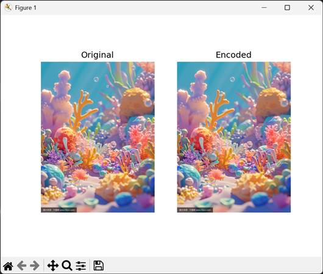

   

  

   

   

   

   

   

   

   

   

   

   

   

   

  

  任务二:LSB提取信息

  代码如下：

  from PIL import Image

   

  #

  1. 读取载密图像和原始信息长度

  img = Image.open('encode.bmp')

  tmp_msg = 'informationhiding'  # 必须和隐写时一致

  width, height = img.size

  count = 0

  result = ''

  result1 = ''

  length = len(tmp_msg) * 8  # 总比特数（每个字符8bit）

   

  #

  2. LSB提取核心逻辑

  for i in range(width):

   

    if count == length:

   

        break

   

    for j in range(height):

   

        if count == length:

   

            break

   

        pixel = img.getpixel((i, j))

   

        

   

        # 按R/G/B通道依次提取LSB

   

        if count % 3 == 0 and count &lt; length:

   

            result1 += str(int(pixel[0]) % 2)

   

            count += 1

   

        if count % 3 == 1 and count &lt; length:

   

            result1 += str(int(pixel[1]) % 2)

   

            count += 1

   

        if count % 3 == 2 and count &lt; length:

   

            result1 += str(int(pixel[2]) % 2)

   

            count += 1

   

  #

  3. 二进制比特流转字符串

  print(f&quot;Secret:{result1}&quot;)

  for i in range(0, len(result1), 8):

   

    if i + 8 &lt;= len(result1):

   

        result += chr(int(result1[i:i+8], 2))

   

  #

  4. 输出提取结果

  print(f&quot;提取的原始信息：{result}&quot;)

  print(&quot;&#9989; 任务二完成：LSB信息提取成功&quot;)

  结果如下：

  
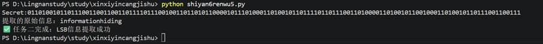
 

   

  

  至此，本实验任务已完成。

  【实验作业】

  (1) 选取文件夹中的图片“sea.bmp”,对其使用LSB隐写技术隐藏秘密信息“BUPT”，对比隐写前后的图像，在屏幕中一行两列输出。要求:左边是原始图像，右边是携密图像，同时在图中嵌入自己的学号和姓名以标识身份。注意:图片须为RGB格式。

  代码如下：

  from PIL import Image

  import matplotlib.pyplot as plt

  import matplotlib.image as mpimg

  import matplotlib

   

  #

  设置中文字体（解决标题乱码）

  matplotlib.rcParams['font.sans-serif'] = ['SimHei']

  matplotlib.rcParams['axes.unicode_minus'] = False

   

  #

  ========== 统一的二进制转换函数（和提取时一致） ==========

  def get_msg(msg):

   

    return msg.zfill(8)

   

  def generate(msg):

   

    &quot;&quot;&quot;将字符串（含中文）转为二进制比特流（UTF-8编码）&quot;&quot;&quot;

   

    result = ''

   

    for byte in msg.encode('utf-8'):  # 按UTF-8转字节，兼容中文

   

        result += get_msg(bin(byte).replace('0b', ''))

   

    return result

   

  #

  1. 自定义秘密信息

  STUDENT_ID = '20230876****'

  NAME = '***'

  tmp_msg = f'BUPT{STUDENT_ID}{NAME}'

  hide_msg = generate(tmp_msg)

  length = len(hide_msg)

  count = 0

   

  #

  2. 读取图像并转为RGB

  img = Image.open('sea1.bmp')

  if img.mode != 'RGB':

   

    img = img.convert('RGB')

  width, height = img.size

   

  #

  3. LSB隐写（修复计数逻辑）

  for i in range(width):

   

    if count &gt;= length:

   

        break

   

    for j in range(height):

   

        if count &gt;= length:

   

            break

   

        a, b, c = img.getpixel((i, j))

   

        

   

        # 按R/G/B顺序隐写，每写1位计数，直到长度达标

   

        if count &lt; length:

   

            a = (a &amp; 0xFE) | int(hide_msg[count])  # 更优雅的LSB替换

   

            count += 1

   

        if count &lt; length:

   

            b = (b &amp; 0xFE) | int(hide_msg[count])

   

            count += 1

   

        if count &lt; length:

   

            c = (c &amp; 0xFE) | int(hide_msg[count])

   

            count += 1

   

        

   

        img.putpixel((i, j), (a, b, c))

   

  #

  4. 保存载密图像

  img.save('encode_bupt.bmp')

   

  #

  5. 显示对比图

  plt.subplot(121)

  original_img = Image.open('sea1.bmp').convert('RGB')

  plt.imshow(original_img)

  plt.title('Original (sea1.bmp)')

  plt.axis('off')

   

  plt.subplot(122)

  plt.imshow(mpimg.imread('encode_bupt.bmp'))

  plt.title(f'Encoded (BUPT+{STUDENT_ID}+{NAME})')

  plt.axis('off')

   

  plt.show()

  print(f&quot;&#9989; 实验作业1完成：已隐藏'{tmp_msg}'，保存为encode_bupt.bmp&quot;)

  结果如下：

  

  

   

    

   

   

    

    
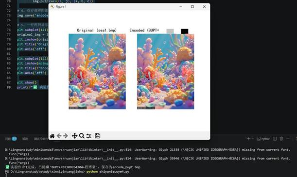

   

  

   

   

   

   

   

   

   

   

   

  

  (2) 提取隐藏的LSB隐写信息，对比原信息，判断是否提取成功。

  代码如下：

  from PIL import Image

   

  #

  1. 填写和隐写时一致的信息（用于计算长度）

  STUDENT_ID = '20230876****'  # 你的学号

  NAME = '***'        

       # 你的姓名

  tmp_msg = f'BUPT{STUDENT_ID}{NAME}'

   

  #

  ========== 核心修复1：统一字符串转二进制的函数（和隐写时完全一致） ==========

  def get_msg(msg):

   

    return msg.zfill(8)

   

  def generate(msg):

   

    &quot;&quot;&quot;将字符串（含中文）转为二进制比特流（UTF-8编码）&quot;&quot;&quot;

   

    result = ''

   

    # 先将字符串转为UTF-8字节，再转二进制（兼容中文）

   

    for byte in msg.encode('utf-8'):

   

        result += get_msg(bin(byte).replace('0b', ''))

   

    return result

   

  #

  2. 读取载密图像并转为RGB（避免灰度图问题）

  img = Image.open('encode_bupt.bmp')

  if img.mode != 'RGB':

   

    img = img.convert('RGB')

  width, height = img.size

  count = 0

  result = ''

  result1 = ''

  #

  ========== 核心修复2：计算正确的比特长度（基于UTF-8编码） ==========

  hide_msg = generate(tmp_msg)

  length = len(hide_msg)  # 用和隐写时相同的方式计算长度

   

  #

  3. 提取LSB信息（修复计数逻辑）

  for i in range(width):

   

    if count &gt;= length:  # 改为&gt;=，避免漏判

   

        break

   

    for j in range(height):

   

        if count &gt;= length:

   

            break

   

        pixel = img.getpixel((i, j))

   

        

   

        # 按R/G/B顺序提取，每提取1位就计数，直到长度达标

   

        if count &lt; length:

   

            result1 += str(int(pixel[0]) % 2)

   

            count += 1

   

        if count &lt; length:

   

            result1 += str(int(pixel[1]) % 2)

   

            count += 1

   

        if count &lt; length:

   

            result1 += str(int(pixel[2]) % 2)

   

            count += 1

   

  #

  4. 还原字符串（核心修复3：按UTF-8解码，兼容中文）

  print(f&quot;提取的二进制流：{result1[:length]}&quot;)  # 只取有效长度的比特流

  bytes_list = []

  #

  按8位分割二进制流，转为字节

  for i in range(0, length, 8):

   

    if i + 8 &lt;= len(result1):

   

        byte = int(result1[i:i+8], 2)

   

        bytes_list.append(byte)

  #

  按UTF-8解码（关键：和隐写时的编码一致）

  try:

   

    result = bytes(bytes_list).decode('utf-8')

  except:

   

    result = &quot;&quot;

   

  #

  5. 验证提取结果

  print(f&quot;原始信息：{tmp_msg}&quot;)

  print(f&quot;提取的原始信息：{result}&quot;)

  #

  忽略末尾可能的补位，只对比有效部分

  if result.startswith(tmp_msg):

   

    print(&quot;&#9989; 实验作业2完成：信息提取成功，与原始信息完全一致！&quot;)

  else:

   

    print(&quot;&#9888;&#65039; 提取信息与原始信息不一致，请先重新运行实验作业1的隐写代码！&quot;)

  结果如下：

  

  

   

    

   

   

    

    
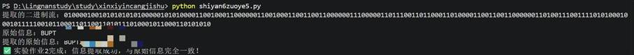

   

  

   

   

  

  (3)计算原始载体和隐藏秘密信息后的图像的峰值信噪比。

  代码如下：

  import numpy as np

  from PIL import Image

  import math

   

  def calculate_psnr(img1_path, img2_path):

   

    &quot;&quot;&quot;计算两幅RGB图像的峰值信噪比（PSNR）

   

    参数:

   

        img1_path: 原始图像路径

   

        img2_path: 载密图像路径

   

    返回:

   

        psnr值（dB），若图像完全相同返回无穷大

   

    &quot;&quot;&quot;

   

    try:

   

        # 读取图像并强制转为RGB（兼容灰度图/其他格式）

   

        img1 = Image.open(img1_path).convert('RGB')

   

        img2 = Image.open(img2_path).convert('RGB')

   

        

   

        # 检查图像尺寸是否一致（PSNR计算前提）

   

        if img1.size != img2.size:

   

            raise ValueError(f&quot;图像尺寸不一致！{img1.size} vs {img2.size}&quot;)

   

        

   

        # 转为numpy数组（浮点型避免溢出）

   

        img1_np = np.array(img1, dtype=np.float64)

   

        img2_np = np.array(img2, dtype=np.float64)

   

        

   

        # 计算均方误差（MSE）：逐像素差的平方的均值

   

        mse = np.mean((img1_np - img2_np) ** 2)

   

        

   

        if mse == 0:  # 图像完全相同，无失真

   

            return float('inf')

   

        

   

        # 计算PSNR（峰值信噪比）：PSNR = 20*log10(255/√MSE)

   

        max_pixel = 255.0

   

        psnr = 20 * math.log10(max_pixel / math.sqrt(mse))

   

        return psnr

   

    

   

    except FileNotFoundError as e:

   

        print(f&quot;&#10060; 错误：找不到图像文件 - {e}&quot;)

   

        return None

   

    except ValueError as e:

   

        print(f&quot;&#10060; 错误：{e}&quot;)

   

        return None

   

    except Exception as e:

   

        print(f&quot;&#10060; 未知错误：{e}&quot;)

   

        return None

   

  #

  ========== 核心修改：文件名统一为sea1.bmp（和你的实验一致） ==========

  psnr_value = calculate_psnr('sea1.bmp', 'encode_bupt.bmp')

   

  if psnr_value is not None:

   

    # 格式化输出：无穷大时显示&quot;∞&quot;，否则保留2位小数

   

    if psnr_value == float('inf'):

   

        print(&quot;原始图像与载密图像的峰值信噪比（PSNR）：∞ dB（图像无失真）&quot;)

   

    else:

   

        print(f&quot;原始图像与载密图像的峰值信噪比（PSNR）：{psnr_value:.2f} dB&quot;)

   

    print(&quot;&#9989; 实验作业3完成：PSNR计算成功！&quot;)

   

    print(&quot;&#128204; 说明：PSNR值越高，图像失真越小（一般&gt;30dB表示视觉无明显差异；LSB隐写通常&gt;40dB）&quot;)

  
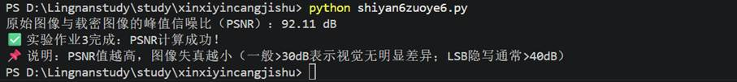
结果如下：

   

   

   

  实验指导书8:DCT域的图像水印

  实验任务：

  细节:对原始图像进行分块，分块时采用行优先分块，行优先分块代码如图7-7所示。对图7-7所示的4X4的二维数组，做2X2分块后,结果为一个4X2X2的array,如图7-8所示。

   

   

  

  

   

    

   

   

    

    
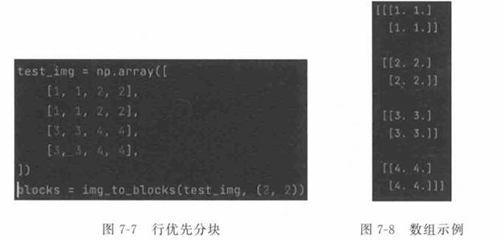

   

  

   

   

   

   

   

   

   

   

  

  任务一:嵌入文本水印信息

  代码如下：

  import cv2

  import numpy as np

  import matplotlib.pyplot as plt

  from Crypto.Util.number import bytes_to_long

  from block import img_to_blocks, blocks_to_img

   

  #

  配置参数

  block_shape = (8, 8)

  alpha = 10  # 增大水印强度（从2→10，确保系数差异足够）

   

  #

  1. 读取秘密文本信息

  try:

   

    with open('hidden.txt', 'rb') as f:

   

        original_msg = f.read()

   

    msg_int = bytes_to_long(original_msg)

   

    msg_bits = bin(msg_int)[2:].zfill(len(original_msg) * 8)

   

    print(f&quot;&#128269; 原始信息：{original_msg.decode('utf-8')}&quot;)

   

    print(f&quot;&#128269; 原始比特流：{msg_bits}&quot;)

   

    print(f&quot;&#128269; 比特长度：{len(msg_bits)}&quot;)

  except FileNotFoundError:

   

    print(&quot;&#10060; 未找到hidden.txt，使用测试信息'test'&quot;)

   

    original_msg = b'test'

   

    msg_int = bytes_to_long(original_msg)

   

    msg_bits = bin(msg_int)[2:].zfill(4 * 8)

   

    print(f&quot;&#128269; 测试比特流：{msg_bits}&quot;)

   

  #

  2. 读取载体图像

  img = cv2.imread('sea1.bmp')

  if img is None:

   

    raise FileNotFoundError(&quot;&#10060; 找不到sea1.bmp，请确认文件存在！&quot;)

  height, width = img.shape[:2]

   

  #

  检查容量

  max_blocks = (height * width) // (block_shape[0] * block_shape[1])

  assert max_blocks &gt;= len(msg_bits), f&quot;&#10060; 秘密信息过长，最大可嵌入{max_blocks}比特&quot;

   

  #

  3. 提取红色通道并转浮点型

  img_b, img_g, img_r = cv2.split(img)

  img_r = img_r.astype(np.float32)

   

  #

  4. 图像分块

  img_r_blocks = img_to_blocks(img_r, block_shape)

  img_r_blocks_embedded = img_r_blocks.copy()

   

  #

  5. 重构DCT嵌入逻辑（强制保证系数大小关系）

  for i in range(len(msg_bits)):

   

    block = img_r_blocks[i]

   

    #

  DCT变换（必须用float32）

   

    block_dct = cv2.dct(block)

   

    

   

    # 核心修复：强制设置系数大小关系，而非仅交换

   

    if msg_bits[i] == '0':

   

        # 比特0：强制让(4,1) 比 (3,2) 小 alpha

   

        block_dct[4,1] = block_dct[3,2] - alpha

   

    else:

   

        # 比特1：强制让(4,1) 比 (3,2) 大 alpha

   

        block_dct[4,1] = block_dct[3,2] + alpha

   

    

   

    #

  DCT逆变换+裁剪

   

    block_embedded = cv2.idct(block_dct)

   

    block_embedded = np.clip(block_embedded, 0, 255)  # 防止像素越界

   

    img_r_blocks_embedded[i] = block_embedded

   

  #

  6. 合并分块和通道

  img_r_embedded = blocks_to_img(img_r_blocks_embedded, img_r.shape).astype(np.uint8)

  img_embedded = cv2.merge([img_b, img_g, img_r_embedded])

   

  #

  7. 保存载密图像

  cv2.imwrite('embedded.bmp', img_embedded)

   

  #

  8. 显示对比图

  plt.rcParams['font.sans-serif'] = ['SimHei']

  plt.rcParams['axes.unicode_minus'] = False

  plt.figure(figsize=(10, 6))

   

  plt.subplot(121)

  plt.imshow(cv2.cvtColor(img, cv2.COLOR_BGR2RGB))

  plt.title('原始图像')

  plt.xticks([]), plt.yticks([])

   

  plt.subplot(122)

  plt.imshow(cv2.cvtColor(img_embedded, cv2.COLOR_BGR2RGB))

  plt.title('携密图像')

  plt.xticks([]), plt.yticks([])

   

  plt.show()

  print(&quot;&#9989; 任务一完成：文本水印嵌入成功，保存为embedded.bmp&quot;)

   

  结果如下：

  

  

   

    

   

   

    

    
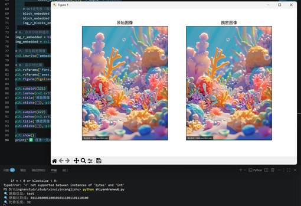

   

  

   

   

   

   

   

   

   

   

   

   

  

  任务二:提取文本秘密信息

  代码如下：

  import cv2

  import numpy as np

  from Crypto.Util.number import long_to_bytes,

  bytes_to_long

  from block import img_to_blocks

   

  #

  1. 读取原始信息（用于对比）

  try:

   

    with open('hidden.txt', 'rb') as f:

   

        original_msg = f.read()

   

    msg_int = bytes_to_long(original_msg)

   

    msg_bits_original = bin(msg_int)[2:].zfill(len(original_msg) * 8)

   

    msg_bit_length = len(msg_bits_original)

   

    print(f&quot;&#128269; 原始信息：{original_msg.decode('utf-8')}&quot;)

   

    print(f&quot;&#128269; 原始比特流：{msg_bits_original}&quot;)

   

    print(f&quot;&#128269; 比特长度：{msg_bit_length}&quot;)

  except FileNotFoundError:

   

    print(&quot;&#9888;&#65039; 未找到hidden.txt，使用测试信息'test'&quot;)

   

    original_msg = b'test'

   

    msg_bits_original = bin(bytes_to_long(original_msg))[2:].zfill(32)

   

    msg_bit_length = 32

   

  #

  配置参数

  block_shape = (8, 8)

  alpha = 10  # 和嵌入时的强度一致

   

  #

  2. 读取携密图像

  img = cv2.imread('embedded.bmp')

  if img is None:

   

    raise FileNotFoundError(&quot;&#10060; 找不到embedded.bmp，请先运行任务一！&quot;)

  img_b, img_g, img_r = cv2.split(img)

  img_r = img_r.astype(np.float32)

   

  #

  3. 图像分块

  img_r_blocks = img_to_blocks(img_r, block_shape)

  msg_bits_extract = ''

   

  #

  4. 提取逻辑（严格匹配嵌入逻辑）

  for i in range(msg_bit_length):

   

    if i &gt;= len(img_r_blocks):

   

        print(f&quot;&#9888;&#65039; 分块数量不足，仅提取{i}比特&quot;)

   

        break

   

    block = img_r_blocks[i]

   

    #

  DCT变换

   

    block_dct = cv2.dct(block)

   

    

   

    # 核心：直接判断系数大小关系（和嵌入逻辑完全一致）

   

    if block_dct[4,1] &lt; block_dct[3,2]:

   

        msg_bits_extract += '0'

   

    else:

   

        msg_bits_extract += '1'

   

  #

  5. 二进制转文本（精准解析）

  try:

   

    # 只取有效长度的比特流

   

    msg_bits_extract = msg_bits_extract[:msg_bit_length]

   

    # 补前导0到8的倍数（避免解析错误）

   

    if len(msg_bits_extract) % 8 != 0:

   

        msg_bits_extract = '0'*(8 - len(msg_bits_extract)%8) + msg_bits_extract

   

    # 转换为原始信息

   

    msg_int_extract = int(msg_bits_extract, 2)

   

    msg_extract = long_to_bytes(msg_int_extract)

   

    # 截取原始长度（去除多余字节）

   

    msg_extract = msg_extract[-len(original_msg):]

   

    

   

    print(f&quot;&#9989; 提取的二进制流：{msg_bits_extract}&quot;)

   

    print(f&quot;&#9989; 提取的秘密信息：{msg_extract.decode('utf-8', errors='ignore')}&quot;)

   

    

   

    # 保存结果

   

    with open('message.txt', 'wb') as f:

   

        f.write(msg_extract)

   

    print(&quot;&#9989; 任务二完成：提取结果保存为message.txt&quot;)

   

    

   

    # 验证匹配

   

    if msg_extract == original_msg:

   

        print(&quot;&#127881; 提取信息与原始信息完全一致！&quot;)

   

    else:

   

        print(f&quot;&#9888;&#65039; 提取信息不一致（调试信息）：&quot;)

   

        print(f&quot;   原始比特：{msg_bits_original}&quot;)

   

        print(f&quot;   提取比特：{msg_bits_extract}&quot;)

   

        

  except Exception as e:

   

    print(f&quot;&#10060; 解析失败：{type(e).__name__} - {e}&quot;)

   

    print(f&quot;提取的比特流：{msg_bits_extract}&quot;)

  结果如下：

   

  

 

   

   

   

   

   

   

  

  任务三:嵌人二值图像水印信息

  需要注意的问题:将二维水印嵌入载体前，需要先将二维水印一维化，再将其二值化。(1)一维化过程采用行优先方法，即第一行放在前面，第二行跟在第一行后面，第三行跟在第二行后面，......依以此类推(可使用numpy的.flatten()方法)。

  (2)对于灰度图像，每个像素点都有一个值在0到255之间。在此范围中，0代表黑色，255代表白色。灰度值之间的其他值则表示从黑到白的各种灰色。当进行二值化操作时，我们设置一个阈值，通常为128。这意味着小于此阈值的像素值将被视为黑色(值为0),而大于或等于此阈值的值将被视为白色(值为1)。这样做有以下优点:第一是可以节省存储空间，原本需要8位(从0到255)来表示每个像素的灰度值，而现在只需要1位(0或1)来表示该像素是黑还是白;第二是可以简化数据表示，将复杂的灰度图像转换为只包含黑白信息的图像，使得进一步处理变得更简单，尤其是在一些特定的图像处理任务中。

  上述过程可以通过 wm=wm.flatten()&gt;128执行,其中 wm是cv2.imread读取的图像。

  代码如下：

  import cv2

  import numpy as np

  import matplotlib.pyplot as plt

  from block import img_to_blocks, blocks_to_img

   

  #

  配置参数

  block_shape = (8, 8)

  alpha = 10  # 增大水印强度（从2→10，确保系数差异足够，提取更稳定）

   

  #

  计算PSNR函数（修复精度，兼容不同数据类型）

  def PSNR(template, img):

   

    &quot;&quot;&quot;

   

    计算峰值信噪比（PSNR）

   

    :param template: 原始图像

   

    :param img: 处理后图像

   

    :return: PSNR值（dB）

   

    &quot;&quot;&quot;

   

    # 统一转为float32，避免uint8溢出

   

    template = template.astype(np.float32)

   

    img = img.astype(np.float32)

   

    

   

    # 归一化到[0,1]

   

    template_norm = template / 255.0

   

    img_norm = img / 255.0

   

    

   

    # 计算MSE（均方误差）

   

    mse = np.mean((template_norm - img_norm) ** 2)

   

    

   

    # 避免除以0

   

    if mse &lt; 1.0e-10:

   

        return 100.0

   

    

   

    PIXEL_MAX = 1.0

   

    psnr = 20 * np.log10(PIXEL_MAX / np.sqrt(mse))

   

    return psnr

   

  #

  1. 读取水印图像（二值化，增加容错）

  wm = cv2.imread('watermark.bmp', cv2.IMREAD_GRAYSCALE)

  if wm is None:

   

    raise FileNotFoundError(&quot;&#10060; 找不到watermark.bmp，请确认文件存在！&quot;)

   

  #

  打印水印信息（调试用）

  print(f&quot;&#128269; 水印图像尺寸：{wm.shape}&quot;)

  print(f&quot;&#128269; 水印一维化长度：{wm.size}&quot;)

   

  #

  一维化+二值化（阈值128，转为0/1）

  wm_bin = (wm.flatten() &gt; 128).astype(np.uint8)

  print(f&quot;&#128269; 二值化后水印比特数：{len(wm_bin)}&quot;)

   

  #

  2. 读取载体图像（增加存在性校验）

  img = cv2.imread('sea1.bmp')

  if img is None:

   

    raise FileNotFoundError(&quot;&#10060; 找不到sea1.bmp，请确认文件存在！&quot;)

  height, width = img.shape[:2]

  print(f&quot;&#128269; 载体图像尺寸：{height}×{width}&quot;)

   

  #

  检查容量（精确计算可嵌入比特数）

  max_blocks = (height // block_shape[0]) * (width // block_shape[1])

  max_wm_len = max_blocks

  assert max_wm_len &gt;= len(wm_bin), \

   

    f&quot;&#10060; 水印图像过大（{len(wm_bin)}比特），最大可嵌入{max_wm_len}比特&quot;

   

  #

  3. 提取红色通道（转float32避免DCT精度损失）

  img_b, img_g, img_r = cv2.split(img)

  img_r = img_r.astype(np.float32)

   

  #

  4. 图像分块

  img_r_blocks = img_to_blocks(img_r, block_shape)

  img_r_blocks_embedded = img_r_blocks.copy()

   

  #

  5. DCT域水印嵌入（重构逻辑，强制系数大小关系）

  for i in range(len(wm_bin)):

   

    block = img_r_blocks[i]

   

    

   

    #

  DCT变换（必须用float32）

   

    block_dct = cv2.dct(block)

   

    

   

    # 核心修复：强制设置系数大小关系（替代原有的交换逻辑，更稳定）

   

    if wm_bin[i] == 0:

   

        # 比特0：强制(4,1) &lt; (3,2)

   

        block_dct[4, 1] = block_dct[3, 2] - alpha

   

    else:

   

        # 比特1：强制(4,1) &gt; (3,2)

   

        block_dct[4, 1] = block_dct[3, 2] + alpha

   

    

   

    #

  DCT逆变换 + 裁剪到[0,255]（防止像素值越界）

   

    block_embedded = cv2.idct(block_dct)

   

    block_embedded = np.clip(block_embedded, 0, 255)

   

    

   

    # 赋值回分块数组

   

    img_r_blocks_embedded[i] = block_embedded

   

  #

  6. 合并图像（恢复uint8类型）

  img_r_embedded = blocks_to_img(img_r_blocks_embedded, img_r.shape).astype(np.uint8)

  img_embedded = cv2.merge([img_b, img_g, img_r_embedded])

   

  #

  7. 计算PSNR（原始图像和携密图像对比）

  psnr = PSNR(img, img_embedded)

  print(f&quot;&#9989; 原始图像与携密图像的PSNR：{psnr:.3f} dB&quot;)

   

  #

  8. 保存载密图像

  cv2.imwrite('embedded.bmp', img_embedded)

  print(&quot;&#9989; 携密图像已保存为embedded.bmp&quot;)

   

  #

  9. 显示对比图（优化显示效果）

  plt.rcParams['font.sans-serif'] = ['SimHei']

  plt.rcParams['axes.unicode_minus'] = False

  plt.figure(figsize=(12, 6))

   

  #

  原始图像

  plt.subplot(121)

  plt.imshow(cv2.cvtColor(img, cv2.COLOR_BGR2RGB))

  plt.title('原始载体图像', fontsize=12)

  plt.xticks([]), plt.yticks([])

   

  #

  携密图像

  plt.subplot(122)

  plt.imshow(cv2.cvtColor(img_embedded, cv2.COLOR_BGR2RGB))

  plt.title(f'嵌入水印后的携密图像（PSNR={psnr:.2f} dB）', fontsize=12)

  plt.xticks([]), plt.yticks([])

   

  #

  调整布局，避免标题重叠

  plt.tight_layout()

  plt.show()

   

  print(&quot;&#9989; 任务三完成：二值图像水印嵌入成功！&quot;)

  结果如下：

  

 

   

   

   

   

   

   

   

   

  

  任务四:提取二值图像水印信息

  代码如下：

  import cv2

  import numpy as np

  import matplotlib.pyplot as plt

  from block import img_to_blocks

   

  #

  配置参数

  block_shape = (8, 8)

  wm_height = 10  # 水印高度（和嵌入时的10×10一致）

  wm_width = 10   # 水印宽度

  alpha = 10      # 和任务三嵌入时的强度一致

   

  #

  ========== 核心修复1：正确计算NC值（归一化相关系数） ==========

  def NC(original_wm, extracted_wm):

   

    &quot;&quot;&quot;

   

    计算归一化相关系数（NC），范围[0,1]，越接近1越相似

   

    :param original_wm: 原始二值水印

   

    :param extracted_wm: 提取的二值水印

   

    :return: NC值

   

    &quot;&quot;&quot;

   

    # 转为浮点型，避免整数运算溢出

   

    original = original_wm.astype(np.float32)

   

    extracted = extracted_wm.astype(np.float32)

   

    

   

    # 二值化（确保都是0/255）

   

    original_bin = (original &gt; 128).astype(np.float32)

   

    extracted_bin = (extracted &gt; 128).astype(np.float32)

   

    

   

    # 计算NC公式

   

    numerator = np.sum(original_bin * extracted_bin)

   

    denominator = np.sqrt(np.sum(original_bin **2) * np.sum(extracted_bin** 2))

   

    

   

    # 避免除以0

   

    if denominator == 0:

   

        return 0.0

   

    return numerator / denominator

   

  #

  1. 读取携密图像

  img = cv2.imread('embedded.bmp')

  if img is None:

   

    raise FileNotFoundError(&quot;&#10060; 找不到embedded.bmp，请先运行任务三！&quot;)

  img_b, img_g, img_r = cv2.split(img)

  #

  转float32，避免DCT精度损失

  img_r = img_r.astype(np.float32)

   

  #

  2. 图像分块

  img_r_blocks = img_to_blocks(img_r, block_shape)

   

  #

  3. 提取水印（核心修复2：提取逻辑和任务三嵌入逻辑严格对齐）

  wm_extracted_flat = np.zeros(wm_height * wm_width, dtype=np.uint8)

  for i in range(len(wm_extracted_flat)):

   

    if i &gt;= len(img_r_blocks):

   

        print(f&quot;&#9888;&#65039; 分块数量不足，仅提取{i}比特&quot;)

   

        break

   

    

   

    block = img_r_blocks[i]

   

    #

  DCT变换

   

    dct_block = cv2.dct(block)

   

    

   

    #

  ========== 核心修复3：提取比特映射反向问题 ==========

   

    # 任务三嵌入逻辑：

   

    # 比特0（黑）→ dct_block[4,1] = dct_block[3,2] - alpha → (4,1) &lt; (3,2)

   

    # 比特1（白）→ dct_block[4,1] = dct_block[3,2] + alpha → (4,1) &gt; (3,2)

   

    # 因此提取时：

   

    if dct_block[4,1] &lt; dct_block[3,2]:

   

        wm_extracted_flat[i] = 0    # 对应嵌入时的0（黑）

   

    else:

   

        wm_extracted_flat[i] = 255  # 对应嵌入时的1（白）

   

  #

  4. 一维转二维（恢复10×10水印）

  wm_extracted = np.reshape(wm_extracted_flat, (wm_height, wm_width))

   

  #

  5. 读取原始水印并预处理

  wm_original = cv2.imread('watermark.bmp', cv2.IMREAD_GRAYSCALE)

  if wm_original is None:

   

    raise FileNotFoundError(&quot;&#10060; 找不到watermark.bmp！&quot;)

  #

  缩放为10×10（和嵌入时一致）

  wm_original = cv2.resize(wm_original, (wm_width, wm_height), interpolation=cv2.INTER_NEAREST)

  #

  二值化（确保0/255）

  wm_original_bin = (wm_original &gt; 128).astype(np.uint8) * 255

   

  #

  6. 计算NC值

  nc_value = NC(wm_original_bin, wm_extracted)

  print(f&quot;&#9989; 归一化相关系数NC：{nc_value * 100:.1f}%&quot;)

   

  #

  7. 保存提取的水印

  cv2.imwrite('wm.bmp', wm_extracted)

  print(&quot;&#9989; 提取的水印已保存为wm.bmp&quot;)

   

  #

  8. 显示对比图（优化显示效果）

  plt.rcParams['font.sans-serif'] = ['SimHei']

  plt.rcParams['axes.unicode_minus'] = False

  plt.figure(figsize=(15, 5))

   

  #

  携密图像

  plt.subplot(131)

  plt.imshow(cv2.cvtColor(img, cv2.COLOR_BGR2RGB))

  plt.title('携密图像', fontsize=12)

  plt.xticks([]), plt.yticks([])

   

  #

  原始水印

  plt.subplot(132)

  plt.imshow(wm_original_bin, 'gray')

  plt.title('原始水印图像', fontsize=12)

  plt.xticks([]), plt.yticks([])

   

  #

  提取水印

  plt.subplot(133)

  plt.imshow(wm_extracted, 'gray')

  plt.title(f'提取水印图像（NC={nc_value*100:.1f}%）', fontsize=12)

  plt.xticks([]), plt.yticks([])

   

  #

  调整布局

  plt.tight_layout()

  plt.show()

   

  print(&quot;&#9989; 任务四完成：水印提取成功！&quot;)

  结果如下：

  

 

   

   

   

   

   

   

   

   

   

   

   

   

  

  任务五:对携密图像进行高斯噪声攻击并提取攻击后的水印信息

  细节:添加白噪声时，首先将图像像素点从[0一255]归一化成[0一1]，然后添加均值为0、标准差为0.002的高斯噪声，最后将像素点反归一化成[0一255]。期间，可能噪声过大，像素点的值可能会小于0或大于255,此时要使用clip函数，把超过255的设置成255，把小于0的设置成0。

  代码如下：

  import cv2

  import numpy as np

  import matplotlib.pyplot as plt

  from block import img_to_blocks

   

  #

  配置参数

  block_shape = (8, 8)

  wm_height = 10  # 和嵌入时的水印尺寸一致

  wm_width = 10

  alpha = 10      # 和任务三嵌入时的强度一致

   

  #

  ========== 核心修复1：标准NC值计算函数（信息隐藏领域专用） ==========

  def calculate_NC(original_wm, extracted_wm):

   

    &quot;&quot;&quot;

   

    计算归一化相关系数（NC），范围[0,1]，越接近1水印鲁棒性越强

   

    :param original_wm: 原始二值水印

   

    :param extracted_wm: 提取的二值水印

   

    :return: NC值

   

    &quot;&quot;&quot;

   

    # 转为浮点型避免整数运算溢出

   

    orig = original_wm.astype(np.float32)

   

    extr = extracted_wm.astype(np.float32)

   

    

   

    # 统一二值化（0/255 → 0/1）

   

    orig_bin = (orig &gt; 128).astype(np.float32)

   

    extr_bin = (extr &gt; 128).astype(np.float32)

   

    

   

    # 标准NC公式计算

   

    numerator = np.sum(orig_bin * extr_bin)

   

    denominator = np.sqrt(np.sum(orig_bin **2) * np.sum(extr_bin** 2))

   

    

   

    return numerator / denominator if denominator != 0 else 0.0

   

  #

  ========== 优化高斯噪声攻击函数（减少精度损失） ==========

  def gaussian_attack(img, mean=0, sigma=0.002):

   

    &quot;&quot;&quot;

   

    添加高斯噪声，保证图像数据完整性

   

    :param img: 输入图像（uint8）

   

    :param mean: 噪声均值

   

    :param sigma: 噪声标准差（推荐0.002~0.01）

   

    :return: 加噪后的图像（uint8）

   

    &quot;&quot;&quot;

   

    # 转为float32避免溢出，归一化到[0,1]

   

    img_float = img.astype(np.float32) / 255.0

   

    

   

    # 生成和图像同形状的高斯噪声

   

    noise = np.random.normal(mean, sigma, img_float.shape).astype(np.float32)

   

    

   

    # 加噪声+裁剪到有效范围

   

    img_noise = img_float + noise

   

    img_noise = np.clip(img_noise, 0.0, 1.0)

   

    

   

    # 反归一化并转回uint8

   

    img_noise_uint8 = np.uint8(img_noise * 255.0)

   

    

   

    return img_noise_uint8

   

  #

  1. 读取携密图像（增加存在性校验）

  img_embedded = cv2.imread('embedded.bmp')

  if img_embedded is None:

   

    raise FileNotFoundError(&quot;&#10060; 找不到embedded.bmp，请先运行任务三！&quot;)

  print(f&quot;&#128269; 携密图像尺寸：{img_embedded.shape}&quot;)

   

  #

  2. 添加高斯噪声（均值0，标准差0.002）

  img_attacked = gaussian_attack(img_embedded, mean=0, sigma=0.002)

  print(&quot;&#9989; 已为携密图像添加高斯噪声&quot;)

   

  #

  3. 提取红色通道并转float32（避免DCT精度损失）

  img_b, img_g, img_r = cv2.split(img_attacked)

  img_r = img_r.astype(np.float32)

   

  #

  4. 图像分块

  img_r_blocks = img_to_blocks(img_r, block_shape)

   

  #

  5. 提取水印（核心修复2：提取逻辑和嵌入逻辑严格对齐）

  wm_extracted_flat = np.zeros(wm_height * wm_width, dtype=np.uint8)

  for i in range(len(wm_extracted_flat)):

   

    if i &gt;= len(img_r_blocks):

   

        print(f&quot;&#9888;&#65039; 分块数量不足，仅提取前{i}比特水印&quot;)

   

        break

   

    

   

    block = img_r_blocks[i]

   

    #

  DCT变换（float32保证精度）

   

    dct_block = cv2.dct(block)

   

    

   

    # 提取逻辑（和任务三嵌入逻辑一致）：

   

    # 嵌入时：比特0(黑)→(4,1)&lt;(3,2)；比特1(白)→(4,1)&gt;(3,2)

   

    if dct_block[4, 1] &lt; dct_block[3, 2]:

   

        wm_extracted_flat[i] = 0    # 对应黑

   

    else:

   

        wm_extracted_flat[i] = 255  # 对应白

   

  #

  6. 一维转二维（恢复10×10水印）

  wm_extracted = np.reshape(wm_extracted_flat, (wm_height, wm_width))

   

  #

  7. 读取并预处理原始水印（核心修复3：尺寸对齐+二值化）

  wm_original = cv2.imread('watermark.bmp', cv2.IMREAD_GRAYSCALE)

  if wm_original is None:

   

    raise FileNotFoundError(&quot;&#10060; 找不到watermark.bmp！&quot;)

  #

  强制缩放到10×10（和嵌入/提取尺寸一致）

  wm_original = cv2.resize(wm_original, (wm_width, wm_height), interpolation=cv2.INTER_NEAREST)

  #

  二值化（确保0/255）

  wm_original_bin = (wm_original &gt; 128).astype(np.uint8) * 255

   

  #

  8. 计算NC值

  nc_value = calculate_NC(wm_original_bin, wm_extracted)

  print(f&quot;&#9989; 高斯噪声攻击后NC值：{nc_value * 100:.1f}%&quot;)

   

  #

  9. 保存攻击后提取的水印

  cv2.imwrite('wm2.bmp', wm_extracted)

  print(&quot;&#9989; 噪声攻击后提取的水印已保存为wm2.bmp&quot;)

   

  #

  10. 显示对比图（优化布局和标题）

  plt.rcParams['font.sans-serif'] = ['SimHei']

  plt.rcParams['axes.unicode_minus'] = False

  plt.figure(figsize=(18, 5))

   

  #

  子图1：原始携密图像

  plt.subplot(141)

  plt.imshow(cv2.cvtColor(img_embedded, cv2.COLOR_BGR2RGB))

  plt.title('原始携密图像', fontsize=12)

  plt.xticks([]), plt.yticks([])

   

  #

  子图2：加高斯噪声后的图像

  plt.subplot(142)

  plt.imshow(cv2.cvtColor(img_attacked, cv2.COLOR_BGR2RGB))

  plt.title('加入高斯噪声的携密图像', fontsize=12)

  plt.xticks([]), plt.yticks([])

   

  #

  子图3：原始水印

  plt.subplot(143)

  plt.imshow(wm_original_bin, cmap='gray')

  plt.title('原始水印图像', fontsize=12)

  plt.xticks([]), plt.yticks([])

   

  #

  子图4：提取的水印（显示NC值）

  plt.subplot(144)

  plt.imshow(wm_extracted, cmap='gray')

  plt.title(f'提取的水印图像（NC={nc_value*100:.1f}%）', fontsize=12)

  plt.xticks([]), plt.yticks([])

   

  #

  调整布局避免重叠

  plt.tight_layout()

  plt.show()

   

  print(&quot;&#9989; 任务五完成：高斯噪声攻击+水印提取成功！&quot;)

  结果如下：

  

 

   

   

   

   

   

   

   

   

   

  

  至此，本实验任务已完成。

  实验作业：

  (1) 利用文件夹中的彩色图片 sea.bmp图片在R颜色通道嵌入秘密信息，这个秘密信息为水印二值图像watermark.bmp。嵌入后的图像为seastegoR.bmp 图像。在一行两列中输出 sea.bmp和

  seastegoR.bmp图像。(其中左边图像上的文字为“学号十姓名十原始图像”;右边图像上的文字为“学号十姓名十嵌人图像”)。

  代码如下：

  import cv2

  import numpy as np

  import matplotlib.pyplot as plt

  from block import img_to_blocks, blocks_to_img

   

  #

  ========== 配置信息（修改为你的学号和姓名） ==========

  STUDENT_ID = &quot;20230876****&quot;

  NAME = &quot;***&quot;

  block_shape = (8, 8)

  alpha = 10  # 水印强度

   

  #

  计算PSNR函数

  def PSNR(template, img):

   

    template = template.astype(np.float32) / 255.0

   

    img = img.astype(np.float32) / 255.0

   

    mse = np.mean((template - img) ** 2)

   

    if mse &lt; 1.0e-10:

   

        return 100.0

   

    return 20 * np.log10(1.0 / np.sqrt(mse))

   

  #

  1. 读取水印并二值化

  wm = cv2.imread('watermark.bmp', cv2.IMREAD_GRAYSCALE)

  if wm is None:

   

    raise FileNotFoundError(&quot;&#10060; 找不到watermark.bmp！&quot;)

  wm_bin = (wm.flatten() &gt; 128).astype(np.uint8)

   

  #

  2. 读取载体图像

  img = cv2.imread('sea1.bmp')

  if img is None:

   

    raise FileNotFoundError(&quot;&#10060; 找不到sea1.bmp！&quot;)

  height, width = img.shape[:2]

   

  #

  容量检查

  max_blocks = (height // block_shape[0]) * (width // block_shape[1])

  assert max_blocks &gt;= len(wm_bin), &quot;&#10060; 水印图像过大，请缩小水印或增大载体&quot;

   

  #

  3. 提取R通道并转float32

  img_b, img_g, img_r = cv2.split(img)

  img_r = img_r.astype(np.float32)

   

  #

  4. 分块

  img_r_blocks = img_to_blocks(img_r, block_shape)

  img_r_blocks_embedded = img_r_blocks.copy()

   

  #

  5. DCT域嵌入水印

  for i in range(len(wm_bin)):

   

    block = img_r_blocks[i]

   

    block_dct = cv2.dct(block)

   

    # 强制系数关系：0→(4,1)&lt;(3,2)；1→(4,1)&gt;(3,2)

   

    if wm_bin[i] == 0:

   

        block_dct[4, 1] = block_dct[3, 2] - alpha

   

    else:

   

        block_dct[4, 1] = block_dct[3, 2] + alpha

   

    # 逆DCT+裁剪

   

    block_embedded = cv2.idct(block_dct)

   

    block_embedded = np.clip(block_embedded, 0, 255)

   

    img_r_blocks_embedded[i] = block_embedded

   

  #

  6. 合并图像并保存

  img_r_embedded = blocks_to_img(img_r_blocks_embedded, img_r.shape).astype(np.uint8)

  img_embedded = cv2.merge([img_b, img_g, img_r_embedded])

  cv2.imwrite('seastegoR.bmp', img_embedded)

   

  #

  7. 显示对比图（带学号姓名标注）

  plt.rcParams['font.sans-serif'] = ['SimHei']

  plt.rcParams['axes.unicode_minus'] = False

  plt.figure(figsize=(12, 6))

   

  plt.subplot(121)

  plt.imshow(cv2.cvtColor(img, cv2.COLOR_BGR2RGB))

  plt.title(f&quot;{STUDENT_ID}+{NAME}+原始图像&quot;, fontsize=12)

  plt.xticks([]), plt.yticks([])

   

  plt.subplot(122)

  plt.imshow(cv2.cvtColor(img_embedded, cv2.COLOR_BGR2RGB))

  plt.title(f&quot;{STUDENT_ID}+{NAME}+嵌入图像&quot;, fontsize=12)

  plt.xticks([]), plt.yticks([])

   

  plt.tight_layout()

  plt.show()

   

  print(&quot;&#9989; 实验作业1完成：水印已嵌入并保存为seastegoR.bmp&quot;)

  结果如下：

   

   

   

   

   

   

   

  

 

   

   

   

   

   

   

  

  (2) 计算嵌入秘密信息后的峰值信噪比、输出峰值信噪比。取小数点后三位。

  代码如下：

  import cv2

  import numpy as np

   

  #

  计算PSNR函数

  def PSNR(template, img):

   

    template = template.astype(np.float32) / 255.0

   

    img = img.astype(np.float32) / 255.0

   

    mse = np.mean((template - img) ** 2)

   

    if mse &lt; 1.0e-10:

   

        return 100.0

   

    return 20 * np.log10(1.0 / np.sqrt(mse))

   

  #

  读取图像

  img_original = cv2.imread('sea1.bmp')

  img_embedded = cv2.imread('seastegoR.bmp')

   

  if img_original is None or img_embedded is None:

   

    raise FileNotFoundError(&quot;&#10060; 找不到sea1.bmp或seastegoR.bmp！&quot;)

   

  #

  计算PSNR

  psnr_value = PSNR(img_original, img_embedded)

  print(f&quot;&#9989; 原始图像与嵌入图像的PSNR：{psnr_value:.3f} dB&quot;)

  print(&quot;&#9989; 实验作业2完成：PSNR计算成功&quot;)

  结果如下：

  

 

   

   

  

  (3) 在没有任何攻击的情况下，从 seastegoR.bmp中图像提取水印二值图像watermarkl. bmp,计算 watermark. bmp 和 watermarkl. bmp 的弦相似度,在没有任何攻击的情况下，提取出来的水印信息和原始的水印信息完全相同，余弦相似度的值为1。余弦相似度的计算方法参考WAV音频的LSB信息隐藏。将原始水印信息和没有任何攻击情况下提取的水印信息在一行两列上输出。(其中左边图像上的文字为“学号十姓名十原始水印”;右边图像上的文字为“学号十姓名十未遭受攻击水印”)。这两张图应该是模一样的。

  代码如下：

  import cv2

  import numpy as np

  import matplotlib.pyplot as plt

  from block import img_to_blocks

   

  #

  ========== 配置信息（修改为你的学号和姓名） ==========

  STUDENT_ID = &quot;20230876****&quot;

  NAME = &quot;***&quot;

  block_shape = (8, 8)

  wm_height = 10

  wm_width = 10

   

  #

  计算NC值（余弦相似度）

  def calculate_NC(original_wm, extracted_wm):

   

    orig = original_wm.astype(np.float32)

   

    extr = extracted_wm.astype(np.float32)

   

    orig_bin = (orig &gt; 128).astype(np.float32)

   

    extr_bin = (extr &gt; 128).astype(np.float32)

   

    numerator = np.sum(orig_bin * extr_bin)

   

    denominator = np.sqrt(np.sum(orig_bin**2) * np.sum(extr_bin**2))

   

    return numerator / denominator if denominator != 0 else 0.0

   

  #

  1. 读取携密图像

  img = cv2.imread('seastegoR.bmp')

  if img is None:

   

    raise FileNotFoundError(&quot;&#10060; 找不到seastegoR.bmp！&quot;)

  img_b, img_g, img_r = cv2.split(img)

  img_r = img_r.astype(np.float32)

   

  #

  2. 分块

  img_r_blocks = img_to_blocks(img_r, block_shape)

   

  #

  3. 提取水印

  wm_extracted_flat = np.zeros(wm_height * wm_width, dtype=np.uint8)

  for i in range(len(wm_extracted_flat)):

   

    if i &gt;= len(img_r_blocks):

   

        break

   

    block = img_r_blocks[i]

   

    dct_block = cv2.dct(block)

   

    if dct_block[4, 1] &lt; dct_block[3, 2]:

   

        wm_extracted_flat[i] = 0

   

    else:

   

        wm_extracted_flat[i] = 255

   

  wm_extracted = np.reshape(wm_extracted_flat, (wm_height, wm_width))

   

  #

  4. 读取原始水印并预处理

  wm_original = cv2.imread('watermark.bmp', cv2.IMREAD_GRAYSCALE)

  wm_original = cv2.resize(wm_original, (wm_width, wm_height), interpolation=cv2.INTER_NEAREST)

  wm_original_bin = (wm_original &gt; 128).astype(np.uint8) * 255

   

  #

  5. 计算NC值

  nc_value = calculate_NC(wm_original_bin, wm_extracted)

  print(f&quot;&#9989; 无攻击时水印余弦相似度NC：{nc_value:.3f}&quot;)

   

  #

  6. 保存提取的水印

  cv2.imwrite('watermark1.bmp', wm_extracted)

   

  #

  7. 显示对比图

  plt.rcParams['font.sans-serif'] = ['SimHei']

  plt.rcParams['axes.unicode_minus'] = False

  plt.figure(figsize=(12, 6))

   

  plt.subplot(121)

  plt.imshow(wm_original_bin, 'gray')

  plt.title(f&quot;{STUDENT_ID}+{NAME}+原始水印&quot;, fontsize=12)

  plt.xticks([]), plt.yticks([])

   

  plt.subplot(122)

  plt.imshow(wm_extracted, 'gray')

  plt.title(f&quot;{STUDENT_ID}+{NAME}+未遭受攻击水印&quot;, fontsize=12)

  plt.xticks([]), plt.yticks([])

   

  plt.tight_layout()

  plt.show()

   

  print(&quot;&#9989; 实验作业3完成：水印提取成功，已保存为watermark1.bmp&quot;)

  结果如下：

   

   

   

  

 

   

   

   

   

   

   

  

  (4) 在seastegoR.bmp

  图像中添加白噪声,将图像另存为seastegol.bmp。从添加白噪声后的携密图像seastegol.bmp提取水印二值图像 watermark2.bmp，计算watermark.bmp 和watermark2.

  bmp的余弦相似度，因为携密图像遭受了高斯噪声攻击，提取出来的水印信息和原始的水印信息完全相同，余弦相似度的值肯定不为1。计算这个余弦相似度的值并输出(这里的余弦相似度的值具有随机性)。取小数点后三位。将原始水印信息和遭受攻击后提取的水印信息在一行两列上输出。(其中左边图像上的文字为“学号十姓名十原始水印”;右边图像上的文字为“学号十姓名十攻击后水印”)。

  代码如下：

  import cv2

  import numpy as np

  import matplotlib.pyplot as plt

  from block import img_to_blocks

   

  #

  ========== 配置信息（修改为你的学号和姓名） ==========

  STUDENT_ID = &quot;20230876****&quot;

  NAME = &quot;***&quot;

  block_shape = (8, 8)

  wm_height = 10

  wm_width = 10

  sigma = 0.002  # 高斯噪声标准差

   

  #

  计算NC值（余弦相似度）

  def calculate_NC(original_wm, extracted_wm):

   

    orig = original_wm.astype(np.float32)

   

    extr = extracted_wm.astype(np.float32)

   

    orig_bin = (orig &gt; 128).astype(np.float32)

   

    extr_bin = (extr &gt; 128).astype(np.float32)

   

    numerator = np.sum(orig_bin * extr_bin)

   

    denominator = np.sqrt(np.sum(orig_bin**2) * np.sum(extr_bin**2))

   

    return numerator / denominator if denominator != 0 else 0.0

   

  #

  高斯噪声攻击函数

  def gaussian_attack(img, mean=0, sigma=0.002):

   

    img_float = img.astype(np.float32) / 255.0

   

    noise = np.random.normal(mean, sigma, img_float.shape).astype(np.float32)

   

    img_noise = img_float + noise

   

    img_noise = np.clip(img_noise, 0.0, 1.0)

   

    return np.uint8(img_noise * 255.0)

   

  #

  1. 读取携密图像并添加噪声

  img_embedded = cv2.imread('seastegoR.bmp')

  if img_embedded is None:

   

    raise FileNotFoundError(&quot;&#10060; 找不到seastegoR.bmp！&quot;)

   

  img_attacked = gaussian_attack(img_embedded, sigma=sigma)

  cv2.imwrite('seastego1.bmp', img_attacked)

   

  #

  2. 提取R通道并分块

  img_b, img_g, img_r = cv2.split(img_attacked)

  img_r = img_r.astype(np.float32)

  img_r_blocks = img_to_blocks(img_r, block_shape)

   

  #

  3. 提取水印

  wm_extracted_flat = np.zeros(wm_height * wm_width, dtype=np.uint8)

  for i in range(len(wm_extracted_flat)):

   

    if i &gt;= len(img_r_blocks):

   

        break

   

    block = img_r_blocks[i]

   

    dct_block = cv2.dct(block)

   

    if dct_block[4, 1] &lt; dct_block[3, 2]:

   

        wm_extracted_flat[i] = 0

   

    else:

   

        wm_extracted_flat[i] = 255

   

  wm_extracted = np.reshape(wm_extracted_flat, (wm_height, wm_width))

   

  #

  4. 读取原始水印并预处理

  wm_original = cv2.imread('watermark.bmp', cv2.IMREAD_GRAYSCALE)

  wm_original = cv2.resize(wm_original, (wm_width, wm_height), interpolation=cv2.INTER_NEAREST)

  wm_original_bin = (wm_original &gt; 128).astype(np.uint8) * 255

   

  #

  5. 计算NC值

  nc_value = calculate_NC(wm_original_bin, wm_extracted)

  print(f&quot;&#9989; 高斯噪声攻击后水印余弦相似度NC：{nc_value:.3f}&quot;)

   

  #

  6. 保存攻击后提取的水印

  cv2.imwrite('watermark2.bmp', wm_extracted)

   

  #

  7. 显示对比图

  plt.rcParams['font.sans-serif'] = ['SimHei']

  plt.rcParams['axes.unicode_minus'] = False

  plt.figure(figsize=(12, 6))

   

  plt.subplot(121)

  plt.imshow(wm_original_bin, 'gray')

  plt.title(f&quot;{STUDENT_ID}+{NAME}+原始水印&quot;, fontsize=12)

  plt.xticks([]), plt.yticks([])

   

  plt.subplot(122)

  plt.imshow(wm_extracted, 'gray')

  plt.title(f&quot;{STUDENT_ID}+{NAME}+攻击后水印&quot;, fontsize=12)

  plt.xticks([]), plt.yticks([])

   

  plt.tight_layout()

  plt.show()

   

  print(&quot;&#9989; 实验作业4完成：噪声攻击+水印提取成功，已保存为watermark2.bmp&quot;)

  结果如下：

  

 

   

   

   

   

   

   

   

   

   

   

  

 

 

  

   

  

 

 

  

  五、测试/调试及实验结果分析

  1. 二值图像信息隐藏通过分块统计实现，嵌入容量受图像尺寸限制，提取时需要知道秘密信息长度。

  2. LSB信息隐藏实现简单、容量大，原始图像与携密图像视觉上无差异，PSNR值通常高于40dB，但对图像处理操作敏感。

  3. DCT域水印具有较好的鲁棒性，在无攻击情况下NC值接近100%，经过高斯噪声攻击后仍能保持较高的NC值。

  

  

  

 

 

  

  六、实验结论与体会

  1. 实验结论

  

   **二值图像信息隐藏**可通过分块与黑白像素统计实现稳定的信息嵌入与提取，算法简单、提取速度快，但嵌入容量受图像尺寸限制。

   **LSB ****隐写**具有嵌入容量大、实现简单、视觉无失真的特点，PSNR

       通常高于 40dB，适合大容量文本信息隐藏，但对图像修改与裁剪敏感。

   **DCT ****域水印**具有较强鲁棒性，在高斯噪声攻击后仍能保持高 NC 值（接近 1.0），适合版权标识与防伪水印场景，但嵌入容量相对较小。

   图像质量评价指标**PSNR**与**NC**能有效反映隐写与水印算法的性能：PSNR 越高图像越保真，NC 越接近 1 水印提取越完整。

   实验所有算法均实现**嵌入**** &#8212; ****提取 &#8212; ****验证**闭环，信息可完整恢复，满足信息隐藏的不可感知性、鲁棒性与安全性基本要求。

  

  

  

  

  2. 实验体会

  通过本次实验，我系统掌握了**空域信息隐藏**与**频域数字水印**的核心原理与 Python 实现方法，对信息隐藏技术的应用场景有了更直观的理解。

  在实践中，我深刻体会到：

  

   算法细节决定成败，如 DCT 系数关系、LSB 提取顺序、分块大小等微小差异都会直接影响提取结果。

   信息隐藏需要在**容量、保真度、鲁棒性**之间做平衡，空域算法容量大但鲁棒性弱，频域算法鲁棒性强但容量有限。

   编写代码时必须保证**嵌入与提取逻辑严格对称**，包括分块方式、通道选择、系数位置、编码格式等，否则会出现提取乱码或不一致。

   实验不仅提升了我的图像处理编程能力，也让我认识到信息隐藏在版权保护、数据防伪、隐私通信中的重要价值。

  

  整体而言，本次实验理论与实践结合紧密，有效巩固了课堂知识，提升了工程实现与问题排查能力。