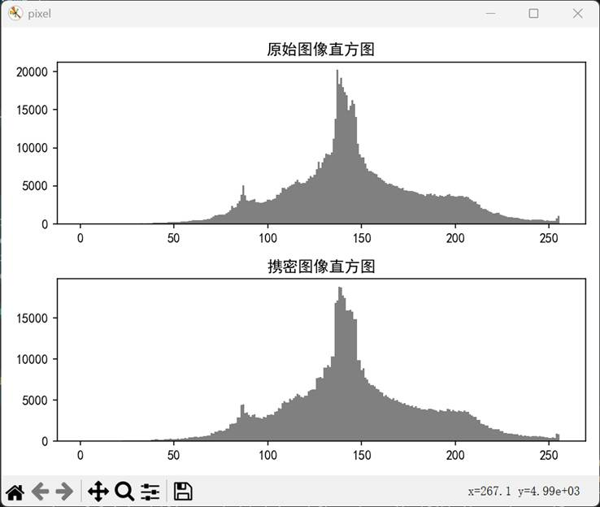
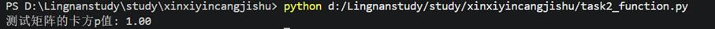
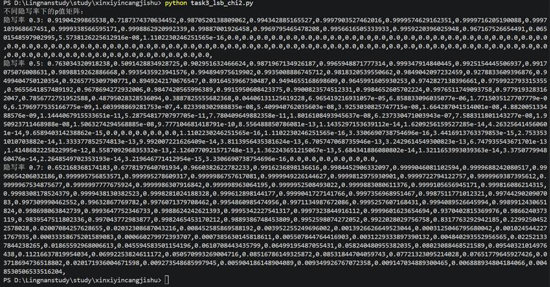
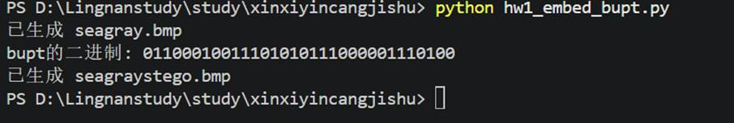
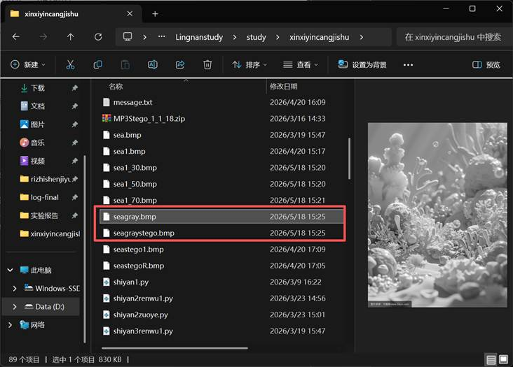
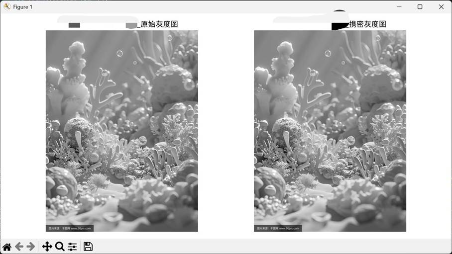
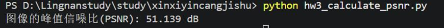
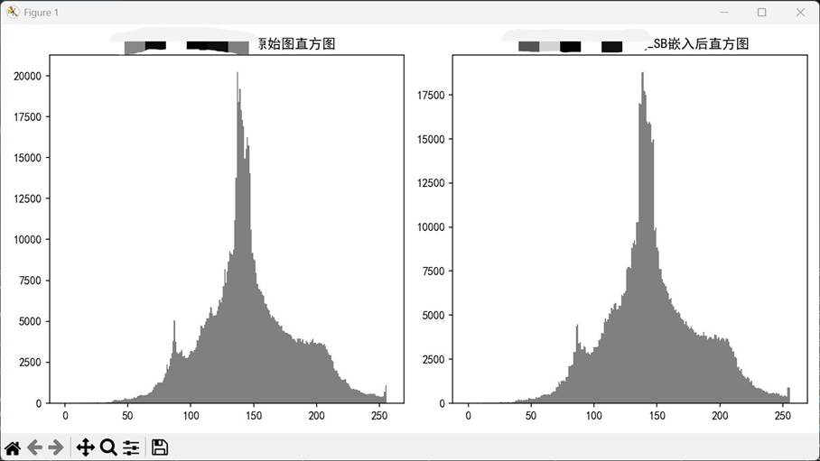
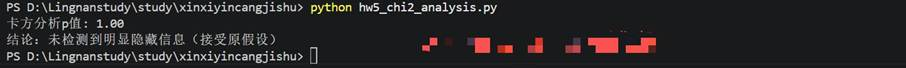

一、实验目的及要求

          实现LSB嵌入，并用卡方分析检测。

   

  

 

 

  

  二、实验原理与内容

  隐写分析原理、灰度图转换、LSB嵌入、直方图对比、卡方分析实现。

  ** **

  ** **

   

  

 

 

  

  三、实验软硬件环境

  (1)Windows 环境。

  (2) Python 3.7或以上。

  (3)图像文件 sea.bmp。

   

   

   

   

  

 

 

  

  四、实验过程（实验步骤、记录、数据、分析）

  任务一:灰度图LSB嵌入和直方图变化

  将彩色图转为灰度图，然后对灰度图像进行LSB嵌入，并比较嵌入秘密信息前后的直方图变化，代码如下。

  from PIL import Image

  import matplotlib.pyplot as plt

  import numpy as np

   

  #

  图像的基本信息

  img = Image.open(&quot;sea1.bmp&quot;)

  width = img.size[0]

  height = img.size[1]

   

  #

  rgb彩色图像转灰度图

  def rgb2gray(img_):

   

    img_ = img_.convert(&quot;L&quot;)

   

    return img_

   

  #

  生成随机信息

  def randomMsg(percent):

   

    if 0 &lt; percent &lt;= 1:

   

        row = round(width * percent)

   

        col = round(height * percent)

   

        return np.random.randint(0, 2, (col, row))

   

    else:

   

        raise Exception(&quot;传入的值必须属于(0,1]&quot;)

   

  #

  将信息写入

  def lsbWritein(img, msg):

   

    for y in range(len(msg)):

   

        for x in range(len(msg[0])):

   

            color = img.getpixel((x, y))

   

            temp = bin(color).replace('0b', '')

   

            # 不满足8bit长度的在高位补0

   

            for j in range(8 - len(temp)):

   

                temp = '0' + temp

   

            temp = temp[:7] + str(msg[y][x])

   

            img.putpixel((x, y), int(temp, 2))

   

    return img

   

  #

  主函数

  def main():

   

    plt.figure(&quot;pixel&quot;)

   

    rt = 1

   

    img_gray = rgb2gray(img)

   

    matrix_gray = np.array(img_gray)

   

    msg = np.array(randomMsg(rt))

   

    img_lsb = lsbWritein(img_gray, msg)

   

    matrix_lsb = np.array(img_lsb)

   

   

    # 表格绘制

   

    # 解决中文显示问题

   

    plt.rcParams['font.sans-serif'] = ['SimHei']

   

    plt.rcParams['axes.unicode_minus'] = False

   

   

    plt.subplot(211)

   

    plt.title(&quot;原始图像直方图&quot;)

   

    plt.hist(matrix_gray.flatten(), bins=np.arange(0.5, 257), color='gray')

   

   

    plt.subplot(212)

   

    plt.title(&quot;携密图像直方图&quot;)

   

    plt.hist(matrix_lsb.flatten(), bins=np.arange(0.5, 257), color='gray')

   

   

    plt.tight_layout()

   

    plt.show()

   

  if __name__ == &quot;__main__&quot;:

   

    main()

  结果如下：

  

  

   

    

   

   

    

    

   

  

   

   

   

   

   

   

   

   

   

   

   

   

   

   

   

   

  

  任务二:卡方分析函数

  代码如下。

  from scipy.stats import chi2

  import numpy as np

   

  #

  卡方分析

  def stgPrb(matrix):

   

    count = np.zeros(256, dtype=int)

   

    # 统计每个灰度值的像素数

   

    for i in range(len(matrix)):

   

        for j in range(len(matrix[0])):

   

            count[matrix[i][j]] += 1

   

   

    # 提取偶数灰度（2,4,...,254）的像素数

   

    h2i = count[2:255:2]

   

    # 提取奇数灰度（3,5,...,255）的像素数

   

    h2is = (h2i + count[3:256:2]) / 2

   

   

    # 过滤掉h2is为0的项（避免除以0）

   

    filter_ = (h2is != 0)

   

    k = sum(filter_)

   

    if k == 0:

   

        return 0.0  # 无有效数据时返回0

   

   

    idx = np.zeros(k, dtype=int)

   

    pos = 0

   

    for i in range(127):

   

        if filter_[i]:

   

            idx[pos] = i

   

            pos += 1

   

   

    # 计算卡方统计量

   

    r = sum(((h2i[idx] - h2is[idx]) ** 2) / h2is[idx])

   

    # 计算p值

   

    p = 1 - chi2.cdf(r, k - 1)

   

    return p

   

  if __name__ == &quot;__main__&quot;:

   

    # 测试函数：用随机矩阵验证

   

    test_matrix = np.random.randint(0, 256, (100, 100))

   

    p = stgPrb(test_matrix)

   

    print(f&quot;测试矩阵的卡方p值: {p:.2f}&quot;)

  结果如下：

  

 

  

  任务三:LSB卡方分析源代码

  代码如下。

  from PIL import Image

  from task2_function import stgPrb

  import numpy as np

   

  #

  图像的基本信息

  img = Image.open(&quot;sea1.bmp&quot;)

  width = img.size[0]

  height = img.size[1]

   

  #

  rgb彩色图像转灰度图

  def rgb2gray(img_):

   

    img_ = img_.convert(&quot;L&quot;)

   

    return img_

   

  #

  生成随机信息

  def randomMsg(percent):

   

    if percent &gt; 0 and percent &lt;= 1:

   

        row = round(width * percent)

   

        col = round(height * percent)

   

        return np.random.randint(0, 2, (col, row))

   

    else:

   

        raise Exception(&quot;传入的值必须属于(0,1]&quot;)

   

  #

  将信息写入

  def lsbWritein(img, msg):

   

    for y in range(len(msg)):

   

        for x in range(len(msg[0])):

   

            color = img.getpixel((x, y))

   

            temp = bin(color).replace('0b', '')

   

            # 不满足8bit长度的在高位补0

   

            for j in range(8 - len(temp)):

   

                temp = '0' + temp

   

            temp = temp[:7] + str(msg[y][x])

   

            img.putpixel((x, y), int(temp, 2))

   

    return img

   

  #

  主函数

  def main():

   

    p = np.zeros((3, 91))

   

    for k in range(3):

   

        img_gray = rgb2gray(img.copy())

   

        # 根据隐写率大小生成秘密信息，隐写率为0.3,0.5,0.7三种

   

        rt = 0.3 + 0.2 * k

   

        msg = randomMsg(rt)

   

        # lsb隐写

   

        img_lsb = lsbWritein(img_gray, msg)

   

        img_lsb.save(f&quot;sea1_{int(rt*100)}.bmp&quot;)

   

        matrix = np.array(img_lsb)

   

   

        # 循环，确定一个隐写率区间对图片进行分析

   

        i = 0

   

        for rto in range(10, 101):

   

            row = round(width * (rto / 100))

   

            col = round(height * (rto / 100))

   

            p[k][i] = stgPrb(matrix[0:row, 0:col])

   

            i += 1

   

   

    # 输出

   

    print(&quot;不同隐写率下的p值矩阵：&quot;)

   

    for i in range(3):

   

        print(f&quot;隐写率 {0.3+0.2*i}: &quot;, end=&quot;&quot;)

   

        for j in range(91):

   

            print(p[i][j], end=',')

   

        print()

   

  if __name__ == &quot;__main__&quot;:

   

    main()

  结果如下：

  

  

   

    

   

   

    

    

   

  

   

   

   

   

   

   

   

   

   

   

   

   

  

  至此，本实验任务已经完成。

  【实验作业】

  (1)将彩色图 sea. bmp 转成灰度图 seagray.bmp,利用LSB方法嵌入bupt 后生成seagraystego. bmp。此处同学们需要思考的一个重要问题是，bupt转成ASCII码后才32 bit，而 seagray.bmp 图的像素点很多，应该如何嵌人?建议嵌入的时候用bupt 的

  ASCII的二进制嵌入前32bit，后面添加随机数。

  代码如下：

  from PIL import Image

  import numpy as np

   

  #

  图像的基本信息

  img = Image.open(&quot;sea1.bmp&quot;)

  width = img.size[0]

  height = img.size[1]

   

  #

  转灰度图并保存

  img_gray = img.convert(&quot;L&quot;)

  img_gray.save(&quot;seagray.bmp&quot;)

   

  #

  将字符串转为二进制（8bit ASCII）

  def str_to_bin(s):

   

    bin_str = ''

   

    for c in s:

   

        bin_str += bin(ord(c))[2:].zfill(8)

   

    return bin_str

   

  #

  生成随机填充位

  def generate_padding(total_len):

   

    return ''.join(np.random.choice(['0', '1'], total_len))

   

  #

  LSB嵌入函数

  def lsb_embed(img, data_bin):

   

    img = img.copy()

   

    data_idx = 0

   

    total_bits = len(data_bin)

   

    for y in range(height):

   

        for x in range(width):

   

            if data_idx &gt;= total_bits:

   

                break

   

            color = img.getpixel((x, y))

   

            temp = bin(color)[2:].zfill(8)

   

            temp = temp[:7] + data_bin[data_idx]

   

            img.putpixel((x, y), int(temp, 2))

   

            data_idx += 1

   

        if data_idx &gt;= total_bits:

   

            break

   

    return img

   

  def main():

   

    #

  1. 转灰度图

   

    print(&quot;已生成 seagray.bmp&quot;)

   

   

    #

  2. 准备数据：bupt的二进制 + 随机填充

   

    bupt_bin = str_to_bin(&quot;bupt&quot;)  # 共32bit

   

    print(f&quot;bupt的二进制: {bupt_bin}&quot;)

   

   

    # 随机填充到图像大小

   

    img_size_bits = width * height

   

    padding_len = img_size_bits - len(bupt_bin)

   

    full_data = bupt_bin + generate_padding(padding_len)

   

   

    #

  3. LSB嵌入

   

    stego_img = lsb_embed(img_gray, full_data)

   

    stego_img.save(&quot;seagraystego.bmp&quot;)

   

    print(&quot;已生成 seagraystego.bmp&quot;)

   

  if __name__ == &quot;__main__&quot;:

   

    main()

  结果如下：

  

  

   

    

    

    

    

   

   

    

    

   

   

    

   

   

    

    

    

   

  

   

   

   

   

   

   

   

   

   

   

   

   

   

   

   

   

   

   

  

  (2)在一行两列中输出 seagray.bmp 和 seagraystego.bmp,截图插入实验告中,同时在图中添加本人学号和姓名作为标注;标注的方式是学号(10位)十姓名十原始灰度图、学号(10位)十姓名十携密灰度图。

  代码如下：

  from PIL import Image

  import matplotlib.pyplot as plt

   

  def main():

   

    # 加载图像

   

    img_gray = Image.open(&quot;seagray.bmp&quot;)

   

    img_stego = Image.open(&quot;seagraystego.bmp&quot;)

   

   

    # 解决中文显示问题

   

    plt.rcParams['font.sans-serif'] = ['SimHei']

   

    plt.rcParams['axes.unicode_minus'] = False

   

   

    # 一行两列显示

   

    plt.figure(figsize=(10, 5))

   

    plt.subplot(121)

   

    plt.imshow(img_gray, cmap='gray')

   

    plt.title(&quot;20230876****_***_原始灰度图&quot;)

   

    plt.axis('off')

   

   

    plt.subplot(122)

   

    plt.imshow(img_stego, cmap='gray')

   

    plt.title(&quot;20230876****_***_携密灰度图&quot;)

   

    plt.axis('off')

   

   

    plt.tight_layout()

   

    plt.savefig(&quot;hw2_images.png&quot;, dpi=300)

   

    plt.show()

   

  if __name__ == &quot;__main__&quot;:

   

    main()

  结果如下：

   

   

   

   

   

   

  

  

   

    

   

   

    

    

   

  

   

   

   

   

   

   

   

   

   

   

   

   

   

  

  (3)计算隐写后的图像的峰值信噪比，从主观(视觉效果)和客观(峰值信噪比)上来查看隐写后图像的透明性。将峰值信噪比的结果截图插入实验报告中。峰值信噪比取小数点后三位即可。

  代码如下：

  import numpy as np

  from PIL import Image

  import math

   

  def calculate_psnr(original, stego):

   

    # 转为numpy数组

   

    original = np.array(original, dtype=np.float64)

   

    stego = np.array(stego, dtype=np.float64)

   

   

    # 计算MSE

   

    mse = np.mean((original - stego) ** 2)

   

    if mse == 0:

   

        return float('inf')  # 无噪声时PSNR无穷大

   

   

    # 计算PSNR

   

    max_pixel = 255.0

   

    psnr = 20 * math.log10(max_pixel / math.sqrt(mse))

   

    return psnr

   

  def main():

   

    # 加载图像

   

    img_gray = Image.open(&quot;seagray.bmp&quot;)

   

    img_stego = Image.open(&quot;seagraystego.bmp&quot;)

   

   

    psnr = calculate_psnr(img_gray, img_stego)

   

    print(f&quot;图像的峰值信噪比(PSNR): {psnr:.3f} dB&quot;)

   

   

    # 可选：保存结果截图

   

    with open(&quot;hw3_psnr_result.txt&quot;, &quot;w&quot;) as f:

   

        f.write(f&quot;学号: 20230876****\n姓名: ***\nPSNR: {psnr:.3f} dB\n&quot;)

   

  if __name__ == &quot;__main__&quot;:

   

    main()

  结果如下：

  

  

   

    

   

   

    

    

   

  

   

   

  

  (4)比较嵌入秘密信息前后的直方图变化，将直方图显示在屏幕上，截图插入实验报告中，并在图中添加本人学号和姓名作为标注。要求标注:学号(10位)十姓名十原始图直方图、学号(10位)十姓名十LSB嵌入后直方图

  代码如下：

  from PIL import Image

  import matplotlib.pyplot as plt

  import numpy as np

   

  def main():

   

    # 加载图像

   

    img_gray = Image.open(&quot;seagray.bmp&quot;)

   

    img_stego = Image.open(&quot;seagraystego.bmp&quot;)

   

   

    matrix_gray = np.array(img_gray)

   

    matrix_stego = np.array(img_stego)

   

   

    # 解决中文显示问题

   

    plt.rcParams['font.sans-serif'] = ['SimHei']

   

    plt.rcParams['axes.unicode_minus'] = False

   

   

    plt.figure(figsize=(10, 5))

   

    plt.subplot(121)

   

    plt.title(&quot;20230876****_***_原始图直方图&quot;)

   

    plt.hist(matrix_gray.flatten(), bins=np.arange(0.5, 257), color='gray')

   

   

    plt.subplot(122)

   

    plt.title(&quot;20230876****_***_LSB嵌入后直方图&quot;)

   

    plt.hist(matrix_stego.flatten(), bins=np.arange(0.5, 257), color='gray')

   

   

    plt.tight_layout()

   

    plt.savefig(&quot;hw4_histogram.png&quot;, dpi=300)

   

    plt.show()

   

  if __name__ == &quot;__main__&quot;:

   

    main()

  结果如下：

  

  

   

    

   

   

    

    

   

  

   

   

   

   

   

   

   

   

   

   

   

   

   

  

  (5)利用卡方分析方法判断隐写后的图像是否隐藏秘密信息，计算p(取小数点后两位)，将结果截图插入实验报告中，并在图中添加本人学号和姓名作为标注。学号(10位)十姓名。

  代码如下：

  from PIL import Image

  from task2_function import stgPrb

  import numpy as np

   

  def main():

   

    # 加载携密图像

   

    img_stego = Image.open(&quot;seagraystego.bmp&quot;)

   

    matrix = np.array(img_stego)

   

   

    # 计算p值

   

    p = stgPrb(matrix)

   

    print(f&quot;卡方分析p值: {p:.2f}&quot;)

   

   

    # 结果判断

   

    if p &lt; 0.05:

   

        print(&quot;结论：图像中存在隐藏信息（拒绝原假设）&quot;)

   

    else:

   

        print(&quot;结论：未检测到明显隐藏信息（接受原假设）&quot;)

   

   

    # 保存结果

   

    with open(&quot;hw5_chi2_result.txt&quot;, &quot;w&quot;) as f:

   

        f.write(f&quot;学号: 20230876****\n姓名: ***\n卡方p值: {p:.2f}\n&quot;)

   

        f.write(&quot;结论：存在隐藏信息&quot; if p &lt; 0.05 else &quot;结论：未检测到隐藏信息&quot;)

   

  if __name__ == &quot;__main__&quot;:

   

    main()

  

结果如下：

   

   

  

 

 

  

   

  

 

 

  

  五、测试/调试及实验结果分析

  1.

  静态数据水印实现最简单，但安全性最低，容易被发现和篡改。

  2. 静态代码水印比静态数据水印更隐蔽，但仍可通过静态分析和代码审查发现。

  3. 动态数据结构水印需要特定触发条件，比静态水印更难检测，但触发条件可能被破解。

  4. Easter Egg水印是最隐蔽的方式，但需要精心设计触发条件，否则容易被逆向工程发现。

  5. 软件水印的安全性取决于隐蔽性、鲁棒性、容量和代价等因素。

   

  

 

 

  

  六、实验结论与体会

  一、实验结论

  

   本次实验完成了灰度图像 LSB 最低有效位信息隐写，通过修改像素灰度值最低位二进制比特，能够在不破坏图像视觉效果的前提下完成秘密信息嵌入，嵌入前后肉眼无法分辨原图与载密图像差异，隐写隐蔽性较强。

   对原始图像与嵌入秘密信息后的载密图像绘制灰度直方图对比可知，LSB 隐写会改变图像像素灰度值分布规律，相邻灰度值像素数量趋于均衡，直方图出现明显特征变化，可作为隐写识别的直观依据。

   利用卡方检验算法能够有效对 LSB 隐写图像进行检测，通过计算得出的 P 值可准确判断图像是否存在隐藏信息，隐写率越高，卡方检测识别效果越明显，检测准确率随之提升。

   经峰值信噪比 PSNR 计算得出，LSB 隐写后图像信噪比数值较高，说明信息嵌入造成的图像失真程度极低，满足信息隐写对于图像质量的基本要求。

   成功实现指定字符信息在图像内的完整嵌入，掌握了信息二进制转换、像素比特位修改、秘密信息提取相关核心流程，完成不同隐写比例下的隐写实验与检测实验。

  

  二、实验心得体会

  通过本次信息隐藏技术实验，我系统学习并掌握了

  LSB 图像隐写的基本原理与实际实现流程，明白了最低有效位替换是最简单实用的空域隐写方式，也清晰认识到该隐写算法的优势与不足。

  在代码编写与调试过程中，我熟练运用

  Python 图像处理库完成图像读取、格式转换、像素遍历与信息嵌入操作，解决了库环境缺失、图片路径错误、二进制数据转换异常等诸多问题，自身代码编写能力与实验实操能力得到有效锻炼。同时在绘制直方图、计算 PSNR、开展卡方检测的过程中，进一步理解了图像质量评价标准与隐写分析的核心思路。

  实验过程中我也发现 LSB 隐写存在明显短板，该算法抗检测能力较弱，极易被卡方分析等经典隐写分析手段识别，仅适用于简易场景下的信息隐藏，无法应用于高安全性的保密通信场景。这也让我意识到信息隐藏技术不仅要实现信息隐藏，更要兼顾抗检测、抗压缩、抗篡改等多重性能。

  此次实验让我深刻体会到网络信息安全领域中信息隐藏技术的实用价值，明白了隐写技术在隐私保护、秘密通信、版权保护等方面的重要作用。今后我会继续深入学习更多高级隐写算法与隐写分析技术，夯实专业基础知识，提升自身在信息安全方向的实践与研究能力。