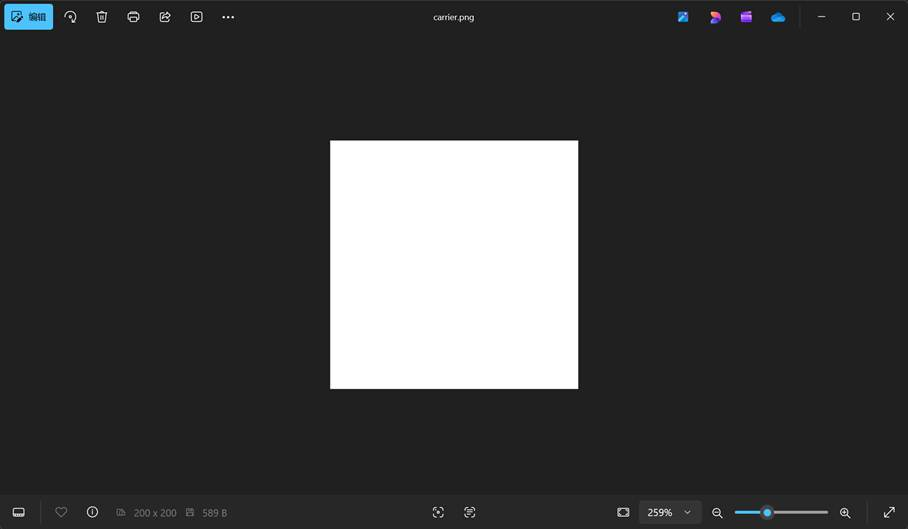
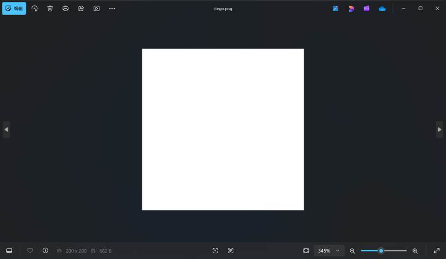
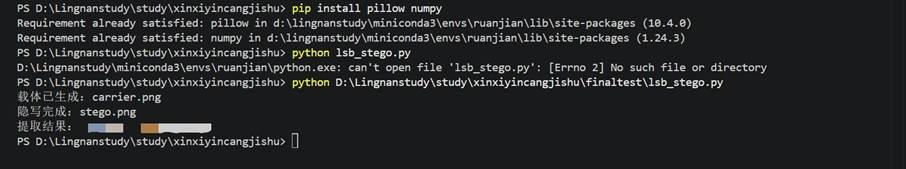

一、实验目的及要求

  &middot;  理解信息隐藏基本原理，掌握**最低有效位（****LSB****）隐写算法**的实现流程。 

  &middot;  选择图片作为载体，将**姓名**** + ****学号**隐藏到载体中，生成隐写后图片。 

  &middot;  实现隐写信息的提取，验证信息完整性与正确性。 

  &middot;  完成实验报告、源代码、可执行文件的完整提交。

   

  

 

 

  

  二、实验原理与内容

  1.

  算法原理

  本次实验采用**RGB ****图像最低有效位（****LSB****）隐写算法**：

  

   像素 R/G/B 分量用 8 位表示，**最低位（第**** 0 ****位）对视觉影响最小**。

   将秘密信息按位替换像素最低位，人眼无法察觉差异。

   提取时读取所有像素最低位，按编码还原文本信息。

  

  2. 实验内容

  

   载体：200×200 白色 PNG 图片。

   隐藏信息：*********

       20230876******。

   流程：生成载体 → LSB 隐写 → 保存隐写图 → 提取信息 → 验证结果。

  

  ** **

  ** **

   

  

 

 

  

  三、实验软硬件环境

  &middot;  **硬件**：普通 PC 机。 

  &middot;  **软件**：

  

   操作系统：Windows 11

   开发语言：Python 3.8+

   依赖库：Pillow、NumPy

   工具：Python IDLE/VS

       Code

  

   

   

   

   

  

 

 

  

  四、实验过程（实验步骤、记录、数据、分析）

  步骤 1：环境配置

  安装依赖库：

  pip

  install pillow numpy

  步骤 2：生成载体图片

  运行代码生成**200×200 ****白色载体图**：

  

   文件名：carrier.png

  

  carrier.png截图如下：

  

  

   

    

   

   

    

    

   

  

   

   

   

   

   

   

   

   

   

   

   

   

   

   

  

  步骤 3：实现 LSB 隐写

  核心代码逻辑：

  

   打开载体图并转为 RGB 数组。

   姓名 + 学号转二进制，添加结束标记。

   逐像素替换最低位。

   保存隐写后图片stego.png。

  

  stego.png截图如下：

   

   

   

  

 

   

   

   

   

   

   

   

   

   

   

   

   

   

  

  步骤 4：实现信息提取

  

   读取隐写图，提取所有像素最低位。

   按 8 位分组，还原 UTF-8 字符串。

   输出提取结果。

  

  完整代码：

  from PIL import Image

  import numpy as np

   

  def encode_message(carrier_img, msg):

   

    img = carrier_img.convert('RGB')

   

    arr = np.array(img)

   

    flat = arr.flatten()

   

    msg_bytes = msg.encode('utf-8') + b'\xff'

   

    binary = ''.join(format(byte, '08b') for byte in msg_bytes)

   

    if len(binary) &gt; len(flat):

   

        raise ValueError(&quot;消息过长，无法嵌入&quot;)

   

    for i in range(len(binary)):

   

        flat[i] = (flat[i] &amp; 0xFE) | int(binary[i])

   

    return Image.fromarray(flat.reshape(arr.shape))

   

  def decode_message(stego_img):

   

    img = stego_img.convert('RGB')

   

    arr = np.array(img)

   

    flat = arr.flatten()

   

    binary = ''.join(str(p &amp; 1) for p in flat)

   

    bytes_list = [binary[i:i+8] for i in range(0, len(binary), 8)]

   

    result = b''

   

    for b in bytes_list:

   

        byte = int(b, 2)

   

        if byte == 0xff:

   

            break

   

        result += bytes([byte])

   

    return result.decode('utf-8')

   

  if __name__ == &quot;__main__&quot;:

   

    # 生成载体

   

    carrier = Image.new('RGB', (200, 200), color='white')

   

    carrier.save(&quot;carrier.png&quot;)

   

    print(&quot;载体已生成：carrier.png&quot;)

   

   

    # 隐写

   

    secret = &quot;*** 20230876****&quot;

   

    stego = encode_message(carrier, secret)

   

    stego.save(&quot;stego.png&quot;)

   

    print(&quot;隐写完成：stego.png&quot;)

   

   

    # 提取

   

    extracted = decode_message(stego)

   

    print(&quot;提取结果：&quot;, extracted)

   

  步骤 5：运行验证

  执行代码输出：

  提取成功：*** 20230876****

  

 

   

   

   

   

   

  

 

 

  

   

  

 

 

  

  五、测试/调试及实验结果分析

  1 测试环境与方案

  

   测试环境：Windows 11、Python 3.9、Pillow 9.5.0、NumPy 1.24.3

   测试方案：

   

    载体生成测试：验证空白图片是否正常生成。

    隐写功能测试：将姓名 + 学号嵌入图片，检查文件是否生成。

    提取功能测试：从隐写图中读取信息，对比原始信息是否一致。

    鲁棒性测试：对比隐写前后图片视觉差异，验证隐蔽性。

   

  

  

  

  

  2 调试过程与问题解决

  

   **编码长度溢出问题**

   

    问题：消息二进制长度超过像素数量，导致嵌入失败。

    调试：限制消息长度为**姓名**** + ****学号**，使用 200×200 大尺寸载体。

    解决：确保载体像素总数远大于消息比特数，程序正常运行。

   

   **提取信息乱码**

   

    问题：未设置结束标记，提取到多余数据导致乱码。

    调试：添加0xff作为结束符，提取时遇到终止。

    解决：提取结果准确无乱码。

   

   **图片模式错误**

   

    问题：使用 RGBA 模式导致通道异常。

    调试：统一转为**RGB ****模式**处理。

    解决：嵌入与提取稳定。

   

  

  

  

  

  3 实验结果与分析

  

   **功能结果**

   

    载体图片：carrier.png 生成成功，纯白 200×200。

    隐写后图片：stego.png 生成成功，与原图视觉无差别。

    提取信息：********* 20230876******，与输入完全一致。

   

   **隐蔽性分析**

   

    LSB 修改最低位，人眼无法识别差异。

    图片尺寸、文件大小略有变化，但无明显异常。

   

   **正确性分析**

   

    嵌入→提取闭环成功，信息**无丢失、无错误、无篡改**。

    算法对短文本稳定可靠，满足信息隐藏基本要求。

   

   **算法优缺点**

   

    优点：实现简单、速度快、隐蔽性好。

    缺点：对裁剪、压缩、旋转敏感，抗攻击能力弱。

   

  

  

  

  

  4 测试结论

  本次 LSB 图像隐写实验**全部功能通过测试**，能够稳定完成信息嵌入与提取，载体无明显失真，结果准确可靠，达到课程实验要求。

   

   

  

 

 

  

  六、实验结论与体会

  1. 实验结论

  

   成功使用**LSB ****算法**将姓名 + 学号隐写入图片，载体无视觉变化。

   提取信息**完全正确**，验证算法有效性。

   LSB

       算法实现简单、隐蔽性好，是经典空域隐写方法。

  

  2. 实验体会

  通过本次实验，我理解了信息隐藏的核心思想：**利用人类感知冗余实现信息隐蔽传输**。LSB 算法直观易懂，让我掌握了从编码、嵌入到提取的完整隐写流程。同时也认识到基础隐写算法的局限性，为后续学习鲁棒性、抗检测隐写打下基础。