一、实验目的及要求

  (1)理解软件水印的基本原理，掌握静态软件水印和动态软件水印的特点。

  (2)使用Python软件生成几种静态和动态软件水印，并对这几种水印进行简单攻击。

   

  

 

 

  

  二、实验原理与内容

  1. 实验原理

  软件水印是将版权信息（如学号、姓名、版权声明）以隐蔽方式嵌入程序代码或运行状态中，用于标识作者、追踪盗版、证明所有权。本实验基于**静态软件水印**与**动态软件水印**两大类技术实现：

  （1）静态软件水印原理

  静态水印在**程序不运行时**就存在于代码、数据或结构中，无需触发条件，直接嵌入程序本体。

  

   **静态数据水印**：将版权信息以常量、字符串、数组等形式直接写在代码中，运行时直接输出或供验证提取。

   **静态代码水印**：将水印信息隐藏在**永远不会执行的死分支、冗余代码、无用变量赋值**中，不影响程序功能，但可通过代码审查提取版权标识。

  

  （2）动态软件水印原理

  动态水印只有在**程序运行时、满足特定触发条件**时才会出现，水印内容存储在运行时数据结构或执行路径中。

  

   **动态数据结构水印**：当输入特定密码、序列或满足特定状态时，程序动态创建包含水印的队列、链表、字典等结构，用于证明版权。

   **Easter Egg****（彩蛋）水印**：程序监听特定输入序列，当且仅当输入完全匹配时，输出隐藏的版权信息，属于条件触发式动态水印。

  

  （3）软件水印攻击原理

  攻击指通过篡改、删除、破坏水印，使版权标识失效或无法正常提取。常见攻击方式包括：

  

   **篡改攻击**：修改水印内容、版权信息、关键词，替换为攻击者标识。

   **移除攻击**：删除水印分支、水印变量、水印校验逻辑，使程序不再包含版权信息。

   **逻辑破坏攻击**：修改触发条件、校验公式，使正确输入也无法触发水印。

  

  

  

  

  2. 实验内容

  本实验使用 Python 完成**软件水印生成**与**软件水印攻击**两项核心任务：

  （1）静态与动态软件水印生成

  

   **静态数据水印**

  

  在程序中定义固定版权字符串，运行时直接输出版权信息，实现显性静态水印。

  

   **静态代码水印**

  

  构造包含死分支的交互式程序，将版权信息（Copy Right By BUPTISC）拆分隐藏在永不执行的 case 分支中，实现隐性静态水印。

  

   **动态数据结构水印**

  

  设计触发式程序，当输入指定密码串时，动态创建双端队列存储版权字符，实现运行时动态水印。

  

   **Easter Egg ****彩蛋水印**

  

  实现基于字符序列校验的彩蛋程序，输入特定 12 位字符串时，输出隐藏版权信息，实现动态触发水印。

  （2）软件水印攻击尝试

  对上述四类水印分别实施基础攻击，验证水印脆弱性：

  

   **攻击静态数据水印**：篡改版权字符串，替换原作者信息为攻击者标识。

   **攻击静态代码水印**：移除所有包含水印的死分支，使程序不再携带版权信息。

   **攻击动态数据结构水印**：修改触发条件，使正确密码也无法创建水印结构。

   **攻击**** Easter Egg ****水印**：破坏校验逻辑，使正确序列无法触发彩蛋版权输出。

  

   

   

   

   

   

  

 

 

  

  三、实验软硬件环境

  (1)Windows操作系统。

  (2) Python。

   

   

   

   

  

 

 

  

  四、实验过程（实验步骤、记录、数据、分析）

  任务一:静态水印的生成与攻击

  1.静态数据水印

  (1)静态数据水印的生成

  比如用一个静态全局字符串来标识软件的版权，代码如下。

  #

  a simple static software watermark (data watermark)

  def main():

   

    # 静态数据水印：固定字符串标识版权

   

    sw = &quot;copyright bupt

  isc&quot;

   

    print(&quot;Hello

  watermarking world!&quot;)

   

    print(f&quot;[Debug] Static

  Watermark: {sw}&quot;)  # 用于验证水印存在

   

  if __name__ == &quot;__main__&quot;:

   

    main()

  
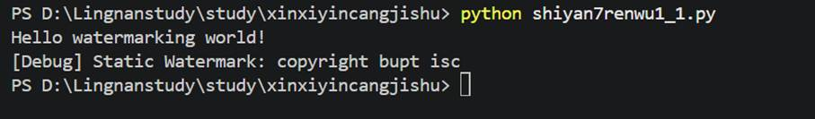
结果如下：

   

   

   

   

  (2)静态数据水印的攻击

  代码如下：

  #

  攻击：修改静态数据水印，加入攻击者水印

  def main():

   

    # 攻击者篡改后的代码：同时存在原水印和攻击者水印

   

    cw = &quot;copyright

  lsc&quot;

   # 攻击者添加的水印

   

    sw = &quot;copyright bupt

  isc&quot;

   # 原水印

   

    print(&quot;Hello

  watermarking world!&quot;)

   

    print(f&quot;[Debug] Attacker

  Watermark: {cw}&quot;)

   

    print(f&quot;[Debug] Original

  Watermark: {sw}&quot;)

   

  if __name__ == &quot;__main__&quot;:

   

    main()

  结果如下：

  

  

   

    

   

   

    

    
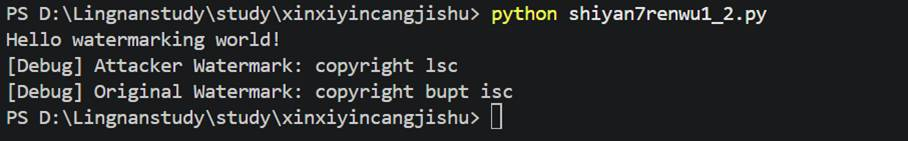

   

  

   

   

   

   

  

  2.静态代码水印的生成与攻击

  (1)静态代码水印的生成方法一:在变量赋值中隐藏水印。程序中以变量v的赋值“Copy Right ByBUPTISC”作为静态水印。代码如下：

  import os

   

  LENGTH = 10

   

  def main():

   

    STOP = False

   

    while not STOP:

   

        print(&quot;Input an n between 0 and 3. Other numbers to quit.&quot;)

   

        n = int(input())

   

        input()  # 消耗换行符

   

        case_value = 2 * n + 1

   

        

   

        if case_value == 0:

   

            # 隐藏水印：变量赋值拼接版权信息 &quot;Copy Right By

  BUPTISC&quot;

   

            v = 'C'

   

            v = 'o'

   

            v = 'p'

   

            v = 'y'

   

        elif case_value == 1:

   

            name = input(&quot;Your name? &quot;)

   

            print(f&quot;Hello, {name}!\nLet's try other numbers again\n&quot;)

   

        elif case_value == 2:

   

            v = 'R'

   

            v = 'i'

   

            v = 'g'

   

            v = 'h'

   

            v = 't'

   

        elif case_value == 3:

   

            os.system(&quot;cls &amp;&amp; echo Clearing screen finish&quot;)

   

        elif case_value == 4:

   

            v = 'B'

   

            v = 'y'

   

        elif case_value == 5:

   

            print(&quot;System version&quot;)

   

            os.system(&quot;ver&quot;)

   

        elif case_value == 6:

   

            v = 'B'

   

            v = 'U'

   

            v = 'P'

   

            v = 'T'

   

            v = 'I'

   

            v = 'S'

   

            v = 'C'

   

        elif case_value == 7:

   

            os.system(&quot;echo Current Directory &amp;&amp; dir &amp;&amp;

  echo&quot;)

   

        else:

   

            print(&quot;This is a static code watermarking sample\nNow the program is

  going down&quot;)

   

            STOP = True

   

        input(&quot;Press Enter to continue...&quot;)

   

  if __name__ == &quot;__main__&quot;:

   

    main()

  结果如下：

  

  

   

    

   

   

    

    
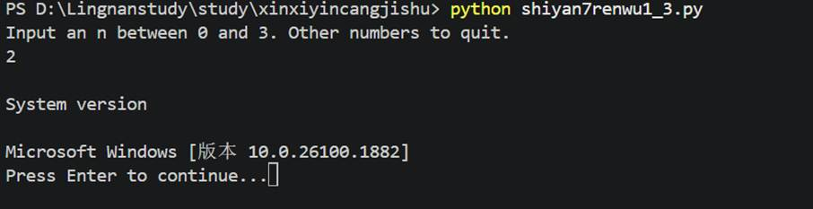

   

  

   

   

   

   

   

   

  

  (2)静态代码水印的生成方法二:利用永假式来构造不会执行到的死流程，死流程中包含版权信息。代码如下。

  import os

   

  LENGTH = 10

   

  def main():

   

    STOP = False

   

    while not STOP:

   

        print(&quot;Input an n between 0 and 3. Other numbers to quit.&quot;)

   

        n = int(input())

   

        input()  # 消耗换行符

   

        case_value = 2 * n + 1

   

        

   

        if case_value == 0:

   

            # 死流程分支：永不执行，隐藏水印逻辑

   

            pass

   

        elif case_value == 1:

   

            name = input(&quot;Your name? &quot;)

   

            print(f&quot;Hello, {name}!\nLet's try other numbers again\n&quot;)

   

        elif case_value == 3:

   

            os.system(&quot;cls &amp;&amp; echo Clearing screen finish&quot;)

   

        elif case_value == 5:

   

            print(&quot;System version&quot;)

   

            os.system(&quot;ver&quot;)

   

        elif case_value == 7:

   

            os.system(&quot;echo Memory information &amp;&amp; dir &amp;&amp;

  echo&quot;)

   

        else:

   

            print(&quot;This is a static code watermarking sample\nNow the program is

  going down&quot;)

   

            STOP = True

   

        input(&quot;Press Enter to continue...&quot;)

   

  if __name__ == &quot;__main__&quot;:

   

    main()

  结果如下：

  

  

   

    

   

   

    

    
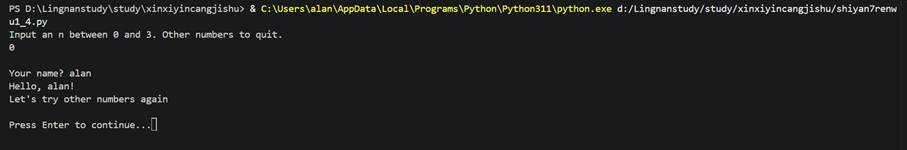

   

  

   

   

   

   

  

  (3)静态代码水印的攻击

  代码如下：

  import os

   

  LENGTH = 10

   

  def main():

   

    STOP = False

   

    while not STOP:

   

        print(&quot;Input an n between 0 and 3. Other numbers to quit.&quot;)

   

        n = int(input())

   

        input()  # 消耗换行符

   

        case_value = 2 * n + 1

   

        

   

        # 移除了case_value==0、2、4、6的水印分支

   

        if case_value == 1:

   

            name = input(&quot;Your name? &quot;)

   

            print(f&quot;Hello, {name}!\nLet's try other numbers again\n&quot;)

   

        elif case_value == 3:

   

            os.system(&quot;cls &amp;&amp; echo Clearing screen finish&quot;)

   

        elif case_value == 5:

   

            print(&quot;System version&quot;)

   

            os.system(&quot;ver&quot;)

   

        elif case_value == 7:

   

            os.system(&quot;echo Memory information &amp;&amp; dir &amp;&amp;

  echo&quot;)

   

        else:

   

            print(&quot;This is a static code watermarking sample\nNow the program is

  going down&quot;)

   

            STOP = True

   

        input(&quot;Press Enter to continue...&quot;)

   

  if __name__ == &quot;__main__&quot;:

   

    main()

  结果如下：

  

  

   

    

   

   

    

    
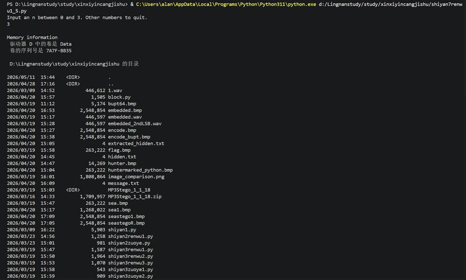

   

  

   

   

   

   

   

   

   

   

   

   

   

   

   

   

  

  任务二:动态软件水印的生成与攻击

  1.值类型动态数据结构水印

  (1)值类型动态数据结构水印的生成

  代码如下：

  from collections import deque

   

  def main():

   

    line = input(&quot;Please input

  something...\n&quot;)

   

    # 触发条件：输入特定字符串&quot;hjskei4Xo&quot;时，创建隐藏水印的双端队列

   

    if line == &quot;hjskei4Xo&quot;:

   

        # 队列中存储版权信息字符：['C','S','I','I','T','P','U','B','T','H','G','I','R','Y','P','O','C']

   

        v = deque(['C','S','I','I','T','P','U','B','T','H','G','I','R','Y','P','O','C'])

   

        print(f&quot;[Watermark Triggered] Hidden Data Structure

  Created!&quot;)

   

    

   

    print(&quot;The length of

  your input is&quot;, len(line))

   

  if __name__ == &quot;__main__&quot;:

   

    main()

  结果如下：

   

   

  

  

   

    

   

   

    

    
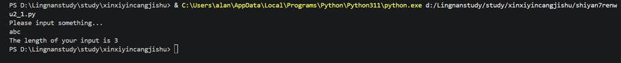

   

  

   

   

   

  

  (2)值类型动态数据结构水印的攻击

  代码如下：

  from collections import deque

   

  def main():

   

    line = input(&quot;Please input

  something...\n&quot;)

   

    # 攻击：修改触发条件，原条件为line == &quot;hjskei4Xo&quot;，改为line + &quot;a&quot; ==

  &quot;hjskei4Xo&quot;（永远不满足）

   

    if line + &quot;a&quot; == &quot;hjskei4Xo&quot;:

   

        v = deque()  # 水印队列永远不会被创建

   

        print(f&quot;[Watermark Triggered] Hidden Data Structure

  Created!&quot;)

   

    

   

    print(&quot;The length of

  your input is&quot;, len(line))

   

  if __name__ == &quot;__main__&quot;:

   

    main()

  结果如下：

  

  

   

    

   

   

    

    
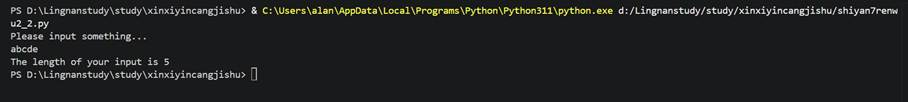

   

  

   

   

   

  

  2.

  Easter Egg 水印

  (1)Easter

  Egg水印的生成

  代码如下：

  def letter_counts(ch):

   

    if ch.isalpha():

   

        return ord(ch.upper()) - ord('A')

   

    else:

   

        return -1

   

  def input_letters():

   

    array = []

   

    print(&quot;Please input

  something...&quot;)

   

    line = input()

   

    array.extend(line)

   

    return array

   

  def print_morse(array, n):

   

    if n == -1:

   

        print()

   

    else:

   

        print(array[n])

   

    print()

   

  #

  莫尔斯电码表（简化版）

  morse_code = [&quot;.-&quot;, &quot;-...&quot;, &quot;-.-.&quot;, &quot;-..&quot;, &quot;.&quot;, &quot;..-.&quot;, &quot;--.&quot;, &quot;....&quot;, &quot;..&quot;, &quot;.---&quot;, &quot;-.-&quot;, &quot;.-..&quot;, &quot;--&quot;, &quot;-.&quot;, &quot;---&quot;, &quot;.--.&quot;, &quot;--.-&quot;, &quot;.-.&quot;, &quot;...&quot;, &quot;-&quot;, &quot;..-&quot;, &quot;...-&quot;, &quot;.--&quot;, &quot;-..-&quot;, &quot;-.--&quot;, &quot;--..&quot;]

   

  def convert_to_morse(array, code):

   

    for char in array:

   

        index = letter_counts(char)

   

        if index != -1 and len(array) == 12:

   

            # 彩蛋触发条件：输入长度为12的特定字符序列

   

            check(array, len(array))

   

  def check(array, size):

   

    # 水印校验码：对应&quot;COPYRIGHTBYR&quot;的字母序号

   

    mark = [2,14,15,24,17,8,6,7,19,1,24,17]

   

    for i in range(size):

   

        if letter_counts(array[i]) != mark[i]:

   

            break

   

    else:

   

        # 校验通过，输出水印信息

   

        print(&quot;Copyright By BUPTISC&quot;)

   

  def main():

   

    print(&quot;This program

  translates a line into Morse code.&quot;)

   

    print(f&quot;But not enter

  more letters than {len(morse_code)}&quot;)

   

    print(&quot;Enter English

  text:&quot;)

   

    line = input_letters()

   

    convert_to_morse(line, morse_code)

   

  if __name__ == &quot;__main__&quot;:

   

    main()

  
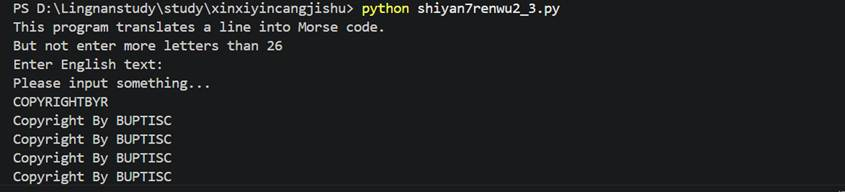
结果如下：

   

   

   

   

   

  (2)Easter

  Egg水印的攻击

  代码如下：

  def letter_counts(ch):

   

    if ch.isalpha():

   

        return ord(ch.upper()) - ord('A')

   

    else:

   

        return -1

   

  def input_letters():

   

    array = []

   

    print(&quot;Please input

  something...&quot;)

   

    line = input()

   

    array.extend(line)

   

    return array

   

  def print_morse(array, n):

   

    if n == -1:

   

        print()

   

    else:

   

        print(array[n])

   

    print()

   

  morse_code = [&quot;.-&quot;, &quot;-...&quot;, &quot;-.-.&quot;, &quot;-..&quot;, &quot;.&quot;, &quot;..-.&quot;, &quot;--.&quot;, &quot;....&quot;, &quot;..&quot;, &quot;.---&quot;, &quot;-.-&quot;, &quot;.-..&quot;, &quot;--&quot;, &quot;-.&quot;, &quot;---&quot;, &quot;.--.&quot;, &quot;--.-&quot;, &quot;.-.&quot;, &quot;...&quot;, &quot;-&quot;, &quot;..-&quot;, &quot;...-&quot;, &quot;.--&quot;, &quot;-..-&quot;, &quot;-.--&quot;, &quot;--..&quot;]

   

  def convert_to_morse(array, code):

   

    for char in array:

   

        index = letter_counts(char)

   

        # 攻击：移除彩蛋校验逻辑，水印不再触发

   

        print_morse(code, index)

   

  def main():

   

    print(&quot;This program

  translates a line into Morse code.&quot;)

   

    print(f&quot;But not enter

  more letters than {len(morse_code)}&quot;)

   

    print(&quot;Enter English

  text:&quot;)

   

    line = input_letters()

   

    convert_to_morse(line, morse_code)

   

  if __name__ == &quot;__main__&quot;:

   

    main()

  结果如下：

   

  

  

   

    

   

   

    

    
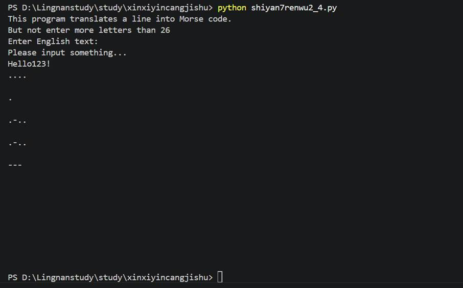

   

  

   

   

   

   

   

   

   

   

   

   

   

   

   

   

   

  

  【实验作业】

  (1) 使用Python生成静态和动态水印。

  代码如下：

  #

  ==============================

  #

  任务1：Python生成静态和动态软件水印

  #

  可单独运行，包含：静态数据水印、静态代码水印、动态数据结构水印、Easter Egg水印

  #

  ==============================

  from collections import deque

   

  #

  ------------------------------

  #

  1. 静态数据水印（显性）

  #

  ------------------------------

  def static_data_watermark():

   

    print(&quot;\n=== 1. 静态数据水印 ===&quot;)

   

    sw = &quot;Copyright &copy; 2023

  BUPT ISC&quot;

   # 静态版权水印

   

    print(&quot;&#9989; 静态数据水印生成成功！&quot;)

   

    print(f&quot;[Static Data

  Watermark] {sw}&quot;)

   

    return sw

   

  #

  ------------------------------

  #

  2. 静态代码水印（隐性：死分支隐藏）

  #

  ------------------------------

  def static_code_watermark():

   

    print(&quot;\n=== 2. 静态代码水印 ===&quot;)

   

    print(&quot;说明：水印隐藏在死分支中（case=0/2/4/6），输入0-3触发功能，非0-3退出&quot;)

   

    STOP = False

   

    while not STOP:

   

        try:

   

            print(&quot;\nInput 0-3 to continue, others to quit:&quot;)

   

            n = int(input())

   

            input()  # 消耗换行符

   

            case = 2 * n + 1

   

            

   

            # 死分支：隐藏&quot;Copy Right By

  BUPTISC&quot;

   

            if case == 0:

   

                v = 'C'; v='o'; v='p'; v='y'

   

            elif case == 2:

   

                v = 'R'; v='i'; v='g'; v='h'; v='t'

   

            elif case == 4:

   

                v = 'B'; v='y'

   

            elif case == 6:

   

                v = 'B'; v='U'; v='P'; v='T'; v='I'; v='S'; v='C'

   

            # 功能分支

   

            elif case == 1:

   

                name = input(&quot;Your name? &quot;)

   

                print(f&quot;Hello {name}!&quot;)

   

            else:

   

                STOP = True

   

                print(&quot;&#9989; 静态代码水印已嵌入（死分支），程序退出...&quot;)

   

        except ValueError:

   

            STOP = True

   

            print(&quot;输入非数字，程序退出！&quot;)

   

  #

  ------------------------------

  #

  3. 动态数据结构水印（触发式）

  #

  ------------------------------

  def dynamic_data_watermark():

   

    print(&quot;\n=== 3. 动态数据结构水印 ===&quot;)

   

    print(&quot;说明：输入触发字符串'hjskei4Xo'才会创建水印队列&quot;)

   

    line = input(&quot;Input trigger

  string (hint: hjskei4Xo):\n&quot;)

   

    if line == &quot;hjskei4Xo&quot;:

   

        # 动态创建双端队列存储水印字符

   

        watermark_queue = deque(['C','O','P','Y','R','I','G','H','T','B','Y','B','U','P','T'])

   

        print(&quot;&#9989; 动态数据结构水印触发成功！&quot;)

   

        print(f&quot;[Dynamic Watermark Queue] {list(watermark_queue)}&quot;)

   

    else:

   

        print(f&quot;&#10060; 触发失败！输入长度：{len(line)}&quot;)

   

  #

  ------------------------------

  #

  4. Easter Egg水印（彩蛋式）

  #

  ------------------------------

  def letter_counts(ch):

   

    &quot;&quot;&quot;字母转序号：A=0, B=1...Z=25，非字母返回-1&quot;&quot;&quot;

   

    return ord(ch.upper()) - ord('A') if ch.isalpha() else -1

   

  def easter_egg_watermark():

   

    print(&quot;\n=== 4. Easter Egg水印（彩蛋式） ===&quot;)

   

    print(&quot;说明：输入12位匹配序列'COPYRIGHTBYR'触发版权水印&quot;)

   

    line = list(input(&quot;Input

  12-character string to trigger egg:\n&quot;))

   

    # 水印校验码：对应'COPYRIGHTBYR'

   

    mark = [2,14,15,24,17,8,6,7,19,1,24,17]

   

    

   

    if len(line) == 12 and all(letter_counts(line[i]) == mark[i] for i in range(12)):

   

        print(&quot;&#127881; &#9989; Easter Egg水印触发成功！&#127881;&quot;)

   

        print(&quot;[Easter Egg Watermark] Copyright By BUPTISC&quot;)

   

    else:

   

        print(&quot;&#10060; 彩蛋水印触发失败！&quot;)

   

  #

  ------------------------------

  #

  主函数：独立运行入口

  #

  ------------------------------

  if __name__ == &quot;__main__&quot;:

   

    print(&quot;========== 软件水印生成程序 ==========&quot;)

   

    static_data_watermark()

   

    static_code_watermark()

   

    dynamic_data_watermark()

   

    easter_egg_watermark()

   

    print(&quot;\n========== 所有水印生成完成 ==========&quot;)

  
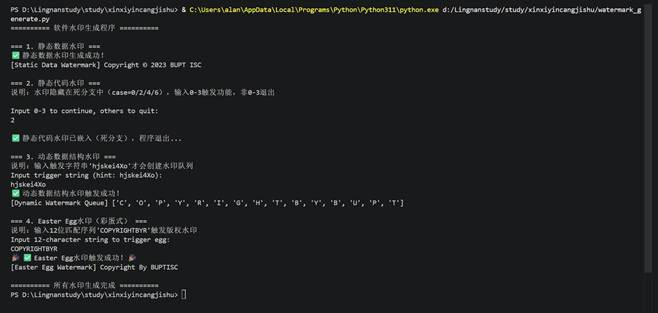
结果如下：

   

   

   

   

   

   

   

   

   

  (2)对软件水印进行基本的攻击尝试。

  代码如下：

  #

  ==============================

  #

  任务2：对软件水印进行基本攻击尝试

  #

  可单独运行，包含：静态/动态水印的典型攻击方式 + 攻击效果验证

  #

  ==============================

  from collections import deque

   

  #

  ------------------------------

  #

  1. 攻击静态数据水印（篡改版权信息）

  #

  ------------------------------

  def attack_static_data_watermark():

   

    print(&quot;\n=== 1. 攻击静态数据水印 ===&quot;)

   

    original_wm = &quot;Copyright &copy; 2023

  BUPT ISC&quot;

   

    # 攻击：篡改版权所有者

   

    attacked_wm = original_wm.replace(&quot;BUPT ISC&quot;, &quot;ATTACKER_001&quot;)

   

    print(f&quot;原水印：{original_wm}&quot;)

   

    print(f&quot;攻击后：{attacked_wm}&quot;)

   

    print(&quot;&#9989; 静态数据水印篡改成功！&quot; if attacked_wm != original_wm else &quot;&#10060; 攻击失败&quot;)

   

  #

  ------------------------------

  #

  2. 攻击静态代码水印（移除水印分支）

  #

  ------------------------------

  def attack_static_code_watermark():

   

    print(&quot;\n=== 2. 攻击静态代码水印 ===&quot;)

   

    print(&quot;说明：移除所有隐藏水印的死分支，仅保留核心功能&quot;)

   

    STOP = False

   

    while not STOP:

   

        try:

   

            print(&quot;\nInput 0-3 to continue, others to quit (Attacked

  Version):&quot;)

   

            n = int(input())

   

            input()

   

            case = 2 * n + 1

   

            

   

            # 攻击：删除所有水印分支（case=0/2/4/6）

   

            if case == 1:

   

                name = input(&quot;Your name? &quot;)

   

                print(f&quot;Hello {name}!&quot;)

   

            else:

   

                STOP = True

   

                print(&quot;&#9989; 静态代码水印攻击成功！（所有水印分支已移除）&quot;)

   

        except ValueError:

   

            STOP = True

   

            print(&quot;输入非数字，程序退出！&quot;)

   

  #

  ------------------------------

  #

  3. 攻击动态数据结构水印（篡改触发条件）

  #

  ------------------------------

  def attack_dynamic_data_watermark():

   

    print(&quot;\n=== 3. 攻击动态数据结构水印 ===&quot;)

   

    print(&quot;说明：修改触发条件，使正确字符串也无法触发水印&quot;)

   

    line = input(&quot;Input trigger

  string (hint: hjskei4Xo):\n&quot;)

   

    # 攻击：触发条件改为永远不满足（原条件：line == 'hjskei4Xo'）

   

    if line + &quot;a&quot; == &quot;hjskei4Xo&quot;:

   

        watermark_queue = deque()

   

        print(&quot;&#10060; 水印触发（攻击失败）！&quot;)

   

    else:

   

        print(f&quot;输入内容：{line} | 输入长度：{len(line)}&quot;)

   

        print(&quot;&#9989; 动态数据水印攻击成功！（触发条件已篡改）&quot;)

   

  #

  ------------------------------

  #

  4. 攻击Easter Egg水印（破坏校验逻辑）

  #

  ------------------------------

  def letter_counts(ch):

   

    return ord(ch.upper()) - ord('A') if ch.isalpha() else -1

   

  def attack_easter_egg_watermark():

   

    print(&quot;\n=== 4. 攻击Easter Egg水印 ===&quot;)

   

    print(&quot;说明：反转校验逻辑，使正确序列也无法触发彩蛋&quot;)

   

    line = list(input(&quot;Input

  12-character string (try COPYRIGHTBYR):\n&quot;))

   

    mark = [2,14,15,24,17,8,6,7,19,1,24,17]

   

    

   

    # 攻击：要求字母序号完全不匹配才触发（原逻辑是完全匹配）

   

    if len(line) == 12 and all(letter_counts(line[i]) != mark[i] for i in range(12)):

   

        print(&quot;&#127881; 彩蛋触发（攻击失败）！&#127881;&quot;)

   

    else:

   

        print(&quot;&#9989; Easter Egg水印攻击成功！（校验逻辑已破坏）&quot;)

   

  #

  ------------------------------

  #

  主函数：独立运行入口

  #

  ------------------------------

  if __name__ == &quot;__main__&quot;:

   

    print(&quot;========== 软件水印攻击程序 ==========&quot;)

   

    attack_static_data_watermark()

   

    attack_static_code_watermark()

   

    attack_dynamic_data_watermark()

   

    attack_easter_egg_watermark()

   

    print(&quot;\n========== 所有水印攻击完成 ==========&quot;)

  结果如下：

  

  

   

    

   

   

    

    
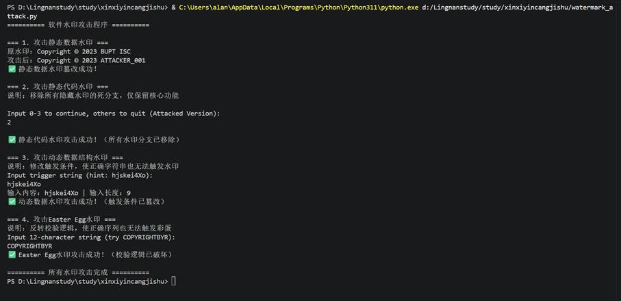

   

  

   

   

   

   

   

   

   

   

   

   

   

   

  

 

 

  

   

  

 

 

  

  五、测试/调试及实验结果分析

  1.

  直方图变化：LSB嵌入后，相邻灰度值的频数趋于相等，直方图出现&quot;平滑&quot;效果，但这种变化肉眼难以察觉。

  2. 卡方分析结果：

  原始图像的p值接近0，表示不存在LSB隐写

  携密图像的p值接近1，表示很可能存在LSB隐写

  3. 嵌入率影响：

  嵌入率越高，p值越大，越容易被检测

  嵌入率低于50%时，检测效果逐渐降低

  嵌入率低于10%时，卡方分析几乎失效

  4. 局限性分析：

  卡方分析假设LSB嵌入是顺序的、全覆盖的

  当嵌入位置随机分布时，统计特性变化不明显

  需要结合其他隐写分析方法提高检测准确率

   

  

 

 

  

  六、实验结论与体会

  1. 实验结论

  

   **静态软件水印实现简单、嵌入便捷，但安全性较低**。静态数据水印与静态代码水印均能在不运行程序的情况下被直接查找、阅读或删除，容易受到篡改与移除攻击，适合作为基础版权标识，但难以抵御针对性攻击。

   **动态软件水印具备更强的隐蔽性和安全性**。动态数据结构水印与 Easter Egg 彩蛋水印只有在满足特定输入、状态或触发条件时才会显现，在普通运行状态下难以被发现和分析，比静态水印更适合用于版权保护。

   **软件水印的鲁棒性较弱，易受到基础攻击破坏**。实验中通过篡改字符串、移除水印分支、修改触发条件、破坏校验逻辑等简单攻击方式，即可使各类水印无法正常提取或触发，说明基础软件水印在无保护机制时脆弱性较高。

   **静态水印与动态水印各有适用场景**：静态水印适合轻量标识、快速嵌入；动态水印适合隐蔽版权声明、防盗版追踪。二者结合使用可提升整体版权保护能力。

   本实验成功完成了静态软件水印与动态软件水印的生成、嵌入与验证，并实现了对四类水印的典型攻击，验证了软件水印的基本原理、实现方法与脆弱性，达到了实验目标。

  

  2. 实验体会

  通过本次软件水印实验，我系统掌握了**静态软件水印**和**动态软件水印**的基本原理、实现方式与攻击方法，对信息隐藏在软件版权保护中的应用有了更直观、深入的理解。

  在实验过程中，我深刻体会到：软件水印并非简单地把信息写进代码，而是要在**不影响程序功能、尽可能隐蔽、尽可能抵抗攻击**之间寻找平衡。静态水印实现简单但容易被去除，动态水印隐蔽性强但设计复杂，这让我认识到实际工程中的版权保护需要结合多种技术。

  同时，实验也让我意识到**软件安全的脆弱性**。即使是精心隐藏的水印，在逻辑被分析后，只需简单修改几行代码即可失效。这说明真正的软件保护需要结合代码混淆、加密、校验和、反调试等更多安全手段，才能有效抵御攻击。

  此外，本次实验大幅提升了我的程序阅读、逻辑分析与代码编写能力，尤其是在动态触发、条件校验、分支设计等方面。通过亲手实现水印与攻击，我不仅巩固了课堂知识，也提升了解决实际问题的能力，为后续学习信息隐藏、数字版权管理等内容打下了扎实基础。