## 第3章黑客常用的Windows网络命令行

网络命令是可以判断网络故障以及网络运行情况，是网络管理员必须掌握的一种技能。Windows下的网络管理命令功能十分强大，对于黑客来说，命令行中的网络管理工具是其必须掌握的利器。

## 3.1黑客常用命令

### 3.1.1  测试物理网络的Ping命令

通过发送Internet控制消息协议（ICMP）并接收其应答，测试验证与另一台TCP/IP计算机的IP级连通性。对应的应答消息的接收情况将和往返过程的时间一起显示出来。Ping是用于检测网络连接性、可到达性和名称解析的疑难问题主要TCP/IP命令。如果不带参数，Ping将显示帮助。通过在命令提示符下输入“ping /?”命令，即可查看Ping命令的详细说明。

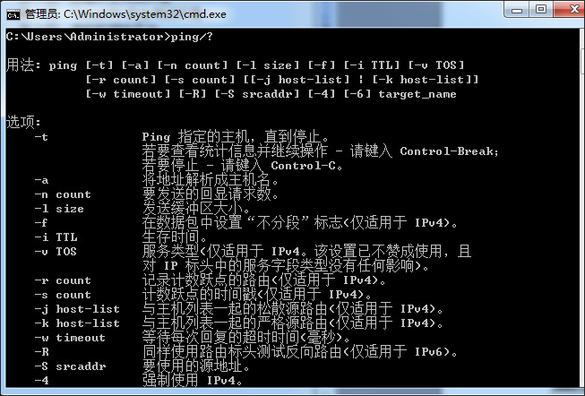

1．语法

[-t] [-a] [-n count] [-l size] [-f] [-i TTL] [-v TOS] [-r count] [-s count]{-j Hostlist|-k hostlist}] [-w Timeout] [TargetName]

2. 参数说明

●–t：指定在中断前Ping可以持续发送回响请求信息到目的地。要中断并显示统计信息，可按“Ctrl+Break”组合键。要中断并退出Ping，可按“Ctrl+C”组合键。

●–a：指定对目的IP地址进行反向名称解析。若解析成功，Ping将显示相应的主机名。

●–n：发送指定个数的数据包。通过这个命令可以自己定义发送的个数，对衡量网络速度有很大帮助。能够测试发送数据包的返回平均时间及时间快慢程度（默认值为4）。选购服务器（虚拟主机）前可以把这个作为参考。

●–l：发送指定大小的数据包。默认为32Byte，最大值是65500Byte。

●–f：在数据包中发送“不要分段”标志，数据包就不会被路由上的网关分段。默认发送的数据包都通过路由分段再发送给对方，加上此参数后路由就不会再分段处理了。

●–i：将“生存时间”字段设置为TTL指定的值。指定TTL值在对方系统中停留的时间，同时检查网络的运转情况。

●–v：将“服务类型”字段设置为TOS（Type Of Server）指定的值。

●–r：在“记录路由”字段中记录传出和返回数据包的路由。通常情况下，发送的数据包通过一系列路由才到达目标地址，通过此参数可设定想探测经过路由的个数，限定能跟踪到9个路由。

●–s：指定Count的跃点数的时间戳。与参数-r差不多，但此参数不记录数据包返回经过的路由，最多只记录4个。

●–j：利用host-list指定的电脑列表路由数据包。连续电脑可以被中间网关分隔（路由稀疏源）IP允许的最大数量为9。

●–k：利用host-list指定的电脑列表路由数据包。连续电脑不能被中间风头分隔（路由严格源）IP允许的最大数量为9。

●–w：timeout指定超时间隔，单位为ms。

● target_name：指定要Ping的远程电脑名。

●–n：定义向目标IP发送数据包的次数，默认为3次。

3．典型示例

利用ping命令可以快速查找局域网故障，快速搜索最快的QQ服务器，实现对别人进行Ping攻击。

（1）如果想要ping自己的机器，例如键入“Ping  192.168.1.10”命令。

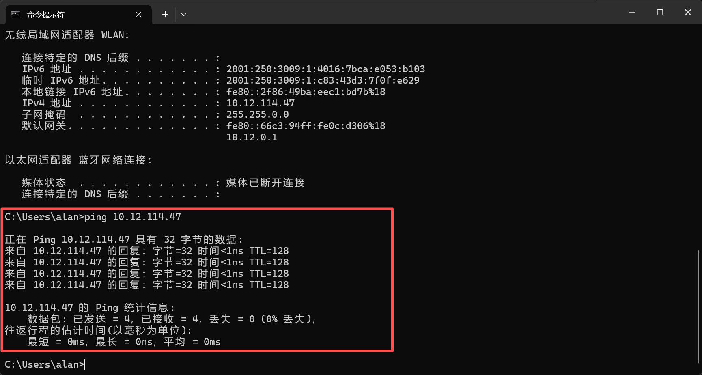

（2）如果在命令提示符下键入“Ping www.baidu.com”命令，图中运行结果，表示连接正常，所有发送的包均被成功接收，丢包率为0。

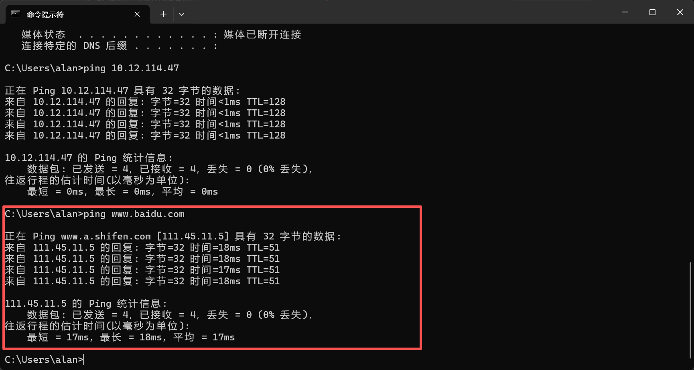

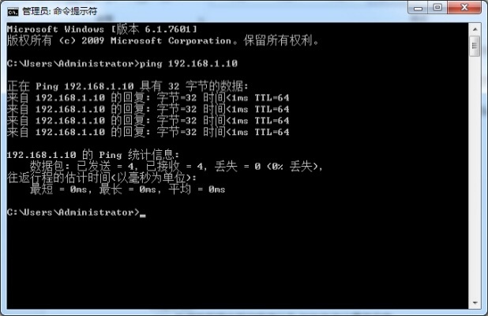
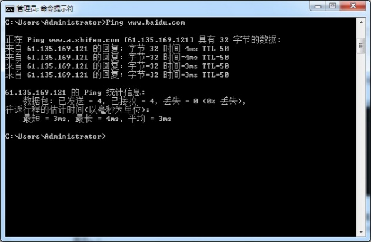

Ping  192.168.1.10结果	Ping www.baidu.com结果

（3）若想验证目的地211.84.112.29并记录4个跃点的路由，则应在命令提示符下键入“Ping –r 4 211.84.命令，以检测该网络内路由器工作是否正常。

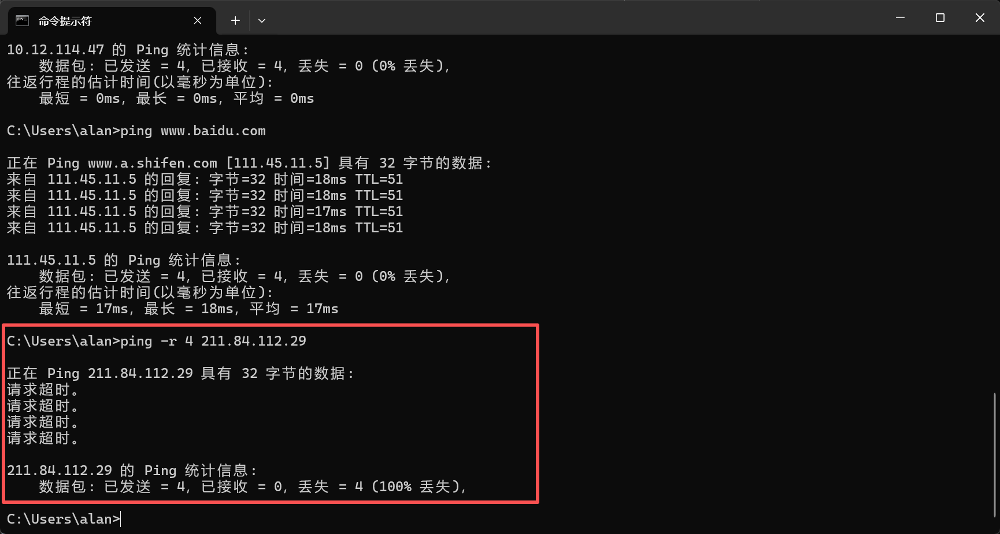

（4）测试到网站www.baidu.com的连通性及所经过的路由器和网关，并只发送一个测试数据包。在命令提示符下键入“Ping www.baidu.com –n 1–r 命令。

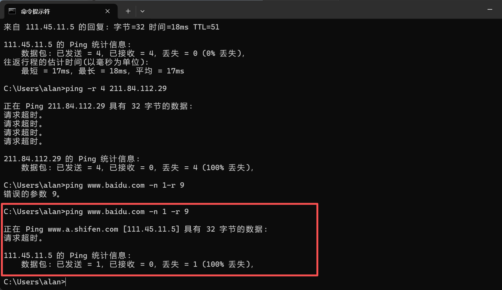

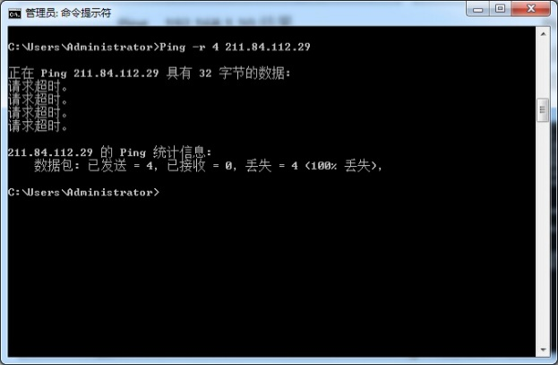
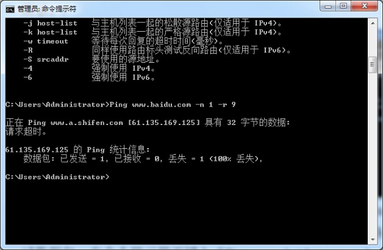

Ping –r 4 211.84.112.29结果Ping www.baidu.com –n 1–r 9结果

### 3.1.2  查看网络连接的Netstat

Netstat是一个监控TCP/IP网络的非常有用的工具，可以显示路由表、实际的网络连接，以及每一个网络接口设备的状态信息，可以让用户得知目前都有哪些网络连接正在运作。Netstat用于显示与IP、TCP、UDP和ICMP协议相关的统计数据，一般用于检验本机各端口的网络连接情况。

如果计算机有时候接收到的数据报导致出错数据或故障，不必感到奇怪，TCP/IP可以容许这些类型的错误并自动重发数据报。但如果累计出错情况数目占到所接收IP数据报相当大的百分比，或者它的数目正迅速增加，就应该使用Netstat查一查为什么会出现这些情况了。

一般用“netstat -na”命令来显示所有连接的端口并用数字表示。

1．语法

netstat [-a] [-e] [-n] [-o] [-p Protocol] [-r] [-s] [Interval]

2．参数说明

● -a：显示所有活动的TCP连接以及计算机侦听的TCP和UDP端口。

●-e：显示以太网统计信息，如发送和接收的字节数、数据包数。

●–n：显示活动的TCP连接，但只以数字形式表现地址和端口号，却不尝试确定名称。

●–o：显示活动的TCP连接并包括每个连接的进程ID（PID）。可在Windows任务管理器“进程”选项卡上找到基于PID的应用程序。该参数可以与-a、-n和-p结合使用。

●-p protocol：显示Protocol所指定的协议的连接。在这种情况下，Protocol可以是TCP、UDP、TCPV6或UDPV6。

●-s：按协议显示统计信息。默认情况下，显示TCP、UDP、ICMP和IP协议的统计信息。如果安装了WindowsXP的IPV6协议，则显示有关IPV6上的TCP、IPV6上的UDP、ICMPV6和IPV6协议统计信息。可以使用-p参数指定协议集。

●-r：显示IP路由表的内容。该参数与route print命令等价。

●Interval：每隔 Interval秒重新显示一次选定的信息。按“Ctrl+C”组合键停止重新显示统计信息。如果省略该参数，netstat将只打印一次选定的信息。

3．netstat命令使用详解

在使用netstat命令时还可以实现如下几个功能。

（1）与该命令一起使用的参数必须以连字符（—）而不是以短斜线（/）作为前缀。

（2）Netstat提供下列统计信息。

●Proto协议的名称（TCP或UDP）

● Local Address本地计算机的IP地址和正在使用的端口号码。如果不指定-n参数，则显示与IP地址和端口对应的名称。如果端口尚未建立，端口以星号（*）显示。

● Foreign Address连接该插槽的远程计算机的IP地址和端口号码。如果不指定-n参数，就显示与IP地址和端口对应的名称。如果端口尚未建立，端口以星号（*）显示。

●（state）表明TCP连接的状态。其中，LISTEN表示侦听来自远方TCP端口的连接请求；SYN-SENT表示再发送连接请求后等待匹配的连接请求；SYN-RECEIVED表示再收到和发送一个连接请求后，等待对方对连接请求的确认；ESTABLISHED表示代表一个打开的连接；FIN-WAIT-1表示等待远程TCP连接中断请求，或先前连接中断请求的确认；FIN-WAIT-2表示从远程TCP等待连接中断请求；CLOSE-WAIT表示等待从本地用户发来的连接中断请求；CLOSING表示等待远程TCP对连接中断的确认；LAST-ACK表示等待原来发向远程TCP连接中断请求的确认；TIME-WAIT表示等待足够时间以确保远程TCP接收到连接中断请求的确认；CLOSED表示没有任何连接状态。

（3）只有当网际协议（TCP/IP）网络连接中安装为网络适配器属性的组件时，该命令才可用。

（4）如下为Netstat的一些常用选项。

●netstat –s：本选项能够按照各个协议分别显示其统计数据。如果应用程序（如Web浏览器）运行速度比较慢，或不能显示Web页之类的数据，就可以用本选项来查看一下所显示的信息。需要仔细查看统计数据的各行，找到出错的关键字，进而确定问题所在。

●netstat –e：本选项用于显示关于以太网的统计数据。它列出的项目包括传送数据报的总字节数、错误数、删除数、数据报数量和广播数量。这些统计数据既有发送的数据报数量，也有接收的数据报数量（这个选项可以用来统计一些基本的网络流量）。

●netstat –r：可以显示关于路由表的信息。除显示有效路由外，还显示当前有效的连接。

●netstat –a：本选项显示一个有效连接信息列表，包括已建立的连接（ESTABLISHED），也包括监听连接请求（LISTENING）的那些连接。

●bnetstat –n：显示所有已建立的有效连接。

4．典型示例

Netstat命令可显示显示活动的TCP连接、计算机侦听的端口、以太网统计信息、IP路由表、IPV4统计信息（对于IP、ICMP、TCP和UDP协议）以及IPV6统计信息（对于IPV6、ICMPV6、通过IPV6的TCP以及通过IPV6的UDP协议）。使用时如果不带参数，Netstat将显示活动的TCP连接。

下面再介绍介绍几个Netstat命令的应用实例，具体如下：

（1）若想要显示本机所有活动的TCP连接，以及计算机侦听的TCP和UDP端口，则应键入“Netstat –a”命令。

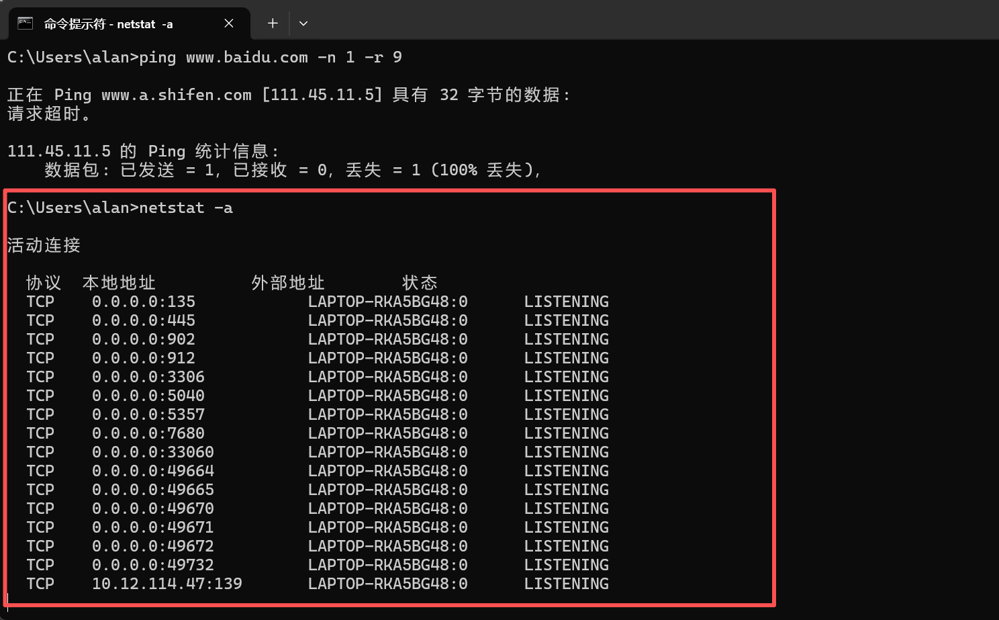

（2）显示服务器活动的TCP/IP连接，则应键入“netstat –n”命令或“netstat（不带任何参数）”命令。

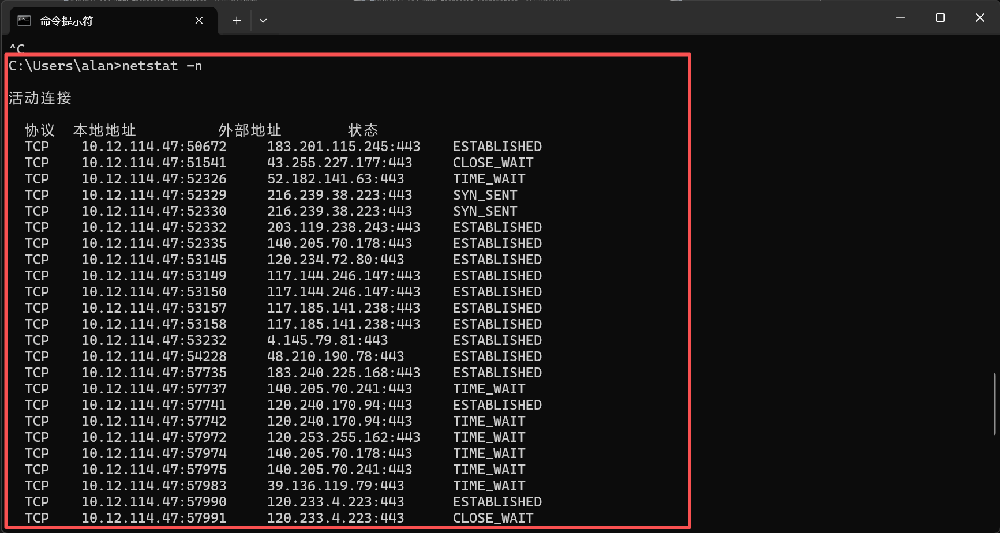

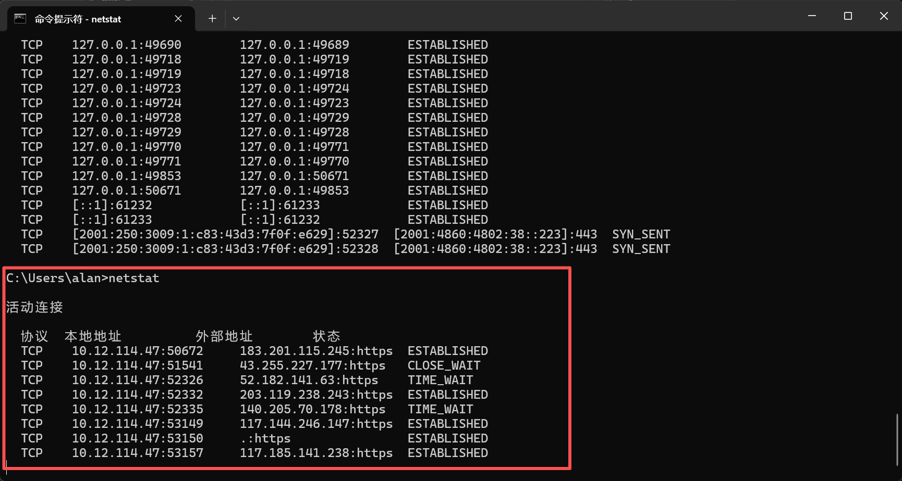

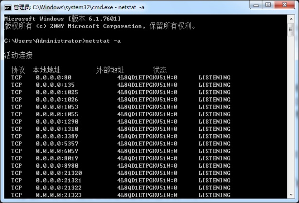
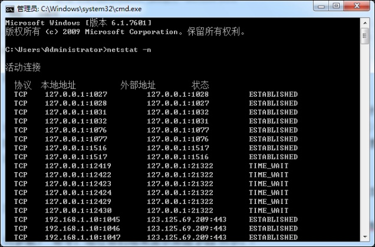

Netstat –a结果  netstat –n结果

（3）显示以太网统计信息和所有协议的统计信息，则应键入“netstat –s –e”命令。

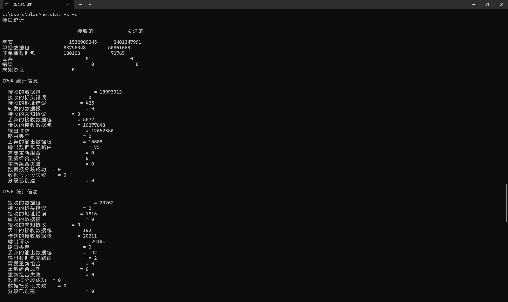

（4）检查路由表确定路由配置情况，则应键入“Netstat –rn”命令。

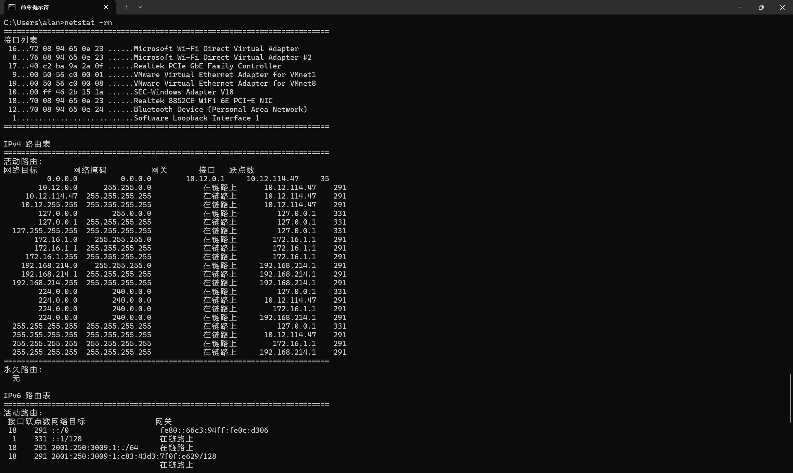

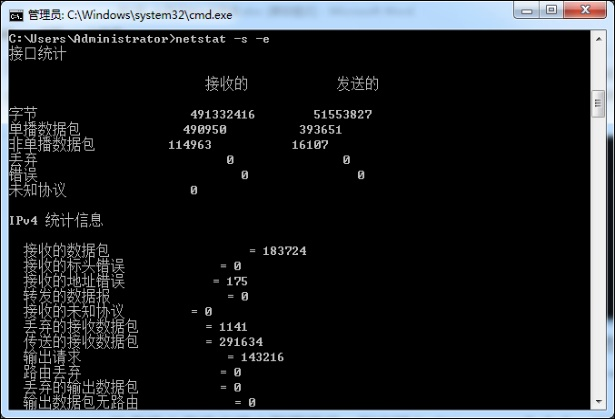
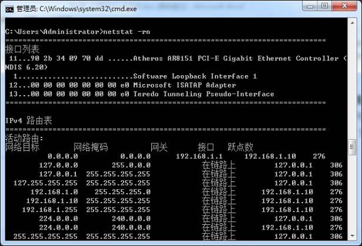

netstat –s –e结果Netstat –rn结果

### 3.1.3  工作组和域的Net命令

许多 Windows 网络命令以Net开始。这些Net命令有一些公共属性：通过键入Net/? 可查阅所有可用的Net命令。通过键入Net help命令，可在命令行中获得Net命令的语法帮助。

在工作组中用户的一切设置在本机上进行，密码放在本机的数据库中验证。如果用户的计算机加入域，则各种策略由域控制器统一设定，用户名和密码也需到域控制器去验证，也即用户的账号和密码可在同一域中任何一台计算机上登录，这样做主要是为了便于管理。

下面来介绍几个常用的Net子命令。

1.net accounts

作用：更新用户账号数据库、更改密码及所有账号的登录要求。必须要在更改账号参数的计算机上运行网络登录服务。

命令格式：net accounts [/forcelogoff:{minutes | no}] [/minpwlen:length] [/maxpwage:{days | unlimited}] [/minpwage:days] [/uniquepw:number] [/domain] 或net accounts [/sync] [/domain]

●输入不带参数的“net accounts”命令，用于显示当前密码设置、登录时限及域信息。

● /forcelogoff:{minutes | no}设置当用户账号或有效登录时间过期时，结束用户和服务器会话前的等待时间。no选项禁止强行注销（该参数的默认设置为 no）。

● /minpwlen:length设置用户账号密码的最少字符数。允许范围为0～14，默认值为6。

● /maxpwage:{days | unlimited}设置用户账号密码有效的最大天数。unlimited不设置最大天数。/maxpwage选项的天数必须大于/minpwage。允许范围是1～49,710天（unlimited），默认值为90天。

● /minpwage:days设置用户必须保持原密码的最小天数。0值不设置最小时间。允许范围为0～49,710天，默认值为0天。

● /uniquepw:number要求用户更改密码时，必须在经过number次后，才能重复使用与之相同的密码。允许范围为0～8，默认值为5。

● /domain在当前域的主域控制器上执行该操作。否则只在本地计算机执行操作。

● /sync当用于主域控制器时，该命令使域中所有备份域控制器同步；当用于备份域控制器时，该命令仅使该备份域控制器与主域控制器同步，仅适用于Windows NT Server 域成员的计算机。

2.net file

作用：用于关闭一个共享的文件并且删除文件锁。

命令格式：net file [id [/close]]

● id：指文件的标识号。

● /close：关闭一个打开的文件且删除文件上的锁。可在文件共享服务器上输入该命令。

3.net config

作用：显示运行的可配置服务，或显示并更改某项服务的设置。

命令格式：net pause server

●输入不带参数的“net config”命令，用于显示可配置服务的列表。

● service通过“net config”命令进行配置的服务（server或workstation）。

● options为服务的特定选项。

4.net computer

作用：从域数据库中添加或删除计算机。

命令格式：net computer\\computername{/add | /del}

● \\computername指定要添加到域或从域中删除的计算机。

● /add将指定计算机添加到域。

● /del将指定计算机从域中删除。

5.net continue

作用：重新激活挂起的服务。

命令格式：net continue server

6.net view

作用：显示域列表，计算机列表或指定计算机的共享资源列表。

命令格式：net view [\\computername|/dp,aom[omainname]]

●输入不带参数的net view显示当前域的计算机列表。

● \\computername指定要查看其共享资源的计算机名称

● /domain[omainname]指定要查看其可用计算机的域。

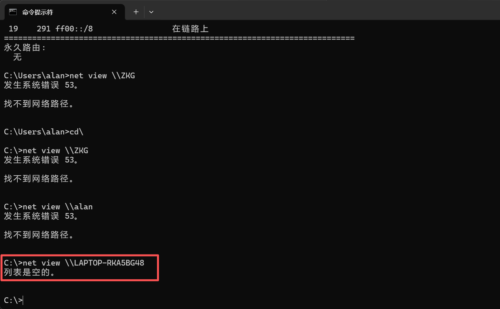

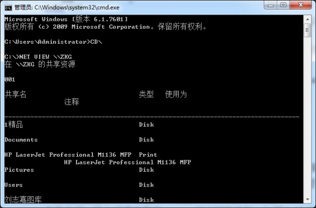

查看指定计算机的共享资源

7.net user

作用：添加或更改用户账号或显示用户账号信息。该命令也可以写为net users。

命令格式：net user[username[password | *][options]][/domain]

●输入不带参数的net user查看计算机上的用户账号列表。

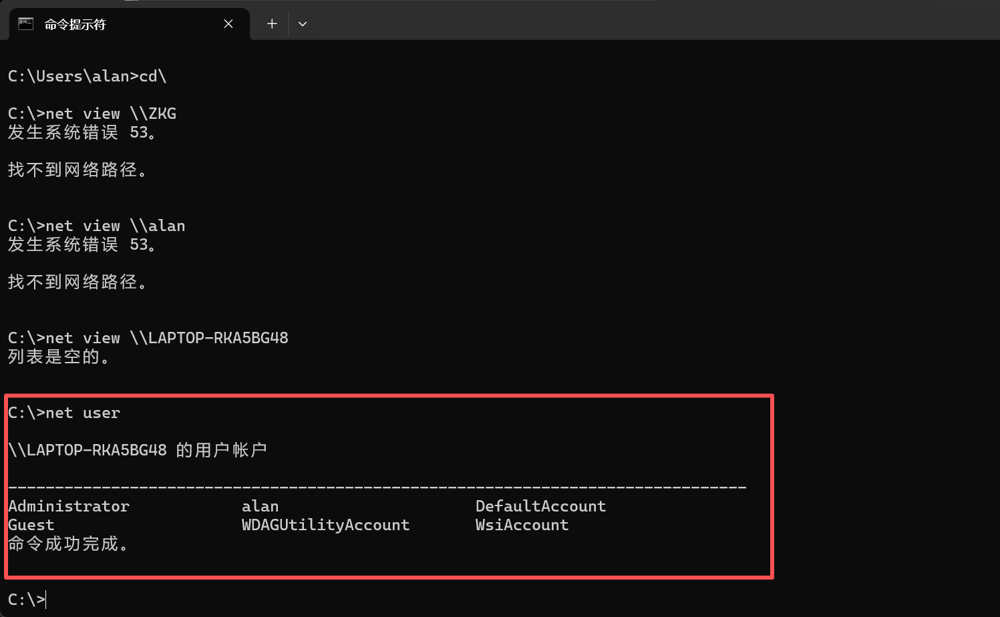

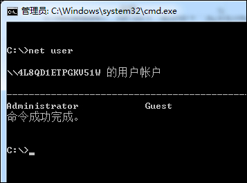

查看计算机上的用户账号列表

● username添加、删除、更改或查看用户账号名。

● password为用户账号分配或更改密码。密码必须满足net accounts命令的/minpwlen选项贩密码最小长度，最多可以有127个字符。

● */add和/delete是添加和删除用户账户。

● /domain在计算机主域的主域控制器中执行操作。

● /active:[no/yes]禁用或启用用户账号。

8.net use

作用：连接计算机或断开计算机与共享资源的连接，或显示计算机的连接信息。

命令格式：net use [devicename | *][\\computername\sharename[\volume]][password | *] [/user: [domainame\]username][/delete]|[/persistent:{yes | no}]]

参数介绍：输入不带参数的net use列出网络连接。

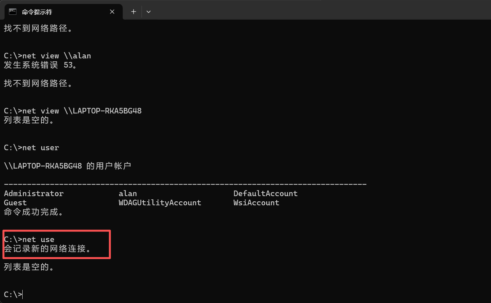

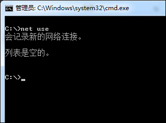

查看网络连接

9.net start

命令格式：net start server

作用：启动服务或显示已启动服务的列表。不带参数则显示已打开服务。在需要启动一个服务时，只需在后边加上服务名称就可以了。

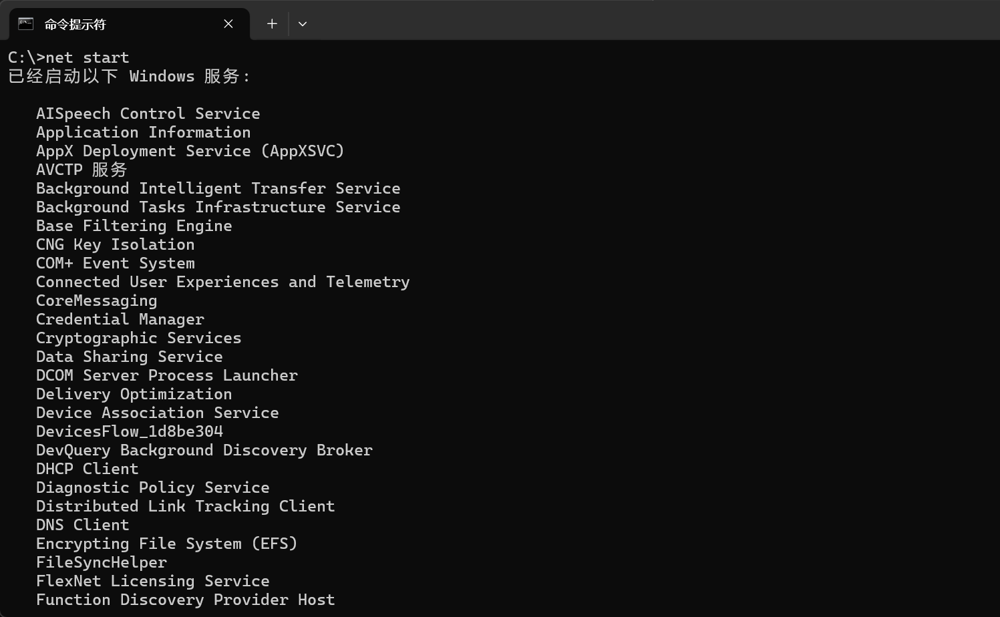

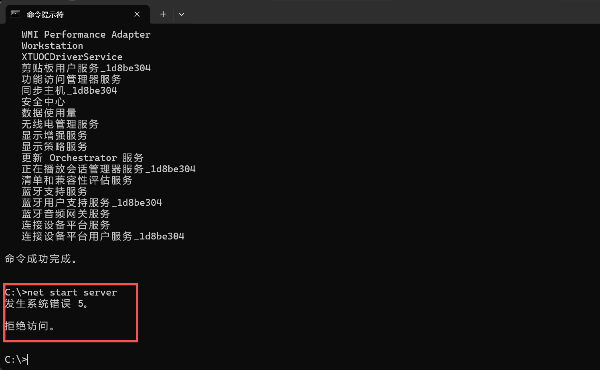

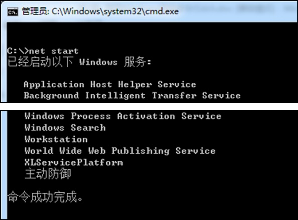
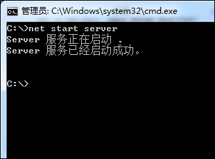

显示已启动的服务启动server服务

10. net pause

作用：暂停正在运行的服务。

命令格式：net pause server

11. net stop

作用：停止Windows NT网络服务。

命令格式：net stop server

与net stop命令相反的命令是net start，net stop命令用于停止Windows NT网络服务，net start命令用于启动Windows NT网络服务。

12. net share

作用：创建、删除或显示共享资源。

命令格式：net share sharename=drive:path[/users:number | /unlimited][/remark:”text”]

●不带任何参数的net share命令，可用于显示本地计算机上所有共享资源的信息，如图2-31所示。

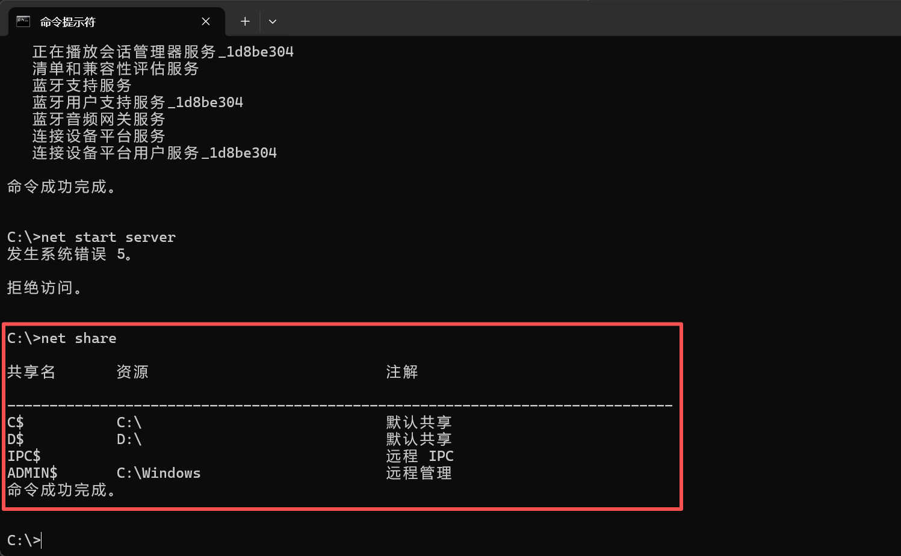

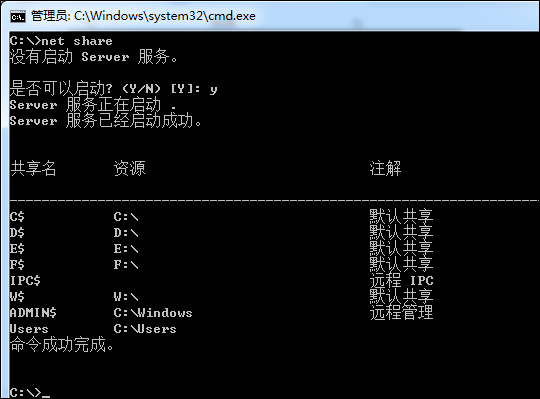

本地计算机上所有共享资源的信息

●sharename是共享资源的网络名称。

●drive:path指定共享目录的绝对路径。

●/user:number设置可以同时访问共享资源的最大用户数。

●/unlimited不限制同时访问共享资源的用户数

●/remark:"text" 添加关于资源的注释，注释文字用引号引住。

●/delete停止共享资源。

13. net session

作用：列出或断开本地计算机和与其相连接的客户端，也可写为net sessions或net sess。

命令格式：net session [\\computername][/delete]

●输入不带参数的net session显示所有与本地计算机的会话信息。

●\\computername标识要列出或断开会话的计算机。

● delete结束与\\computername计算机会话，并关闭本次会话期间计算机的所有连接。

14. net send

作用：向网络的其他用户，计算机或通信名发送消息。如用“Net send /users server will shutdown in 10 minutes”命令给所有连接到服务器的用户发送消息。

命令格式：net send {name | * | /domain[:name] | /users} message

●name为要接收发送消息的用户名、计算机名或通信名。

●*为将消息发送到组中的所有名称。

●/domain[:name]将消息发送到计算机域中的所有名称。

●/users将消息发送到与服务器连接的所有用户。

●message作为消息发送的文本。

15. net print

作用：显示或控制打印作业及打印队列。

命令格式：net print [\computername ] job# [/hold | /release | /delete]

●computername为共享打印机队列的计算机名。

●job# 为在打印机队列中分配给打印作业的标识号。

●/hold 为使用 job# 时，在打印机队列中使打印作业等待。

●/release为释放保留的打印作业。

●/delete为从打印机队列中删除打印作业。

16. net name

作用：添加或删除消息名或显示计算机接收消息的名称列表。

命令格式：net name[name[/add | /delete]]

●输入不带参数的net name列出当前使用的名称。

●name为指定接收消息的名称。

●/add将名称添加到计算机中。

●/delete从计算机中删除名称。

### 3.1.423端口登录的Telnet命令

Telnet是传输控制协议/因特网协议（TCP/IP）网络（如Internet）的登录和仿真程序，主要用于Internet会话。基本功能是允许用户登录进入远程主机系统。

常用的Telnet命令

Telnet命令的格式为：telnet+空格+IP地址/主机名称。

例如：“telnet 192.168.0.103 80”命令如果执行成功，则将从IP地址为192.168.0.9的远程计算机上得到Login：提示符。

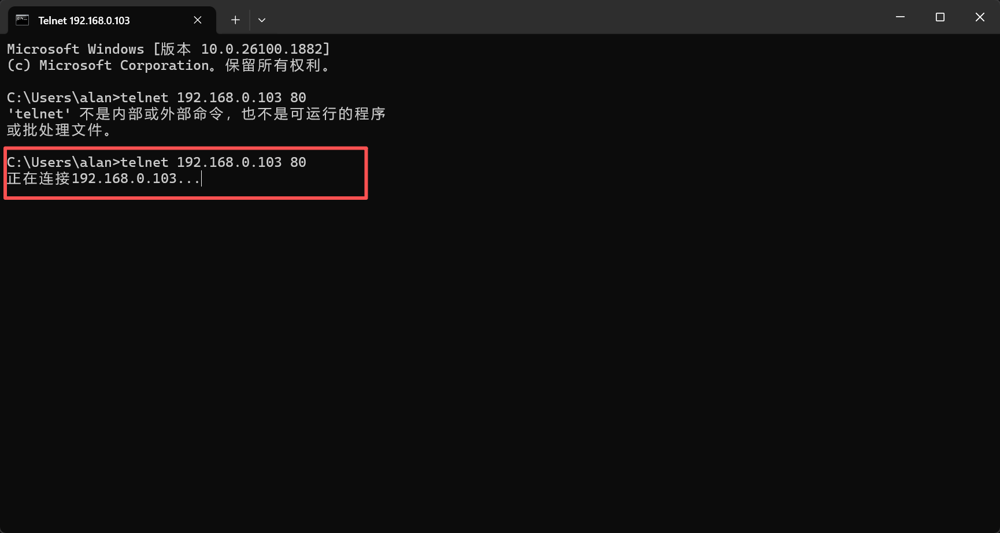

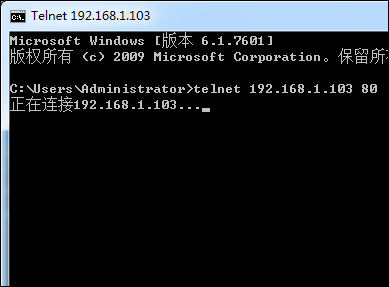

当telnet成功连接到远程系统上时，将显示登录信息并提示用户输入用户名和口令。如果用户名和口令输入正确，则成功登录并在远程系统上工作。在Telnet提示符后可输入很多命令用来控制telnet会话过程。在telnet提示下输入“？”，屏幕显示telnet命令的帮助信息。

### 3.1.5传输协议FTP命令

FTP命令是Internet用户使用最频繁的命令之一，通过FTP命令可将文件传送到正在运行FTP服务的远程计算机上，或从正在运行FTP服务的远程计算机上下载文件。在“命令提示符”窗口中运行“ftp”命令，即可进入FTP子环境窗口。或在“运行”对话框中运行“ftp”命令，也可进入FTP子环境窗口。

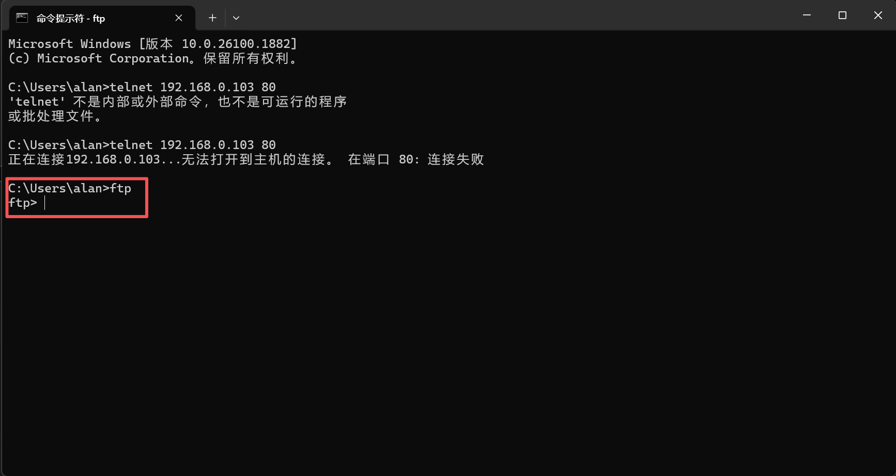

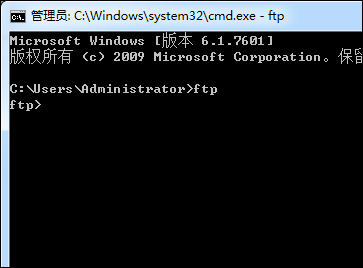

进入FTP子环境窗口

FTP的命令行格式为：ftp -v -n –d -g [主机名]。

–v：显示远程服务器的所有响应信息。

–n：限制FTP的自动登录，即不使用。

–d：使用调试方式。

–g：取消全局文件名。

### 3.1.6查看网络配置的IPConfig命令

Ipconfig是调试计算机网络的常用命令，通常大家使用它显示计算机中网络适配器的IP地址、子网掩码及默认网关，这是Ipconfig的不带参数用法。常见的用法还有Ipconfig/all。

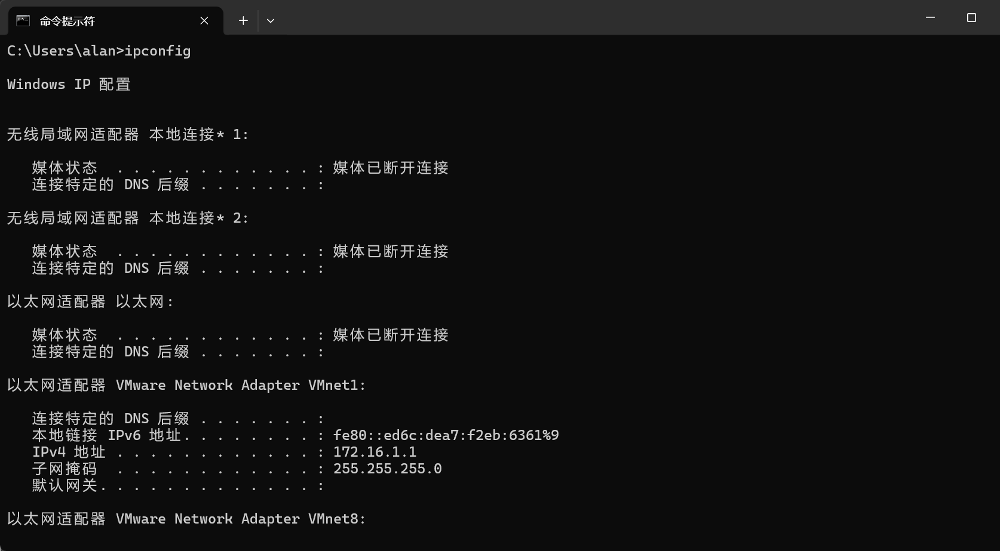

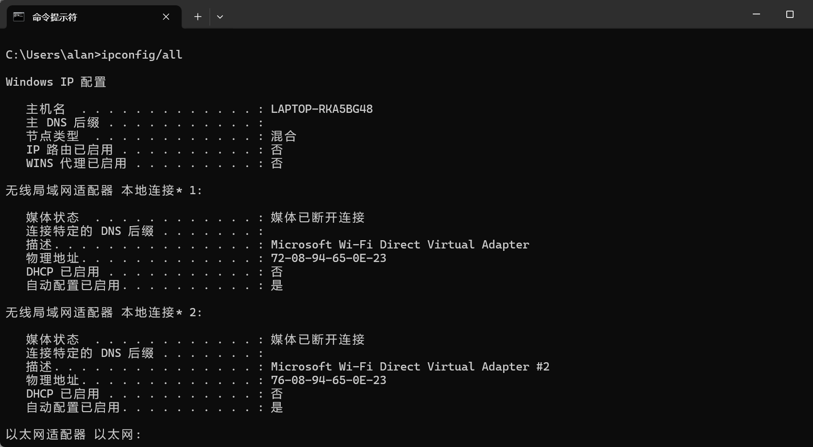

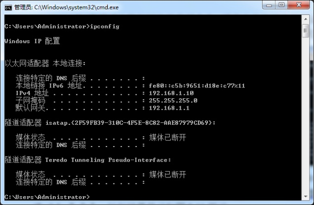
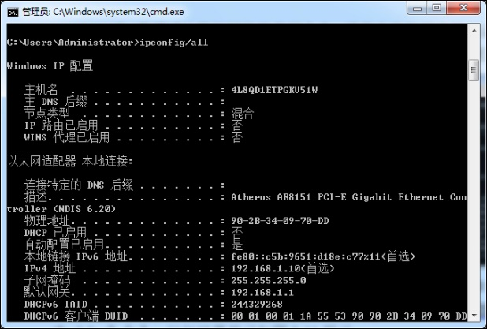

## 3.2其他的几个网络命令

任何一个网络管理员，都必须掌握网络管理构成中经常用到的一些管理命令和工具。网络管理是任何一个网络得以正常运行的保障，依据规模大小、重要性、复杂程度不同，网络管理的重要性也会有所差异，同时对网络管理人员的技术水平要求也会有所不同。但任何一个网络管理员，都必须掌握网络管理构成中经常用到的一些管理命令和工具。

### 3.2.1  Tracert命令

Tracert（跟踪路由）是路由跟踪实用程序，用于确定 IP 数据报访问目标所采取的路径。Tracert 命令用 IP 生存时间（TTL）字段和 ICMP 错误消息，来确定从一个主机到网络上其他主机的路由。

命令格式：Tracert [-d] [-h MaximumHops] [-j Hostlist] [-w Timeout] [TargetName]

● /d：防止tracert试图将中间路由器的IP地址解析为它们的名称。这样可加速显示tracert的结果。

● -h MaximumHops：在搜索目标（目的）路径中指定跃点最大数。默认值为30个跃点。

● -j HostList：指定“回响请求”消息对于在主机列表中指定的的中间目标集使用IP报头中的“松散源路由”选项。可以由一个或多个具有松散源路由的路由器分隔连续中间的目的地。主机列表中的地址或名称的最大数为9。主机列表是一系列由空格分开的IP地址（用带点的十进制符号表示）。

● -w Timeout：指定等待“ICMP已超时”或“回响答复”消息（对应于要接收的给定回响请求消息）的时间（以毫秒为单位）。如果超时时间内未收到消息，则显示一个星号（*）。默认的超时时间为4000（4s）。

● TargetName：指定目标，可以是IP地址或主机名。

Tracert诊断工具通过向目标发送具有变化的“生存时间（TTL）”值的“ICMP 回响请求”消息，来确定到达目标的路径。要求路径上每个路由器在转发数据包之前，至少将IP数据包中的TTL递减1。这样，TTL就成为最大链路计数器，数据包上的TTL到达0时，路由器应将“ICMP已超时”的消息发送回源计算机。

Tracert发送TTL为1的第一条“回响请求”消息，并在随后的每次发送过程将TTL递增1，直到目标响应或跃点达到最大值，从而确定路径，在默认情况下，跃点的最大数量是30，可使用-h参数指定。

检查中间路由器返回的“ICMP 超时”消息，与目标返回的“回显答复”消息可确定路径。但某些路由器不会为其TTL值已过期的数据包返回“已超时”消息，而且这些路由器对于Tracert命令不可见。在这种情况下，将为该跃点显示一行星号（*）。

要跟踪路径并为路径中的每个路由器、链路提供网络延迟、数据包丢失信息，请使用 pathping命令。只有当“Internet 协议（TCP/IP）”协议在“网络连接”中安装为网络适配器属性的组件时，该Tracert命令才可用。

如果要想追踪到腾讯网（www.qq.com）的路由，证明局域网络和Internet连接是否正常，则应输入命令：tracert  www.qq.com，命令执行完成后的结果，如图所示。从运行结果可知，局域网可以正常连接至Internet，实现对腾讯网的访问。同时，可以显示该链路中所有经过的路由器由设备的IP地址。

若想要追踪到清华大学（www.tsinghua.edu.cn）路由，判断故障所在。应在命令提示符下输入“tracert  www.tsinghua.edu.cn”命令，命令执行后的结果如图所示。

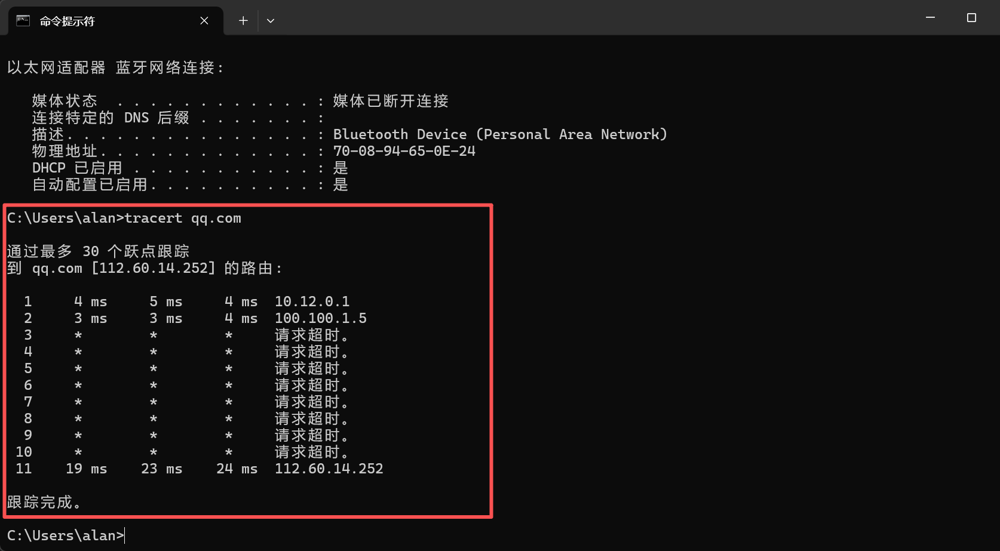

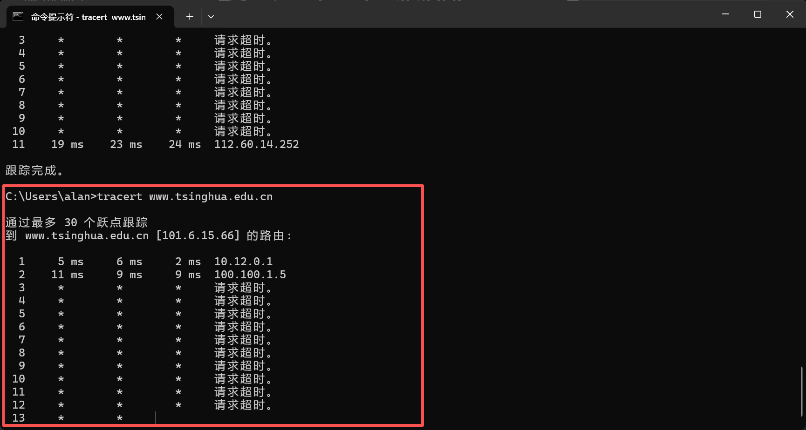

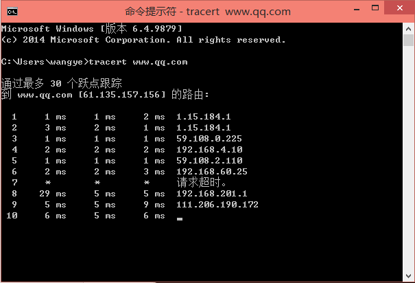
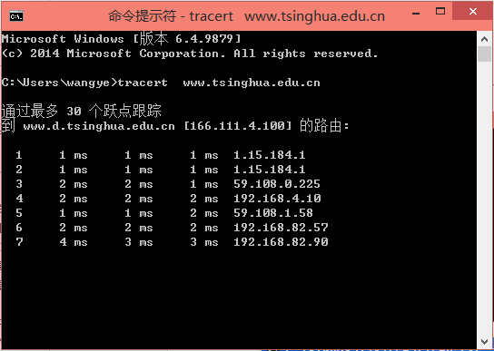

追踪到腾讯网路由追踪到清华大学路由

### 3.2.2  Route命令

Route命令的作用是手动配置路由表，在本地 IP 路由表中显示和修改条目。它是网络管理工作中应用较多的工具，使用不带参数的Route命令可以显示其帮助信息。

命令格式：Route [-f] [-p] [Command[Destination] [mask  Netmask] [Gateway] [metric Metric] [if Interface]]

● -f ：清除所有不是主路由（网掩码为 255.255.255.255 的路由）、环回网络路由（目标为 127.0.0.0，子网掩码为 255.255.255.0 的路由）或多播路由（目标为 224.0.0.0，子网掩码为 240.0.0.0 的路由）的条目的路由表。如果它与命令之一（如 add、change 或 delete）结合使用，路由表会在运行命令之前清除。

● -p ：与 add 命令共同使用时，指定路由被添加到注册表并在启动 TCP/IP 协议时初始化 IP 路由表。默认情况下，启动 TCP/IP 协议时不会保存添加的路由。与 print 命令一起使用时，则显示永久路由列表。所有其他命令都忽略此参数。永久路由存储在注册位置是HKLM\\SYSTEM\CurrentControlSet\Services\Tcpip\Parameters\PersistentRoutes。

● Command ：指定要运行的命令。下表列出了有效的命令。

●Add：添加路由。

●Change：更改现存路由。

●Delete：删除路由。

●Print：打印路由。

● Destination：指定路由的网络目标地址。目标地址可以是一个 IP 网络地址（其中网络地址的主机地址位设置为 0），对于主机路由是 IP 地址，对于默认路由是 .0。

● mask subnetmask：指定与网络目标地址相关联的网掩码（又称之为子网掩码）。子网掩码对于 IP 网络地址可以是一适当的子网掩码，对于主机路由是 255.255.255.255 ，对于默认路由是 .0。如果忽略，则使用子网掩码 255.255.255.255。定义路由时由于目标地址和子网掩码之间的关系，目标地址不能比它对应的子网掩码更为详细。换句话说，如果子网掩码的一位是 0，则目标地址中的对应位就不能设置为 1。

● Gateway ：指定超过由网络目标和子网掩码定义的可达到的地址集的前一个或下一个跃点 IP 地址。对于本地连接的子网路由，网关地址是分配给连接子网接口的 IP 地址。对于要经过一个或多个路由器才可用到的远程路由，网关地址是一个分配给相邻路由器的、可直接达到的 IP 地址。

● metric  Metric：为路由指定所需跃点数的整数值（范围是 1 ~ 9999），它用来在路由表里的多个路由中选择与转发包中的目标地址最为匹配的路由。所选的路由具有最少的跃点数。跃点数能够反映跃点的数量、路径的速度、路径可靠性、路径吞吐量以及管理属性。

●If  Interface ：指定目标可以到达的接口的接口索引。使用 route print 命令可以显示接口及其对应接口索引的列表。对于接口索引可以使用十进制或十六进制的值。对于十六进制值，要在十六进制数的前面加上 0x。忽略 if 参数时，接口由网关地址确定。

如果是 print 或 delete 命令，可以忽略 Gateway 参数，使用通配符来表示目标和网关。Destination 的值可以是由星号 (*) 指定的通配符。如果指定目标含有一个星号 (*) 或问号 (?)，它被看作是通配符，只打印或删除匹配的目标路由。星号代表任意一字符序列，问号代表任一字符。例如， 10.*.1, 192.168.*、 127.* 和 *224* 都是星号通配符的有效使用。 只有当网际协议 (TCP/IP) 协议在 网络连接中安装为网络适配器属性的组件时，该命令才可用。

如果要显示路由表中的当前项目，则应在命令提示符下键入“Route  print”命令，执行结果显示如图所示。由于用IP地址配置了网卡，因此，所有这些项目都是自动添加的。

如果想要显示IP路由表中以192开始的路由，则应在命令提示符下键入“Route print 192.*”命令，运行结果显示如图所示。

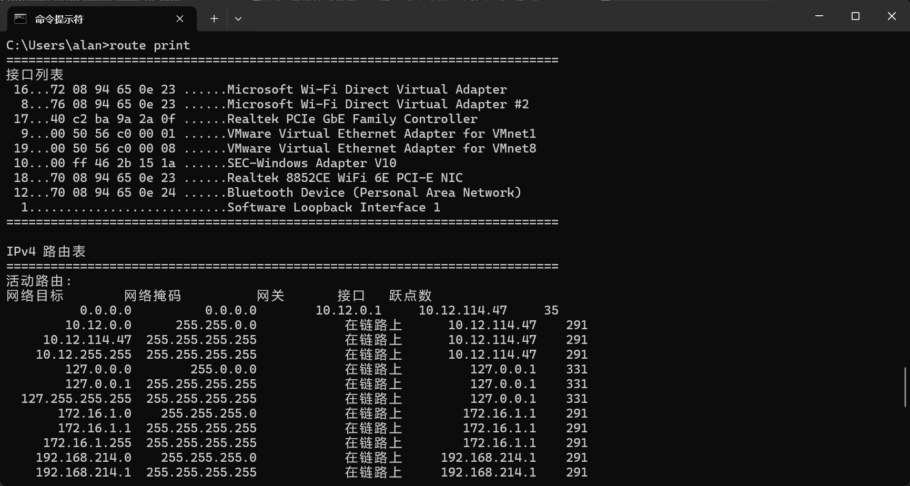

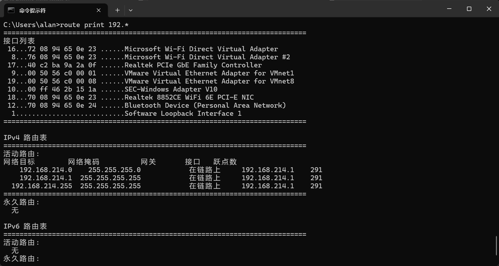

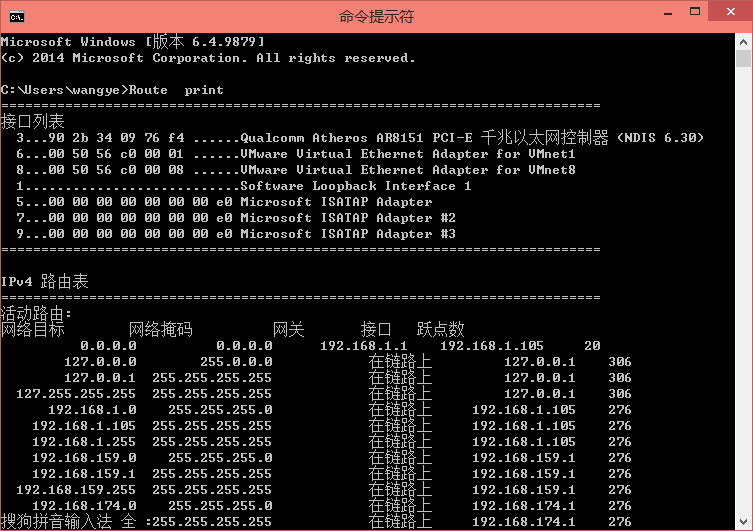
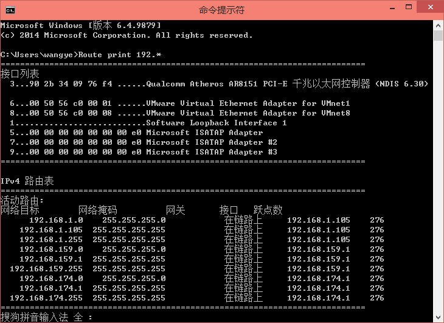

显示路由表中的当前项目显示路由表中以192开始的路由

如果想要删除目标为192.168.0.0，子网掩码为 255.255.0.0 的路由，则应输入“route delete 192.168.0.0 mask 255.255.命令。

如果想要删除IP路由表中以10开始的所有路由，则应输入“route delete 192.*”命令。

### 3.2.3  Netsh命令

Netsh是本地或远程计算Windows 2000网络组件的命令行和脚本实用程序。为了存档或配置其他服务器，Netsh实用程序也可将配置脚本保存在文本文件中。Netsh实用程序是一个外壳，通过附加的“Netsh 帮助 DLL”可支持多个Windows 2000组件。

有两种方式可以运行Netsh命令，具体的介绍如下。

1．从cmd.exe命令提示符运行netsh命令。

从cmd.exe命令提示符可以运行netsh命令。若想在远程Windows2000/2003 Server上运行这些netsh命令，必须先使用“远程桌面连接”连接到运行终端服务器的Windows2000/2003 Server，Windows2000和Windows Server 2003中Netsh上下文命令间存在一些功能上的差异。

Netsh是一个命令行脚本实用程序，可让用户从本地或远程显示或修改当前运行的计算机的网络配置。使用不带参数的netsh可以打开netsh.exe命令提示符（即netsh>）。

命令格式：Netsh [-a aliasfile] [-c context] [-r remotecomputer] [{netshcommand|-f scriptfile}]

●-a：运行aliasfile后返回到Netsh提示符。

●Aliasfile：指定包含一个或多个Netsh命令的文本文件的名称。

●-c：更改到指定的Netsh上下文。

●Context：指定netsh上下文。

●-r：配置远程计算机。

● RemoteComputer：指定要配置的远程计算机。

● NetshCommand：指定要运行的Netsh命令。

●-f：运行脚本后退出netsh.exe。

● scriptFile：指定要运行的脚本。

如果指定-r后跟另一个命令，则Netsh将在远程计算机上执行该命令，再返回到cmd.exe命令提示符。如果指定-r后不跟其他命令，则Netsh将以远程模式打开。该过程类似于在Netsh命令提示符下使用set machine命令。使用-r时，仅为Netsh的当前示例设置目标计算机。在退出并重新输入Netsh之后，目标计算机将被自被重置为本地计算机。可通过指定存储在WINS中的计算机名称、UNC名称和一个由DNS服务器解析的Internet名或数字IP地址，在远程计算机上运行Netsh命令。

2．从netsh.exe命令提示符运行Netsh命令。

用户可以从netsh.exe命令提示符（即netsh>）运行这些命令。常见的命令的含义如下：

●..：到上一级的上下文。

●abort：脱机模式下进行的所有更改。Abort在联机模式中不起作用。

●add helper：装入Netsh中的帮助程序DLL。

●alias：加由用户定义的字符串组成的别名，Netsh将用户定议的字符串与其他字符串同等处理。使用没有参数的alias可以显示所有可用的别名。

●bye：退出netsh.exe命令窗口。

●commit：脱机模式下所作的全部更改提交到路由器。Commit在联机模式下无效。

●delete helper：Netsh命令中删除帮助程序DLL.

●dump：建一个包含当前配置的脚本。如果将该脚本保存到文件中，则可使用该文件恢复已更改的配置设置。

●exec：载脚本文件并执行其中的命令。

●exit：退出netsh.exe命令返回至CMD命令行提示符。

●popd：与pushd一起使用时，popd使用户能够更改上下文，在新的上下文中运行命令，再返回到先前的上下文。

（1）Netsh命令设置了2个脚本netsh别名（shaddr和shp），在退出InterfaceIP上下文时，在netsh命令提示符下可输入“alias shaddr show interface ip addr”命令和“Alias shp helpers”命令，执行结果如图所示。当以后再在netsh命令提示符下键入“shaddr”命令，netsh.exe会将其解释为命令show interface ip addr。如果在netsh命令提示符下键入“shp”命令，则netsh.exe会将其解释为命令show helpers。如果想要退出netsh.exe返回至CMD命令行提示符，则可键入“exit”命令，执行结果如图所示。

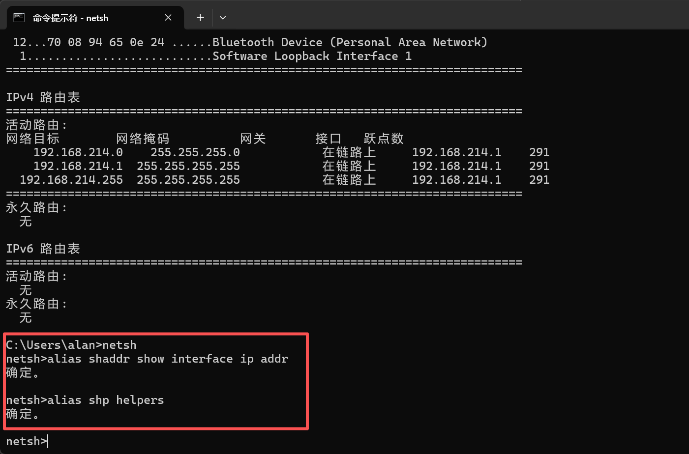

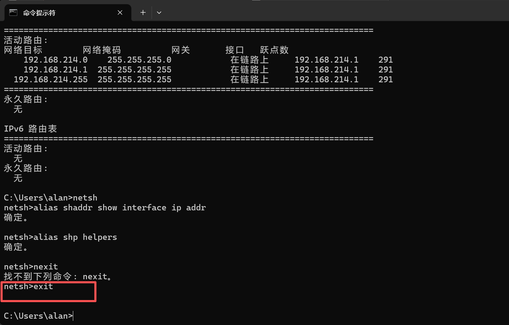

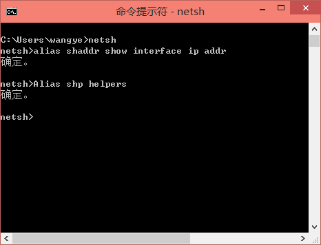
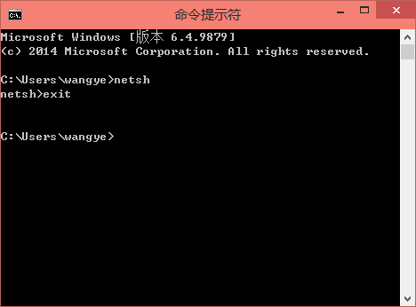

设置别名窗口退出netsh.exe窗口

（2）强制卸载TCP/IP协议

对于很多网络故障而言，卸载并重新安装TCP/IP协议是一种非常有效的解决办法，此时可借助Windows系统的netsh命令，将TCP/IP协议的工作状态恢复到操作系统安装时的原始状态，也相当于把当前的TCP/IP协议卸载掉，并重新安装新的TCP/IP协议。

在命令提示符窗口中输入“netsh”命令之后，再输入“int ip reset new.txt”命令，即可自动重新安装TCP/IP协议并将操作的记录保存在当前目录的“new.txt”日志文件中。再重新打开TCP/IP协议的属性设置窗口之后，检查其中的各项网络参数，查看是否已经被恢复到原始状态，并对TCP/IP协议的各项参数进行重新设置。

### 3.2.4 Arp命令

按照缺省设置，Arp高速缓存中的项目是动态的，每当发送一个指定地点的数据报且高速缓存中不存在当前项目时，Arp便会自动添加该项目。一旦高速缓存的项目被输入，就已经开始走向失效状态。因此，如果Arp高速缓存中项目很少或根本没有时，请通过另一台计算机或路由器的Ping命令添加。需要通过arp命令查看高速缓存中的内容时，最好先Ping 此台计算机。

命令格式：arp[-a [InetAddr] [-N IfaceAddr]] [-g [InetAddr] [-]] [-d InetAddr [IfaceAddr]] [-s InetAddr EtherAddr [IfaceAddr]]

●-a[ InetAddr] [ -N IfaceAddr] 显示所有接口的当前ARP缓存表。要显示特定IP地址的ARP缓存项，请使用带有InetAddr参数的arp -a，此处的InetAddr代表IP地址。如果未指定InetAddr，则使用第一个适用的接口。要显示特定接口的Arp缓存表，请将-N IfaceAddr 参数与-a参数一起使用，此处的IfaceAddr代表指派给该接口IP 地址。-N参数区分大小写。

●-g[ InetAddr] [ -N IfaceAddr]与-a相同。

●-d InetAddr [IfaceAddr] 删除指定的IP地址项，此处的InetAddr代表IP地址。对于指定的接口，要删除表中的某项，请使用IfaceAddr参数，此处的IfaceAddr代表指派给该接口的IP地址。要删除所有项，请使用星号（*）通配符代替InetAddr。

●-s InetAddr EtherAddr [IfaceAddr] 向ARP缓存添加可将IP地址InetAddr解析成物理地址EtherAddr的静态项。要向指定接口的表添加静态Arp缓存项，请使用IfaceAddr参数，此处的IfaceAddr代表指派给该接口的IP地址。

如果想要显示所有接口的Arp缓存表，则应键入“arp  -a”命令，运行结果如图所示。如果想要添加将IP地址192.168.0.0解析成物理地址00-AA-00的静态ARP缓存项，则应键入“arp –s 192.168.0.0-AA-00”命令，运行结果如图所示。

显示接口缓存表添加静态ARP缓存项

【注意】

InetAddr和IfaceAddr的IP地址用带圆点的十进制记数法表示。EtherAddr的物理地址由六个字节组成，这些字节用十六进制记数法表示且用连字符隔开（比如，00-AA-00）。通过-s参数添加的绑定项属于静态项，它们不会造成Arp缓存超时而消失，只有终止TCP/IP后再启动，这些项才会被删除。要创建永久的静态Arp缓存项，在批处理文件中使用Arp命令创建，并通过“计划任务程序”在启动时运行该批处理文件。只有将TCP/IP安装为网卡的属性组件时，该Arp命令才可以使用。
