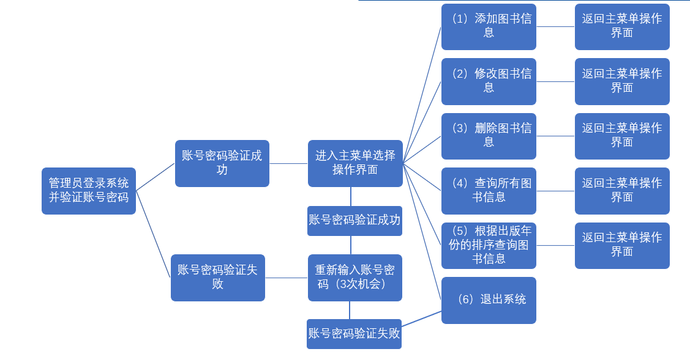
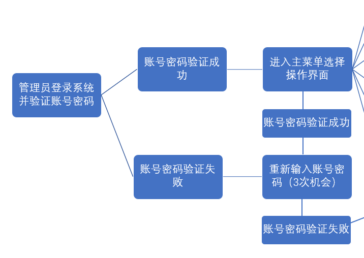
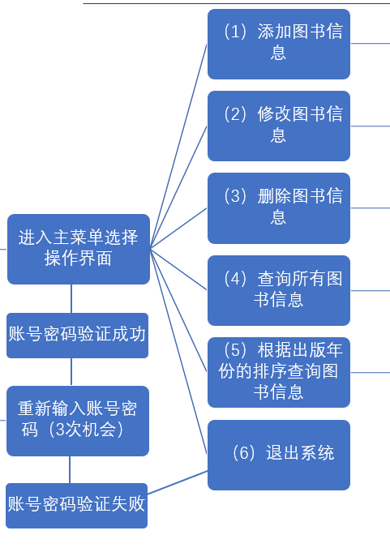
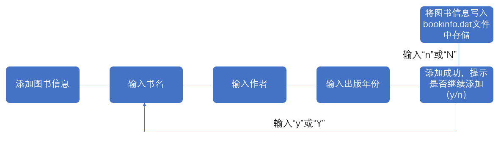
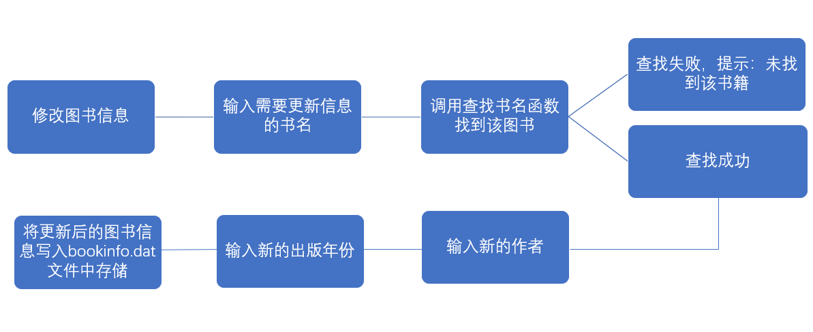
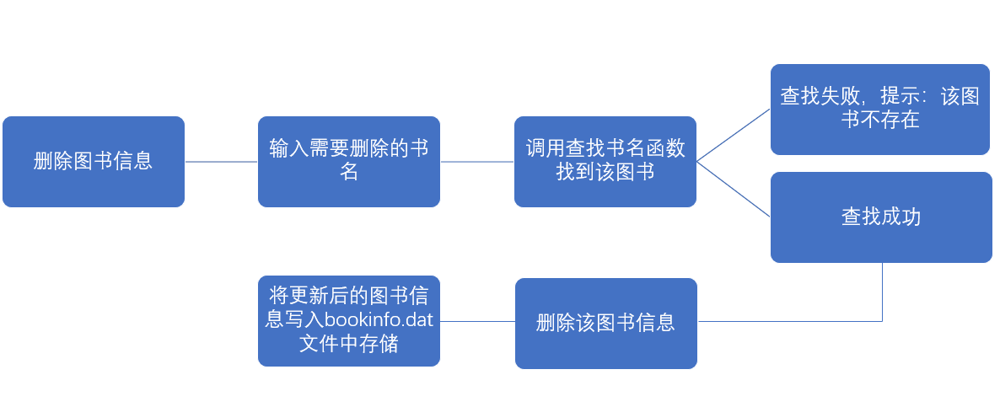

图书信息管理系统

项目需求分析

项目组成员：***

修改记录

目  录

一: 引言	3

1.1目的	3

1.2背景	4

二: 项目概述	4

2.1系统定位	4

2.2系统范围	5

2.3组织结构	5

2.4系统业务流程	5

2.4.1 登录功能流程	6

2.4.2 主菜单选择功能流程	7

2.4.3 添加图书信息功能流程	8

2.4.4 修改图书信息功能流程	9

2.4.5 删除图书信息功能流程	10

2.4.6 查询所有图书信息功能流程	11

2.4.7 根据出版年份排序查询图书信息功能流程	12

2.5业务规则	13

2.6系统特性	14

2.7系统运行环境	15

2.7.1设备及分布	15

2.7.2支撑软件	15

2.8约束	15

三：功能需求	13

3.1参与者	13

四：非功能需求	16

4.1界面元素	16

4.2其他非功能需求	17

4.2.1性能	17

4.2.2安全性	17

4.2.3可维护性	17

4.2.4可扩展性	18

4.2.5可移植性	18

4.2.6可用性	18

4.2.7用户文档	18

# 一: 引言

## 1.1目的

编写目的：本说明为 图书信息管理系统 的软件需求说明

预期读者：系统开发者，需求提供方，目标客户

## 1.2背景

一、课题研究背景：

1.图书馆管理需求：随着图书馆规模的扩大和藏书数量的增加，传统的手工管理方式已经无法满足高效、准确、便捷的图书管理需求。因此，开发一个自动化的图书信息管理系统成为提高图书馆管理效率的必要手段。

2.信息化时代的需求：随着信息技术的快速发展，图书馆需要借助计算机技术和网络技术来提升服务质量和工作效率。图书信息管理系统可以实现图书信息的数字化存储和管理，方便读者查询和借阅，同时也方便管理员进行图书库存管理和统计工作。

3.用户需求多样化：不同用户对图书信息管理系统的需求可能有所不同。例如，学生可能需要快速找到所需的教材，而教师可能需要查找特定领域的专业书籍。因此，图书信息管理系统需要提供灵活的功能和界面，以满足不同用户的需求。

二、选题的意义和价值：

图书信息管理系统的选题具有重要的现实意义和长远价值。它可以提高管理效率，优化资源利用，提升用户体验，数据驱动决策，促进知识传播，保障数据安全，适应未来发展。

# 二: 项目概述

## 2.1系统定位

图书信息管理系统的系统定位是一个辅助图书馆或书店进行日常管理工作的信息化、自动化和智能化的工具。它旨在提高管理效率，优化资源利用，提升用户体验，并保障数据安全。

## 2.3组织结构

## 2.4系统业务流程

### 2.4.1 登录功能流程

### 2.4.2 主菜单选择操作流程

### 2.4.3 添加图书信息操作流程

### 2.4.4 修改图书信息操作流程

### 2.4.5 删除图书信息操作流程

### 2.4.6 查询所有图书信息操作流程

### 2.4.7 根据出版年份排序查询图书信息操作流程

# 三：功能需求

## 3.1参与者

识别系统的参与者，在下面以列表的形式给出。

| 总页数 | 25 | 正文 |  | 附录 |  | 生效日期 |  |
| 编制 |  |  |  | 批准 |  |  |  |

| 版本号 | 变更控制报告 编号 | 更改条款及内容 | 更改人 | 审批人 | 更改日期 |
|  |  |  |  |  |  |
|  |  |  |  |  |  |
|  |  |  |  |  |  |
|  |  |  |  |  |  |
|  |  |  |  |  |  |
|  |  |  |  |  |  |
|  |  |  |  |  |  |
|  |  |  |  |  |  |
|  |  |  |  |  |  |
|  |  |  |  |  |  |
|  |  |  |  |  |  |
|  |  |  |  |  |  |
|  |  |  |  |  |  |
|  |  |  |  |  |  |
|  |  |  |  |  |  |

| 功能需求 | 功能需求 |
| 功能名称 | 登录功能 |
| 优先级 |  |
| 业务背景 |  |
| 功能说明 | 用户通过该模块登录，获取后序访问权限 |
| 约束条件 | 管理员账号密码唯一 |
| 其他需求 |  |
| 裁剪说明 |  |

| 功能需求 | 功能需求 |
| 功能名称 | 主菜单选择操作 |
| 优先级 |  |
| 业务背景 |  |
| 功能说明 | 管理员登陆成功后使用功能 |
| 约束条件 | 不能输入除1-6以外的数字 |
| 其他需求 |  |
| 裁剪说明 |  |

| 功能需求 | 功能需求 |
| 功能名称 | 添加图书信息操作 |
| 优先级 |  |
| 业务背景 |  |
| 功能说明 | 可以添加图书信息，书名、作者和出版年份，并且可以存储到bookinfo.dat文件中 |
| 约束条件 |  |
| 其他需求 |  |
| 裁剪说明 |  |

| 功能需求 | 功能需求 |
| 功能名称 | 修改图书信息 |
| 优先级 |  |
| 业务背景 |  |
| 功能说明 | 可修改图书的作者和出版年份 |
| 约束条件 | 不可修改图书的书名 |
| 其他需求 |  |
| 裁剪说明 |  |

| 功能需求 | 功能需求 |
| 功能名称 | 删除图书信息 |
| 优先级 |  |
| 业务背景 |  |
| 功能说明 | 可删除指定书名的图书的信息 |
| 约束条件 |  |
| 其他需求 |  |
| 裁剪说明 |  |

| 功能需求 | 功能需求 |
| 功能名称 | 查询所有图书信息 |
| 优先级 |  |
| 业务背景 |  |
| 功能说明 | 可查询所有图书信息 |
| 约束条件 |  |
| 其他需求 |  |
| 裁剪说明 |  |

| 功能需求 | 功能需求 |
| 功能名称 | 根据出版年份排序查询图书信息 |
| 优先级 |  |
| 业务背景 |  |
| 功能说明 | 可按照出版年份升序排序查询图书信息 |
| 约束条件 |  |
| 其他需求 |  |
| 裁剪说明 |  |

| 序号 | 参与者 | 说明 |
| 1 | 管理员 | 可实现添加图书信息、修改图书信息、删除图书信息、查询所有图书信息、根据出版年份排序查询图书信息的操作功能 |