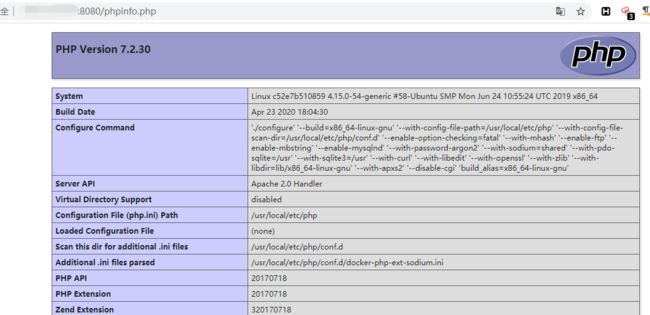
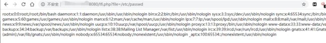
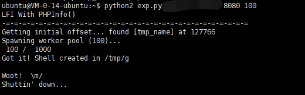
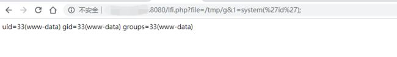
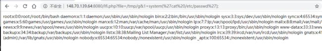

PHP文件包含漏洞(利用phpinfo)复现

PHP文件包含漏洞中，如果找不到可以包含的文件，我们可以通过包含临时文件的方法来getshell。因为临时文件名是随机的，如果目标网站上存在phpinfo，则可以通过phpinfo来获取临时文件名，进而进行包含。

漏洞环境

执行如下命令启动环境：

docker compose up -d

环境启动后，访问http://your-ip:8080/phpinfo.php即可看到一个PHPINFO页面

访问http://your-ip:8080/lfi.php?file=/etc/passwd，可见的确存在文件包含漏洞。

利用方法简述

在给PHP发送POST数据包时，如果数据包里包含文件区块，无论你访问的代码中有没有处理文件上传的逻辑，PHP都会将这个文件保存成一个临时文件（通常是/tmp/php[6个随机字符]），文件名可以在$_FILES变量中找到。这个临时文件，在请求结束后就会被删除。

同时，因为phpinfo页面会将当前请求上下文中所有变量都打印出来，所以我们如果向phpinfo页面发送包含文件区块的数据包，则即可在返回包里找到$_FILES变量的内容，自然也包含临时文件名。

在文件包含漏洞找不到可利用的文件时，即可利用这个方法，找到临时文件名，然后包含之。

但文件包含漏洞和phpinfo页面通常是两个页面，理论上我们需要先发送数据包给phpinfo页面，然后从返回页面中匹配出临时文件名，再将这个文件名发送给文件包含漏洞页面，进行getshell。在第一个请求结束时，临时文件就被删除了，第二个请求自然也就无法进行包含。

这个时候就需要用到条件竞争，具体流程如下：

发送包含了webshell的上传数据包给phpinfo页面，这个数据包的header、get等位置需要塞满垃圾数据

因为phpinfo页面会将所有数据都打印出来，1中的垃圾数据会将整个phpinfo页面撑得非常大

php默认的输出缓冲区大小为4096，可以理解为php每次返回4096个字节给socket连接

所以，我们直接操作原生socket，每次读取4096个字节。只要读取到的字符里包含临时文件名，就立即发送第二个数据包

此时，第一个数据包的socket连接实际上还没结束，因为php还在继续每次输出4096个字节，所以临时文件此时还没有删除

利用这个时间差，第二个数据包，也就是文件包含漏洞的利用，即可成功包含临时文件，最终getshell

漏洞复现

用exp.py脚本来不断的上传数据，利用条件竞争实现包含文件。
成功包含临时文件后，会执行')?>，写入一个新的文件g到/tmp/目录。
用python2执行：python exp.py your-ip 8080 100

看到只用了100个数据包的时候就写入成功了,之后就可以配合lfi.php执行任意命令，然后配合之前存在文件包含漏洞的php文件，就可以任意命令执行。

查看文件

